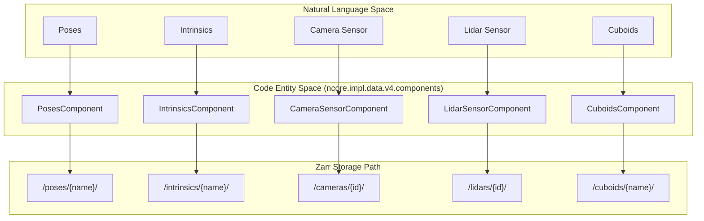
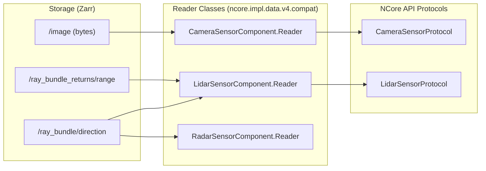

<!-- source: DeepWiki mcp.deepwiki.com · repo NVIDIA/ncore · page 2.1 Data Components and Schema · fetched 2026-10-26 -->

# Data Components and Schema

<details>
<summary>Relevant source files</summary>

The following files were used as context for generating this wiki page:

- [docs/data/formats.rst](docs/data/formats.rst)
- [docs/data/storage_and_access.rst](docs/data/storage_and_access.rst)
- [docs/index.rst](docs/index.rst)
- [docs/tools/ncore_vis.rst](docs/tools/ncore_vis.rst)
- [ncore/impl/data/compat.py](ncore/impl/data/compat.py)
- [ncore/impl/data/v4/BUILD.bazel](ncore/impl/data/v4/BUILD.bazel)
- [ncore/impl/data/v4/compat.py](ncore/impl/data/v4/compat.py)
- [ncore/impl/data/v4/compat_test.py](ncore/impl/data/v4/compat_test.py)
- [ncore/impl/data/v4/components.py](ncore/impl/data/v4/components.py)
- [ncore/impl/data/v4/components_test.py](ncore/impl/data/v4/components_test.py)

</details>


The NCore V4 data format is a modular, component-based specification designed for robotics and autonomous vehicle recordings. It decomposes complex multi-sensor sequences into independent, versioned data units called **Components**. These components are stored within **Component Groups**, typically serialized as Zarr hierarchies in either directory-based stores or single-file Indexed Tar (`.itar`) archives [docs/data/formats.rst:10-15]().

This page provides a technical reference for the built-in component types, their Zarr hierarchy, and the schemas used for spatial and sensor data.

## Component Architecture and Hierarchy

Each sequence is represented as a collection of component groups. A component group is a Zarr store containing specific component instances (e.g., a "poses" component, multiple "camera" components) [docs/data/formats.rst:38-43]().

### Root Structure
The root of a V4 Zarr store contains sequence-level metadata and organized sub-directories for each component type [docs/data/formats.rst:65-86]().

```text
ncore4[-{group_name}].zarr/
├── sequence_meta_data/           # Global sequence info
│   ├── sequence_id: str
│   ├── version: "v4"
│   └── sequence_timestamp_interval_us: {start, stop}
└── {component_type}/             # e.g., "poses", "cameras", "lidars"
    └── {instance_name}/          # e.g., "default", "camera_front"
         ├── component_meta_data/
         └── {data_arrays}        # Zarr datasets (poses, images, etc.)
```

### System Component Mapping
The following diagram bridges the logical component names used in the NCore API to their underlying implementation classes and storage paths.

**NCore Component Entity Mapping**

Sources: [docs/data/formats.rst:41-58](), [ncore/impl/data/v4/components.py:43-55]()

---

## Spatial and Calibration Components

### PosesComponent
Stores rigid SE(3) transformations (4x4 matrices) between coordinate frames. It distinguishes between **Static Poses** (e.g., extrinsic calibration) and **Dynamic Poses** (e.g., ego-vehicle trajectory) [docs/data/formats.rst:88-109]().

*   **Static Poses**: Stored as attributes keyed by `(source_frame, target_frame)`.
*   **Dynamic Poses**: Stored as `[N, 4, 4]` float arrays with an associated `[N]` uint64 timestamp array [docs/data/formats.rst:104-109]().
*   **Common Frames**: `rig` (vehicle body), `world` (local navigation frame), and `world_global` (e.g., ECEF) [docs/data/formats.rst:111-114]().

### IntrinsicsComponent
Contains mathematical models for sensor projections. Supported models include `ftheta`, `opencv-pinhole`, and `opencv-fisheye` for cameras, and `row-offset-spinning` for LiDAR [docs/data/formats.rst:120-145]().

Sources: [docs/data/formats.rst:88-145](), [ncore/impl/data/v4/components.py:51-51]()

---

## Sensor Components

Sensor components share a frame-based indexing scheme where data is keyed by the **end-of-frame timestamp** [docs/data/formats.rst:166-183]().

### CameraSensorComponent
Stores image data and per-frame metadata. Images are typically stored as encoded bytes (e.g., JPEG, PNG) in a Zarr array of type `|Sx` [docs/data/formats.rst:184-191]().

### Ray-Bundle Sensors (LiDAR and Radar)
NCore V4 uses a unified "Ray Bundle" serialization for LiDAR and Radar to support flexible multi-return data.

*   **Ray Bundle**: Stores the geometric properties of rays (e.g., normalized directions in the sensor frame) [docs/data/formats.rst:203-205]().
*   **Ray Bundle Returns**: Stores per-return properties like `range`, `intensity`, and `timestamp_offset_us` [docs/data/formats.rst:206-215]().
*   **Valid Mask**: A bit-packed mask (`ray_bundle_returns_valid_mask_packed`) indicates which returns are valid for a given ray [docs/data/formats.rst:198-199]().

**Sensor Data Flow**

Sources: [docs/data/formats.rst:166-215](), [ncore/impl/data/v4/compat.py:43-53]()

---

## Annotation Components

### CuboidsComponent
Stores 3D bounding box tracks. Each observation includes [docs/data/formats.rst:56-57]():
*   **Pose**: Center position and orientation in a reference frame (usually `world`).
*   **Dimensions**: Width, length, height.
*   **Metadata**: `track_id`, `label`, and `label_source` (e.g., manual, model-generated).

### MasksComponent
Stores static boolean masks for sensors, currently primarily used for cameras to mask out ego-vehicle parts (e.g., side mirrors, hood) [docs/data/formats.rst:147-162]().

---

## Timestamp Indexing and Access

NCore uses `HalfClosedInterval` (`[start, stop)`) for all time-based queries [ncore/impl/data/v4/components.py:52]().

1.  **Sequence Level**: The `sequence_timestamp_interval_us` defines the valid range for the entire recording [ncore/impl/data/v4/components.py:96]().
2.  **Frame Level**: Every sensor frame has a `[start, end]` timestamp pair stored in the `frames/attrs/frames_timestamps_us` array [docs/data/formats.rst:176]().
3.  **Lookup**: The `SequenceLoaderV4` provides `get_closest_frame_index`, which uses `closest_index_sorted` to resolve a query timestamp to a specific frame index based on a `relative_frame_time` (0.0 for start, 1.0 for end) [ncore/impl/data/v4/compat_test.py:142-167]().

Sources: [ncore/impl/data/v4/components.py:52-100](), [ncore/impl/data/v4/compat_test.py:142-167](), [docs/data/formats.rst:176-178]()

---

