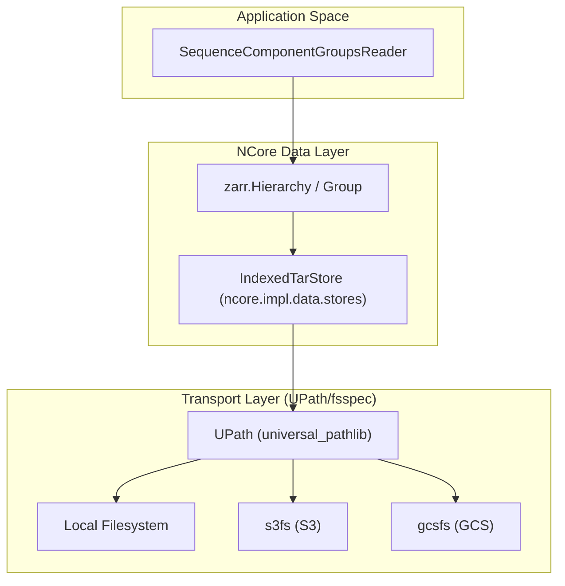
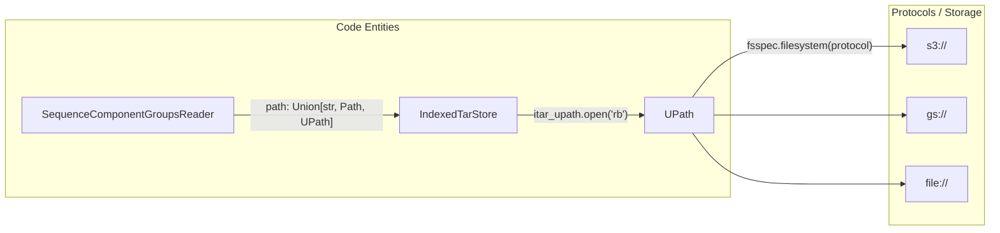

<!-- source: DeepWiki mcp.deepwiki.com · repo NVIDIA/ncore · page 2.2 Storage Backends: .itar and Zarr · fetched 2026-10-26 -->

# Storage Backends: .itar and Zarr

<details>
<summary>Relevant source files</summary>

The following files were used as context for generating this wiki page:

- [docs/_static/custom.css](docs/_static/custom.css)
- [docs/apis/install.rst](docs/apis/install.rst)
- [docs/data/conventions.rst](docs/data/conventions.rst)
- [docs/data/formats.rst](docs/data/formats.rst)
- [docs/data/storage_and_access.rst](docs/data/storage_and_access.rst)
- [docs/index.rst](docs/index.rst)
- [docs/tools/ncore_vis.rst](docs/tools/ncore_vis.rst)
- [ncore/impl/data/stores.py](ncore/impl/data/stores.py)
- [ncore/impl/sensors/camera.py](ncore/impl/sensors/camera.py)
- [ncore/impl/sensors/camera_test.py](ncore/impl/sensors/camera_test.py)
- [ncore/impl/sensors/common.py](ncore/impl/sensors/common.py)
- [ncore/impl/sensors/lidar.py](ncore/impl/sensors/lidar.py)

</details>


This page details the storage layer of the NCore V4 data format, focusing on the `IndexedTarStore` (`.itar`) format and its integration with `zarr`. It covers the technical implementation of O(1) random access within TAR archives, performance characteristics, and the unified access model for local and cloud storage.

## Overview

NCore V4 components are persisted as `zarr` groups [docs/data/storage_and_access.rst:10-13](). While standard `zarr` often uses directory-based storage (one file per chunk), NCore introduces the `.itar` (Indexed Tar Archive) format to consolidate these chunks into a single, cloud-optimized container [docs/data/storage_and_access.rst:18-27]().

| Feature | Directory Store (`.zarr`) | Indexed Tar (`.zarr.itar`) |
| :--- | :--- | :--- |
| **Structure** | Folder with many small files | Single consolidated file |
| **Access** | Native OS filesystem | `IndexedTarStore` via `zarr` |
| **Random Access** | O(1) via filesystem | O(1) via CBOR/LZMA index |
| **Cloud Optimization** | High request overhead | Efficient (Range-requests) |
| **Updates** | Supports incremental updates | Write-once / Append-only |

Sources: [docs/data/storage_and_access.rst:43-53]()

## The Indexed Tar (.itar) Format

The `.itar` format addresses the "many small files" problem of standard Zarr stores while maintaining random-access performance. It appends a compressed index to a standard TAR archive, allowing the library to locate any member without scanning the entire file [docs/data/storage_and_access.rst:21-27]().

### Implementation: `IndexedTarStore`

The `IndexedTarStore` class implements the abstract `zarr.Store` interface [ncore/impl/data/stores.py:43-43](). It manages a `TarRecordIndex` which maps string keys (Zarr chunk paths) to specific byte offsets and sizes within the TAR container [ncore/impl/data/stores.py:69-79]().

#### Data Flow: Reading a Chunk
1. **Key Lookup**: The store queries the `index.records` dictionary [ncore/impl/data/stores.py:137-137]().
2. **File Seek**: The underlying file object performs a `seek()` to the `offset_data` [ncore/impl/data/stores.py:143-143]().
3. **Direct Read**: Exactly `size` bytes are read into memory [ncore/impl/data/stores.py:144-144]().

#### Data Flow: Writing/Closing
When writing in `"w"` mode, members are added sequentially [ncore/impl/data/stores.py:169-169](). Upon calling `close()`, the store serializes the index using **CBOR** and compresses it with **LZMA** before appending it as a trailer to the file [ncore/impl/data/stores.py:198-210]().

### System Architecture: Storage Abstraction

The following diagram shows how `IndexedTarStore` bridges the Zarr API to various physical storage backends.

**Storage Backend Architecture**

Sources: [ncore/impl/data/stores.py:43-111](), [docs/data/storage_and_access.rst:159-173]()

## Performance Benchmarks

`.itar` is optimized for high-throughput sequential and random access. Because it bypasses the standard Python `tarfile` module's multiple wrapping layers (like `ExFileObject`), it achieves significantly higher speeds [docs/data/storage_and_access.rst:119-123]().

### Read Throughput Comparison (Local SSD)

| Format | Sequential (MB/s) | Random (MB/s) | Latency (ms) | Time-to-first-read |
| :--- | :--- | :--- | :--- | :--- |
| **.itar** | **9847** | **9492** | **0.46** | **2.1 ms** (index load) |
| `tarfile` (pre-parsed) | 8470 | 7402 | 0.54 | 82.6 ms (header scan) |
| `WebDataset` | 1557 | N/A | 2.91 | 3.2 ms |
| `Parquet` | 1552 | 1542 | 2.92 | 2929.0 ms |
| `HDF5` | 754 | 1027 | 6.01 | 1.0 ms |

Sources: [docs/data/storage_and_access.rst:72-117]()

## Cloud and Remote Access

NCore utilizes `UPath` (built on `fsspec`) to provide protocol-agnostic access to data [docs/data/storage_and_access.rst:164-170](). 

### Data Access Flow
When a user provides a path like `s3://bucket/data.zarr.itar`, the following occurs:
1. `IndexedTarStore` initializes a `UPath` object [ncore/impl/data/stores.py:94-99]().
2. The `fsspec` implementation (e.g., `s3fs`) handles HTTP Range-Requests [docs/data/storage_and_access.rst:164-173]().
3. The `.itar` index is read from the end of the remote file first [ncore/impl/data/stores.py:115-115]().
4. Subsequent chunk reads only fetch the specific byte ranges required, minimizing egress costs and latency [docs/data/storage_and_access.rst:45-47]().

**Remote Access Entity Mapping**

Sources: [ncore/impl/data/stores.py:81-111](), [docs/data/storage_and_access.rst:142-158]()

## Usage Example

Loading a sequence composed of multiple `.itar` stores:

```python
from ncore.data.v4 import SequenceComponentGroupsReader, PosesComponent
from pathlib import Path

# Combine base data with a separate calibration update
reader = SequenceComponentGroupsReader([
    Path("base_sequence.zarr.itar"),
    Path("updated_calib.zarr.itar"),
])

# Open readers for specific components
poses = reader.open_component_readers(PosesComponent.Reader)
```
Sources: [docs/data/storage_and_access.rst:144-158]()

## Key Classes Reference

| Class | Responsibility | File |
| :--- | :--- | :--- |
| `IndexedTarStore` | Implements Zarr `Store` interface for indexed TARs. | [ncore/impl/data/stores.py:43]() |
| `TarRecordIndex` | Data structure holding the mapping of keys to offsets. | [ncore/impl/data/stores.py:76]() |
| `SequenceComponentGroupsReader` | High-level API for reading combined V4 components. | [docs/data/storage_and_access.rst:52]() |

Sources: [ncore/impl/data/stores.py:43-80](), [docs/data/storage_and_access.rst:51-53]()

---

