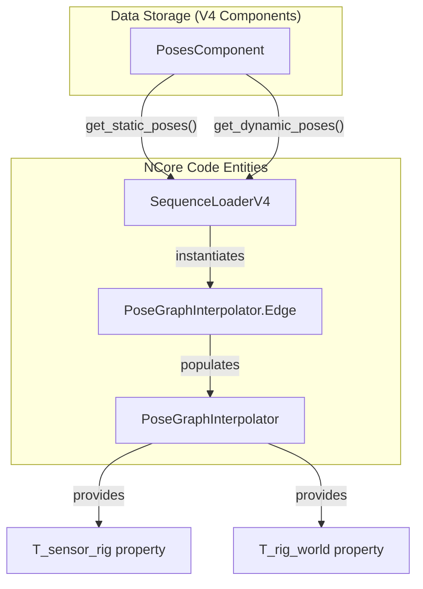
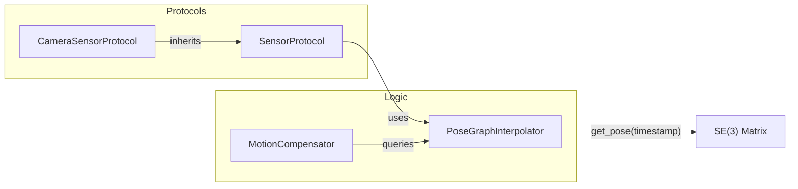

<!-- source: DeepWiki mcp.deepwiki.com · repo NVIDIA/ncore · page 2.3 Coordinate Conventions and Pose Graph · fetched 2026-10-26 -->

# Coordinate Conventions and Pose Graph

Relevant source files

The following files were used as context for generating this wiki page:

- [docs/_static/custom.css](docs/_static/custom.css)
- [docs/apis/install.rst](docs/apis/install.rst)
- [docs/data/conventions.rst](docs/data/conventions.rst)
- [ncore/impl/data/compat.py](ncore/impl/data/compat.py)
- [ncore/impl/data/v4/BUILD.bazel](ncore/impl/data/v4/BUILD.bazel)
- [ncore/impl/data/v4/compat.py](ncore/impl/data/v4/compat.py)
- [ncore/impl/data/v4/compat_test.py](ncore/impl/data/v4/compat_test.py)
- [ncore/impl/data/v4/components.py](ncore/impl/data/v4/components.py)

NCore defines a rigorous spatial specification to ensure consistency across various sensors, ego-vehicles, and global reference frames. All spatial relationships are represented in a **pose graph**, a tree-like structure that manages both static calibrations and time-varying trajectories.

## Coordinate Systems and Transformations

NCore follows a specific convention for representing 3D spatial data to ensure interoperability between modules.

### SE(3) Matrices and $T_{a}^{b}$ Notation
All relative transformations are stored as homogeneous 4x4 $SE(3)$ matrices. These matrices consist of a 3x3 rotation matrix $\mathbf{R}$ and a 3x1 translation vector $\mathbf{t}$ [docs/data/conventions.rst:24-27]().

NCore uses the identifier `T_a_b` to represent the transformation $T_{a}^{b}$, which maps points from coordinate system $a$ to coordinate system $b$ [docs/data/conventions.rst:28-30]().
*   **Point Transformation**: $\mathbf{p}_b = \mathbf{R}_a^b \, \mathbf{p}_a + \mathbf{t}_a^b$ [docs/data/conventions.rst:32-36]().
*   **Chaining**: Transformations are composed via matrix multiplication: $T_a^c = T_b^c \, T_a^b$ [docs/data/conventions.rst:38-43]().

### Standard Coordinate Frames
The following named frames are standard across NCore:

| Frame Name | Description | Orientation |
| :--- | :--- | :--- |
| `rig` | Vehicle/robot body frame. Origin is middle of rear axis on ground [docs/data/conventions.rst:109-112](). | X-front, Y-left, Z-up (Right-handed) |
| `world` | Sequence-local reference frame, usually identity at the first ego pose [docs/data/conventions.rst:95-97](). | Local metric space |
| `world_global` | Earth-Centered-Earth-Fixed (ECEF) global frame [docs/data/conventions.rst:82-82](). | Global ECEF |
| `camera` | Sensor-local frame. Origin at optical center [docs/data/conventions.rst:128-131](). | Z-forward, X-right, Y-down |
| `image` | 2D pixel coordinates. Origin at top-left [docs/data/conventions.rst:135-138](). | U-right, V-down |

Sources: [docs/data/conventions.rst:24-140]()

## Pose Graph Representation

The pose graph is a tree of named coordinate frames connected by rigid transformations. Because it is a tree (no cycles), there is a unique path between any two frames, traversable via composition or $SE(3)$ inversion [docs/data/conventions.rst:49-54]().

### Static vs. Dynamic Edges
Edges in the graph fall into two categories:
1.  **Static Edges**: Time-invariant $SE(3)$ matrices representing fixed relationships like extrinsic calibrations (e.g., `T_camera_rig`) [docs/data/conventions.rst:58-61]().
2.  **Dynamic Edges**: Time-dependent trajectories. These are sequences of $SE(3)$ matrices with associated timestamps, interpolated using SLERP (rotation) and linear interpolation (translation) [docs/data/conventions.rst:63-67]().

### Pose Graph Implementation
In the codebase, the pose graph is managed by the `PoseGraphInterpolator` [ncore/impl/common/transformations.py:26-26](). When a `SequenceLoaderV4` is initialized, it constructs this graph by reading both static and dynamic poses from the `PosesComponent` [ncore/impl/data/v4/compat.py:123-138]().

**Pose Graph Data Flow**

Sources: [ncore/impl/data/v4/compat.py:86-138](), [docs/data/conventions.rst:49-68]()

## Timestamps and Intervals

NCore uses microsecond-precision integers for timestamps. Temporal ranges are represented using the `HalfClosedInterval` class, which defines a range $[start, stop)$ [ncore/impl/common/transformations.py:26-26]().

*   **Sequence Interval**: Every sequence has a `sequence_timestamp_interval_us` defining its total duration [ncore/impl/data/v4/components.py:96-96]().
*   **Sensor Frames**: Sensors (Camera, LiDAR, Radar) store frame timing as an $(N, 2)$ array of start/end timestamps [ncore/impl/data/compat.py:173-175]().
*   **FrameTimepoint**: An enumeration (`START` or `END`) used to select which timestamp to use when querying poses or indexing frames [ncore/impl/data/compat.py:177-180]().

Sources: [ncore/impl/data/v4/components.py:74-79](), [ncore/impl/data/compat.py:173-180]()

## PoseGraphInterpolator and Motion Compensation

The `PoseGraphInterpolator` is the primary tool for resolving spatial queries at specific points in time. It is used extensively for **Motion Compensation**, especially for sensors with non-instantaneous capture like rolling-shutter cameras or spinning LiDARs.

### Key Capabilities
*   **Interpolation**: Computes the pose at any timestamp $t$ within the trajectory range [docs/data/conventions.rst:64-65]().
*   **Frame-Relative Queries**: Through the `SensorProtocol`, users can query `T_sensor_rig` (static) or `T_rig_world` (interpolated at frame start/end) [ncore/impl/data/compat.py:193-200]().
*   **Coordinate Conversion**: The `MotionCompensator` utility uses the pose graph to transform point clouds or rays from their capture time to a common reference time [ncore/impl/common/transformations.py:26-26]().

**Entity Relationship: Pose Querying**

Sources: [ncore/impl/data/compat.py:157-200](), [ncore/impl/data/v4/compat.py:26-26](), [docs/data/conventions.rst:114-117]()

---

