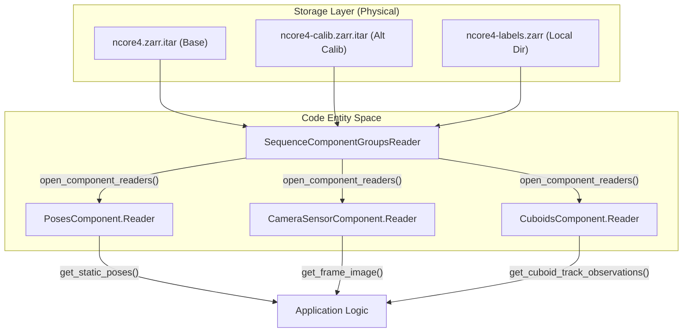
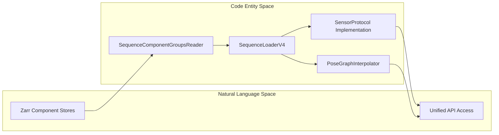

<!-- source: DeepWiki mcp.deepwiki.com · repo NVIDIA/ncore · page 2.4 Reading and Writing Sequences · fetched 2026-10-26 -->

# Reading and Writing Sequences

Relevant source files

The following files were used as context for generating this wiki page:

- [docs/data/formats.rst](docs/data/formats.rst)
- [docs/data/storage_and_access.rst](docs/data/storage_and_access.rst)
- [docs/index.rst](docs/index.rst)
- [docs/tools/ncore_vis.rst](docs/tools/ncore_vis.rst)
- [ncore/data_converter/__init__.py](ncore/data_converter/__init__.py)
- [ncore/impl/data/compat.py](ncore/impl/data/compat.py)
- [ncore/impl/data/v4/BUILD.bazel](ncore/impl/data/v4/BUILD.bazel)
- [ncore/impl/data/v4/compat.py](ncore/impl/data/v4/compat.py)
- [ncore/impl/data/v4/compat_test.py](ncore/impl/data/v4/compat_test.py)
- [ncore/impl/data/v4/components.py](ncore/impl/data/v4/components.py)
- [ncore/impl/data_converter/base.py](ncore/impl/data_converter/base.py)
- [tools/data_converter/BUILD.bazel](tools/data_converter/BUILD.bazel)

NCore V4 utilizes a component-based architecture for reading and writing data. Unlike monolithic formats, V4 distributes data across modular *component groups*, which are independently managed Zarr stores. This design allows for flexible composition of sequences by combining different stores (e.g., combining a base sensor store with a separate calibration or labels store).

## Sequence Reading and Writing Architecture

The primary interface for interacting with V4 data consists of the `SequenceComponentGroupsReader` and `SequenceComponentGroupsWriter` classes. These classes manage the lifecycle of Zarr stores and coordinate access to specific data components like poses, intrinsics, and sensor frames.

### Reading Sequences
The `SequenceComponentGroupsReader` accepts a list of paths to component stores. It aggregates these stores into a single logical sequence view.

*   **Initialization**: It reads metadata from each store and verifies sequence consistency (e.g., matching `sequence_id`) [ncore/impl/data/v4/components.py:102-121]().
*   **Component Access**: Users open specific component readers (e.g., `PosesComponent.Reader`) by passing the desired reader class to `open_component_readers()` [docs/data/storage_and_access.rst:150-157]().

### Writing Sequences
The `SequenceComponentGroupsWriter` manages the creation of new Zarr stores, either as directory-based stores or `.itar` archives.

*   **Lazy Initialization**: Stores are created on-demand when a component group is first accessed [ncore/impl/data/v4/components.py:170-180]().
*   **Storage Profiles**: The `store_type` parameter determines if the output is a standard directory or a high-performance `.itar` file [ncore/impl/data/v4/components.py:191-197]().

### Sequence Reading Data Flow
The following diagram illustrates how the reader aggregates multiple physical Zarr stores into a unified logical sequence.

**Sequence Reader Component Aggregation**

Sources: [ncore/impl/data/v4/components.py:102-121](), [ncore/impl/data/v4/compat.py:85-121](), [docs/data/storage_and_access.rst:142-158]()

## SequenceLoaderV4 Compatibility Layer

The `SequenceLoaderV4` class provides a unified, protocol-based interface (`SequenceLoaderProtocol`) for accessing sequence data. It abstracts the underlying component-based structure into a more sensor-centric API, making it easier to migrate from older formats or build generic tools.

### Key Responsibilities
1.  **Pose Graph Construction**: It automatically instantiates a `PoseGraphInterpolator` by collecting all static and dynamic poses from the `PosesComponent` [ncore/impl/data/v4/compat.py:123-138]().
2.  **Sensor Mapping**: It maps sensor IDs to their respective component readers (Cameras, Lidars, Radars) [ncore/impl/data/v4/compat.py:112-120]().
3.  **Resource Management**: Implements `reload_resources()` to handle multi-process data loading scenarios by refreshing internal Zarr handles [ncore/impl/data/v4/compat.py:161-163]().

**Compatibility Layer Architecture**

Sources: [ncore/impl/data/v4/compat.py:60-141](), [ncore/impl/data/compat.py:79-154]()

## Component Group Assignments

NCore supports different organizational profiles for data components. While the default is a single store, complex datasets often separate sensors to optimize parallel I/O or independent updates.

| Profile | Description | Typical Usage |
| :--- | :--- | :--- |
| **Default** | All components (poses, sensors, etc.) in a single `ncore4.zarr.itar` file. | Small sequences, distribution-ready datasets. |
| **Separate Sensors** | Each sensor type (e.g., `ncore4-cameras`, `ncore4-lidars`) has its own store. | Large datasets where users might only need one modality. |
| **Separate All** | Every component instance has a dedicated store (e.g., `ncore4-camera_front_wide`). | High-performance training pipelines requiring maximum I/O parallelism. |

In the `SequenceLoaderV4` and visualization tools like `ncore_vis`, these are managed via group name parameters (e.g., `poses_component_group_name`) [ncore/impl/data/v4/compat.py:78-81](), [docs/tools/ncore_vis.rst:83-94]().

## UPath and Cloud-Agnostic Access

NCore utilizes `universal_pathlib` (`UPath`) for all filesystem operations. This allows the same reading and writing code to work across local files and cloud object storage without modification [docs/data/storage_and_access.rst:164-170]().

### Implementation Detail
The `BaseDataConverter` and `SequenceComponentGroupsWriter` both cast input strings to `UPath` objects [ncore/impl/data_converter/base.py:63-63](), [ncore/impl/data/v4/components.py:125-140](). This enables:
*   **Transparent S3/GCS Access**: Using URLs like `s3://bucket/seq.zarr.itar` [docs/data/storage_and_access.rst:184-189]().
*   **Atomic Operations**: Remote filesystems leverage `fsspec` implementations for robust cloud I/O [docs/data/storage_and_access.rst:198-202]().

Sources: [ncore/impl/data/v4/components.py:49-50](), [ncore/impl/data_converter/base.py:25-25](), [docs/data/storage_and_access.rst:159-170]()

---

