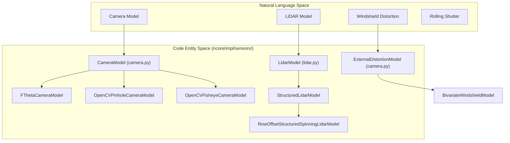
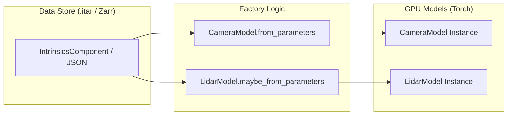

<!-- source: DeepWiki mcp.deepwiki.com · repo NVIDIA/ncore · page 3 Sensor Models · fetched 2026-10-26 -->

# Sensor Models

Relevant source files

The following files were used as context for generating this wiki page:

- [CHANGELOG.md](CHANGELOG.md)
- [README.md](README.md)
- [docs/data/sensor_models.rst](docs/data/sensor_models.rst)
- [ncore/BUILD.bazel](ncore/BUILD.bazel)
- [ncore/impl/data/stores.py](ncore/impl/data/stores.py)
- [ncore/impl/data/types.py](ncore/impl/data/types.py)
- [ncore/impl/sensors/camera.py](ncore/impl/sensors/camera.py)
- [ncore/impl/sensors/camera_test.py](ncore/impl/sensors/camera_test.py)
- [ncore/impl/sensors/common.py](ncore/impl/sensors/common.py)
- [ncore/impl/sensors/lidar.py](ncore/impl/sensors/lidar.py)

NCore provides a high-level, GPU-accelerated sensor modeling layer designed for neural reconstruction and robotics applications. This layer abstracts the mathematical complexities of different camera and LiDAR hardware into unified APIs for projection, unprojection, and motion compensation [README.md:11-17]().

The sensor modeling subsystem is built on top of `torch.nn.Module` to enable seamless integration into deep learning pipelines and to leverage CUDA acceleration for high-throughput ray operations [ncore/impl/sensors/common.py:22-31]().

### Core Architecture

All sensor models inherit from a common `BaseModel` which manages device placement (CPU/GPU) and floating-point precision (`dtype`) [ncore/impl/sensors/common.py:22-32](). The system distinguishes between **Intrinsics** (internal sensor geometry) and **External Distortion** (environmental effects like windshields).

#### System Entity Map: Sensors to Code
The following diagram maps high-level sensor concepts to their corresponding implementation classes and data structures in the NCore codebase.

**Sensor Model Entity Mapping**

**Sources:** [ncore/impl/sensors/camera.py:40-48](), [ncore/impl/sensors/camera.py:175-185](), [ncore/impl/sensors/lidar.py:37-38](), [ncore/impl/sensors/lidar.py:130-131]()

---

### Camera Models

NCore supports multiple camera parameterizations to handle everything from standard pinhole lenses to ultra-wide fisheye optics.

*   **FTheta Model**: NVIDIA's proprietary model using polynomial distortion, ideal for wide FOV sensors [docs/data/sensor_models.rst:45-57]().
*   **OpenCV Pinhole**: Standard model supporting radial, tangential, and thin-prism distortion [docs/data/sensor_models.rst:109-135]().
*   **OpenCV Fisheye**: Specialized polynomial distortion for hemispherical lenses [docs/data/sensor_models.rst:185-190]().

#### Key Features
*   **Rolling Shutter**: Models include `ShutterType` (e.g., `ROLLING_TOP_TO_BOTTOM`) to account for CMOS sensor readout timing [ncore/impl/data/types.py:64-72]().
*   **External Distortion**: The `BivariateWindshieldModel` uses 2D polynomials to correct for ray deflection caused by vehicle glass [ncore/impl/sensors/camera.py:78-85]().

For implementation details and mathematical definitions, see **[Camera Models](#3.1)**.

**Sources:** [ncore/impl/sensors/camera.py:175-185](), [docs/data/sensor_models.rst:15-28]()

---

### LiDAR Models

The LiDAR layer provides tools for mapping between 3D world points and sensor-specific angular representations (Azimuth/Elevation).

*   **Structured LiDAR**: Models sensors with a fixed grid of lasers (rows) and firing sequence (columns), such as the Hesai P128 [ncore/impl/sensors/lidar.py:180-182]().
*   **Ray-to-Angle Mapping**: Efficient conversion between `sensor_rays` and `sensor_angles` [ncore/impl/sensors/lidar.py:115-128]().

#### Motion Compensation
LiDAR scans are often "smeared" because the vehicle moves during the spin. NCore provides `MotionCompensator` utilities to de-warp point clouds based on high-frequency ego-pose data [ncore/impl/sensors/lidar.py:63-74]().

For implementation details and structured lookup logic, see **[LiDAR Models](#3.2)**.

**Sources:** [ncore/impl/sensors/lidar.py:37-60](), [ncore/impl/sensors/lidar.py:130-146]()

---

### Data Integration

Sensor models are typically initialized from the NCore V4 Data Format using the `from_parameters` factory methods.

**Parameter to Model Flow**

| Model Class | Parameter Type | File Reference |
| :--- | :--- | :--- |
| `FThetaCameraModel` | `FThetaCameraModelParameters` | [ncore/impl/sensors/camera.py:189]() |
| `OpenCVPinholeCameraModel` | `OpenCVPinholeCameraModelParameters` | [ncore/impl/sensors/camera.py:461]() |
| `RowOffsetStructuredSpinningLidarModel` | `RowOffsetStructuredSpinningLidarModelParameters` | [ncore/impl/sensors/lidar.py:180]() |

**Sources:** [ncore/impl/sensors/camera.py:189-200](), [ncore/impl/sensors/lidar.py:98-114](), [ncore/impl/data/types.py:138-150]()

---

