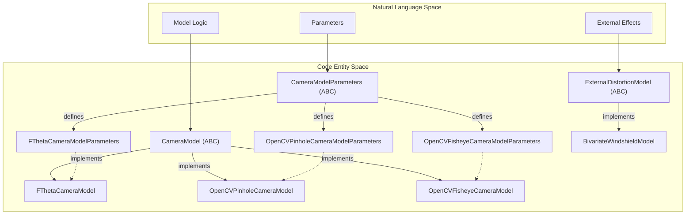

<!-- source: DeepWiki mcp.deepwiki.com · repo NVIDIA/ncore · page 3.1 Camera Models · fetched 2026-10-26 -->

# Camera Models

<details>
<summary>Relevant source files</summary>

The following files were used as context for generating this wiki page:

- [docs/data/sensor_models.rst](docs/data/sensor_models.rst)
- [ncore/impl/data/stores.py](ncore/impl/data/stores.py)
- [ncore/impl/data/types.py](ncore/impl/data/types.py)
- [ncore/impl/sensors/camera.py](ncore/impl/sensors/camera.py)
- [ncore/impl/sensors/camera_test.py](ncore/impl/sensors/camera_test.py)
- [ncore/impl/sensors/common.py](ncore/impl/sensors/common.py)
- [ncore/impl/sensors/lidar.py](ncore/impl/sensors/lidar.py)

</details>


NCore provides a suite of GPU-accelerated camera models designed for high-performance projection and unprojection tasks. These models support various lens geometries, including standard perspective, wide-angle fisheye, and NVIDIA's proprietary FTheta parameterization. The system explicitly handles rolling-shutter effects through iterative optimization and supports external distortion models, such as those caused by vehicle windshields.

## Architecture Overview

All camera models inherit from a common base and provide consistent APIs for mapping between 3D rays and 2D image coordinates. The implementation leverages PyTorch for batch processing on both CPU and GPU.

### Class Hierarchy and Data Flow

The following diagram illustrates the relationship between the camera model classes and the data structures defined in the NCore schema.

**Camera Model Entity Map**

Sources: [ncore/impl/sensors/camera.py:40-42](), [ncore/impl/sensors/camera.py:228-230](), [ncore/impl/data/types.py:139-141]()

## Supported Camera Models

### FTheta Camera Model
The `FThetaCameraModel` is a flexible polynomial-based model suitable for a wide range of field-of-views. It maps the angle $\theta$ (between the ray and the principal axis) to a pixel distance $\delta$ using a 5th-order polynomial [docs/data/sensor_models.rst:83-91]().

*   **Forward Polynomial**: Maps angle $\theta$ to pixel distance $\delta$.
*   **Backward Polynomial**: Maps pixel distance $\delta$ to angle $\theta$.
*   **Reference System**: One polynomial is designated as the `reference_poly`, while the other is an approximation used for initialization [ncore/impl/data/types.py:59-62]().

### OpenCV Models
NCore implements standard OpenCV-compatible models for integration with existing computer vision pipelines:
*   **OpenCVPinholeCameraModel**: Supports rational radial ($k_1 \dots k_6$), tangential ($p_1, p_2$), and thin prism ($s_1 \dots s_4$) distortion [docs/data/sensor_models.rst:120-135]().
*   **OpenCVFisheyeCameraModel**: Uses a 4th-order polynomial distortion mapping $\theta$ to $d = \theta(1 + k_1\theta^2 + k_2\theta^4 + k_3\theta^6 + k_4\theta^8)$ [docs/data/sensor_models.rst:198-205]().

Sources: [ncore/impl/sensors/camera.py:488-490](), [ncore/impl/sensors/camera.py:657-659](), [ncore/impl/sensors/camera.py:821-823]()

## Projection and Unprojection APIs

The models provide two primary functional interfaces: `project` and `unproject`. These functions handle batches of points/rays and integrate with the rolling-shutter and external distortion logic.

| Function | Input | Output | Description |
| :--- | :--- | :--- | :--- |
| `project` | 3D Points (World/Rig) | 2D Image Coords | Projects 3D points to pixels, optionally compensating for motion/shutter. |
| `unproject` | 2D Image Coords | 3D Rays (Sensor) | Converts pixel coordinates back into normalized 3D rays. |

### Data Flow for Projection
```mermaid
sequenceDiagram
    participant App as Application
    participant CM as CameraModel
    participant ED as ExternalDistortionModel
    participant Opt as ShutterOptimizer

    App->>CM: project(points, T_world_sensor)
    alt is Rolling Shutter
        CM->>Opt: find_shutter_times(points)
        Opt-->>CM: timestamps_us
    end
    CM->>ED: distort_camera_rays(rays)
    ED-->>CM: distorted_rays
    CM->>CM: apply_intrinsic_distortion(distorted_rays)
    CM-->>App: image_points
```
Sources: [ncore/impl/sensors/camera.py:321-340](), [ncore/impl/sensors/camera.py:384-405]()

## Rolling-Shutter Compensation

For cameras with `ShutterType` other than `GLOBAL` (e.g., `ROLLING_TOP_TO_BOTTOM`), the exact time a pixel is captured depends on its image coordinates [ncore/impl/data/types.py:64-71](). 

### Iterative Shutter Optimization
Because the pixel coordinate depends on the camera pose at a specific time, and that time depends on the pixel coordinate, NCore uses an iterative loop to find a consistent solution:
1.  **Initialize**: Assume global shutter time (frame timestamp).
2.  **Project**: Map 3D points to image coordinates using the current pose.
3.  **Update Time**: Calculate new per-point timestamps based on the projected `u` or `v` coordinates and the `shutter_type` [ncore/impl/sensors/camera.py:1152-1175]().
4.  **Interpolate Pose**: Get updated `T_world_sensor` for each point using `PoseGraphInterpolator`.
5.  **Repeat**: Typically converges in 2-3 iterations [ncore/impl/sensors/camera.py:1183-1195]().

Sources: [ncore/impl/sensors/camera.py:1134-1145](), [ncore/impl/sensors/camera.py:1178-1198]()

## External Distortion: BivariateWindshieldModel

The `BivariateWindshieldModel` accounts for refraction through a vehicle's windshield. It is applied to rays before they enter the camera lens (during projection) or after they exit the lens (during unprojection) [ncore/impl/sensors/camera.py:78-84]().

*   **Mechanism**: It uses spherical coordinates $\phi = \arcsin(x/\text{norm})$ and $\theta = \arcsin(y/\text{norm})$ [ncore/impl/sensors/camera.py:81-82]().
*   **Polynomials**: Deflection is computed via bivariate polynomials of order $N$ in both $\phi$ and $\theta$ [ncore/impl/sensors/camera.py:83-84]().
*   **Application**:
    *   `distort_camera_rays`: Transforms external rays to internal (camera-side) rays [ncore/impl/sensors/camera.py:186-191]().
    *   `undistort_camera_rays`: Transforms internal rays to external (world-side) rays [ncore/impl/sensors/camera.py:193-198]().

Sources: [ncore/impl/sensors/camera.py:78-100](), [ncore/impl/sensors/camera.py:186-198]()

---

