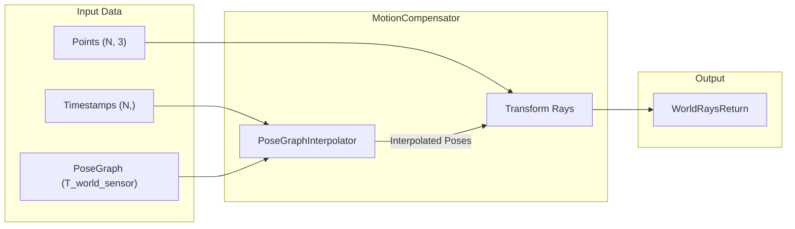

<!-- source: DeepWiki mcp.deepwiki.com · repo NVIDIA/ncore · page 3.2 LiDAR Models · fetched 2026-10-26 -->

# LiDAR Models

<details>
<summary>Relevant source files</summary>

The following files were used as context for generating this wiki page:

- [docs/data/sensor_models.rst](docs/data/sensor_models.rst)
- [ncore/impl/data/stores.py](ncore/impl/data/stores.py)
- [ncore/impl/data/types.py](ncore/impl/data/types.py)
- [ncore/impl/sensors/camera.py](ncore/impl/sensors/camera.py)
- [ncore/impl/sensors/camera_test.py](ncore/impl/sensors/camera_test.py)
- [ncore/impl/sensors/common.py](ncore/impl/sensors/common.py)
- [ncore/impl/sensors/lidar.py](ncore/impl/sensors/lidar.py)

</details>


NCore provides a GPU-accelerated sensor modeling layer for LiDAR sensors, supporting both generic and structured spinning models. These models handle the conversion between 3D points, sensor rays, and spherical angles, while accounting for per-row offsets and motion compensation during vehicle movement.

## Core Abstractions

LiDAR modeling in NCore is built around a hierarchy of classes that define how rays are mapped to angles and how structured data (like range images) relates to 3D space.

### LidarModel
The base class `LidarModel` defines the standard interface for all LiDAR types. It provides abstract methods for converting between sensor rays and sensor angles (elevation and azimuth) [ncore/impl/sensors/lidar.py:37-38]().

Key return types include:
*   `SensorAnglesReturn`: Contains elevation/azimuth angles and a validity flag [ncore/impl/sensors/lidar.py:41-49]().
*   `SensorRayReturn`: Contains 3D sensor rays and a validity flag [ncore/impl/sensors/lidar.py:52-60]().
*   `WorldRaysReturn`: Encapsulates rays in the world frame, including origin, direction, and optional per-ray timestamps for motion compensation [ncore/impl/sensors/lidar.py:63-74]().

### StructuredLidarModel
An extension of the base model for sensors with a fixed grid-like scan pattern (e.g., spinning LiDARs). It introduces "elements" (row/column indices) and provides methods to map these indices directly to 3D points or rays [ncore/impl/sensors/lidar.py:130-178]().

### Class Hierarchy and Data Flow
The following diagram illustrates the relationship between the LiDAR model entities and the data structures they produce.

**LiDAR Model Entity Mapping**
```mermaid
graph TD
    subgraph "Code Entity Space"
        LM["LidarModel (Base)"]
        SLM["StructuredLidarModel"]
        ROSLM["RowOffsetStructuredSpinningLidarModel"]
        MC["MotionCompensator"]
        
        SAR["SensorAnglesReturn"]
        SRR["SensorRayReturn"]
        WRR["WorldRaysReturn"]
    end

    subgraph "Natural Language Concepts"
        RA["Ray-to-Angle Mapping"]
        RO["Per-row Azimuth Offsets"]
        MC_CONCEPT["Motion Compensation"]
        RI["Range Image Elements"]
    end

    LM -->|defines| RA
    SLM --|> LM
    SLM -->|manages| RI
    ROSLM --|> SLM
    ROSLM -->|implements| RO
    MC -->|produces| WRR
    MC_CONCEPT --> MC
```
Sources: [ncore/impl/sensors/lidar.py:37-181](), [ncore/impl/sensors/lidar.py:41-74]()

---

## RowOffsetStructuredSpinningLidarModel

The `RowOffsetStructuredSpinningLidarModel` is the primary implementation for modern high-resolution spinning sensors (e.g., Hesai P128). It models the sensor as a grid where each row (laser) may have a unique azimuth offset relative to the global rotation [ncore/impl/sensors/lidar.py:180-185]().

### Ray-to-Angle Mapping
The model uses spherical coordinates where:
1.  **Elevation ($\theta$):** The angle from the XY plane.
2.  **Azimuth ($\phi$):** The rotation around the Z-axis.

For this model, the azimuth is corrected per-row:
$$\phi_{effective} = \phi_{column} + \text{offset}_{row}$$

Implementation:
*   `elements_to_sensor_angles`: Maps `(row, col)` to `(elevation, azimuth)` [ncore/impl/sensors/lidar.py:270-282]().
*   `sensor_rays_to_sensor_angles`: Converts 3D directions to spherical angles using `atan2` and `asin` [ncore/impl/sensors/lidar.py:284-306]().

### Column Lookup (cKDTree)
To perform the inverse mapping (angles to columns), the model employs a `scipy.spatial.cKDTree`. This is used to build a lookup table (`angles_to_columns_map`) that allows the model to find the nearest column index for a given azimuth angle efficiently [ncore/impl/sensors/lidar.py:221-268]().

Sources: [ncore/impl/sensors/lidar.py:180-306]()

---

## Motion Compensation

Because LiDAR sensors capture points over a period of time (a "sweep"), the ego-vehicle's movement causes spatial distortion. NCore provides the `MotionCompensator` utility to resolve this.

### Data Flow for Motion Compensation
The compensator takes a set of points, their timestamps, and the vehicle's pose trajectory to produce accurately localized rays in the world coordinate frame.

**Motion Compensation Data Flow**

Sources: [ncore/impl/sensors/lidar.py:494-547](), [ncore/impl/data/types.py:36]()

### Key Functions
*   **`apply_motion_compensation`**: The main entry point. It interpolates the sensor's pose at every individual point's timestamp and transforms the points into a unified world frame [ncore/impl/sensors/lidar.py:514-547]().
*   **`PoseGraphInterpolator`**: Used internally to provide $SE(3)$ poses at arbitrary timestamps using SLERP for rotations and linear interpolation for translations [ncore/impl/data/types.py:36]().

---

## Technical Implementation Details

### Parameterization
LiDAR models are initialized from `LidarModelParameters`. The `RowOffsetStructuredSpinningLidarModelParameters` includes:
*   `row_elevations_rad`: Array of elevation angles for each laser [ncore/impl/sensors/lidar.py:183]().
*   `column_azimuths_rad`: Array of azimuth angles for each horizontal step [ncore/impl/sensors/lidar.py:184]().
*   `row_azimuth_offsets_rad`: Per-row corrections for the azimuth [ncore/impl/sensors/lidar.py:185]().

### GPU Acceleration
All heavy mathematical operations (ray-to-angle conversion, point transformations) are implemented using `torch` to leverage GPU acceleration [ncore/impl/sensors/lidar.py:25-34](). The `BaseModel` ensures that all buffers and parameters are correctly moved to the target `device` (e.g., `cuda`) during initialization [ncore/impl/sensors/common.py:22-59]().

### Summary Table: Key LiDAR Methods
| Method | Input | Output | Description |
| :--- | :--- | :--- | :--- |
| `sensor_angles_to_sensor_rays` | $(\theta, \phi)$ | $(x, y, z)$ | Converts spherical angles to unit vectors. |
| `elements_to_sensor_points` | $(r, c, dist)$ | $(x, y, z)$ | Maps range image pixels to 3D sensor space. |
| `apply_motion_compensation` | $P_{sensor}, t$ | $P_{world}$ | Transforms points to world frame using timestamps. |

Sources: [ncore/impl/sensors/lidar.py:125-171](), [ncore/impl/sensors/lidar.py:514-547](), [ncore/impl/sensors/common.py:22-78]()

---

