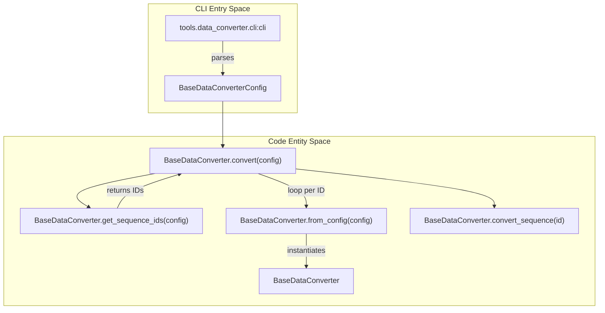
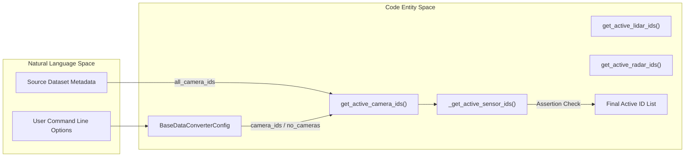

<!-- source: DeepWiki mcp.deepwiki.com · repo NVIDIA/ncore · page 4 Data Converters · fetched 2026-10-26 -->

# Data Converters

Relevant source files

The following files were used as context for generating this wiki page:

- [docs/conversions/index.rst](docs/conversions/index.rst)
- [ncore/data_converter/__init__.py](ncore/data_converter/__init__.py)
- [ncore/impl/data_converter/base.py](ncore/impl/data_converter/base.py)
- [tools/data_converter/BUILD.bazel](tools/data_converter/BUILD.bazel)
- [tools/data_converter/cli.py](tools/data_converter/cli.py)

NCore provides a robust data conversion framework designed to import 3rd-party dataset formats into the NCore V4 component-based format [docs/conversions/index.rst:7-9](). The framework abstracts common tasks such as sensor filtering, sequence discovery, and output directory management, allowing developers to focus on dataset-specific parsing logic.

### Conversion Architecture

The architecture is built around abstract base classes that define a standard lifecycle for processing datasets. The framework distinguishes between generic converters and those that operate specifically on local file systems.

#### Class Hierarchy and Core Entities

| Entity | Role | Source |
| :--- | :--- | :--- |
| `BaseDataConverter` | Abstract base class defining the conversion lifecycle (`convert`, `convert_sequence`). | [ncore/impl/data_converter/base.py:49-58]() |
| `BaseDataConverterConfig` | Dataclass for common CLI parameters like output paths and sensor filters. | [ncore/impl/data_converter/base.py:29-47]() |
| `FileBasedDataConverter` | Specialization for datasets stored in a local root directory. | [ncore/impl/data_converter/base.py:177-180]() |
| `FileBasedDataConverterConfig` | Adds `root_dir` requirement for local dataset discovery. | [ncore/impl/data_converter/base.py:159-174]() |

#### Data Conversion Lifecycle

The following diagram illustrates the relationship between the CLI entry point and the internal class methods that govern the conversion process.

**Data Converter Class Interaction**

**Sources:** [ncore/impl/data_converter/base.py:115-156](), [tools/data_converter/cli.py:34-75]()

### Sensor Filtering

The framework provides built-in mechanisms to filter which sensors are exported during conversion. This is managed via the `BaseDataConverterConfig` and resolved at runtime through helper methods.

*   **Selective Export:** Users can specify specific IDs for cameras, LiDARs, or radars, or disable entire sensor classes using flags like `--no-cameras` [tools/data_converter/cli.py:47-73]().
*   **Resolution Logic:** The `_get_active_sensor_ids` method ensures that requested sensor IDs are a valid subset of the sensors available in the source dataset [ncore/impl/data_converter/base.py:89-101]().

**Sensor Resolution Logic**

**Sources:** [ncore/impl/data_converter/base.py:65-86](), [ncore/impl/data_converter/base.py:103-113]()

### CLI Entry Points

The conversion tools are unified under a single `click` group defined in `tools/data_converter/cli.py`. This CLI handles global configuration such as:
*   `--root-dir`: Input path for raw data [tools/data_converter/cli.py:35-40]().
*   `--output-dir`: Destination for V4 formatted data [tools/data_converter/cli.py:41]().
*   `--debug`: Support for remote `debugpy` sessions [tools/data_converter/cli.py:43-46]().

Subcommands (implemented in child pages) extend this group to provide dataset-specific parameters.

### Supported Datasets

NCore includes specialized converters for several major autonomous driving and robotics datasets. For detailed technical specifications, implementation details, and usage instructions, see the respective child pages:

*   **[COLMAP Converter](#4.1)**: Handles SfM outputs and ScanNet++ data, including virtual LiDAR generation from point clouds.
*   **[Waymo Open Dataset Converter](#4.2)**: Processes TFRecords, handles multi-return LiDAR, and parses panoptic segmentation.
*   **[Physical AI (PAI) Converter](#4.3)**: Manages local and streaming ingestion of PAI data with DRACO-encoded point clouds.

**Sources:** [docs/conversions/index.rst:7-17](), [ncore/impl/data_converter/base.py:49-58]()

---

