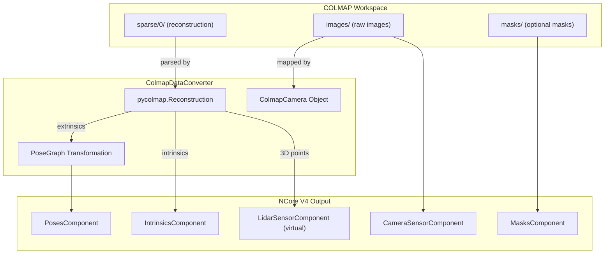
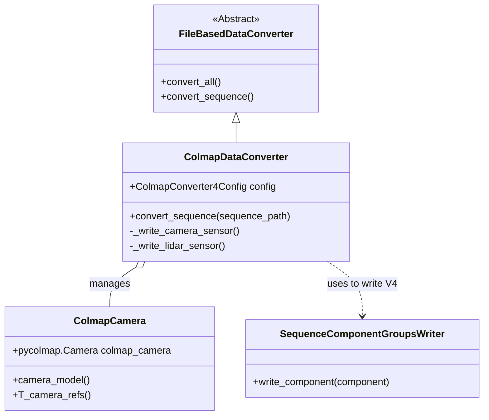

<!-- source: DeepWiki mcp.deepwiki.com · repo NVIDIA/ncore · page 4.1 COLMAP Converter · fetched 2026-10-26 -->

# COLMAP Converter

<details>
<summary>Relevant source files</summary>

The following files were used as context for generating this wiki page:

- [docs/conversions/colmap/colmap.rst](docs/conversions/colmap/colmap.rst)
- [tools/data_converter/colmap/BUILD.bazel](tools/data_converter/colmap/BUILD.bazel)
- [tools/data_converter/colmap/NOTICE](tools/data_converter/colmap/NOTICE)
- [tools/data_converter/colmap/README.md](tools/data_converter/colmap/README.md)
- [tools/data_converter/colmap/converter.py](tools/data_converter/colmap/converter.py)

</details>


The COLMAP Converter is a specialized tool within the NCore data conversion framework designed to transform COLMAP Structure-from-Motion (SfM) reconstructions into the NCore V4 component-based data format. Since COLMAP data lacks native temporal information and follows specific SfM conventions, this converter implements several logical mappings to align SfM outputs with NCore's time-indexed, sensor-centric architecture.

## Architecture and Data Flow

The converter is implemented in `ColmapDataConverter`, which extends `FileBasedDataConverter` [tools/data_converter/colmap/converter.py:168-171](). It leverages `pycolmap` to parse sparse reconstructions and uses the `SequenceComponentGroupsWriter` to serialize the resulting data into `.itar` or Zarr directory stores [tools/data_converter/colmap/converter.py:32-41]().

### Logical Entity Mapping

| COLMAP Entity | NCore V4 Entity | Implementation Detail |
| :--- | :--- | :--- |
| Camera ID (int) | Sensor ID (str) | Prefixed with `camera_prefix` (e.g., `camera1`) [tools/data_converter/colmap/converter.py:178](). |
| Image Frame | Timestep | Assigned at 1 FPS starting from `start_time_sec` [tools/data_converter/colmap/converter.py:89-90](). |
| Camera Extrinsics | `PosesComponent` | Converted from World-to-Camera (COLMAP) to Camera-to-World (NCore) [tools/data_converter/colmap/converter.py:93-99](). |
| 3D Point Cloud | `LidarSensorComponent` | Exported as a single static frame in `virtual_lidar` [tools/data_converter/colmap/converter.py:320-332](). |
| Image Masks | `MasksComponent` | Automatically detected via file naming conventions [tools/data_converter/colmap/converter.py:270-285](). |

### Data Flow Diagram

The following diagram illustrates the transformation from COLMAP filesystem structures to NCore V4 components.

**COLMAP to NCore V4 Conversion Pipeline**

Sources: [tools/data_converter/colmap/converter.py:168-350](), [docs/conversions/colmap/colmap.rst:80-84]()

## Configuration and CLI

The converter is configured via `ColmapConverter4Config` [tools/data_converter/colmap/converter.py:56-70](). It supports two primary CLI subcommands: `colmap-v4` for general reconstructions and `scannetpp-v4` for the ScanNet++ DSLR dataset.

### Subcommand: colmap-v4
This is the generic entry point for standard COLMAP exports.

*   **Logical Timestamps**: Since SfM images are unordered in time, the converter assigns a synthetic 1 FPS timeline [tools/data_converter/colmap/converter.py:89-90]().
*   **Downsampled Sensors**: If `include_downsampled_images` is enabled, the converter looks for directories like `images_2`, `images_4`, etc., and creates separate sensor entries (e.g., `camera1_2`) with appropriately scaled intrinsics [tools/data_converter/colmap/converter.py:204-213]().
*   **Virtual LiDAR**: SfM points are converted into a `LidarSensorComponent` frame. RGB values from the reconstruction are stored as generic `rgb` per-point data [tools/data_converter/colmap/converter.py:328-332]().

### Subcommand: scannetpp-v4
A specialized wrapper for ScanNet++ DSLR data [tools/data_converter/colmap/converter.py:461-483]().
*   Sets default paths to `dslr/colmap` and `dslr/resized_images`.
*   Forces the use of `OPENCV_FISHEYE` camera models.
*   Extracts train/test split metadata from `train_test_lists.json` and stores it in the sequence metadata [tools/data_converter/colmap/converter.py:488-510]().

Sources: [tools/data_converter/colmap/converter.py:56-70](), [tools/data_converter/colmap/converter.py:461-510](), [docs/conversions/colmap/colmap.rst:131-178]()

## Implementation Details

### Camera Model Mapping
The `ColmapCamera.camera_model` property maps COLMAP integer camera types to NCore's `OpenCVPinholeCameraModelParameters` or `OpenCVFisheyeCameraModelParameters` [tools/data_converter/colmap/converter.py:102-165]().

| COLMAP Type | COLMAP Name | NCore Model |
| :--- | :--- | :--- |
| 0 | `SIMPLE_PINHOLE` | `OpenCVPinholeCameraModel` |
| 1 | `PINHOLE` | `OpenCVPinholeCameraModel` |
| 2 | `SIMPLE_RADIAL` | `OpenCVPinholeCameraModel` (k1 only) |
| 3 | `RADIAL` | `OpenCVPinholeCameraModel` (k1, k2) |
| 4 | `OPENCV` | `OpenCVPinholeCameraModel` (k1, k2, p1, p2) |
| 5 | `OPENCV_FISHEYE` | `OpenCVFisheyeCameraModel` (k1, k2, k3, k4) |

Sources: [tools/data_converter/colmap/converter.py:128-165](), [docs/conversions/colmap/colmap.rst:36-40]()

### Mask Detection Conventions
The converter searches for binary/grayscale masks using a priority-based resolution logic [tools/data_converter/colmap/converter.py:270-285]():
1.  **Explicit**: Path provided via `--masks-dir`.
2.  **Co-located**: File named `<image_stem>_mask.png` in the same directory as the image.
3.  **Standard Directory**: File in a `masks/` subdirectory with the same name as the image.

Sources: [tools/data_converter/colmap/converter.py:270-285](), [docs/conversions/colmap/colmap.rst:49-60]()

### Class Relationship Diagram

This diagram shows how the conversion logic is structured internally.

**Internal Converter Logic and Component Writers**

Sources: [tools/data_converter/colmap/converter.py:73-168](), [tools/data_converter/colmap/converter.py:343-350]()

## Usage Examples

### Standard COLMAP Conversion
```bash
bazel run //tools/data_converter/colmap:convert -- \
    --root-dir /path/to/colmap_reconstruction \
    --output-dir /path/to/ncore_v4 \
    colmap-v4
```

### ScanNet++ Conversion
```bash
bazel run //tools/data_converter/colmap:convert -- \
    --root-dir /path/to/scannetpp/scene_id \
    --output-dir /path/to/output \
    scannetpp-v4
```

Sources: [tools/data_converter/colmap/README.md:46-50](), [tools/data_converter/colmap/README.md:113-117]()

---

