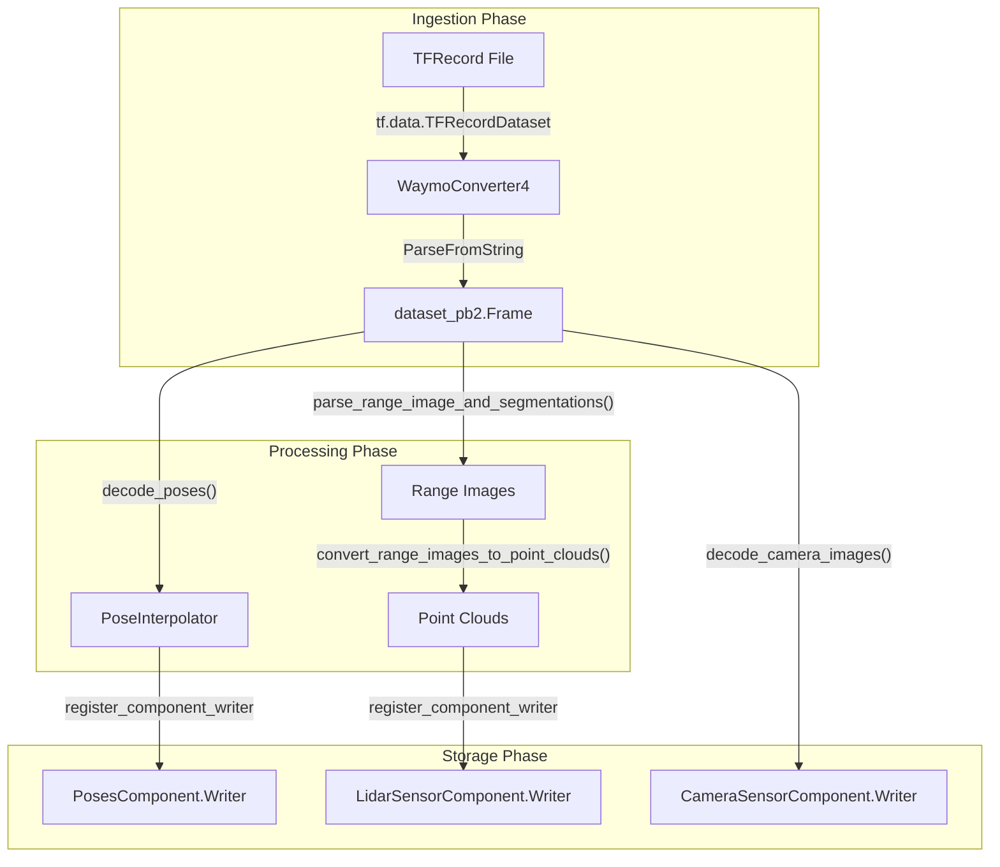
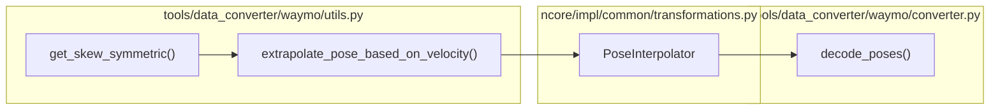

<!-- source: DeepWiki mcp.deepwiki.com · repo NVIDIA/ncore · page 4.2 Waymo Open Dataset Converter · fetched 2026-10-26 -->

# Waymo Open Dataset Converter

<details>
<summary>Relevant source files</summary>

The following files were used as context for generating this wiki page:

- [deps/waymo-open-dataset/cc-proto.patch](deps/waymo-open-dataset/cc-proto.patch)
- [deps/waymo-open-dataset/py-utils.patch](deps/waymo-open-dataset/py-utils.patch)
- [docs/conversions/waymo/waymo.rst](docs/conversions/waymo/waymo.rst)
- [tools/data_converter/waymo/BUILD.bazel](tools/data_converter/waymo/BUILD.bazel)
- [tools/data_converter/waymo/NOTICE](tools/data_converter/waymo/NOTICE)
- [tools/data_converter/waymo/converter.py](tools/data_converter/waymo/converter.py)
- [tools/data_converter/waymo/deps.py](tools/data_converter/waymo/deps.py)
- [tools/data_converter/waymo/utils.py](tools/data_converter/waymo/utils.py)
- [tools/data_converter/waymo/waymo_range_image_utils.py](tools/data_converter/waymo/waymo_range_image_utils.py)

</details>


The `WaymoConverter4` is a specialized implementation of the NCore V4 data conversion framework designed to ingest the [Waymo Open Dataset](https://waymo.com/open/) (WOD) from its native `TFRecord` format and produce standardized NCore V4 sequences. This converter handles complex sensor data including multi-return LiDAR with motion de-compensation, panoptic segmentation masks, and high-frequency egomotion interpolation.

## Architecture and Data Flow

The converter follows a structured lifecycle: it first ingests all frames from a `.tfrecord` file into memory, decodes the global pose graph, and then iterates through sensors to write V4 components.

### System Entity Mapping
The following diagram maps high-level conversion stages to specific code entities and data structures.

**Conversion Data Flow**

Sources: `[tools/data_converter/waymo/converter.py:129-188]()`, `[tools/data_converter/waymo/utils.py:97-122]()`

## LiDAR Processing Pipeline

Waymo LiDAR data is stored as "range images" (spherical projections). The converter implements a high-performance pipeline to transform these into motion-compensated 3D point clouds.

### Multi-Return and Motion Compensation
Waymo provides two returns (primary and secondary). The converter uses `convert_range_images_to_point_clouds` to batch these returns into a single TensorFlow operation to minimize overhead `[tools/data_converter/waymo/utils.py:105-108]()`.

Key features include:
*   **Per-Pixel Poses**: For the `TOP` LiDAR, the converter utilizes `range_image_pose_compressed` to account for the vehicle's motion during the sensor's 360-degree sweep `[tools/data_converter/waymo/waymo_range_image_utils.py:106-113]()`.
*   **Timestamp Approximation**: Individual point timestamps are linearly interpolated between the start and end of the LiDAR spin `[tools/data_converter/waymo/waymo_range_image_utils.py:130-135]()`.
*   **Return Matching**: The primary and secondary returns are matched and stored, maintaining the `RowOffsetStructuredSpinningLidarModel` parameters for downstream ray-casting `[tools/data_converter/waymo/converter.py:47-49]()`.

### Implementation Detail: Range Image Parsing
The converter uses a custom `parse_matrix_proto` function (implemented in `proto_utils.py`) to bypass the slow default Python protobuf parser for large float/int matrices `[tools/data_converter/waymo/waymo_range_image_utils.py:112-123]()`.

Sources: `[tools/data_converter/waymo/waymo_range_image_utils.py:77-123]()`, `[tools/data_converter/waymo/utils.py:97-192]()`

## Camera and Panoptic Segmentation

The converter processes five camera sensors (Front, Front Left, Front Right, Side Left, Side Right) `[tools/data_converter/waymo/converter.py:92-98]()`.

### Coordinate Convention Fix
Waymo uses a camera coordinate system where +X is the principal axis, +Y is left, and +Z is up `[docs/conversions/waymo/waymo.rst:29-32]()`. The NCore standard requires +Z as the principal axis, +X right, and +Y down. The converter applies a 90-degree rotation during the `decode_camera_images` process to align with the NCore convention `[docs/conversions/waymo/waymo.rst:34-35]()`.

### Segmentation Masks
Panoptic segmentation data is parsed from the `camera_segmentation_pb2` protocol buffers. These are converted into `MasksComponent` entries, supporting 29 semantic classes `[docs/conversions/waymo/waymo.rst:37]()`.

Sources: `[tools/data_converter/waymo/converter.py:92-98]()`, `[docs/conversions/waymo/waymo.rst:18-38]()`

## Pose and Egomotion

Waymo provides egomotion via `frame.pose.transform`. However, because LiDAR points and camera shutters may trigger between frame timestamps, the converter uses a `PoseInterpolator` to provide SE(3) transforms at any arbitrary microsecond `[tools/data_converter/waymo/converter.py:35]()`.

### Velocity-Based Extrapolation
In cases where precise frame poses are missing or need refinement, `extrapolate_pose_based_on_velocity` uses the matrix exponential of the skew-symmetric angular velocity matrix to project the vehicle's state forward in time `[tools/data_converter/waymo/utils.py:43-61]()`.

**Pose Processing Logic**

Sources: `[tools/data_converter/waymo/utils.py:43-82]()`, `[tools/data_converter/waymo/converter.py:152]()`

## Configuration and Usage

The converter is configured via `WaymoConverter4Config`, which defines the storage backend (`itar` or `directory`) and the component grouping profile `[tools/data_converter/waymo/converter.py:74-80]()`.

### CLI Execution
The converter is typically invoked via Bazel:
```bash
bazel run //tools/data_converter/waymo:convert -- \
    --root-dir <PATH_TO_TFRECORDS> \
    --output-dir <PATH_TO_OUTPUT> \
    waymo-v4
```
Sources: `[docs/conversions/waymo/waymo.rst:68-71]()`

### Component Grouping Profiles
Users can specify how data is partitioned into files:
| Profile | Description |
| :--- | :--- |
| `default` | Groups all sensors into a single storage group. |
| `separate-sensors` | Each sensor (e.g., `lidar_top`, `camera_front`) gets its own file/group. |
| `separate-all` | Every component type for every sensor is stored individually. |

Sources: `[tools/data_converter/waymo/converter.py:78]()`, `[docs/conversions/waymo/waymo.rst:118-122]()`

---

