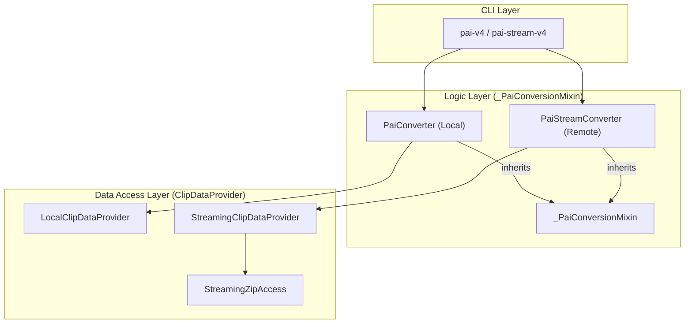
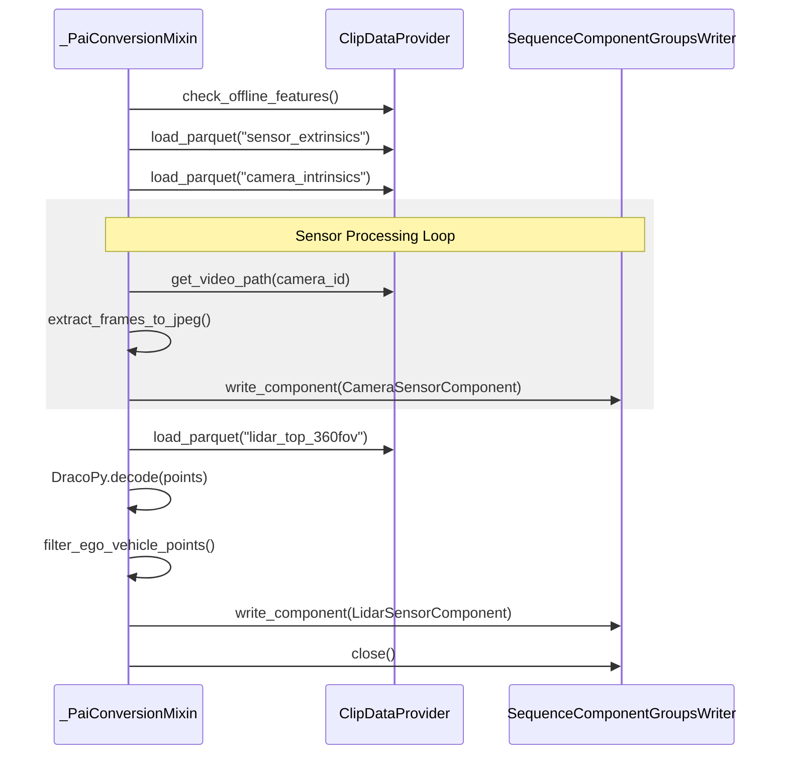

<!-- source: DeepWiki mcp.deepwiki.com · repo NVIDIA/ncore · page 4.3 Physical AI (PAI) Converter · fetched 2026-10-26 -->

# Physical AI (PAI) Converter

Relevant source files

The following files were used as context for generating this wiki page:

- [docs/conversions/pai/pai.rst](docs/conversions/pai/pai.rst)
- [tools/data_converter/pai/README.md](tools/data_converter/pai/README.md)
- [tools/data_converter/pai/converter.py](tools/data_converter/pai/converter.py)
- [tools/data_converter/pai/data_provider.py](tools/data_converter/pai/data_provider.py)
- [tools/data_converter/pai/utils.py](tools/data_converter/pai/utils.py)

The Physical AI (PAI) Converter facilitates the ingestion of the [NVIDIA PhysicalAI-Autonomous-Vehicles](https://huggingface.co/datasets/nvidia/PhysicalAI-Autonomous-Vehicles) dataset into the NCore V4 format [tools/data_converter/pai/README.md:6-9](). It supports the NVIDIA Hyperion 8/8.1 sensor platform, which includes a topology of 7 cameras, a 360° top LiDAR, and associated egomotion and obstacle metadata [docs/conversions/pai/pai.rst:16-19]().

The system provides two primary operational modes:
1.  **Local Mode (`pai-v4`)**: Converts data already downloaded to the local filesystem using the `pai-clip-dl` tool [tools/data_converter/pai/converter.py:100-113]().
2.  **Streaming Mode (`pai-stream-v4`)**: Converts clips directly from HuggingFace using HTTP range requests to avoid full dataset downloads [tools/data_converter/pai/converter.py:116-129]().

### System Architecture and Code Entities

The converter is built on a provider-consumer architecture where a `ClipDataProvider` abstracts the underlying storage (local vs. remote), allowing the `_PaiConversionMixin` to process sensor data uniformly.

**Converter Entity Map**

Sources: [tools/data_converter/pai/converter.py:132-141](), [tools/data_converter/pai/data_provider.py:59-65](), [tools/data_converter/pai/data_provider.py:136-143]()

### Sensor Topology and Data Processing

The converter handles a specific suite of sensors common to the PAI dataset:

| Sensor Category | Specification | Processing Details |
| :--- | :--- | :--- |
| **Cameras** | 7 sensors (Front/Cross 120°, Rear 70°, Tele 30°) | MP4 extraction to JPEG; Shutter delay for rolling shutter [tools/data_converter/pai/converter.py:155-163](). |
| **LiDAR** | 1x Top LiDAR (360° FOV) | DRACO decompression; Ego-vehicle point filtering [tools/data_converter/pai/converter.py:166-168](). |
| **Egomotion** | Rig-to-World Trajectory | Parquet-based SE(3) pose interpolation [tools/data_converter/pai/utils.py:187-197](). |
| **Labels** | Cuboid Obstacles | 3D Bounding boxes with track IDs and class labels [docs/conversions/pai/pai.rst:68-71](). |

#### Point Cloud Filtering
To ensure data quality, the converter applies a spatial filter to LiDAR returns. Points falling within the ego-vehicle's bounding box (defined in `vehicle_dimensions.parquet`) are removed using `filter_ego_vehicle_points` [tools/data_converter/pai/utils.py:31-47]().

#### Video Extraction
Camera data is stored as MP4 files. The converter extracts these into individual JPEG frames and associates them with microsecond-precision timestamps from `timestamps.parquet` [docs/conversions/pai/pai.rst:32-34]().

Sources: [tools/data_converter/pai/converter.py:23-29](), [tools/data_converter/pai/utils.py:31-74](), [docs/conversions/pai/pai.rst:21-44]()

### Conversion Workflow

The conversion process follows a standardized lifecycle managed by the `_convert_clip` method [tools/data_converter/pai/converter.py:180-185]().

**PAI Conversion Sequence**

Sources: [tools/data_converter/pai/converter.py:180-230](), [tools/data_converter/pai/data_provider.py:116-124]()

### Output Profiles and Metadata

The converter supports several `ComponentGroupAssignments` profiles to control how data is partitioned within the `.itar` or directory-based Zarr store:
*   `default`: All components in a single group.
*   `separate-sensors`: Each sensor gets its own group (default) [tools/data_converter/pai/converter.py:111]().
*   `separate-all`: Every component is isolated.

Additionally, a `provenance.json` metadata sidecar is generated to track the source HuggingFace repository ID, revision, and commit SHA used during conversion [tools/data_converter/pai/data_provider.py:105-113]().

Sources: [tools/data_converter/pai/converter.py:100-113](), [tools/data_converter/pai/data_provider.py:185-192]()

### Remote Access and Tooling

For detailed information on how the converter communicates with HuggingFace, manages CDN sessions, and uses the `pai-clip-dl` CLI tool, see the child page:

*   **[PAI Remote Access and pai-clip-dl](#4.3.1)**: Covers `HFRemote`, `StreamingZipAccess`, and the range-request protocol for efficient data streaming.

---

