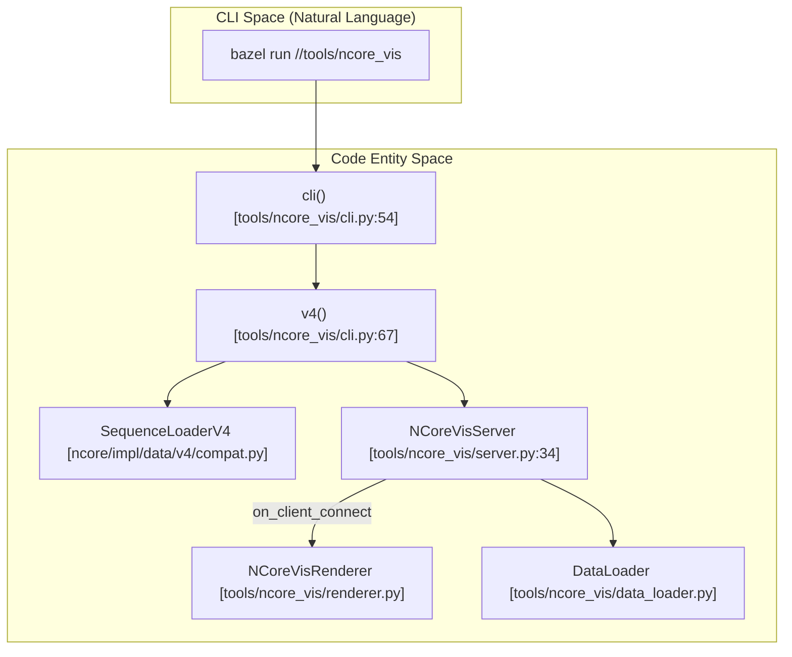

<!-- source: DeepWiki mcp.deepwiki.com · repo NVIDIA/ncore · page 5 ncore_vis: 3D Visualizer · fetched 2026-10-26 -->

# ncore_vis: 3D Visualizer

<details>
<summary>Relevant source files</summary>

The following files were used as context for generating this wiki page:

- [docs/data/formats.rst](docs/data/formats.rst)
- [docs/data/storage_and_access.rst](docs/data/storage_and_access.rst)
- [docs/index.rst](docs/index.rst)
- [docs/tools/ncore_vis.rst](docs/tools/ncore_vis.rst)
- [ncore/impl/common/transformations.py](ncore/impl/common/transformations.py)
- [tools/ncore_vis/README.md](tools/ncore_vis/README.md)
- [tools/ncore_vis/cli.py](tools/ncore_vis/cli.py)
- [tools/ncore_vis/components/__init__.py](tools/ncore_vis/components/__init__.py)
- [tools/ncore_vis/components/base.py](tools/ncore_vis/components/base.py)
- [tools/ncore_vis/server.py](tools/ncore_vis/server.py)

</details>


The `ncore_vis` tool is a browser-based interactive 3D visualization platform designed for inspecting NCore V4 sequence data. Built on the [viser](https://github.com/nerfstudio-project/viser) framework, it provides a high-performance, multi-user environment for exploring multi-sensor datasets, including camera imagery, LiDAR point clouds, 3D cuboids, and ego-vehicle trajectories [docs/tools/ncore_vis.rst:7-11]().

The visualizer employs a **component-based plugin architecture**, where each visualization feature (e.g., LiDAR, Cameras) is an independent module. This allows for concurrent inspection by multiple browser clients, each maintaining its own GUI state and scene viewpoint [tools/ncore_vis/README.md:38-43]().

### System Architecture

The visualization system is divided into three primary layers: the **Server**, the **Renderer**, and the **Components**.

1.  **Server (`NCoreVisServer`)**: Manages the `viser.ViserServer` lifecycle, handles network configuration, and instantiates a new `NCoreVisRenderer` for every unique client connection [tools/ncore_vis/server.py:34-39]().
2.  **Renderer (`NCoreVisRenderer`)**: Orchestrates the rendering pipeline for a specific client. It manages the global reference timeline and triggers updates across all active components [tools/ncore_vis/server.py:72-75]().
3.  **Components (`VisualizationComponent`)**: Individual plugins that define their own GUI tabs and 3D scene objects (e.g., frustums, point clouds) [tools/ncore_vis/components/base.py:67-78]().

#### Data to Entity Mapping: Visualizer Lifecycle
The following diagram illustrates how the CLI command initializes the core classes and transitions into the browser-based visualization loop.

**Visualizer Initialization Flow**

Sources: [tools/ncore_vis/cli.py:54-115](), [tools/ncore_vis/server.py:34-75](), [tools/ncore_vis/README.md:38-43]()

### Launching the Visualizer

The visualizer is typically launched via Bazel. It requires at least one NCore V4 component group (or a sequence metadata JSON) to run [tools/ncore_vis/cli.py:18-22]().

**Basic Usage:**
```bash
bazel run //tools/ncore_vis -- v4 --component-group=path/to/sequence_meta.json
```

**Advanced Options:**
| Option | Default | Description |
| :--- | :--- | :--- |
| `--host` | `0.0.0.0` | Server host address [tools/ncore_vis/cli.py:55]() |
| `--port` | `8080` | Server port [tools/ncore_vis/cli.py:56]() |
| `--rig-frame-id` | `rig` | Pose graph ID for the vehicle body [tools/ncore_vis/cli.py:57]() |
| `--world-frame-id` | `world` | Pose graph ID for the world reference [tools/ncore_vis/cli.py:58]() |

Sources: [docs/tools/ncore_vis.rst:20-69](), [tools/ncore_vis/cli.py:54-62]()

### Plugin Component System

The visualizer is extended by subclassing `VisualizationComponent` and using the `@register_component` decorator [tools/ncore_vis/components/base.py:47-53](). This registry-based approach determines the order of tabs in the GUI [tools/ncore_vis/components/__init__.py:25-26]().

**Component Class Hierarchy**
```mermaid
classDiagram
    class VisualizationComponent {
        <<abstract>>
        +client: viser.ClientHandle
        +data_loader: DataLoader
        +renderer: NCoreVisRenderer
        +create_gui(tab_group)
        +populate_scene()
        +on_reference_frame_change(interval_us)
    }
    
    VisualizationComponent <|-- CameraComponent
    VisualizationComponent <|-- LidarComponent
    VisualizationComponent <|-- CuboidsComponent
    VisualizationComponent <|-- TrajectoryComponent

    style VisualizationComponent font-weight:bold
```
Sources: [tools/ncore_vis/components/base.py:67-127](), [tools/ncore_vis/components/__init__.py:29-35]()

### Sub-System Details

The visualizer functionality is divided into three major areas, detailed in the following child pages:

#### [Renderer and Synchronization Pipeline](#5.1)
Covers the `NCoreVisRenderer` and how it manages the reference sensor timeline. It explains the `HalfClosedInterval` synchronization logic that ensures all sensors (Cameras, LiDAR) display the correct data for the current global timestamp [tools/ncore_vis/components/base.py:116-127]().

#### [Visualization Components](#5.2)
Detailed reference for the built-in plugins:
*   **CameraComponent**: Renders frustums with RGB images, supporting rolling-shutter aware projection for LiDAR and cuboid overlays [docs/tools/ncore_vis.rst:119-135]().
*   **LidarComponent**: Handles point cloud rendering with multiple coloring modes (Intensity, Range, Height, Timestamp) and multi-frame fusion [docs/tools/ncore_vis.rst:180-210]().
*   **CuboidsComponent**: Visualizes 3D bounding boxes with per-class coloring [docs/tools/ncore_vis.rst:211-214]().
*   **TrajectoryComponent**: Displays the ego-vehicle path [docs/tools/ncore_vis.rst:111-115]().

#### [Data Loader and Track Interpolation](#5.3)
Describes the `DataLoader` abstraction used to bridge the NCore V4 storage layer with the visualizer. It covers how `PoseGraphInterpolator` is used for smooth ego-motion and how `CuboidTrack` data is interpolated across timestamps using SLERP and LERP [ncore/impl/common/transformations.py:135-171]().

Sources: [docs/tools/ncore_vis.rst:100-214](), [tools/ncore_vis/components/base.py:67-127](), [ncore/impl/common/transformations.py:66-106]()

---

