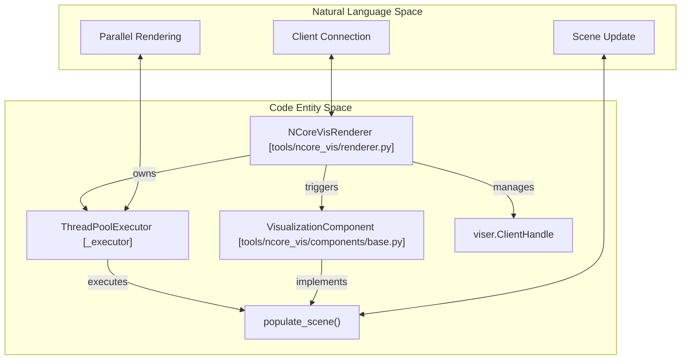
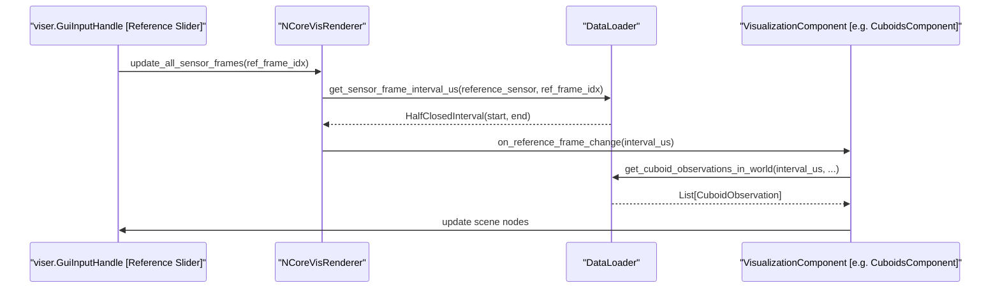

<!-- source: DeepWiki mcp.deepwiki.com · repo NVIDIA/ncore · page 5.1 Renderer and Synchronization Pipeline · fetched 2026-10-26 -->

# Renderer and Synchronization Pipeline

Relevant source files

The following files were used as context for generating this wiki page:

- [tools/ncore_vis/components/camera.py](tools/ncore_vis/components/camera.py)
- [tools/ncore_vis/components/cuboids.py](tools/ncore_vis/components/cuboids.py)
- [tools/ncore_vis/components/lidar.py](tools/ncore_vis/components/lidar.py)
- [tools/ncore_vis/renderer.py](tools/ncore_vis/renderer.py)
- [tools/ncore_vis/server.py](tools/ncore_vis/server.py)
- [tools/ncore_vis/utils.py](tools/ncore_vis/utils.py)

The `NCoreVisRenderer` serves as the central orchestration layer for the `ncore_vis` visualizer. It manages the lifecycle of browser-based clients via the `viser` library, coordinates parallel rendering tasks, and maintains temporal synchronization across heterogeneous sensors using a reference timeline.

## Client Lifecycle and Server Management

The visualization system follows a per-client state model managed by `NCoreVisServer`. When a user connects to the visualizer, the server instantiates a dedicated `NCoreVisRenderer` instance.

*   **Server Entry Point**: `NCoreVisServer.start` initializes the `viser.ViserServer` and blocks, waiting for connections [[tools/ncore_vis/server.py:55-68]]().
*   **Connection Handling**: On `_on_connect`, a new `NCoreVisRenderer` is created, receiving its own `viser.ClientHandle` and a shared `DataLoader` [[tools/ncore_vis/server.py:70-76]]().
*   **Teardown**: On `_on_disconnect`, the renderer instance is removed from the server's tracking dictionary [[tools/ncore_vis/server.py:78-80]]().

### Renderer Initialization Flow
The renderer setup follows a four-phase sequence to ensure GUI elements and scene nodes are initialized in the correct order:
1.  **Sequence Tab Creation**: Establishes the primary timeline controls and playback settings [[tools/ncore_vis/renderer.py:119-120]]().
2.  **Component GUI Instantiation**: Calls `create_gui` on all registered `VisualizationComponent` subclasses [[tools/ncore_vis/renderer.py:123-134]]().
3.  **Cross-Component Linking**: Collects frame sliders from all components to allow the renderer to drive them during synchronization [[tools/ncore_vis/renderer.py:137-138]]().
4.  **Parallel Scene Population**: Triggers the initial 3D rendering of all components [[tools/ncore_vis/renderer.py:145-152]]().

**Sources:** [[tools/ncore_vis/server.py:34-80]](), [[tools/ncore_vis/renderer.py:43-152]]()

## Parallel Rendering Pipeline

To maintain a responsive UI when handling large datasets (e.g., high-resolution LiDAR or multiple camera streams), `NCoreVisRenderer` utilizes a `ThreadPoolExecutor` for non-blocking scene updates.

*   **Worker Pool**: A shared executor with `_MAX_WORKERS` (default 8) is used to offload `populate_scene` calls [[tools/ncore_vis/renderer.py:39-41]](), [[tools/ncore_vis/renderer.py:70-72]]().
*   **Thread-Safe Resources**: The renderer provides a thread-safe `get_class_color` method, protected by a `threading.Lock`, ensuring that multiple components can request deterministic colors for object classes simultaneously during parallel updates [[tools/ncore_vis/renderer.py:85-95]]().

### System Entity Mapping: Rendering Logic
The following diagram illustrates how the natural language concept of "Parallel Rendering" maps to specific code entities and their interactions.

Title: Renderer Threading and Component Interaction

**Sources:** [[tools/ncore_vis/renderer.py:43-72]](), [[tools/ncore_vis/renderer.py:145-152]](), [[tools/ncore_vis/components/base.py:1-40]]()

## Reference Sensor and Temporal Synchronization

A core challenge in multi-sensor visualization is keeping LiDAR, Cameras, and Cuboids in sync despite differing frame rates and trigger times. `NCoreVisRenderer` solves this through a **Reference Sensor Timeline**.

### HalfClosedInterval Synchronization
The renderer maintains a `reference_frame_interval_us`, which is a `HalfClosedInterval` representing the start and end timestamps of the current "active" frame [[tools/ncore_vis/renderer.py:62]]().

1.  **Reference Selection**: The user selects a "Reference Sensor" (typically a LiDAR sensor for better temporal coverage) via a dropdown in the "Sequence" tab [[tools/ncore_vis/renderer.py:155-160]]().
2.  **Interval Extraction**: When the reference frame slider moves, `update_all_sensor_frames` fetches the exact interval for that frame from the `DataLoader` [[tools/ncore_vis/renderer.py:97-105]]().
3.  **Component Notification**: The renderer calls `on_reference_frame_change(interval_us)` on every registered component [[tools/ncore_vis/renderer.py:106-107]]().

### Data Flow: Synchronization
The following diagram maps the synchronization flow from the UI interaction to the data retrieval logic.

Title: Temporal Synchronization Data Flow

**Sources:** [[tools/ncore_vis/renderer.py:97-108]](), [[tools/ncore_vis/components/cuboids.py:85-117]](), [[ncore/impl/common/transformations.py:1-50]]()

## The VisualizationComponent Base Class

All visualizer features (LiDAR, Cameras, Cuboids, Trajectories) are implemented as plugins inheriting from `VisualizationComponent`. This abstraction ensures a consistent interface for the renderer to manage.

### Key Lifecycle Methods
| Function | Purpose | Implementation Detail |
| :--- | :--- | :--- |
| `create_gui` | Defines the UI elements in the side panel. | Components typically add a dedicated tab (e.g., "Lidars") [[tools/ncore_vis/components/lidar.py:99]](). |
| `populate_scene` | Initial creation of 3D scene nodes. | Called during renderer setup to perform the first render pass [[tools/ncore_vis/renderer.py:145]](). |
| `on_reference_frame_change` | Updates the component when the timeline moves. | Used to re-query data based on the new `HalfClosedInterval` [[tools/ncore_vis/components/cuboids.py:85-88]](). |
| `get_frame_sliders` | Returns handles to sensor-specific sliders. | Allows the renderer to synchronize per-sensor UI state [[tools/ncore_vis/renderer.py:137-138]](). |

### Implementation Example: Cuboids
The `CuboidsComponent` demonstrates the synchronization logic:
1.  In `on_reference_frame_change`, it receives the `interval_us` [[tools/ncore_vis/components/cuboids.py:85]]().
2.  It calls `data_loader.get_cuboid_observations_in_world` using that interval [[tools/ncore_vis/components/cuboids.py:115-117]]().
3.  It iterates through observations, calculating SE(3) poses via `se3_from_centroid_euler` and `se3_to_position_wxyz` [[tools/ncore_vis/components/cuboids.py:122-123]]().
4.  It updates `viser` scene nodes within an `atomic()` block for smooth rendering [[tools/ncore_vis/components/cuboids.py:96-147]]().

**Sources:** [[tools/ncore_vis/components/base.py:1-40]](), [[tools/ncore_vis/components/cuboids.py:31-147]](), [[tools/ncore_vis/utils.py:27-56]]()

---

