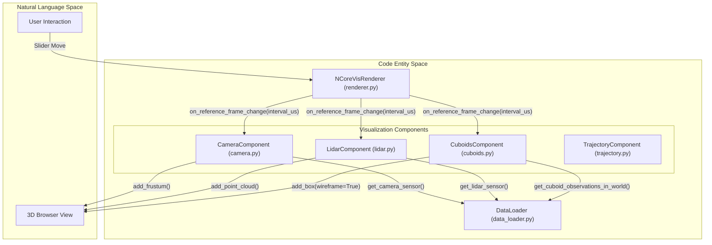
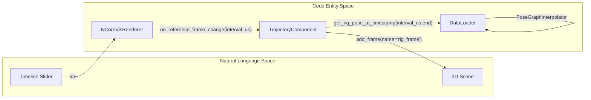

<!-- source: DeepWiki mcp.deepwiki.com · repo NVIDIA/ncore · page 5.2 Visualization Components · fetched 2026-10-26 -->

# Visualization Components

Relevant source files

The following files were used as context for generating this wiki page:

- [ncore/impl/common/transformations.py](ncore/impl/common/transformations.py)
- [tools/ncore_vis/README.md](tools/ncore_vis/README.md)
- [tools/ncore_vis/cli.py](tools/ncore_vis/cli.py)
- [tools/ncore_vis/components/__init__.py](tools/ncore_vis/components/__init__.py)
- [tools/ncore_vis/components/base.py](tools/ncore_vis/components/base.py)
- [tools/ncore_vis/components/camera.py](tools/ncore_vis/components/camera.py)
- [tools/ncore_vis/components/cuboids.py](tools/ncore_vis/components/cuboids.py)
- [tools/ncore_vis/components/lidar.py](tools/ncore_vis/components/lidar.py)
- [tools/ncore_vis/components/trajectory.py](tools/ncore_vis/components/trajectory.py)
- [tools/ncore_vis/renderer.py](tools/ncore_vis/renderer.py)

Visualization components are the modular building blocks of the `ncore_vis` interactive 3D viewer. Built on a plugin architecture, each component is a subclass of `VisualizationComponent` and is responsible for managing its own GUI elements (typically in a dedicated tab) and 3D scene nodes [tools/ncore_vis/README.md:38-43]().

### Component Architecture and Lifecycle

Components are registered using the `@register_component` decorator [tools/ncore_vis/components/base.py:47-53](). When a client connects, the `NCoreVisRenderer` instantiates all registered components and executes their lifecycle methods in a specific order to ensure the GUI and scene are properly synchronized [tools/ncore_vis/renderer.py:123-146]().

| Lifecycle Method | Purpose |
| :--- | :--- |
| `__init__` | Stores references to the `viser` client, `DataLoader`, and `NCoreVisRenderer` [tools/ncore_vis/components/base.py:80-88](). |
| `create_gui` | Defines the component's primary GUI tab and input handles [tools/ncore_vis/components/base.py:91-93](). |
| `create_sequence_gui` | (Optional) Adds controls to the shared "Sequence" tab (e.g., global toggles) [tools/ncore_vis/components/base.py:95-99](). |
| `populate_scene` | Renders the initial 3D objects in the viewer [tools/ncore_vis/components/base.py:103-105](). |
| `on_reference_frame_change` | Updates scene nodes when the global timeline slider moves [tools/ncore_vis/components/base.py:116-127](). |

**Component Data Flow**
The following diagram illustrates how the `NCoreVisRenderer` orchestrates components and links them to the data layer.

Title: Component Orchestration and Data Flow

Sources: [tools/ncore_vis/renderer.py:43-78](), [tools/ncore_vis/components/base.py:67-78](), [tools/ncore_vis/components/camera.py:85-93](), [tools/ncore_vis/components/cuboids.py:31-38]()

---

### CameraComponent

The `CameraComponent` visualizes camera frustums with decoded RGB images and supports advanced projection overlays [tools/ncore_vis/components/camera.py:85-93]().

*   **Frustum Visualization**: Renders a 3D frustum for each camera sensor based on its intrinsic parameters and pose [tools/ncore_vis/components/camera.py:126-130]().
*   **Lidar Projection**: Projects LiDAR point clouds onto the camera image. It supports multiple projection modes: `rolling-shutter`, `mean`, `start`, and `end` [tools/ncore_vis/components/camera.py:78-78](). Rolling-shutter projection utilizes the `CameraModel` to account for ego-motion during the exposure [tools/ncore_vis/components/camera.py:117-120]().
*   **Cuboid Projection**: Projects 3D bounding boxes into the 2D image plane using wireframe edges [tools/ncore_vis/components/camera.py:47-60]().
*   **Mask Overlays**: Applies semi-transparent color tints to images using static sensor masks (e.g., for ego-vehicle masking) [tools/ncore_vis/components/camera.py:124-137]().

Sources: [tools/ncore_vis/components/camera.py:16-116](), [tools/ncore_vis/components/camera.py:155-180]()

---

### LidarComponent

The `LidarComponent` manages the visualization of LiDAR point clouds, offering extensive coloring and processing options [tools/ncore_vis/components/lidar.py:68-74]().

*   **Coloring Styles**: Supports 8 built-in modes including Intensity (with gamma correction), Range (jet), Height (turbo), and per-point timestamps [tools/ncore_vis/components/lidar.py:43-52](). It also scans for generic metadata fields in the V4 data to provide custom coloring [tools/ncore_vis/components/lidar.py:80-82]().
*   **Fusing Mode**: Allows "fusing" multiple frames into a single view by accumulating points over a specified frame range and step [tools/ncore_vis/components/lidar.py:118-125]().
*   **Motion Compensation**: A toggle to enable/disable motion compensation, which corrects for ego-vehicle movement during the LiDAR scan [tools/ncore_vis/components/lidar.py:95-95]().

Sources: [tools/ncore_vis/components/lidar.py:16-126]()

---

### CuboidsComponent

The `CuboidsComponent` renders 3D wireframe bounding boxes. Unlike sensors that are indexed by frame, cuboids are queried by the global scene reference timestamp [tools/ncore_vis/components/cuboids.py:31-38]().

*   **Coordinate Transformation**: Cuboid observations are retrieved via the `DataLoader` and transformed into world coordinates using the pose graph [tools/ncore_vis/components/cuboids.py:115-117]().
*   **Class-Based Coloring**: Boxes are colored deterministically based on their `class_id` using the `NCoreVisRenderer.get_class_color()` helper [tools/ncore_vis/components/cuboids.py:124-124](), [tools/ncore_vis/renderer.py:85-95]().
*   **Labels**: Optional text labels showing `track_id` and `class_id` can be toggled to appear above the boxes [tools/ncore_vis/components/cuboids.py:137-146]().

Sources: [tools/ncore_vis/components/cuboids.py:16-147]()

---

### TrajectoryComponent

The `TrajectoryComponent` visualizes the historical path of the ego-vehicle (the "rig") [tools/ncore_vis/components/trajectory.py:45-51]().

*   **Path Rendering**: Samples the pose graph to render a sequence of red boxes along the rig's path [tools/ncore_vis/components/trajectory.py:113-125]().
*   **Directional Indicators**: Every 10th pose includes arrow-shaped boxes to indicate the forward heading of the vehicle [tools/ncore_vis/components/trajectory.py:128-151]().
*   **Coordinate Frames**: Provides toggles for a live coordinate tripod at the current rig pose and a static tripod at the world origin [tools/ncore_vis/components/trajectory.py:75-94]().

**Trajectory and Pose Synchronization**
The following diagram shows how the `TrajectoryComponent` interacts with the `PoseGraph` via the `DataLoader`.

Title: Trajectory Pose Synchronization

Sources: [tools/ncore_vis/components/trajectory.py:157-162](), [tools/ncore_vis/renderer.py:97-107](), [ncore/impl/common/transformations.py:66-75]()

---

### Visualization Component Summary

| Component | Key Class | Primary Data Source | Main Scene Node |
| :--- | :--- | :--- | :--- |
| **Cameras** | `CameraComponent` | `CameraSensor` | `viser.SceneNodeHandle` (Frustum) |
| **LiDARs** | `LidarComponent` | `LidarSensor` | `viser.PointCloudHandle` |
| **Cuboids** | `CuboidsComponent` | `CuboidsComponent` (V4) | `viser.BoxHandle` (Wireframe) |
| **Trajectory** | `TrajectoryComponent` | `PosesComponent` (V4) | `viser.FrameHandle` (Tripod) |

Sources: [tools/ncore_vis/components/camera.py:85-93](), [tools/ncore_vis/components/lidar.py:68-74](), [tools/ncore_vis/components/cuboids.py:31-38](), [tools/ncore_vis/components/trajectory.py:45-51]()

---

