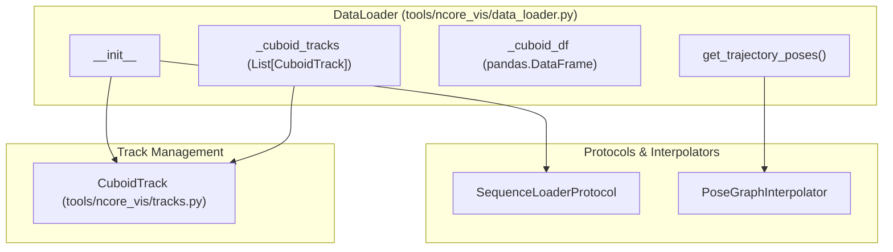
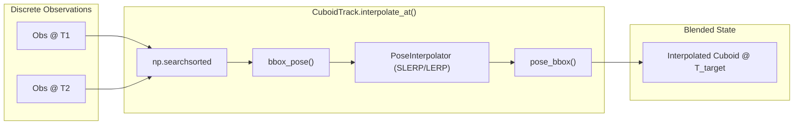

<!-- source: DeepWiki mcp.deepwiki.com · repo NVIDIA/ncore · page 5.3 Data Loader and Track Interpolation · fetched 2026-10-26 -->

# Data Loader and Track Interpolation

Relevant source files

The following files were used as context for generating this wiki page:

- [tools/ncore_vis/BUILD.bazel](tools/ncore_vis/BUILD.bazel)
- [tools/ncore_vis/data_loader.py](tools/ncore_vis/data_loader.py)
- [tools/ncore_vis/tracks.py](tools/ncore_vis/tracks.py)
- [tools/ncore_vis/tracks_test.py](tools/ncore_vis/tracks_test.py)

The Data Loader and Track Interpolation layer provides a high-level abstraction over the raw V4 sequence data, specifically tailored for interactive visualization. It manages sensor caching, trajectory sampling for the ego-vehicle, and the grouping of individual cuboid observations into continuous, interpolatable tracks.

## DataLoader Abstraction

The `DataLoader` class [tools/ncore_vis/data_loader.py:38-43]() acts as a convenience wrapper around the `SequenceLoaderProtocol` [ncore/impl/data/compat.py](). It centralizes access to sensors, the pose graph, and cuboid data, while adding visualization-specific features like LRU caching for sensor objects [tools/ncore_vis/data_loader.py:95-103]() and cross-sensor frame synchronization [tools/ncore_vis/data_loader.py:109-127]().

### Data Flow and Initialization

Upon initialization, the `DataLoader` eagerly processes all cuboid observations from the underlying sequence [tools/ncore_vis/data_loader.py:55-64](). It organizes this data into two primary structures:
1.  **Pandas DataFrame**: A `pd.DataFrame` containing all `CuboidTrackObservation` records, allowing for efficient filtering and querying by class, track ID, or timestamp [tools/ncore_vis/data_loader.py:58-63]().
2.  **CuboidTrack Objects**: A list of `CuboidTrack` instances, which group observations by `track_id` and provide temporal interpolation capabilities [tools/ncore_vis/data_loader.py:64]().

### Trajectory Sampling

The `DataLoader` provides a sampled trajectory of the ego-vehicle (the "rig") relative to the world frame.
*   **Sampling Rate**: Trajectories are sampled at approximately 10 Hz (every 100,000 microseconds) across the entire sequence interval [tools/ncore_vis/data_loader.py:142-146]().
*   **Pose Resolution**: It utilizes the `PoseGraphInterpolator` to evaluate the transformation between `rig_frame_id` and `world_frame_id` at each sampled timestamp [tools/ncore_vis/data_loader.py:149]().

### Entity Mapping: Data Access

The following diagram maps the high-level data requests to the internal code entities and their dependencies.

"Data Loader Entity Map"

Sources: [tools/ncore_vis/data_loader.py:38-64](), [tools/ncore_vis/data_loader.py:133-158](), [tools/ncore_vis/tracks.py:37-49]()

---

## Cuboid Track Interpolation

The `CuboidTrack` class [tools/ncore_vis/tracks.py:37-49]() represents a temporal sequence of cuboid observations for a single tracked object. Because annotations are often sparse (keyframes), this class provides the logic to estimate the object's state at any arbitrary timestamp.

### Interpolation Logic

The core of this functionality is `interpolate_at(timestamp_us, ...)` [tools/ncore_vis/tracks.py:86-161](). It performs the following steps:

1.  **Out-of-Range Handling**: If the requested timestamp is outside the track's range, the method returns `None` unless a `max_clamp_us` threshold is provided [tools/ncore_vis/tracks.py:119-128](). If clamping is active and the timestamp is within the threshold, it returns the nearest boundary observation [tools/ncore_vis/tracks.py:123-128]().
2.  **Binary Search**: It uses `np.searchsorted` to find the two observations ("before" and "after") that bracket the target timestamp [tools/ncore_vis/tracks.py:133-136]().
3.  **Pose Blending**:
    *   The bounding box centroids and rotations are converted into SE(3) matrices using `bbox_pose` [tools/ncore_vis/tracks.py:144-150]().
    *   A `PoseInterpolator` [ncore/impl/common/transformations.py]() blends these matrices.
    *   **Translation** is interpolated linearly (LERP).
    *   **Rotation** is interpolated via Spherical Linear Interpolation (SLERP) [tools/ncore_vis/tracks.py:21-22]().
4.  **Dimension Persistence**: Object dimensions (`bbox3.dim`) are **not** interpolated; they are inherited from the `obs_before` keyframe [tools/ncore_vis/tracks.py:153-154]().

### Track Construction

Tracks are typically instantiated via the `from_observations` factory method [tools/ncore_vis/tracks.py:167-183](), which takes a flat list of `CuboidTrackObservation` objects, groups them by `track_id`, and ensures they are sorted chronologically [tools/ncore_vis/tracks.py:61]().

### Entity Mapping: Interpolation Pipeline

This diagram illustrates the transformation from discrete observations to a continuous temporal track.

"Interpolation Logic Pipeline"

Sources: [tools/ncore_vis/tracks.py:86-161](), [tools/ncore_vis/tracks.py:167-183](), [tools/ncore_vis/tracks_test.py:78-103]()

---

## Key Functions and Methods

| Class / Method | Description | File Reference |
| :--- | :--- | :--- |
| `DataLoader.__init__` | Initializes pandas DataFrame and `CuboidTrack` list from sequence observations. | [tools/ncore_vis/data_loader.py:45-64]() |
| `DataLoader.get_trajectory_poses` | Samples rig-to-world poses at 10Hz using the pose graph. | [tools/ncore_vis/data_loader.py:133-158]() |
| `DataLoader.get_cuboids_at_timestamp` | Queries all tracks and returns interpolated observations for a specific time. | [tools/ncore_vis/data_loader.py:199-215]() |
| `CuboidTrack.interpolate_at` | Performs SLERP/LERP blending between keyframes with optional clamping. | [tools/ncore_vis/tracks.py:86-161]() |
| `CuboidTrack.from_observations` | Factory method to create a list of tracks from heterogeneous observations. | [tools/ncore_vis/tracks.py:167-183]() |

Sources: [tools/ncore_vis/data_loader.py:38-215](), [tools/ncore_vis/tracks.py:37-183]()

---

