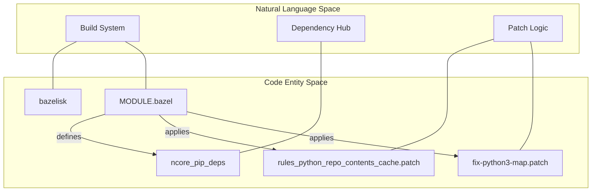
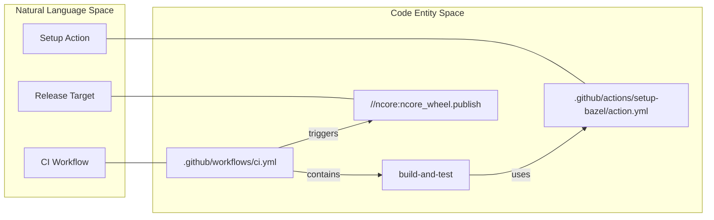

<!-- source: DeepWiki mcp.deepwiki.com · repo NVIDIA/ncore · page 6 Build System and CI/CD · fetched 2026-10-26 -->

# Build System and CI/CD

Relevant source files

The following files were used as context for generating this wiki page:

- [.github/actions/setup-bazel/action.yml](.github/actions/setup-bazel/action.yml)
- [.github/workflows/ci.yml](.github/workflows/ci.yml)
- [MODULE.bazel](MODULE.bazel)
- [bazel/rules_python/BUILD.bazel](bazel/rules_python/BUILD.bazel)
- [bazel/rules_python/rules_python_repo_contents_cache.patch](bazel/rules_python/rules_python_repo_contents_cache.patch)
- [deps/pycolmap/BUILD.bazel](deps/pycolmap/BUILD.bazel)
- [deps/pycolmap/fix-python3-map.patch](deps/pycolmap/fix-python3-map.patch)

This page provides a high-level overview of the NCore build infrastructure, dependency management, and automated pipelines. NCore utilizes **Bazel** (via **Bazelisk**) to manage a complex polyglot environment involving Python toolchains, C++ protobuf compilation, and large-scale data dependencies.

## Build System Overview

NCore is built using Bazel's modern `MODULE.bazel` (Bzlmod) system [MODULE.bazel:20-23](). This architecture ensures hermeticity and reproducible builds across different developer environments and CI runners.

### Dependency Management
The system manages three primary types of dependencies:
1.  **Bazel Modules**: Standard rules for linting, Python, and protocol buffers [MODULE.bazel:25-37]().
2.  **Python Packages**: Managed via `rules_python`, with distinct requirement sets for Python 3.8 and 3.11 [MODULE.bazel:59-72]().
3.  **External Archives**: Third-party source code and test data fetched via `http_archive` [MODULE.bazel:83-123]().

### Toolchain and Patching
To support specialized requirements, NCore applies several patches to its build rules:
*   **Performance**: A patch to `rules_python` enables `--repo_contents_cache` (Bazel 8.3.0+), significantly speeding up CI by caching Python interpreters and wheels [MODULE.bazel:39-47](), [bazel/rules_python/rules_python_repo_contents_cache.patch:1-22]().
*   **Compatibility**: The `pycolmap` dependency is patched to fix Python 2-to-3 `map()` iterator issues [MODULE.bazel:115-123](), [deps/pycolmap/fix-python3-map.patch:1-15]().

For details on toolchain configuration and external repositories, see [Bazel Build Configuration](#6.1).

**Natural Language to Code Entity Mapping: Build System**

Sources: [MODULE.bazel:20-72](), [bazel/rules_python/rules_python_repo_contents_cache.patch:1-5](), [deps/pycolmap/fix-python3-map.patch:1-13]()

---

## CI/CD Pipeline

NCore uses GitHub Actions for continuous integration and delivery. The pipeline is defined in a unified workflow [ .github/workflows/ci.yml:16-25]() that handles testing, documentation, and package distribution.

### Workflow Stages
1.  **Build and Test**: Triggered on all branches and PRs. It verifies code formatting and executes all Bazel test targets [ .github/workflows/ci.yml:51-71]().
2.  **Documentation**: Upon merging to `main`, the system builds the Sphinx-based documentation and deploys it to GitHub Pages [ .github/workflows/ci.yml:76-114]().
3.  **Release**: Automated publishing of the `nvidia-ncore` wheel to PyPI when changes are pushed to `main` [ .github/workflows/ci.yml:119-140]().

### Environment Setup
The `setup-bazel` composite action standardizes the runner environment [ .github/actions/setup-bazel/action.yml:16-17](). It performs critical maintenance tasks such as:
*   **Disk Management**: Removing pre-installed software (dotnet, android) to make room for large PyTorch CUDA wheels [ .github/actions/setup-bazel/action.yml:37-42]().
*   **Authentication**: Configuring `~/.netrc` for authenticated downloads from GitHub Packages [ .github/actions/setup-bazel/action.yml:45-51]().
*   **Caching**: Utilizing `bazel-contrib/setup-bazel` for multi-layer caching of Bazelisk, build artifacts, and repository contents [ .github/actions/setup-bazel/action.yml:60-78]().

For details on the specific jobs and release automation, see [CI/CD Workflows and Release Pipeline](#6.2).

**Natural Language to Code Entity Mapping: CI/CD Pipeline**

Sources: [ .github/workflows/ci.yml:51-140](), [ .github/actions/setup-bazel/action.yml:1-17]()

---

## Summary Table

| Feature | Implementation | Source Reference |
| :--- | :--- | :--- |
| **Build Tool** | Bazel 8.x (Bzlmod) | [MODULE.bazel:20-23]() |
| **Python Support** | 3.8 and 3.11 | [MODULE.bazel:50-57]() |
| **CI Platform** | GitHub Actions | [ .github/workflows/ci.yml:25-27]() |
| **Artifacts** | PyPI Wheels (`nvidia-ncore`) | [ .github/workflows/ci.yml:139-151]() |
| **Caching** | Repository & Disk Cache | [ .github/actions/setup-bazel/action.yml:60-84]() |

## Child Pages
*   [Bazel Build Configuration](#6.1): Deep dive into module structure, toolchains, and external patches.
*   [CI/CD Workflows and Release Pipeline](#6.2): Detailed breakdown of GitHub Actions, caching strategies, and the PyPI release process.

---

