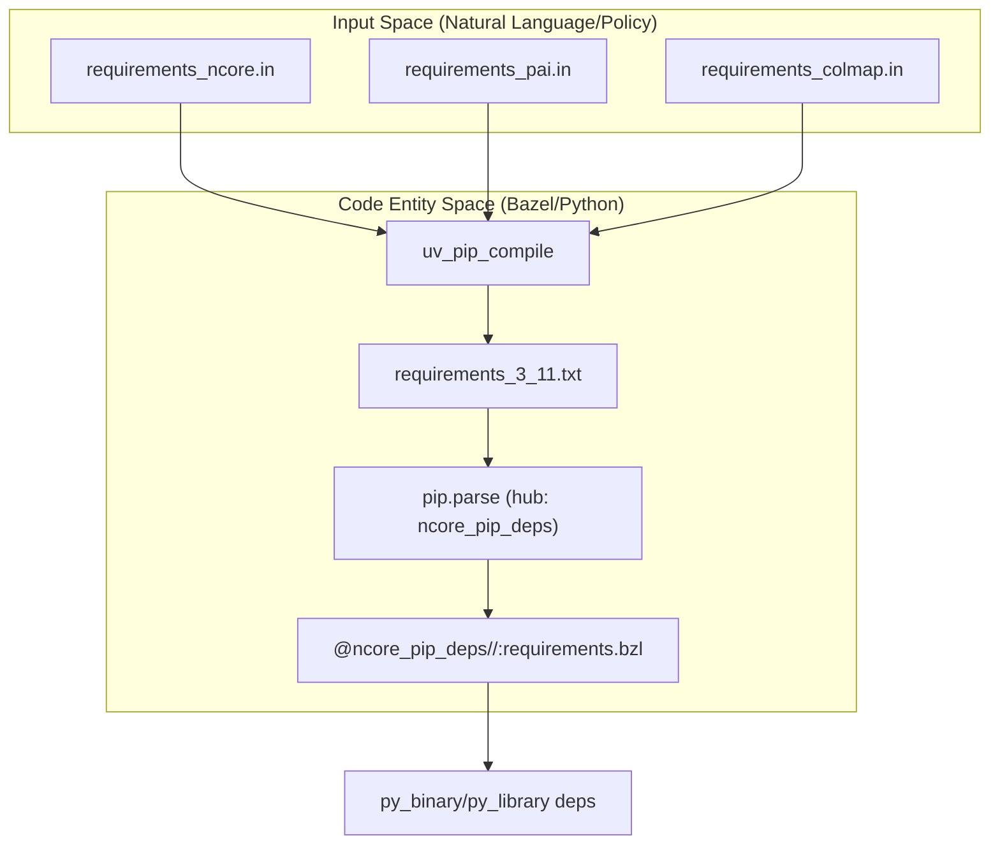
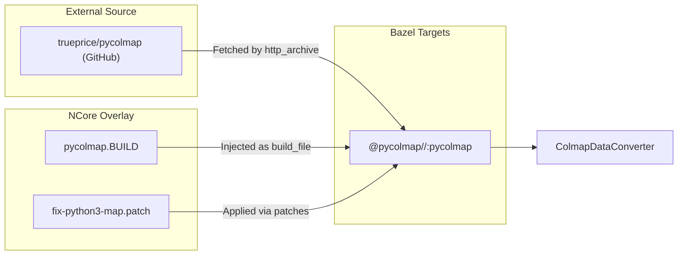

<!-- source: DeepWiki mcp.deepwiki.com · repo NVIDIA/ncore · page 6.1 Bazel Build Configuration · fetched 2026-10-26 -->

# Bazel Build Configuration

Relevant source files

The following files were used as context for generating this wiki page:

- [.bazelversion](.bazelversion)
- [MODULE.bazel](MODULE.bazel)
- [deps/pip/requirements_3_11.txt](deps/pip/requirements_3_11.txt)
- [deps/pip/requirements_colmap.in](deps/pip/requirements_colmap.in)
- [deps/pip/requirements_ncore.in](deps/pip/requirements_ncore.in)
- [deps/pip/requirements_pai.in](deps/pip/requirements_pai.in)
- [deps/pycolmap/BUILD.bazel](deps/pycolmap/BUILD.bazel)
- [deps/pycolmap/fix-python3-map.patch](deps/pycolmap/fix-python3-map.patch)
- [deps/pycolmap/pycolmap.BUILD](deps/pycolmap/pycolmap.BUILD)

This page details the Bazel build system configuration for NCore, including the dependency management via `MODULE.bazel`, multi-version Python toolchain support, and specialized patches for external repositories. NCore utilizes Bazel 8.5.1 as its primary build and orchestration tool [/.bazelversion:1-1]().

## MODULE.bazel Structure

The `MODULE.bazel` file serves as the central manifest for the NCore project, defining the module name as `ncore` and the repository name as `ncore_repo` [/MODULE.bazel:20-23](). It manages core build rules, linting tools, and external dependencies through the Bazel Mod system.

### Core Dependencies
NCore relies on several standard Bazel rule sets to manage its build lifecycle:
*   **rules_python**: For Python toolchains and package management [/MODULE.bazel:37-37]().
*   **aspect_rules_lint**: For static analysis and linting [/MODULE.bazel:25-25]().
*   **rules_uv**: Used for high-performance Python package resolution [/MODULE.bazel:27-27]().
*   **rules_multitool**: Manages the `ruff` formatter [/MODULE.bazel:75-78]().

### Python Toolchains
NCore supports two distinct Python versions to ensure compatibility across different environments:
*   **Python 3.11**: Configured as the default toolchain [/MODULE.bazel:50-53]().
*   **Python 3.8**: Maintained for legacy compatibility [/MODULE.bazel:54-56]().

These versions are exposed as repositories `@python_3_11` and `@python_3_8` [/MODULE.bazel:57-57]().

### The ncore_pip_deps Hub
Python dependencies are resolved using the `pip.parse` extension. To maintain deterministic builds across the supported Python versions, NCore uses separate requirements lock files generated by `uv` [/deps/pip/requirements_3_11.txt:1-2]().

| Hub Name | Python Version | Requirements Lock |
| :--- | :--- | :--- |
| `ncore_pip_deps` | 3.11 | `//deps/pip:requirements_3_11.txt` |
| `ncore_pip_deps` | 3.8 | `//deps/pip:requirements_3_8.txt` |

Sources: [/MODULE.bazel:59-72](), [/deps/pip/requirements_3_11.txt:1-4]()

## Dependency Flow and Entity Mapping

The following diagram illustrates how high-level dependency requirements are transformed into Bazel-accessible targets within the `ncore_pip_deps` hub.

**Diagram: Dependency Resolution Pipeline**

Sources: [/deps/pip/requirements_ncore.in:1-37](), [/deps/pip/requirements_pai.in:1-31](), [/deps/pip/requirements_colmap.in:1-24](), [/MODULE.bazel:59-72]()

## External Repositories

NCore integrates several external projects as `http_archive` dependencies, often requiring custom build files or patches.

### Waymo Open Dataset
The `waymo_open_dataset` repository is integrated primarily for its Protobuf definitions [/MODULE.bazel:99-101](). It requires two specific patches to function within the NCore environment:
*   `cc-proto.patch`: Fixes C++ Protobuf compilation issues.
*   `py-utils.patch`: Adjusts Python utility functions for compatibility.

Sources: [/MODULE.bazel:102-110]()

### pycolmap and Python 3 Compatibility
NCore uses a fork of `trueprice/pycolmap` for reading COLMAP models. Because the upstream library was designed for Python 2, NCore applies a critical patch to fix `map()` behavior [/deps/pycolmap/fix-python3-map.patch:1-15]().

In Python 3, `map()` returns a lazy iterator rather than a list. The `fix-python3-map.patch` wraps these calls in `list()` to allow subscripting (e.g., `params[0]`) which is required by the `SceneManager` and `Camera` classes in `pycolmap` [/deps/pycolmap/fix-python3-map.patch:22-35]().

**Diagram: pycolmap Integration Architecture**

Sources: [/MODULE.bazel:115-123](), [/deps/pycolmap/pycolmap.BUILD:17-37](), [/deps/pycolmap/fix-python3-map.patch:1-12]()

### Test and Documentation Data
Binary assets for unit tests and documentation are hosted as Maven-style artifacts on GitHub Packages:
*   **test-data-v4**: Contains sequence data for V4 format validation [/MODULE.bazel:86-90]().
*   **ncore_docs_data**: Contains images and binary assets for the Sphinx documentation [/MODULE.bazel:93-97]().

## Critical Build Patches

### rules_python: repo_contents_cache
NCore applies a patch to `rules_python` to enable support for `--repo_contents_cache` (available in Bazel 8.3.0+) [/MODULE.bazel:39-42](). This allows Bazel to cache fetched repository contents (like Python interpreters and wheels) across different workspaces and clean builds, significantly reducing CI latency [/MODULE.bazel:43-47]().

### cbor2 Versioning
The `cbor2` library, used for `.itar` indexing, is version-locked specifically to handle Python 3.8 limitations and security vulnerabilities:
*   **>= 5.9.0**: Used for Python >= 3.9 to address CVE-2026-26209 and CVE-2025-68131 [/deps/pip/requirements_ncore.in:27-31]().
*   **5.7.0**: Used for Python 3.8, as newer versions dropped support for that interpreter [/deps/pip/requirements_ncore.in:30-32]().

Sources: [/deps/pip/requirements_ncore.in:27-32](), [/MODULE.bazel:39-47]()

---

