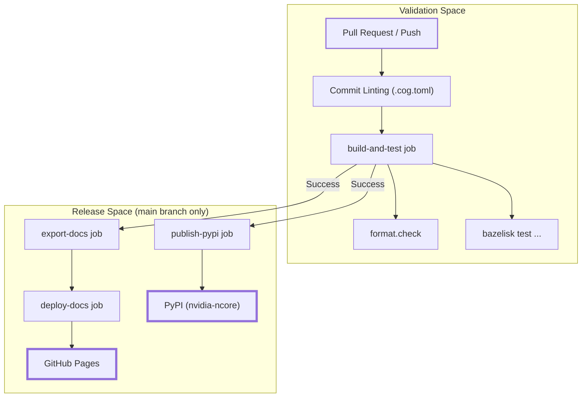
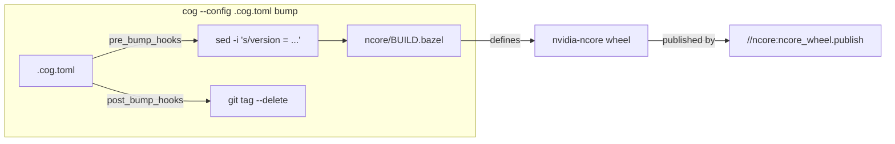

<!-- source: DeepWiki mcp.deepwiki.com · repo NVIDIA/ncore · page 6.2 CI/CD Workflows and Release Pipeline · fetched 2026-10-26 -->

# CI/CD Workflows and Release Pipeline

Relevant source files

The following files were used as context for generating this wiki page:

- [.cog.toml](.cog.toml)
- [.github/ISSUE_TEMPLATE/bug_report.yml](.github/ISSUE_TEMPLATE/bug_report.yml)
- [.github/ISSUE_TEMPLATE/config.yml](.github/ISSUE_TEMPLATE/config.yml)
- [.github/ISSUE_TEMPLATE/feature_request.yml](.github/ISSUE_TEMPLATE/feature_request.yml)
- [.github/PULL_REQUEST_TEMPLATE.md](.github/PULL_REQUEST_TEMPLATE.md)
- [.github/actions/setup-bazel/action.yml](.github/actions/setup-bazel/action.yml)
- [.github/workflows/ci.yml](.github/workflows/ci.yml)
- [.github/workflows/commit-lint.yml](.github/workflows/commit-lint.yml)
- [.gitignore](.gitignore)
- [bazel/rules_python/BUILD.bazel](bazel/rules_python/BUILD.bazel)
- [bazel/rules_python/rules_python_repo_contents_cache.patch](bazel/rules_python/rules_python_repo_contents_cache.patch)
- [bazel/typing/mypy.ini](bazel/typing/mypy.ini)
- [deps/pip/requirements_docs.in](deps/pip/requirements_docs.in)

This page describes the automated infrastructure for the NCore repository, covering continuous integration (CI), documentation deployment, and the Python package release process. The pipeline is built primarily on GitHub Actions and leverages Bazel for reproducible builds and testing.

## Pipeline Architecture Overview

The NCore CI/CD pipeline is defined in `.github/workflows/ci.yml` and consists of three primary stages: validation, documentation generation, and package distribution.

### Workflow Data Flow

The following diagram illustrates the transition from a code contribution to a public release.

**CI/CD Pipeline Data Flow**

Sources: [.github/workflows/ci.yml:16-153](), [.github/workflows/commit-lint.yml:19-43]()

## Core CI Jobs

### build-and-test
The `build-and-test` job is the mandatory gatekeeper for all branches and pull requests [[.github/workflows/ci.yml:51-53]](). It executes on `ubuntu-22.04` and performs the following:
1.  **Environment Setup**: Uses the `setup-bazel` composite action to configure the runner [[.github/workflows/ci.yml:58-64]]().
2.  **Linting**: Runs `bazelisk run format.check` to ensure adherence to style guidelines [[.github/workflows/ci.yml:65-66]]().
3.  **Execution**: Performs a full build and test suite via `bazelisk build ...` and `bazelisk test ...` [[.github/workflows/ci.yml:68-71]]().

### Documentation Pipeline
Documentation is automatically built and deployed when changes are pushed to the `main` branch [[.github/workflows/ci.yml:76-77]]().
*   **export-docs**: Builds the documentation target `//docs:ncore` which generates HTML output in `bazel-bin/docs/ncore_html/` [[.github/workflows/ci.yml:92-94]](). This output is uploaded as a GitHub Pages artifact [[.github/workflows/ci.yml:98-101]]().
*   **deploy-docs**: Takes the uploaded artifact and deploys it to the live site [[.github/workflows/ci.yml:103-115]]().

### publish-pypi
On every push to `main`, the pipeline attempts to publish the updated package to PyPI [[.github/workflows/ci.yml:119-121]]().
*   It uses the `bazelisk run //ncore:ncore_wheel.publish` command [[.github/workflows/ci.yml:139]]().
*   Authentication is handled via a `PYPI_API_TOKEN` secret and the `__token__` username [[.github/workflows/ci.yml:136-138]]().
*   The job includes `--skip-existing` to prevent failures if the version has not been incremented [[.github/workflows/ci.yml:139]]().

Sources: [.github/workflows/ci.yml:51-140]()

## Bazel Environment Setup

The repository uses a custom composite action, `setup-bazel`, to standardize the build environment across different jobs.

### setup-bazel Logic and Caching
This action manages disk space, authentication, and multi-layer caching to optimize CI performance.

| Feature | Implementation | Purpose |
| :--- | :--- | :--- |
| **Disk Space** | `sudo rm -rf /usr/share/dotnet ...` | Reclaims ~20GB for large builds (e.g., PyTorch CUDA wheels) [[.github/actions/setup-bazel/action.yml:37-42]](). |
| **Auth** | `.netrc` configuration | Allows Bazel to authenticate with GitHub Packages for test data downloads [[.github/actions/setup-bazel/action.yml:45-51]](). |
| **Caching** | `bazel-contrib/setup-bazel` | Manages `bazelisk-cache`, `disk-cache`, and `repository-cache` [[.github/actions/setup-bazel/action.yml:60-74]](). |
| **Repo Contents** | `--repo_contents_cache` | Persists Python interpreters and pip wheels across runs (requires Bazel 8.3.0+) [[.github/actions/setup-bazel/action.yml:84]](). |

### Bazel 8.3.0+ Repository Caching
NCore utilizes a custom patch `rules_python_repo_contents_cache.patch` for `rules_python` to support the `--repo_contents_cache` flag [[bazel/rules_python/rules_python_repo_contents_cache.patch:1-39]](). This allows Bazel to cache the entire directory contents of external repositories (like Python toolchains and PyPI wheels) as reproducible artifacts, significantly reducing cold-start times in ephemeral CI environments [[bazel/rules_python/rules_python_repo_contents_cache.patch:3-8]]().

Sources: [.github/actions/setup-bazel/action.yml:16-85](), [bazel/rules_python/rules_python_repo_contents_cache.patch:1-39]()

## Commit Linting and Versioning

NCore enforces the [Conventional Commits](https://www.conventionalcommits.org/) specification to automate changelog generation and version bumping.

### Conventional Commits Workflow
The `conventional-commits` job runs on all pull requests using the `cocogitto-action` [[.github/workflows/commit-lint.yml:29-43]](). It validates that commit messages follow the expected format (e.g., `feat:`, `fix:`, `docs:`) [[.cog.toml:37-47]]().

### Version Bumping Implementation
Versioning is managed by `cocogitto` (`cog`) via the `.cog.toml` configuration:
1.  **Pre-bump**: Before a release commit, `sed` is used to update the version string inside `ncore/BUILD.bazel` [[.cog.toml:19-21]]().
2.  **Post-bump**: The local tag created by `cog` is deleted, as actual tagging is performed by GitHub's release mechanism [[.cog.toml:24-26]]().

**Versioning Code Entities**

Sources: [.github/workflows/commit-lint.yml:19-43](), [.cog.toml:1-48]()

## Release Process Summary

The release of a new version of `nvidia-ncore` follows these steps:

1.  **Development**: Commits are made following Conventional Commits [[.github/PULL_REQUEST_TEMPLATE.md:23]]().
2.  **Validation**: CI runs `build-and-test` and `conventional-commits` linting [[.github/workflows/ci.yml:51-72]]().
3.  **Merging**: PR is merged into `main`.
4.  **Bumping**: A maintainer runs `cog bump --auto` (locally or via automation) to increment the version based on commit types [[.cog.toml:8]]().
5.  **Publishing**: The push to `main` triggers the `publish-pypi` job, which executes `bazelisk run //ncore:ncore_wheel.publish` to upload the new wheel to PyPI [[.github/workflows/ci.yml:119-140]]().

Sources: [.github/workflows/ci.yml:119-140](), [.cog.toml:7-21](), [.github/PULL_REQUEST_TEMPLATE.md:20-30]()

---

