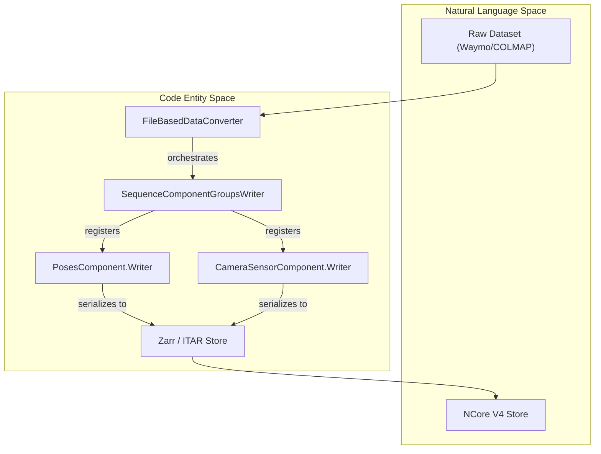
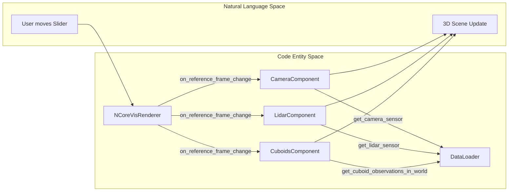

<!-- source: DeepWiki mcp.deepwiki.com · repo NVIDIA/ncore · page 7 Glossary · fetched 2026-10-26 -->

# Glossary

Relevant source files

The following files were used as context for generating this wiki page:

- [CHANGELOG.md](CHANGELOG.md)
- [README.md](README.md)
- [docs/_static/custom.css](docs/_static/custom.css)
- [docs/apis/install.rst](docs/apis/install.rst)
- [docs/data/conventions.rst](docs/data/conventions.rst)
- [docs/data/formats.rst](docs/data/formats.rst)
- [docs/data/sensor_models.rst](docs/data/sensor_models.rst)
- [docs/data/storage_and_access.rst](docs/data/storage_and_access.rst)
- [docs/index.rst](docs/index.rst)
- [docs/tools/ncore_vis.rst](docs/tools/ncore_vis.rst)
- [ncore/BUILD.bazel](ncore/BUILD.bazel)
- [ncore/impl/data/compat.py](ncore/impl/data/compat.py)
- [ncore/impl/data/stores.py](ncore/impl/data/stores.py)
- [ncore/impl/data/types.py](ncore/impl/data/types.py)
- [ncore/impl/data/v4/BUILD.bazel](ncore/impl/data/v4/BUILD.bazel)
- [ncore/impl/data/v4/compat.py](ncore/impl/data/v4/compat.py)
- [ncore/impl/data/v4/compat_test.py](ncore/impl/data/v4/compat_test.py)
- [ncore/impl/data/v4/components.py](ncore/impl/data/v4/components.py)
- [ncore/impl/sensors/camera.py](ncore/impl/sensors/camera.py)
- [ncore/impl/sensors/camera_test.py](ncore/impl/sensors/camera_test.py)
- [ncore/impl/sensors/common.py](ncore/impl/sensors/common.py)
- [ncore/impl/sensors/lidar.py](ncore/impl/sensors/lidar.py)
- [tools/data_converter/colmap/converter.py](tools/data_converter/colmap/converter.py)
- [tools/data_converter/pai/converter.py](tools/data_converter/pai/converter.py)
- [tools/data_converter/waymo/converter.py](tools/data_converter/waymo/converter.py)
- [tools/ncore_vis/components/camera.py](tools/ncore_vis/components/camera.py)
- [tools/ncore_vis/components/cuboids.py](tools/ncore_vis/components/cuboids.py)
- [tools/ncore_vis/components/lidar.py](tools/ncore_vis/components/lidar.py)
- [tools/ncore_vis/renderer.py](tools/ncore_vis/renderer.py)

This glossary defines technical terms, abbreviations, and domain-specific concepts used throughout the NCore codebase. It provides mapping between high-level autonomous vehicle (AV) concepts and their specific implementations in the NCore V4 data format and sensor modeling layers.

## Data Format & Architecture

### Component-Based Format (V4)
The NCore V4 specification represents a recording as a collection of modular, independent stores called "Components". Unlike monolithic formats, V4 allows for partial loading and independent versioning of different data types (e.g., updating labels without re-writing images).
*   **Code Pointers:** `ncore.data.v4` [ncore/data/v4:32-41](), `SequenceComponentGroupsWriter` [ncore/impl/data/v4/components.py:1-20]().
*   **Sources:** [docs/data/formats.rst:10-21](), [docs/data/formats.rst:31-37]().

### Component Group
A logical grouping of components that are stored together, often in a single Zarr hierarchy. NCore supports different profiles for grouping, such as `separate-sensors` (each sensor in its own store) or `default`.
*   **Code Pointers:** `ComponentGroupAssignments` [ncore/impl/data/v4/types.py:50-50](), `SequenceComponentGroupsReader` [ncore/data/v4:39-39]().
*   **Sources:** [tools/data_converter/colmap/converter.py:59-60](), [docs/data/formats.rst:62-66]().

### ITAR (Indexed TAR)
A high-performance storage backend (`.itar`) that appends a CBOR/LZMA index to a standard TAR file. This allows $O(1)$ random access to individual files (like Zarr chunks) within the archive without extracting it, making it ideal for cloud object storage (S3/GCS).
*   **Code Pointers:** `ncore.impl.data.stores.IndexedTarStore` [ncore/impl/data/stores.py:1-50]().
*   **Sources:** [docs/data/formats.rst:25-27](), [CHANGELOG.md:49-50]().

### Pose Graph
A tree structure managing coordinate transformations. It distinguishes between **Static Poses** (extrinsic calibrations, e.g., `camera` to `rig`) and **Dynamic Poses** (time-varying trajectories, e.g., `rig` to `world`).
*   **Code Pointers:** `PosesComponent` [ncore/data/v4:38-38](), `PoseInterpolator` [ncore/impl/common/transformations.py:35-35]().
*   **Sources:** [docs/data/formats.rst:88-118]().

## Sensor Modeling

### Camera Model
A mathematical abstraction for projecting 3D points to 2D image coordinates. NCore implements GPU-accelerated models including Pinhole, Fisheye, and F-Theta.
*   **Code Pointers:** `CameraModel` [ncore/impl/sensors/camera.py:35-35](), `OpenCVFisheyeCameraModel` [ncore/impl/sensors/camera.py:51-51](), `FThetaCameraModel` [ncore/impl/sensors/camera.py:1-100]().
*   **Sources:** [ncore/impl/sensors/camera.py:40-77](), [docs/data/formats.rst:120-145]().

### External Distortion
Distortion effects caused by elements outside the lens assembly, such as a vehicle's windshield. NCore models this using bivariate polynomials.
*   **Code Pointers:** `ExternalDistortionModel` [ncore/impl/sensors/camera.py:40-41](), `BivariateWindshieldModel` [ncore/impl/sensors/camera.py:78-84]().
*   **Sources:** [ncore/impl/sensors/camera.py:78-100]().

### Ray Bundle
The serialized representation of LiDAR or Radar data. It separates the geometry (ray directions) from the returns (intensity, range, elongation).
*   **Code Pointers:** `LidarSensorComponent` [ncore/data/v4:36-36]().
*   **Sources:** [docs/data/formats.rst:192-205]().

### Motion Compensation
The process of correcting "rolling-shutter" distortion in LiDAR scans caused by the vehicle moving while the LiDAR head spins.
*   **Code Pointers:** `MotionCompensator` [ncore/impl/common/transformations.py:34-34]().
*   **Sources:** [tools/ncore_vis/components/lidar.py:16-17](), [tools/data_converter/waymo/converter.py:100-104]().

## Visualization (ncore_vis)

### Reference Sensor
The sensor used to drive the global timeline in the visualizer. All other sensors and cuboids are synchronized to the timestamp interval of the current frame of the reference sensor.
*   **Code Pointers:** `NCoreVisRenderer.reference_sensor` [tools/ncore_vis/renderer.py:61-61](), `update_all_sensor_frames` [tools/ncore_vis/renderer.py:97-102]().
*   **Sources:** [tools/ncore_vis/renderer.py:43-49](), [tools/ncore_vis/renderer.py:153-167]().

### Half-Closed Interval
A time representation `[start, end)` used throughout NCore to define frame boundaries and query windows.
*   **Code Pointers:** `HalfClosedInterval` [ncore/impl/common/transformations.py:43-43]().
*   **Sources:** [tools/ncore_vis/renderer.py:103-105](), [docs/data/formats.rst:74-74]().

## System Mapping Diagrams

### Data Flow: Converter to V4 Storage
This diagram maps the natural language concept of "Data Conversion" to the specific code entities involved in writing V4 components.

**Sources:** [tools/data_converter/waymo/converter.py:175-190](), [tools/data_converter/colmap/converter.py:168-185](), [docs/data/formats.rst:31-37]().

### Component Interaction: ncore_vis
This diagram bridges the visual concept of "Rendering a Frame" to the internal coordination between the `NCoreVisRenderer` and specific `VisualizationComponent` implementations.

**Sources:** [tools/ncore_vis/renderer.py:97-108](), [tools/ncore_vis/components/camera.py:85-93](), [tools/ncore_vis/components/cuboids.py:31-38](), [tools/ncore_vis/components/lidar.py:68-74]().

## Common Abbreviations

| Abbreviation | Full Term | Context |
| :--- | :--- | :--- |
| **T_a_b** | Transformation from B to A | Pose graph / Matrix math [tools/data_converter/colmap/converter.py:98-99]() |
| **us** | Microseconds | Standard unit for NCore timestamps [docs/data/formats.rst:108-108]() |
| **SE(3)** | Special Euclidean Group | Representation of 3D rigid body poses (4x4 matrix) [ncore/impl/common/transformations.py:32-33]() |
| **FOV** | Field of View | Camera and LiDAR sensor specifications [tools/data_converter/pai/converter.py:23-24]() |
| **ITAR** | Indexed TAR | NCore proprietary archive format for random access [ncore/impl/data/stores.py:1-10]() |

**Sources:** [tools/data_converter/colmap/converter.py:81-99](), [docs/data/formats.rst:108-108](), [ncore/impl/common/transformations.py:32-33](), [tools/data_converter/pai/converter.py:23-24]().