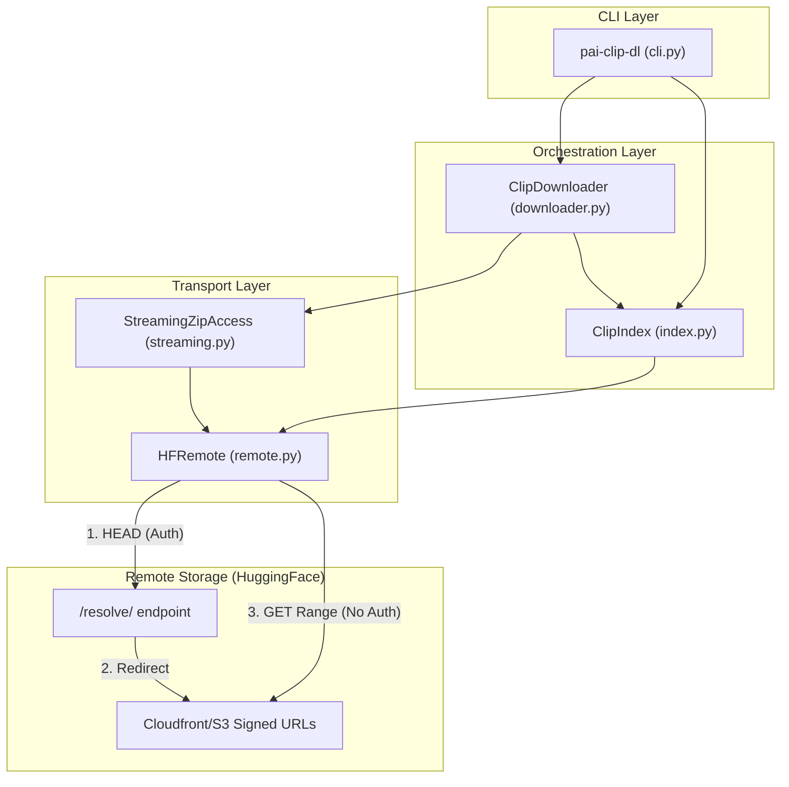
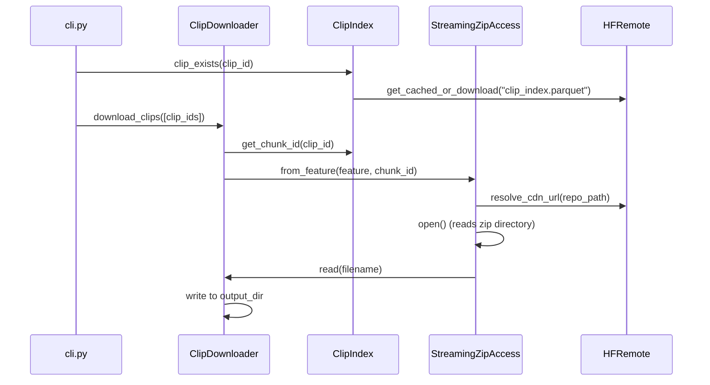

<!-- source: DeepWiki mcp.deepwiki.com · repo NVIDIA/ncore · extra page PAI Remote Access and pai-clip-dl · fetched 2026-10-26 -->

# PAI Remote Access and pai-clip-dl

Relevant source files

The following files were used as context for generating this wiki page:

- [tools/data_converter/pai/BUILD.bazel](tools/data_converter/pai/BUILD.bazel)
- [tools/data_converter/pai/pai_remote/BUILD.bazel](tools/data_converter/pai/pai_remote/BUILD.bazel)
- [tools/data_converter/pai/pai_remote/cli.py](tools/data_converter/pai/pai_remote/cli.py)
- [tools/data_converter/pai/pai_remote/downloader.py](tools/data_converter/pai/pai_remote/downloader.py)
- [tools/data_converter/pai/pai_remote/index.py](tools/data_converter/pai/pai_remote/index.py)
- [tools/data_converter/pai/pai_remote/remote.py](tools/data_converter/pai/pai_remote/remote.py)
- [tools/data_converter/pai/pai_remote/streaming.py](tools/data_converter/pai/pai_remote/streaming.py)

The `pai_remote` sub-package provides a high-performance, authenticated interface for accessing the NVIDIA PhysicalAI-Autonomous-Vehicles dataset hosted on HuggingFace. It enables partial data extraction from large remote archives using HTTP range requests, intelligent CDN URL caching, and a CLI for dataset exploration and downloading.

## System Architecture and Data Flow

The `pai_remote` package bridges the gap between the remote HuggingFace repository and local processing by implementing a tiered access strategy. It resolves dataset revisions to specific commit SHAs, caches metadata locally, and uses `remotezip` to stream specific files from within multi-gigabyte ZIP chunks.

### Code Entity Space to Natural Language Space

The following diagram maps the core Python classes and CLI components to their functional roles in the remote access pipeline.

**Entity Mapping: Remote Access Components**

**Sources:** [tools/data_converter/pai/pai_remote/cli.py:49-53](), [tools/data_converter/pai/pai_remote/downloader.py:50-83](), [tools/data_converter/pai/pai_remote/remote.py:39-46](), [tools/data_converter/pai/pai_remote/streaming.py:39-44]()

## HFRemote: HTTP and CDN Management

The `HFRemote` class [tools/data_converter/pai/pai_remote/remote.py:39-46]() handles the complexities of HuggingFace's authentication and redirect-based CDN architecture. 

### Key Responsibilities:
*   **Authentication**: Injects the `HF_TOKEN` into a `requests.Session` [tools/data_converter/pai/pai_remote/remote.py:50-51]().
*   **CDN Resolution**: HuggingFace `/resolve/` URLs are temporary redirects to signed CDN URLs. `HFRemote` caches these resolved URLs for 50 minutes to avoid redundant `HEAD` requests [tools/data_converter/pai/pai_remote/remote.py:36-37](), [tools/data_converter/pai/pai_remote/remote.py:87-105]().
*   **Commit Tracking**: Extracts the `X-Repo-Commit` header from responses to ensure local caches remain synchronized with the remote repository state [tools/data_converter/pai/pai_remote/remote.py:65-80]().
*   **Local Caching**: Persists small, frequently used index files (like `clip_index.parquet`) to a local cache directory, invalidating them if the remote commit SHA changes [tools/data_converter/pai/pai_remote/remote.py:138-185]().

**Sources:** [tools/data_converter/pai/pai_remote/remote.py:36-185]()

## ClipIndex and Feature Resolution

The `ClipIndex` [tools/data_converter/pai/pai_remote/index.py:61-71]() provides a queryable interface for the dataset manifest. It is responsible for mapping a UUID-based `clip_id` to its corresponding storage artifacts.

| Method | Purpose | Source |
| :--- | :--- | :--- |
| `get_chunk_id(clip_id)` | Returns the integer chunk index (0-N) containing the clip. | [tools/data_converter/pai/pai_remote/index.py:92-97]() |
| `get_sensor_presence(clip_id)` | Returns a map of which sensors (e.g., `camera_front_wide`) are active for a clip. | [tools/data_converter/pai/pai_remote/index.py:159-165]() |
| `get_feature(name)` | Returns a `FeatureSpec` describing the path templates and formats for a feature. | [tools/data_converter/pai/pai_remote/index.py:122-128]() |

**FeatureSpec** [tools/data_converter/pai/pai_remote/index.py:35-43]() objects define whether a feature is stored as a ZIP (sensors, labels) or a Parquet (calibration). They provide templates for resolving the final repository paths [tools/data_converter/pai/pai_remote/index.py:52-58]().

**Sources:** [tools/data_converter/pai/pai_remote/index.py:35-180]()

## StreamingZipAccess: Range-Request Reading

`StreamingZipAccess` [tools/data_converter/pai/pai_remote/streaming.py:39-44]() enables "virtual" ZIP mounting. Instead of downloading a 5GB chunk to extract a 10MB clip, it:
1.  Fetches the ZIP's central directory (the last few KB of the file) [tools/data_converter/pai/pai_remote/streaming.py:81-88]().
2.  Parses the offsets of individual files within the archive.
3.  Performs targeted HTTP range requests via the `remotezip` library to fetch only the requested compressed bytes [tools/data_converter/pai/pai_remote/streaming.py:116-121]().

**Sources:** [tools/data_converter/pai/pai_remote/streaming.py:16-130]()

## pai-clip-dl CLI

The `pai-clip-dl` tool [tools/data_converter/pai/pai_remote/cli.py:67-70]() is the primary entry point for users to interact with remote PAI data.

### Commands and Data Flow

**Operation Logic: download and stream**

### CLI Subcommands:
*   **`info`**: Displays the chunk ID, split (train/val/test), and sensor presence for specific clips [tools/data_converter/pai/pai_remote/cli.py:121-156]().
*   **`list-features`**: Enumerates all available data modalities (camera, lidar, radar, labels, calibration) and their storage formats [tools/data_converter/pai/pai_remote/cli.py:157-179]().
*   **`download`**: Orchestrates the batch download of multiple clips. It groups clips by chunk ID [tools/data_converter/pai/pai_remote/downloader.py:128-134]() to ensure each remote ZIP is opened only once, maximizing efficiency [tools/data_converter/pai/pai_remote/cli.py:73-119]().
*   **`stream`**: Allows listing files inside a remote ZIP or streaming a single file's content to `stdout` or a local path [tools/data_converter/pai/pai_remote/cli.py:180-213]().

**Sources:** [tools/data_converter/pai/pai_remote/cli.py:67-213](), [tools/data_converter/pai/pai_remote/downloader.py:50-134]()

---

