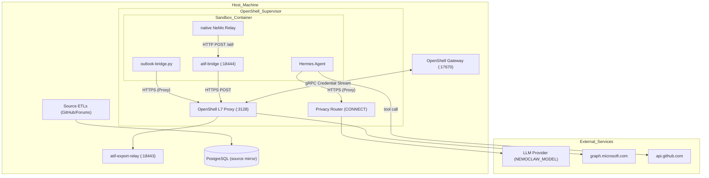

<!-- source: DeepWiki mcp.deepwiki.com · repo NVIDIA/nemoclaw-community · page 1.1 Core Concepts and Architecture · fetched 2026-10-26 -->

# Core Concepts and Architecture

Relevant source files

The following files were used as context for generating this wiki page:

- [README.md](README.md)
- [SUPPORT.md](SUPPORT.md)
- [examples/recipes/nvidia/developer-community-chief-of-staff/.env.example](examples/recipes/nvidia/developer-community-chief-of-staff/.env.example)
- [examples/recipes/nvidia/developer-community-chief-of-staff/README.md](examples/recipes/nvidia/developer-community-chief-of-staff/README.md)

This page documents the fundamental building blocks and architectural patterns shared across the NemoClaw Community repository. It details the composition model, the security substrate provided by OpenShell, and the communication patterns that enable inspectable, constrained agent workflows.

## The Blueprint Composition Model

NemoClaw defines a "Blueprint" as the composition of three distinct layers. This separation ensures that agent logic (Harness) remains decoupled from both the intelligence source (Model) and the execution environment (OpenShell).

| Layer | Responsibility | Key Code Entities |
| :--- | :--- | :--- |
| **Model** | Inference endpoint, model selection, and provider configuration. | `NEMOCLAW_MODEL`, `NEMOCLAW_ENDPOINT_URL`, `COMPATIBLE_API_KEY` |
| **Harness** | The agent runtime, skills, bridges, state, and workflow-specific behavior. | `Hermes Agent`, `outlook-bridge.py`, `atif-bridge`, `NeMo Relay` |
| **OpenShell** | The sandbox, gateway, policy, provider, and networking substrate. | `policy.yaml`, `OpenShell Gateway`, `L7 Proxy`, `Privacy Router` |

**Sources:** [README.md:8-14](), [examples/recipes/nvidia/developer-community-chief-of-staff/README.md:22-34](), [examples/recipes/nvidia/developer-community-chief-of-staff/.env.example:22-36]()

## System Architecture and Data Flow

The architecture follows a "shared-nothing" isolation principle where each example operates within its own bounded sandbox. The OpenShell Supervisor manages the lifecycle and security boundaries of the Harness.

### Component Interaction and Code Mapping
This diagram maps the high-level conceptual components to the specific code entities and services defined in the `developer-community-chief-of-staff` recipe.

**Sources:** [examples/recipes/nvidia/developer-community-chief-of-staff/README.md:63-146](), [examples/recipes/nvidia/developer-community-chief-of-staff/.env.example:8-10](), [examples/recipes/nvidia/developer-community-chief-of-staff/.env.example:131-135]()

## OpenShell Sandbox and Gateway

The **OpenShell Gateway** acts as the central provider store and handles refresh-token rotation [examples/recipes/nvidia/developer-community-chief-of-staff/README.md:138-138](). It communicates with the **L7 Proxy** to provide credentials on-demand [examples/recipes/nvidia/developer-community-chief-of-staff/README.md:83-84]().

### Security Enforcement
1.  **L7 Egress Allowlists**: Defined in `policy.yaml`, these rules restrict the sandbox to specific domains and URI patterns, such as repository-scoped `GET` requests for GitHub [examples/recipes/nvidia/developer-community-chief-of-staff/README.md:46-51]().
2.  **Credential Substitution**: Real secrets (e.g., `GITHUB_TOKEN`, `TAVILY_API_KEY`) never enter the sandbox environment. Instead, the Harness uses provider placeholders which the L7 proxy replaces during transit [examples/recipes/nvidia/developer-community-chief-of-staff/README.md:49-52](), [examples/recipes/nvidia/developer-community-chief-of-staff/README.md:57-61]().
3.  **Kernel-Level Isolation**: Sandboxes utilize Landlock and seccomp to restrict filesystem and system call access, providing a hardened execution layer [examples/recipes/nvidia/developer-community-chief-of-staff/README.md:32-34]().

## L7 Proxy and Credential Substitution Pattern

The L7 proxy pattern is the primary mechanism for maintaining a "zero-trust" posture within the sandbox. When the agent or a skill makes a request, the flow proceeds as follows:

| Step | Entity | Action |
| :--- | :--- | :--- |
| 1 | **Harness** | Initiates HTTPS request using a placeholder (e.g., `Bearer {{github_token}}`). |
| 2 | **L7 Proxy** | Intercepts request; identifies the placeholder [examples/recipes/nvidia/developer-community-chief-of-staff/README.md:83-83](). |
| 3 | **Gateway** | Provides the active, rotated credential to the Proxy [examples/recipes/nvidia/developer-community-chief-of-staff/README.md:138-138](). |
| 4 | **L7 Proxy** | Substitutes placeholder with the real token and forwards to the upstream API. |

This ensures that even if the Harness is compromised, the underlying long-lived credentials or refresh tokens (like the `ms-graph-token.json`) are not exposed to the agent's memory space [examples/recipes/nvidia/developer-community-chief-of-staff/.env.example:52-54]().

**Sources:** [examples/recipes/nvidia/developer-community-chief-of-staff/README.md:46-61](), [examples/recipes/nvidia/developer-community-chief-of-staff/.env.example:84-94]()

## Example Isolation and "Shared-Nothing" Principle

Every example in the `nemoclaw-community` repository is designed to be self-contained. 
- **Independent Setup**: Each recipe has its own lifecycle scripts, such as `00-host-services.sh` and `bring-up.sh` [examples/recipes/nvidia/developer-community-chief-of-staff/.env.example:8-9]().
- **Dedicated Infrastructure**: While examples may share a host, they do not share sandboxes, policies, or credential scopes.
- **Provider Placeholders**: Placeholders are scoped per-sandbox. For instance, the `TAVILY_API_KEY` is only attached if configured for that specific instance [examples/recipes/nvidia/developer-community-chief-of-staff/README.md:57-61]().

## Inference Preflight and Provider Validation

To ensure system integrity before the agent begins execution, a preflight check is performed via `scripts/preflight.py` [examples/recipes/nvidia/developer-community-chief-of-staff/.env.example:3-4](). The `NEMOCLAW_INFERENCE_PREFLIGHT` mechanism validates:
1.  **Endpoint Connectivity**: Confirms the LLM provider is reachable via HTTPS or a local proxy [examples/recipes/nvidia/developer-community-chief-of-staff/.env.example:24-26]().
2.  **Credential Validity**: Tests the provided API key (e.g., `COMPATIBLE_API_KEY` or `OPENAI_API_KEY`) [examples/recipes/nvidia/developer-community-chief-of-staff/.env.example:15-22]().
3.  **Model Availability**: Ensures the requested `NEMOCLAW_MODEL` is active and responding to structured-tool requests [examples/recipes/nvidia/developer-community-chief-of-staff/.env.example:23-25]().

**Sources:** [examples/recipes/nvidia/developer-community-chief-of-staff/.env.example:1-30]()

---

