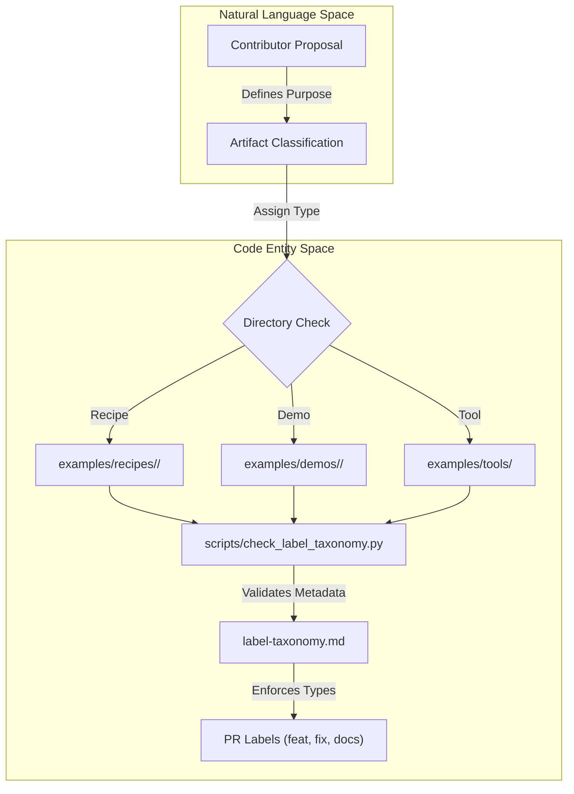
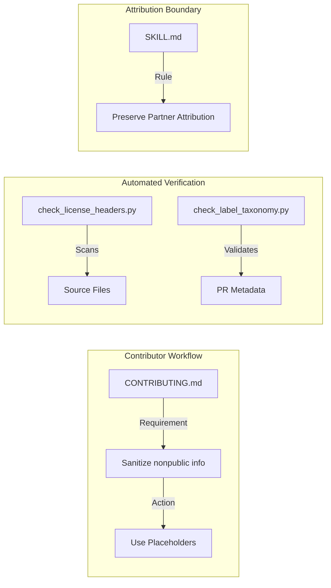

<!-- source: DeepWiki mcp.deepwiki.com · repo NVIDIA/nemoclaw-community · page 1.2 Example Catalog and Taxonomy · fetched 2026-10-26 -->

# Example Catalog and Taxonomy

Relevant source files

The following files were used as context for generating this wiki page:

- [.agents/skills/_shared/controlled-words.md](.agents/skills/_shared/controlled-words.md)
- [.agents/skills/nemoclaw-community-contributor-examples/SKILL.md](.agents/skills/nemoclaw-community-contributor-examples/SKILL.md)
- [.agents/skills/nemoclaw-community-maintainer-policies/SKILL.md](.agents/skills/nemoclaw-community-maintainer-policies/SKILL.md)
- [.github/PULL_REQUEST_TEMPLATE.md](.github/PULL_REQUEST_TEMPLATE.md)
- [CONTRIBUTING.md](CONTRIBUTING.md)
- [WRITING.md](WRITING.md)
- [examples/README.md](examples/README.md)
- [examples/recipes/partners/bluetier/x402-payment-gate/.dockerignore](examples/recipes/partners/bluetier/x402-payment-gate/.dockerignore)

This page documents the organization, naming conventions, and classification system for all artifacts within the NemoClaw Community repository. It provides a technical map of how examples are structured and the requirements for contributing new blueprints to the catalog.

## Repository Taxonomy and Directory Layout

The repository uses a strict hierarchy to ensure examples remain independently deployable and discoverable. The top-level organization is based on **Artifact Type**, followed by **Contributor Provenance** for recipes [examples/README.md:6-7]().

### Artifact Types

| Type | Directory | Description |
| :--- | :--- | :--- |
| **Recipes** | `examples/recipes/` | Reusable, end-to-end agent blueprints including Model, Harness, and OpenShell policy [examples/README.md:25](). |
| **Demos** | `examples/demos/` | Specific field demonstrations (e.g., hardware-specific or vertical-specific setups) [examples/README.md:35-39](). |
| **Launchables** | `examples/launchables/` | Fast-path deployment configurations for specific cloud environments like Brev [examples/README.md:41-45](). |
| **Tools** | `examples/tools/` | Developer utilities and CLI tools for optimizing or evaluating agent harnesses [examples/README.md:47-51](). |

### Provenance Classification

Recipes are further categorized by their authoring entity to manage support expectations and licensing:
*   **NVIDIA**: Authored and maintained by NVIDIA teams (e.g., Chief of Staff, FinGuard) [examples/README.md:9-18]().
*   **Partners**: Contributed by ecosystem partners like HPE, BlueTier, and Shrike Security [examples/README.md:20-28]().
*   **Community**: General community contributions [examples/README.md:29-33]().

**Sources:** [examples/README.md:1-59](), [CONTRIBUTING.md:5-7]()

---

## Data Flow: Example Classification and Validation

When a new contribution is submitted, it undergoes a classification process driven by the `nemoclaw-community-contributor-examples` skill [.agents/skills/nemoclaw-community-contributor-examples/SKILL.md:1-44](). This ensures the artifact matches the repository's structural rules and naming conventions.

### Contribution Pipeline Diagram

"Example Contribution and Taxonomy Validation"

**Sources:** [CONTRIBUTING.md:39-60](), [.github/PULL_REQUEST_TEMPLATE.md:17-20](), [examples/README.md:53-59](), [.agents/skills/nemoclaw-community-contributor-examples/SKILL.md:14-33]()

---

## Naming and Content Standards

All examples must adhere to the **Shared-Nothing Isolation Principle**: no example may depend on private files, internal systems, or local state from another example [CONTRIBUTING.md:148-150]().

### Controlled Vocabulary
Contributors must use the `controlled-words.md` list to ensure consistency across the catalog. Key technical distinctions include:
*   **sandbox**: Refers specifically to the runtime boundary (OpenShell), not a general container [.agents/skills/_shared/controlled-words.md:39]().
*   **policy**: Refers to enforced permissions or restrictions, not general configuration [.agents/skills/_shared/controlled-words.md:40]().
*   **recipe**: Specifically for content under `examples/recipes/` [.agents/skills/_shared/controlled-words.md:25]().
*   **example**: The general term for an independently deployable contribution [.agents/skills/_shared/controlled-words.md:24]().

### Repository Governance and Sanitization
Before publication, all content must be sanitized to remove nonpublic information. This is enforced via the `PULL_REQUEST_TEMPLATE.md` and the `WRITING.md` guide [WRITING.md:27-44]().

"Sanitization and Attribution Logic"

**Sources:** [WRITING.md:27-44](), [CONTRIBUTING.md:151-174](), [.github/PULL_REQUEST_TEMPLATE.md:42-52](), [.agents/skills/nemoclaw-community-contributor-examples/SKILL.md:25-27]()

---

## Detailed Catalog Reference

### NVIDIA Recipes
| Directory | Description | Key Components |
| :--- | :--- | :--- |
| `developer-community-chief-of-staff` | Signal synthesis for Slack/GitHub/Outlook | Multi-persona routing, NVTeam skills [examples/README.md:13](). |
| `pr-review-advisor` | Constrained Hermes PR review workflow | 6-stage finding ledger, attested artifacts [examples/README.md:18](). |
| `payment-ops-hermes` | Constrained payment screening assistant | NeMo Relay, Phoenix observability [examples/README.md:17](). |
| `memory-driven-chief-of-staff` | Locally-authoritative record keeping | SQLite obligation store, intent-gate [examples/README.md:15](). |

### Partner and Community Blueprints
*   **BlueTier x402 Payment Gate**: Implements a maker/checker boundary where the agent submits intents and a host-side gate issues GO/HOLD/STOP verdicts [examples/README.md:24]().
*   **Shrike Security Action Governance**: Uses a `before_tool_call` plugin to intercept and govern agent tool calls via an external enforce plane [examples/README.md:26]().
*   **Deep Research Worker**: A community-contributed recipe using a FastAPI host-side worker for long-running research tasks [examples/README.md:33]().

### Developer Tools
*   **Harness Engineering Playground (hep)**: Provides a CLI for eval-driven harness profile optimization using the `RalphLoopOptimizer`. It is explicitly not an OpenShell blueprint [examples/README.md:51]().

**Sources:** [examples/README.md:9-52](), [CONTRIBUTING.md:132-150](), [.agents/skills/nemoclaw-community-contributor-examples/SKILL.md:34-44]()

---

