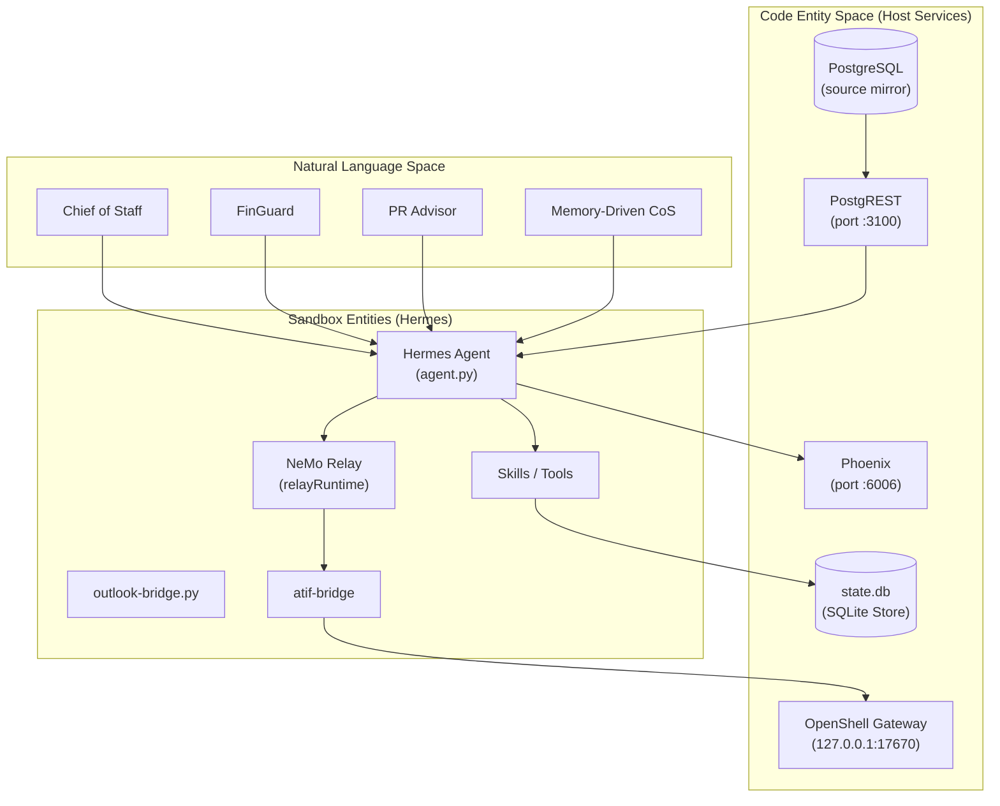
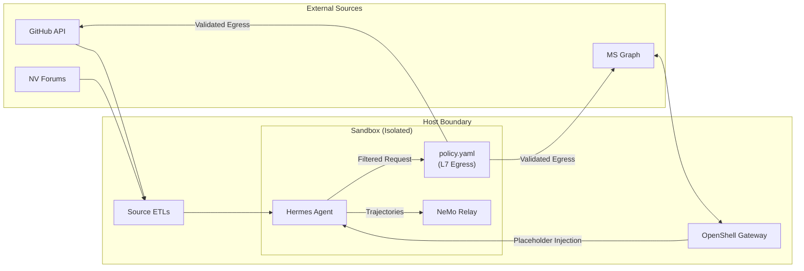

<!-- source: DeepWiki mcp.deepwiki.com · repo NVIDIA/nemoclaw-community · page 2 NVIDIA Recipes · fetched 2026-10-26 -->

# NVIDIA Recipes

Relevant source files

The following files were used as context for generating this wiki page:

- [.github/workflows/nemoclaw-review-advisor-dogfood.yml](.github/workflows/nemoclaw-review-advisor-dogfood.yml)
- [examples/recipes/nvidia/developer-community-chief-of-staff/.env.example](examples/recipes/nvidia/developer-community-chief-of-staff/.env.example)
- [examples/recipes/nvidia/developer-community-chief-of-staff/README.md](examples/recipes/nvidia/developer-community-chief-of-staff/README.md)
- [examples/recipes/nvidia/kubernetes-gpu-autoscaling/.gitignore](examples/recipes/nvidia/kubernetes-gpu-autoscaling/.gitignore)
- [examples/recipes/nvidia/kubernetes-gpu-autoscaling/Chart.yaml](examples/recipes/nvidia/kubernetes-gpu-autoscaling/Chart.yaml)
- [examples/recipes/nvidia/kubernetes-gpu-autoscaling/README.md](examples/recipes/nvidia/kubernetes-gpu-autoscaling/README.md)
- [examples/recipes/nvidia/memory-driven-chief-of-staff/README.md](examples/recipes/nvidia/memory-driven-chief-of-staff/README.md)
- [examples/recipes/nvidia/memory-driven-chief-of-staff/fixtures/README.md](examples/recipes/nvidia/memory-driven-chief-of-staff/fixtures/README.md)
- [examples/recipes/nvidia/memory-driven-chief-of-staff/fixtures/envelopes/intake.json](examples/recipes/nvidia/memory-driven-chief-of-staff/fixtures/envelopes/intake.json)
- [examples/recipes/nvidia/pr-review-advisor/.env.example](examples/recipes/nvidia/pr-review-advisor/.env.example)
- [examples/recipes/nvidia/pr-review-advisor/.gitignore](examples/recipes/nvidia/pr-review-advisor/.gitignore)
- [examples/recipes/nvidia/pr-review-advisor/.npmignore](examples/recipes/nvidia/pr-review-advisor/.npmignore)
- [examples/recipes/nvidia/pr-review-advisor/LICENSE](examples/recipes/nvidia/pr-review-advisor/LICENSE)
- [examples/recipes/nvidia/pr-review-advisor/README.md](examples/recipes/nvidia/pr-review-advisor/README.md)
- [examples/recipes/nvidia/pr-review-advisor/agents/hermes/Dockerfile](examples/recipes/nvidia/pr-review-advisor/agents/hermes/Dockerfile)
- [examples/recipes/nvidia/pr-review-advisor/agents/hermes/SOUL.md](examples/recipes/nvidia/pr-review-advisor/agents/hermes/SOUL.md)
- [examples/recipes/nvidia/pr-review-advisor/agents/hermes/generate-config.ts](examples/recipes/nvidia/pr-review-advisor/agents/hermes/generate-config.ts)

NVIDIA Recipes are high-level agent blueprints designed to demonstrate production-grade patterns for constrained, inspectable AI agents. These recipes are built on a shared architecture involving the **Hermes agent**, **NeMo Relay** for observability, and **OpenShell** for sandbox enforcement. They serve as reference implementations for common enterprise workflows like community management, code review, financial operations, and technical research.

### Shared Architectural Patterns

All NVIDIA-authored recipes leverage a consistent security and observability stack:
*   **Hermes Agent:** The core reasoning engine, typically containerized and running with a specialized TUI or bridge.
*   **NeMo Relay:** An in-process plugin or sidecar that captures agent trajectories and exports them via the **ATIF** (Agent Trajectory Interchange Format) [examples/recipes/nvidia/developer-community-chief-of-staff/README.md:73-75]().
*   **OpenShell Policies:** L7 egress allowlists that enforce the "denied-edge" principle, ensuring agents can only communicate with approved inference providers and APIs [examples/recipes/nvidia/developer-community-chief-of-staff/README.md:38-46]().
*   **Credential Substitution:** Secrets are managed by the OpenShell Gateway and injected into the sandbox as placeholders, preventing raw API keys from ever residing in the agent's memory [examples/recipes/nvidia/developer-community-chief-of-staff/README.md:19-26]().

### The Recipe Catalog

The following recipes represent the core NVIDIA contributions to the NemoClaw Community.

| Recipe | Primary Purpose | Key Technologies |
| :--- | :--- | :--- |
| **Developer Community Chief of Staff** | Aggregates GitHub, Slack, and Forum signals into briefs. | NVTeam Personas, PostgREST, Outlook Bridge |
| **PR Review Advisor** | Security-first automated pull request analysis. | Finding Ledger, Fail-closed Policy, Dogfood CI |
| **FinGuard** | Constrained financial transaction screening. | Maker/Checker Boundary, Phoenix, Mock Rail |
| **NV Tech Assistant** | Grounded research using NVIDIA-internal and public sources. | Brave Search, arXiv integration, Sandbox Policy |
| **Memory-Driven Chief of Staff** | Local, revisable memory and obligation tracking. | SQLite Store, Intent Gate, Tiered Cascading |
| **Kubernetes GPU Autoscaling** | Cost-efficient HPA for GPU-backed inference. | Ollama, Metrics-Proxy, Envoy LeastRequest |

---

### Recipe Overview

#### Developer Community Chief of Staff
This flagship recipe acts as a personal assistant for community managers. It synthesizes signals from GitHub, Slack, and NVIDIA forums to identify gaps between community needs and internal priorities [examples/recipes/nvidia/developer-community-chief-of-staff/README.md:5-12](). It introduces the **NVTeam** role-routing system, allowing the agent to adopt specific personas for different analytical tasks.

For details, see [Developer Community Chief of Staff](#2.1).

#### PR Review Advisor
Designed for secure software development lifecycles, this recipe uses a "fail-closed" security model. It generates a ledger of findings that must be attested before being published by a separate maintainer action. It uses a specialized `generate-config.ts` to manage its Hermes configuration [examples/recipes/nvidia/pr-review-advisor/agents/hermes/generate-config.ts:1-75]().

For details, see [PR Review Advisor](#2.2).

#### Payment Operations Hermes Assistant (FinGuard)
FinGuard demonstrates how to manage high-risk financial operations. It implements a strict **maker/checker boundary** where the agent can only propose payments, but a host-side human checker must release them. OpenShell policies enforce a `denied-edge` to the actual payment rail for the agent.

For details, see [Payment Operations Hermes Assistant (FinGuard)](#2.3).

#### NV Tech Assistant
This recipe focuses on grounded technical research. It limits the agent's search space to allowlisted sources such as NVIDIA documentation and arXiv papers. It utilizes Brave Search for live web grounding within the constraints of the sandbox policy.

For details, see [NV Tech Assistant](#2.4).

#### Memory-Driven Chief of Staff
This recipe manages a local, revisable record of inbound messages in a SQLite database [examples/recipes/nvidia/memory-driven-chief-of-staff/README.md:6-8](). It features an **Intent Gate** that prevents externally "urgent" messages from reaching the high-priority tier unless they match the user's stated priorities in `MEMORY.md` [examples/recipes/nvidia/memory-driven-chief-of-staff/README.md:36-39]().

For details, see [Memory-Driven Chief of Staff](#2.5).

#### Kubernetes GPU Autoscaling
This recipe provides a cost-efficient architecture that runs a CPU-only OpenShell sandbox while autoscaling GPU-backed Ollama replicas [examples/recipes/nvidia/kubernetes-gpu-autoscaling/README.md:6-10](). It uses a `metrics-proxy` sidecar to expose `gpu_utilization` and `latency_avg` to the Kubernetes HPA [examples/recipes/nvidia/kubernetes-gpu-autoscaling/README.md:49-54]().

For details, see [Kubernetes GPU Autoscaling](#2.6).

---

### System Component Mapping

The following diagram bridges the high-level system concepts to the specific code entities and services used across these recipes.

**Diagram: NVIDIA Recipe Component Entity Map**

**Sources:** [examples/recipes/nvidia/developer-community-chief-of-staff/README.md:65-145](), [examples/recipes/nvidia/memory-driven-chief-of-staff/README.md:70-86]()

### Data Flow and Security Boundary

This diagram illustrates how data moves from external sources into the constrained sandbox environment while maintaining the security boundary.

**Diagram: Data Ingress and Policy Enforcement**

**Sources:** [examples/recipes/nvidia/developer-community-chief-of-staff/README.md:45-62](), [examples/recipes/nvidia/developer-community-chief-of-staff/README.md:130-138]()

---

