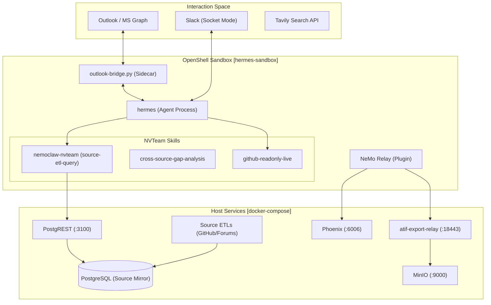
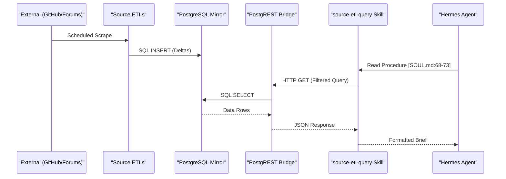

<!-- source: DeepWiki mcp.deepwiki.com · repo NVIDIA/nemoclaw-community · page 2.1 Developer Community Chief of Staff · fetched 2026-10-26 -->

# Developer Community Chief of Staff

Relevant source files

The following files were used as context for generating this wiki page:

- [examples/recipes/nvidia/developer-community-chief-of-staff/.env.example](examples/recipes/nvidia/developer-community-chief-of-staff/.env.example)
- [examples/recipes/nvidia/developer-community-chief-of-staff/.env.example.s3](examples/recipes/nvidia/developer-community-chief-of-staff/.env.example.s3)
- [examples/recipes/nvidia/developer-community-chief-of-staff/README.md](examples/recipes/nvidia/developer-community-chief-of-staff/README.md)
- [examples/recipes/nvidia/developer-community-chief-of-staff/agents/hermes/SOUL.md](examples/recipes/nvidia/developer-community-chief-of-staff/agents/hermes/SOUL.md)

The **Developer Community Chief of Staff** is a flagship NemoClaw recipe designed to serve as a personal Hermes agent. It aggregates signals from disparate developer channels—GitHub, Slack, Outlook, and NVIDIA forums—into actionable operating briefs. By comparing community struggles and gaps against internal priorities, it enables teams to align resources with actual demand.

The system utilizes the **NVTeam role-routing system**, which employs specialized personas to handle cross-source gap analysis and sentiment tracking [examples/recipes/nvidia/developer-community-chief-of-staff/agents/hermes/SOUL.md:5-30](). It operates within a hardened **OpenShell sandbox**, ensuring that sensitive credentials (like GitHub tokens or Outlook OAuth2 secrets) never enter the agent's execution environment directly, but are instead managed by the OpenShell gateway and substituted at the L7 proxy layer [examples/recipes/nvidia/developer-community-chief-of-staff/README.md:27-34]().

### Architecture Overview

The recipe follows a single-host deployment model, typically running on a managed VM. It consists of a containerized Hermes agent and a suite of host-side services for data ingestion and observability.

#### System Component Diagram
This diagram bridges the natural language concepts of "Interaction" and "Data Ingestion" to the specific code entities and services defined in the recipe.

**Sources:** [examples/recipes/nvidia/developer-community-chief-of-staff/README.md:65-146](), [examples/recipes/nvidia/developer-community-chief-of-staff/.env.example:130-140]()

---

### Core Components

#### 1. Hermes Agent Sandbox
The **Hermes Agent Sandbox** is the primary execution environment. It is a containerized runtime protected by Landlock and seccomp, running the Hermes TUI and the NeMo Relay plugin [examples/recipes/nvidia/developer-community-chief-of-staff/README.md:86-94](). It communicates with the outside world via the OpenShell L7 proxy, which handles credential substitution for services like GitHub and Slack [examples/recipes/nvidia/developer-community-chief-of-staff/README.md:46-61]().
*   For details, see [Hermes Agent Sandbox](#2.1.1).

#### 2. Host Services and Data Infrastructure
The recipe relies on a Docker Compose stack to manage persistent state and data ingestion. This includes a **PostgreSQL** database acting as a source mirror, **PostgREST** for providing a read-only HTTP interface to the agent, and **Source ETLs** that scrape GitHub and NVIDIA forums for community signals [examples/recipes/nvidia/developer-community-chief-of-staff/README.md:138-145]().
*   For details, see [Host Services and Data Infrastructure](#2.1.2).

#### 3. Deployment and Bring-up Lifecycle
Deployment is managed through a structured four-phase pipeline. These scripts handle everything from preflight validation of LLM endpoints via `NEMOCLAW_INFERENCE_PREFLIGHT` to the injection of TLS certificates and the application of OpenShell egress policies [examples/recipes/nvidia/developer-community-chief-of-staff/.env.example:1-12]().
*   For details, see [Deployment Scripts and Provider Configuration](#2.1.3).

#### 4. NVTeam Skills and Agent Persona System
The **NVTeam** system defines the behavioral contract for the agent. It uses a `SOUL.md` file to dictate persona-driven responses (e.g., River for Product Management, Akira for Systems Engineering) and includes specialized skills for querying the host-side ETL mirrors and performing cross-platform sentiment analysis [examples/recipes/nvidia/developer-community-chief-of-staff/agents/hermes/SOUL.md:15-30]().
*   For details, see [NVTeam Skills and Agent Persona System](#2.1.4).

---

### Deployment Pipeline
The bring-up process is codified into four distinct phases to ensure infrastructure is ready before the agent starts.

| Phase | Script | Responsibility |
| :--- | :--- | :--- |
| **00** | `00-host-services.sh` | Starts Postgres, PostgREST, Phoenix, and ETL containers [examples/recipes/nvidia/developer-community-chief-of-staff/.env.example:8](). |
| **01** | `01-gateway.sh` | Initializes the OpenShell gateway and configuration. |
| **02** | `02-providers.sh` | Configures inference, Slack, and Outlook OAuth2 providers [examples/recipes/nvidia/developer-community-chief-of-staff/.env.example:12](). |
| **03** | `03-sandbox.sh` | Builds the sandbox, applies Landlock policies, and starts the agent. |

**Sources:** [examples/recipes/nvidia/developer-community-chief-of-staff/.env.example:1-12]()

### Data Flow Mapping
The following diagram maps how community signals move from external sources into the agent's context.

**Sources:** [examples/recipes/nvidia/developer-community-chief-of-staff/README.md:53-56](), [examples/recipes/nvidia/developer-community-chief-of-staff/agents/hermes/SOUL.md:80-82]()

---

