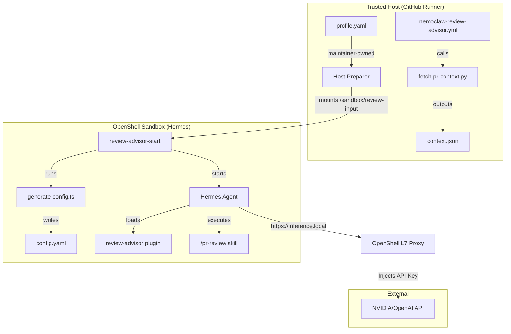

<!-- source: DeepWiki mcp.deepwiki.com · repo NVIDIA/nemoclaw-community · page 2.2 PR Review Advisor · fetched 2026-10-26 -->

# PR Review Advisor

Relevant source files

The following files were used as context for generating this wiki page:

- [.github/workflows/nemoclaw-review-advisor-dogfood.yml](.github/workflows/nemoclaw-review-advisor-dogfood.yml)
- [examples/recipes/nvidia/pr-review-advisor/.env.example](examples/recipes/nvidia/pr-review-advisor/.env.example)
- [examples/recipes/nvidia/pr-review-advisor/.gitignore](examples/recipes/nvidia/pr-review-advisor/.gitignore)
- [examples/recipes/nvidia/pr-review-advisor/.npmignore](examples/recipes/nvidia/pr-review-advisor/.npmignore)
- [examples/recipes/nvidia/pr-review-advisor/LICENSE](examples/recipes/nvidia/pr-review-advisor/LICENSE)
- [examples/recipes/nvidia/pr-review-advisor/README.md](examples/recipes/nvidia/pr-review-advisor/README.md)
- [examples/recipes/nvidia/pr-review-advisor/agents/hermes/Dockerfile](examples/recipes/nvidia/pr-review-advisor/agents/hermes/Dockerfile)
- [examples/recipes/nvidia/pr-review-advisor/agents/hermes/SOUL.md](examples/recipes/nvidia/pr-review-advisor/agents/hermes/SOUL.md)
- [examples/recipes/nvidia/pr-review-advisor/agents/hermes/generate-config.ts](examples/recipes/nvidia/pr-review-advisor/agents/hermes/generate-config.ts)

The PR Review Advisor is a first-party NemoClaw recipe that transforms a Hermes agent and Nemotron-3 Ultra into a reusable, repository-aware pull-request reviewer [examples/recipes/nvidia/pr-review-advisor/README.md:8-12](). It employs a fail-closed security model, a six-stage finding ledger, and a detached-head analysis pattern to ensure that the agent provides high-integrity feedback without ever possessing the credentials to mutate the repository or GitHub state [examples/recipes/nvidia/pr-review-advisor/README.md:63-71]().

## System Architecture

The Advisor operates across a trust boundary between a **Trusted Host** (e.g., a GitHub Actions runner) and an **OpenShell Sandbox** [examples/recipes/nvidia/pr-review-advisor/README.md:43-62]().

1.  **Host Preparer**: Fetches a bounded snapshot of the PR (title, body, and linked issues) and creates a detached-head checkout of the repository [examples/recipes/nvidia/pr-review-advisor/README.md:48-48]().
2.  **OpenShell Sandbox**: Hosts the Hermes agent, the `review-advisor` plugin, and the `/pr-review` skill source [examples/recipes/nvidia/pr-review-advisor/README.md:51-55]().
3.  **Inference Proxy**: OpenShell intercepts model requests to `inference.local`, injecting the real provider credentials at the L7 boundary so the agent never sees them [examples/recipes/nvidia/pr-review-advisor/README.md:66-68]().

### Data Flow and Component Interaction

The following diagram illustrates the flow from PR trigger to artifact generation, highlighting the code entities involved in the lifecycle.

**PR Review Lifecycle: Host to Sandbox**

Sources: [examples/recipes/nvidia/pr-review-advisor/README.md:43-62](), [examples/recipes/nvidia/pr-review-advisor/agents/hermes/Dockerfile:45-55](), [examples/recipes/nvidia/pr-review-advisor/agents/hermes/generate-config.ts:21-65]()

## Review Advisor Plugin and Ledger

The `review-advisor` plugin is a stateful, read-only Python plugin that manages the review lifecycle and the **Finding Ledger**.

### Six-Stage Finding Ledger
The agent must commit findings to an ordered ledger through six enforced stages [examples/recipes/nvidia/pr-review-advisor/README.md:30-31]():

| Stage | Objective |
| :--- | :--- |
| `scope` | Map changed components, interfaces, and trust boundaries. |
| `correctness` | Trace state, errors, lifecycle, and acceptance criteria. |
| `security` | Cover credentials, input validation, and system boundaries. |
| `tests` | Identify missing regression coverage for changed behavior. |
| `operations` | Inspect automation, packaging, and upgrades. |
| `reconciliation` | Update, resolve, or supersede existing findings in the ledger. |

### Plugin and Skill Integration
The `SOUL.md` defines the behavioral contract, explicitly forbidding the use of standard Hermes tools like the terminal or browser, forcing interaction through the `review-advisor` plugin [examples/recipes/nvidia/pr-review-advisor/agents/hermes/SOUL.md:12-34](). The plugin returns a trusted protocol from `review_begin`, and the `pr-review` skill source is provided as an auditable reference rather than a mutable toolset [examples/recipes/nvidia/pr-review-advisor/README.md:14-17]().

Sources: [examples/recipes/nvidia/pr-review-advisor/README.md:21-41](), [examples/recipes/nvidia/pr-review-advisor/agents/hermes/SOUL.md:1-38]()

## Security Model: Fail-Closed and Proxy Pattern

The Advisor implements a **fail-closed security model** where the agent is stripped of all general-purpose tools [examples/recipes/nvidia/pr-review-advisor/agents/hermes/generate-config.ts:18-20]().

### generate-config.ts Inference Proxy
The `generate-config.ts` script generates the Hermes configuration inside the container [examples/recipes/nvidia/pr-review-advisor/agents/hermes/generate-config.ts:4-75](). It hardcodes the `api_key` to `sk-OPENSHELL-PROXY-REWRITE` [examples/recipes/nvidia/pr-review-advisor/agents/hermes/generate-config.ts:26-30](). This string is recognized by the OpenShell gateway, which substitutes it with the real credential stored in the host environment.

### Sandbox Isolation
The `Dockerfile` ensures the sandbox has no access to the host's terminal, browser, or generic filesystem by intentionally omitting these from the configuration [examples/recipes/nvidia/pr-review-advisor/agents/hermes/generate-config.ts:18-20]().
- **Restricted Tools**: The `SOUL.md` explicitly forbids the use of terminal, browser, web, or cron tools [examples/recipes/nvidia/pr-review-advisor/agents/hermes/SOUL.md:28-34]().
- **Attestation**: The host provides a 32-byte attestation key via `REVIEW_ADVISOR_ATTESTATION_KEY_FILE` [examples/recipes/nvidia/pr-review-advisor/agents/hermes/Dockerfile:54](). The host only accepts artifacts that verify against this HMAC and exact request identity [examples/recipes/nvidia/pr-review-advisor/README.md:69-71]().

Sources: [examples/recipes/nvidia/pr-review-advisor/agents/hermes/generate-config.ts:1-75](), [examples/recipes/nvidia/pr-review-advisor/agents/hermes/Dockerfile:1-64](), [examples/recipes/nvidia/pr-review-advisor/agents/hermes/SOUL.md:1-38]()

## Maintainer Feedback Loop

The system includes a feedback loop that allows maintainers to record "lessons" into Hermes' persistent memory [examples/recipes/nvidia/pr-review-advisor/README.md:32-33]().

### record-feedback.py
The `record-feedback.py` script validates and persists explicitly approved feedback [examples/recipes/nvidia/pr-review-advisor/agents/hermes/record-feedback.py:1-186](). It ensures that remembered lessons are treated as fallible hints; every claim must be re-established against the current patch and checkout by the agent during a review [examples/recipes/nvidia/pr-review-advisor/agents/hermes/SOUL.md:23-26]().

Sources: [examples/recipes/nvidia/pr-review-advisor/agents/hermes/record-feedback.py:1-186](), [examples/recipes/nvidia/pr-review-advisor/agents/hermes/SOUL.md:23-26]()

## Dogfood CI Workflow

The Advisor is used to review the NemoClaw repository itself via the `nemoclaw-review-advisor-dogfood.yml` workflow [.github/workflows/nemoclaw-review-advisor-dogfood.yml:1-12]().

### Workflow Lifecycle
1.  **Trigger**: `workflow_dispatch` with `base_sha`, `head_sha`, and `pr_number` [.github/workflows/nemoclaw-review-advisor-dogfood.yml:15-29]().
2.  **Fetch and Bind**: Uses `fetch-pr-context.py` to pull PR metadata and repository objects into a temporary, isolated directory [.github/workflows/nemoclaw-review-advisor-dogfood.yml:87-156]().
3.  **Review Execution**: Launches the OpenShell sandbox with the `REVIEW_PROFILE_PATH` pointing to the dogfood profile [.github/workflows/nemoclaw-review-advisor-dogfood.yml:58-59]().
4.  **Quarantine/Recovery**: The workflow enforces a monotonic wall deadline and cleans the trusted workspace while preserving private appliance configuration [.github/workflows/nemoclaw-review-advisor-dogfood.yml:51-78]().

**Code-to-System Mapping**
| Code Entity | System Role |
| :--- | :--- |
| `nemoclaw-review-advisor-dogfood.yml` | CI Orchestrator [.github/workflows/nemoclaw-review-advisor-dogfood.yml:12]() |
| `fetch-pr-context.py` | Acceptance Context Fetcher [.github/workflows/nemoclaw-review-advisor-dogfood.yml:150]() |
| `review-advisor-start` | Sandbox Entrypoint [examples/recipes/nvidia/pr-review-advisor/agents/hermes/Dockerfile:64]() |
| `generate-config.ts` | Config Integrity Manager [examples/recipes/nvidia/pr-review-advisor/agents/hermes/generate-config.ts:4]() |

Sources: [.github/workflows/nemoclaw-review-advisor-dogfood.yml:1-173](), [examples/recipes/nvidia/pr-review-advisor/README.md:138-154](), [examples/recipes/nvidia/pr-review-advisor/agents/hermes/Dockerfile:1-64]()

---

