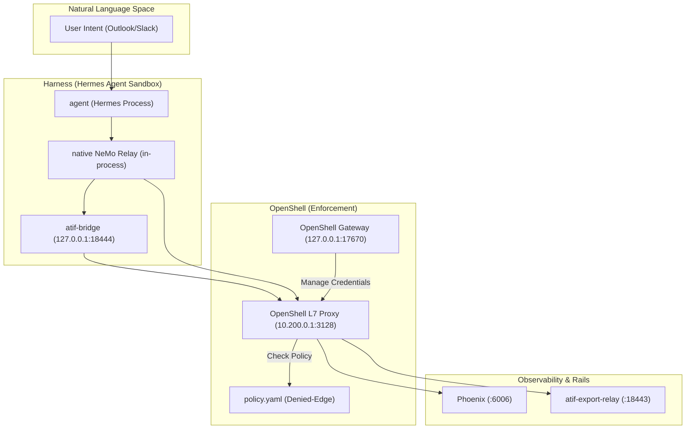
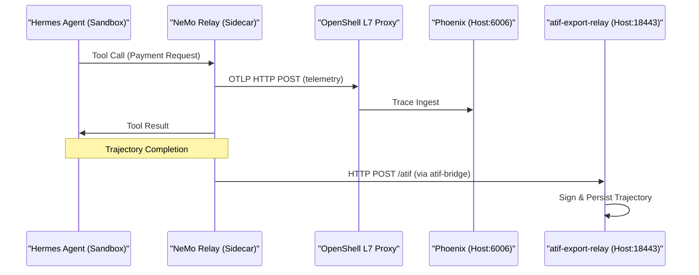

<!-- source: DeepWiki mcp.deepwiki.com · repo NVIDIA/nemoclaw-community · page 2.3 Payment Operations Hermes Assistant (FinGuard) · fetched 2026-10-26 -->

# Payment Operations Hermes Assistant (FinGuard)

Relevant source files

The following files were used as context for generating this wiki page:

- [examples/recipes/nvidia/developer-community-chief-of-staff/.env.example](examples/recipes/nvidia/developer-community-chief-of-staff/.env.example)
- [examples/recipes/nvidia/developer-community-chief-of-staff/README.md](examples/recipes/nvidia/developer-community-chief-of-staff/README.md)

The FinGuard recipe demonstrates a high-assurance payment operations assistant designed with a **maker/checker** security boundary. It uses the Hermes agent framework to facilitate payment requests while enforcing a strict "denied-edge" policy that prevents the agent from directly accessing production payment rails.

## Purpose and Scope

FinGuard is a reference implementation for financial workflows where an LLM-based agent (the "Maker") proposes actions that must be validated by a separate, trusted process or human (the "Checker"). The recipe integrates:
*   **Hermes Agent**: The primary assistant that interacts with users and prepares payment payloads.
*   **NeMo Relay Sidecar**: Provides the secure communication channel and structured tool-calling interface within the sandbox [examples/recipes/nvidia/developer-community-chief-of-staff/README.md:89-90]().
*   **Maker/Checker Boundary**: A structural separation where the agent generates a payment request but lacks the credentials or network path to execute it.
*   **OpenShell Policy**: A fail-closed configuration that explicitly denies the agent container access to the payment rail's production endpoints while allowing limited interaction with mock services [examples/recipes/nvidia/developer-community-chief-of-staff/README.md:32-34]().
*   **Phoenix Observability**: Provides OpenInference-compatible tracing for auditing the decision-making process [examples/recipes/nvidia/developer-community-chief-of-staff/README.md:140-140]().

## System Architecture

The FinGuard architecture bridges the "Natural Language Space" (user intent) to the "Code Entity Space" (execution and enforcement) through a multi-layered sandbox and proxy system.

### Data Flow and Boundary Enforcement

1.  **User Request**: A user provides a natural language payment instruction to the Hermes agent via Outlook or Slack [examples/recipes/nvidia/developer-community-chief-of-staff/README.md:11-12]().
2.  **Payload Generation**: Hermes uses its internal skills to format a `payment_request` JSON payload.
3.  **Policy Interception**: When the agent attempts to "commit" the payment, the **OpenShell Gateway** evaluates the request against the `policy.yaml` [examples/recipes/nvidia/developer-community-chief-of-staff/README.md:80-83]().
4.  **Denied-Edge Enforcement**: The policy allows the agent to talk to a **Mock Payment Rail** for testing but blocks all paths to the real financial API [examples/recipes/nvidia/developer-community-chief-of-staff/README.md:46-51]().
5.  **Checker Verification**: The generated request is routed to a host-side human-in-the-loop (HITL) service via the ATIF bridge [examples/recipes/nvidia/developer-community-chief-of-staff/README.md:125-127]().

### Code Entity Space Mapping

The following diagram maps high-level FinGuard components to specific files and functions within the repository.

**Diagram: FinGuard Entity Mapping**

**Sources:** [examples/recipes/nvidia/developer-community-chief-of-staff/README.md:65-146](), [examples/recipes/nvidia/developer-community-chief-of-staff/.env.example:130-140]()

## Implementation Details

### Maker/Checker Logic
The FinGuard recipe implements the maker/checker pattern by ensuring the agent's environment lacks sensitive financial credentials. Instead, the agent is configured to send its output to an `atif-bridge` sidecar [examples/recipes/nvidia/developer-community-chief-of-staff/README.md:92-92]().

*   **Maker**: The Hermes agent, running in a restricted Docker container. It uses `relayRuntime` to capture events [examples/recipes/nvidia/developer-community-chief-of-staff/README.md:123-123]().
*   **Checker**: A host-side service (documented in the `00-host-services.sh` lifecycle) that receives the **ATIF (Agent Trajectory Interchange Format)** export and presents it for review via the `atif-export-relay` [examples/recipes/nvidia/developer-community-chief-of-staff/README.md:139-139]().

### OpenShell Policy Enforcement
The core security of FinGuard relies on the `policy.yaml`. This policy uses a "Shared-Nothing" isolation principle where only explicitly allowlisted routes are reachable [examples/recipes/nvidia/developer-community-chief-of-staff/README.md:31-34]().

| Feature | Enforcement Mechanism | Code Reference |
| :--- | :--- | :--- |
| **Inference Path** | Validated via `NEMOCLAW_INFERENCE_PREFLIGHT` | [examples/recipes/nvidia/developer-community-chief-of-staff/.env.example:22-29]() |
| **Egress Control** | OpenShell L7 Proxy & Privacy Router | [examples/recipes/nvidia/developer-community-chief-of-staff/README.md:83-85]() |
| **Credential Masking** | Placeholder substitution (e.g., `GITHUB_TOKEN`) | [examples/recipes/nvidia/developer-community-chief-of-staff/README.md:49-51]() |
| **Observability** | `PHOENIX_COLLECTOR_ENDPOINT` routing | [examples/recipes/nvidia/developer-community-chief-of-staff/.env.example:135-135]() |

### Observability with Phoenix
FinGuard utilizes Phoenix to provide a transparent audit trail of every tool call made by the agent. This is critical for the "Checker" to understand *why* a payment was proposed.

**Diagram: Trace and Export Flow**

**Sources:** [examples/recipes/nvidia/developer-community-chief-of-staff/README.md:125-146](), [examples/recipes/nvidia/developer-community-chief-of-staff/.env.example:130-140]()

## Key Configuration Variables

The behavior of the FinGuard assistant is controlled through the `.env` file, which influences the bring-up lifecycle of both host services and the sandbox.

*   `NEMOCLAW_INFERENCE_PREFLIGHT`: Ensures the LLM is reachable and supports structured tool calling before the sandbox starts [examples/recipes/nvidia/developer-community-chief-of-staff/.env.example:29-29]().
*   `OUTLOOK_LOGIN_CACHE`: Manages the lifecycle of the delegated credentials used by the `outlook-bridge` sidecar [examples/recipes/nvidia/developer-community-chief-of-staff/.env.example:60-60]().
*   `PHOENIX_PROJECT_NAME`: Groups traces under a specific FinGuard audit project to keep deployments separate [examples/recipes/nvidia/developer-community-chief-of-staff/.env.example:139-139]().

## Deployment Lifecycle

The FinGuard recipe follows the standard four-phase bring-up:
1.  **00-host-services.sh**: Launches Phoenix, PostgreSQL, and the ATIF Export Relay [examples/recipes/nvidia/developer-community-chief-of-staff/.env.example:8-8]().
2.  **01-gateway.sh**: Starts the OpenShell Gateway [examples/recipes/nvidia/developer-community-chief-of-staff/.env.example:9-9]().
3.  **02-providers.sh**: Configures the v2 providers (Inference, Outlook, GitHub) and validates credentials [examples/recipes/nvidia/developer-community-chief-of-staff/.env.example:12-12]().
4.  **03-sandbox.sh**: Builds the Hermes image, applies the "denied-edge" policy, and starts the container [examples/recipes/nvidia/developer-community-chief-of-staff/README.md:91-94]().

**Sources:** [examples/recipes/nvidia/developer-community-chief-of-staff/README.md:36-42](), [examples/recipes/nvidia/developer-community-chief-of-staff/.env.example:1-12]()

---

