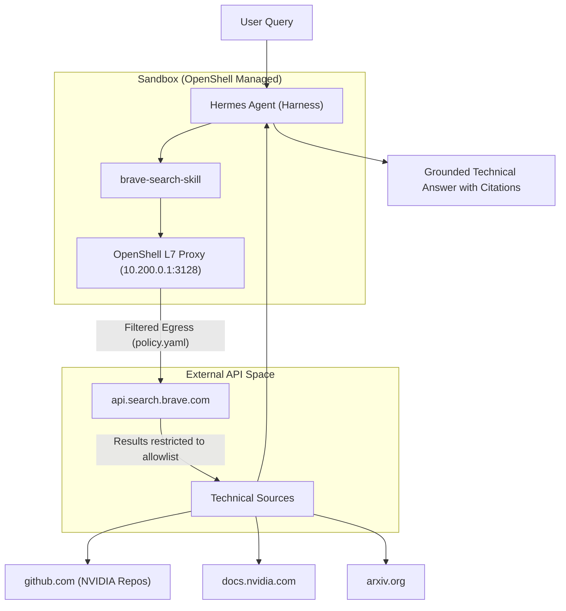
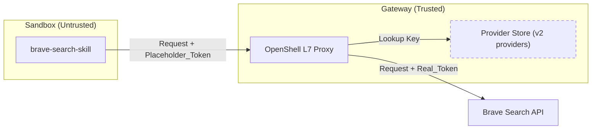

<!-- source: DeepWiki mcp.deepwiki.com · repo NVIDIA/nemoclaw-community · page 2.4 NV Tech Assistant · fetched 2026-10-26 -->

# NV Tech Assistant

Relevant source files

The following files were used as context for generating this wiki page:

- [examples/recipes/nvidia/developer-community-chief-of-staff/.env.example](examples/recipes/nvidia/developer-community-chief-of-staff/.env.example)
- [examples/recipes/nvidia/developer-community-chief-of-staff/README.md](examples/recipes/nvidia/developer-community-chief-of-staff/README.md)

The **NV Tech Assistant** is an NVIDIA-authored recipe designed for grounded technical research. It enables a sandboxed agent to answer complex technical questions by citing evidence from a restricted set of allowlisted domains, including NVIDIA documentation, GitHub repositories, and arXiv pre-prints. It utilizes the **Hermes** agent framework and integrates with **Brave Search** for targeted discovery within its allowlisted boundaries.

## Purpose and Scope

The primary goal of this recipe is to provide a "constrained researcher" persona that avoids hallucinations by strictly adhering to a high-fidelity source list. Unlike general-purpose search agents, the NV Tech Assistant is governed by an **OpenShell** policy that prevents it from accessing the open web, limiting its egress to specific API endpoints and technical domains.

Sources: [examples/README.md:14-14](), [examples/recipes/nvidia/developer-community-chief-of-staff/README.md:5-12]()

---

## Technical Architecture and Data Flow

The recipe follows the standard NemoClaw three-layer architecture: **Model**, **Harness**, and **OpenShell**. The agent operates within a hardened container (Sandbox) and communicates with external technical sources through a secure gateway that performs credential substitution and egress filtering.

### System Data Flow: From Query to Grounded Answer

The following diagram illustrates how a natural language technical query is processed through the system's code entities, specifically highlighting the interaction between the `Hermes` agent and the `OpenShell` L7 proxy.

**Diagram: NV Tech Assistant Technical Research Flow**

Sources: [examples/recipes/nvidia/developer-community-chief-of-staff/README.md:63-135](), [examples/README.md:14-14]()

---

## Lifecycle Scripts

The NV Tech Assistant implements a standardized lifecycle pattern. These scripts manage the environment from initial dependency installation to the final application of the sandbox security policy. They are designed to auto-source configuration from the `.env` file.

| Script | Phase | Description |
| :--- | :--- | :--- |
| `00-onboard.sh` | Onboarding | Verifies the host environment and installs the OpenShell CLI. |
| `01-install.sh` | Installation | Pulls required Docker images and builds the local Hermes research image. |
| `02-providers.sh` | Configuration | Configures inference endpoints and injects the Brave Search API keys into the OpenShell provider store. |
| `03-start.sh` | Execution | Launches the sandbox and applies the `policy.yaml` to the container runtime. |

Sources: [examples/recipes/nvidia/developer-community-chief-of-staff/.env.example:1-12]()

---

## Sandbox Policy and Egress Control

The security of the NV Tech Assistant is defined by its `policy.yaml`. This file enforces a "deny-by-default" network stance, only permitting the agent to communicate with the specific technical domains required for research.

### Egress Allowlist

The agent's network access is strictly limited to:
1.  **Search Discovery**: `api.search.brave.com` (Used by the search skill).
2.  **Research Domains**:
    *   `docs.nvidia.com`
    *   `developer.nvidia.com`
    *   `github.com/NVIDIA/*`
    *   `arxiv.org`
3.  **Inference**: The configured LLM provider (e.g., NVIDIA NIM or OpenAI), validated by `inference_preflight.py`.

### Credential Substitution

The OpenShell gateway handles authentication via the `OpenShell Gateway (127.0.0.1:17670)`. The agent's search skill does not hold the actual `BRAVE_API_KEY`. Instead, it sends a placeholder header, which the gateway replaces with the real credential stored in the host-side provider vault before forwarding the request to Brave.

**Diagram: Credential Substitution and Egress Enforcement**

Sources: [examples/recipes/nvidia/developer-community-chief-of-staff/README.md:46-61](), [examples/recipes/nvidia/developer-community-chief-of-staff/README.md:138-138]()

---

## Key Components

### Hermes Agent Sandbox
The research logic resides in the Hermes sandbox. It uses a specific set of skills focused on retrieval and synthesis. The sandbox environment is provisioned with a narrow egress policy and uses `Landlock/seccomp` for kernel-level isolation.

### Brave Search Integration
The recipe includes a specialized skill that interacts with the Brave Search API. This skill is configured to use the `site:` operator or domain filters to ensure results only originate from the allowlisted technical sources defined in the project scope. The `TAVILY_API_KEY` (if configured in `.env`) provides a similar search-only discovery capability with restricted routes.

Sources: [examples/recipes/nvidia/developer-community-chief-of-staff/README.md:30-34](), [examples/recipes/nvidia/developer-community-chief-of-staff/.env.example:99-108]()

---

