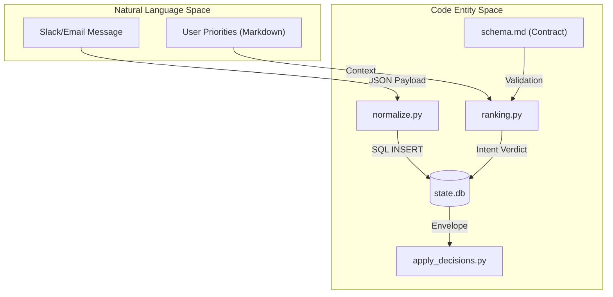
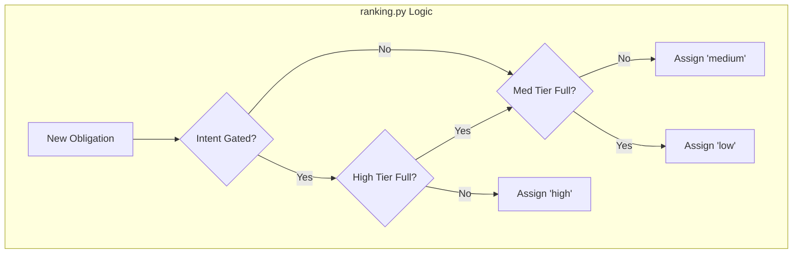

<!-- source: DeepWiki mcp.deepwiki.com · repo NVIDIA/nemoclaw-community · page 2.5 Memory-Driven Chief of Staff · fetched 2026-10-26 -->

# Memory-Driven Chief of Staff

Relevant source files

The following files were used as context for generating this wiki page:

- [examples/recipes/nvidia/memory-driven-chief-of-staff/README.md](examples/recipes/nvidia/memory-driven-chief-of-staff/README.md)
- [examples/recipes/nvidia/memory-driven-chief-of-staff/fixtures/README.md](examples/recipes/nvidia/memory-driven-chief-of-staff/fixtures/README.md)
- [examples/recipes/nvidia/memory-driven-chief-of-staff/fixtures/envelopes/intake.json](examples/recipes/nvidia/memory-driven-chief-of-staff/fixtures/envelopes/intake.json)
- [examples/recipes/nvidia/memory-driven-chief-of-staff/fixtures/graph_messages.json](examples/recipes/nvidia/memory-driven-chief-of-staff/fixtures/graph_messages.json)
- [examples/recipes/nvidia/memory-driven-chief-of-staff/fixtures/memory/attention/current_priorities.md](examples/recipes/nvidia/memory-driven-chief-of-staff/fixtures/memory/attention/current_priorities.md)
- [examples/recipes/nvidia/memory-driven-chief-of-staff/fixtures/memory/index.md](examples/recipes/nvidia/memory-driven-chief-of-staff/fixtures/memory/index.md)
- [examples/recipes/nvidia/memory-driven-chief-of-staff/fixtures/memory/people/dana_okoro.md](examples/recipes/nvidia/memory-driven-chief-of-staff/fixtures/memory/people/dana_okoro.md)
- [examples/recipes/nvidia/memory-driven-chief-of-staff/fixtures/memory/people/sam_ruiz.md](examples/recipes/nvidia/memory-driven-chief-of-staff/fixtures/memory/people/sam_ruiz.md)
- [examples/recipes/nvidia/memory-driven-chief-of-staff/fixtures/memory/projects/billing_migration/billing_migration.md](examples/recipes/nvidia/memory-driven-chief-of-staff/fixtures/memory/projects/billing_migration/billing_migration.md)
- [examples/recipes/nvidia/memory-driven-chief-of-staff/fixtures/slack_messages.json](examples/recipes/nvidia/memory-driven-chief-of-staff/fixtures/slack_messages.json)
- [examples/recipes/nvidia/memory-driven-chief-of-staff/profile/SOUL.md](examples/recipes/nvidia/memory-driven-chief-of-staff/profile/SOUL.md)
- [examples/recipes/nvidia/memory-driven-chief-of-staff/profile/distribution.yaml](examples/recipes/nvidia/memory-driven-chief-of-staff/profile/distribution.yaml)
- [examples/recipes/nvidia/memory-driven-chief-of-staff/profile/schema.md](examples/recipes/nvidia/memory-driven-chief-of-staff/profile/schema.md)
- [examples/recipes/nvidia/memory-driven-chief-of-staff/profile/scripts/_db.py](examples/recipes/nvidia/memory-driven-chief-of-staff/profile/scripts/_db.py)
- [examples/recipes/nvidia/memory-driven-chief-of-staff/profile/scripts/apply_decisions.py](examples/recipes/nvidia/memory-driven-chief-of-staff/profile/scripts/apply_decisions.py)
- [examples/recipes/nvidia/memory-driven-chief-of-staff/profile/scripts/correct.py](examples/recipes/nvidia/memory-driven-chief-of-staff/profile/scripts/correct.py)
- [examples/recipes/nvidia/memory-driven-chief-of-staff/profile/scripts/memory_check.py](examples/recipes/nvidia/memory-driven-chief-of-staff/profile/scripts/memory_check.py)
- [examples/recipes/nvidia/memory-driven-chief-of-staff/profile/scripts/preferences.py](examples/recipes/nvidia/memory-driven-chief-of-staff/profile/scripts/preferences.py)
- [examples/recipes/nvidia/memory-driven-chief-of-staff/profile/scripts/ranking.py](examples/recipes/nvidia/memory-driven-chief-of-staff/profile/scripts/ranking.py)
- [examples/recipes/nvidia/memory-driven-chief-of-staff/profile/scripts/tests/test_apply_decisions.py](examples/recipes/nvidia/memory-driven-chief-of-staff/profile/scripts/tests/test_apply_decisions.py)
- [examples/recipes/nvidia/memory-driven-chief-of-staff/profile/scripts/tests/test_durability.py](examples/recipes/nvidia/memory-driven-chief-of-staff/profile/scripts/tests/test_durability.py)
- [examples/recipes/nvidia/memory-driven-chief-of-staff/profile/scripts/tests/test_memory_check.py](examples/recipes/nvidia/memory-driven-chief-of-staff/profile/scripts/tests/test_memory_check.py)
- [examples/recipes/nvidia/memory-driven-chief-of-staff/profile/scripts/tests/test_ranking.py](examples/recipes/nvidia/memory-driven-chief-of-staff/profile/scripts/tests/test_ranking.py)
- [examples/recipes/nvidia/memory-driven-chief-of-staff/profile/scripts/tests/test_walkthrough.py](examples/recipes/nvidia/memory-driven-chief-of-staff/profile/scripts/tests/test_walkthrough.py)
- [examples/recipes/nvidia/memory-driven-chief-of-staff/profile/scripts/walkthrough.py](examples/recipes/nvidia/memory-driven-chief-of-staff/profile/scripts/walkthrough.py)
- [examples/recipes/nvidia/memory-driven-chief-of-staff/profile/skills/inbound-judging/SKILL.md](examples/recipes/nvidia/memory-driven-chief-of-staff/profile/skills/inbound-judging/SKILL.md)
- [examples/recipes/nvidia/memory-driven-chief-of-staff/profile/skills/memory-consolidation/SKILL.md](examples/recipes/nvidia/memory-driven-chief-of-staff/profile/skills/memory-consolidation/SKILL.md)
- [examples/recipes/nvidia/memory-driven-chief-of-staff/profile/skills/memory-repair/SKILL.md](examples/recipes/nvidia/memory-driven-chief-of-staff/profile/skills/memory-repair/SKILL.md)
- [examples/recipes/nvidia/memory-driven-chief-of-staff/profile/skills/obligation-review/SKILL.md](examples/recipes/nvidia/memory-driven-chief-of-staff/profile/skills/obligation-review/SKILL.md)
- [examples/recipes/nvidia/memory-driven-chief-of-staff/profile/skills/preference-update/SKILL.md](examples/recipes/nvidia/memory-driven-chief-of-staff/profile/skills/preference-update/SKILL.md)

The **Memory-Driven Chief of Staff** is a recipe for the Hermes agent runtime that maintains a locally-authoritative, revisable record of obligations derived from inbound signals (email and Slack). Unlike standard assistants that react to external urgency, this system uses a **Memory-Driven** approach: it admits items to the highest priority tier only if the user's own memory (Markdown-based persona and project files) indicates they have explicitly chosen that work [examples/recipes/nvidia/memory-driven-chief-of-staff/README.md:6-11]().

## System Architecture and Data Flow

The system operates as a closed loop between the **Store** (SQLite), the **Memory** (Markdown), and the **Hermes Skills**. It explicitly avoids writing back to source systems (Outlook/Slack) to preserve the user's data integrity [examples/recipes/nvidia/memory-driven-chief-of-staff/README.md:56-58]().

### Core Components
*   **Store**: A SQLite database at `$HERMES_HOME/workspace/ledger/state.db` containing items, obligations, an append-only audit trail, and source cursors [examples/recipes/nvidia/memory-driven-chief-of-staff/README.md:30]().
*   **Memory**: A set of structured Markdown files at `$HERMES_HOME/workspace/memory/` defining people, projects, and priorities [examples/recipes/nvidia/memory-driven-chief-of-staff/README.md:31]().
*   **Intent Gate**: A logic boundary that prevents "loud" external urgency from occupying the `high` tier unless a memory match exists [examples/recipes/nvidia/memory-driven-chief-of-staff/README.md:36-37]().

### Data Flow: Natural Language to Code Entities

The following diagram illustrates how natural language signals from external sources are transformed into structured obligations and governed by the memory contract.

**Figure 1: Signal Ingestion and Memory Gating**

**Sources:** [examples/recipes/nvidia/memory-driven-chief-of-staff/profile/scripts/normalize.py:1-10](), [examples/recipes/nvidia/memory-driven-chief-of-staff/profile/scripts/ranking.py:1-20](), [examples/recipes/nvidia/memory-driven-chief-of-staff/profile/schema.md:1-50]()

## The Store Schema and Persistence

The local SQLite store is the source of truth for all judgments. It tracks the `intent_gated` status and the `tier` (high, medium, low) for every obligation [examples/recipes/nvidia/memory-driven-chief-of-staff/README.md:32-39]().

### Schema Entities
| Entity | Code Reference | Purpose |
| :--- | :--- | :--- |
| **Obligation** | `state.db` | Represents a single actionable message with its rank and history. |
| **Audit Trail** | `schema.sql` | Append-only log of every change made by the agent or user. |
| **Source Cursors** | `schema.sql` | Tracks sync state for Microsoft Graph and Slack APIs. |

**Sources:** [examples/recipes/nvidia/memory-driven-chief-of-staff/profile/scripts/schema.sql:1-100](), [examples/recipes/nvidia/memory-driven-chief-of-staff/README.md:69-80]()

## Tier Ranking: Cap-and-Cascade

The system employs a deterministic **Cap-and-Cascade** system implemented in `ranking.py`. This ensures the user is never overwhelmed by a single tier [examples/recipes/nvidia/memory-driven-chief-of-staff/README.md:37-38]().

1.  **Cap**: Each tier (`high`, `medium`, `low`) has a fixed maximum number of slots.
2.  **Intent Gate**: Only rows where `intent_gated=True` (confirmed against memory) can enter the `high` tier [examples/recipes/nvidia/memory-driven-chief-of-staff/README.md:36]().
3.  **Cascade**: If an obligation is ranked highly by the model but fails the intent gate, it "cascades" down to the `medium` tier rather than being discarded [examples/recipes/nvidia/memory-driven-chief-of-staff/README.md:37]().
4.  **Reservation**: If fewer items pass the gate than the `high` cap allows, the tier remains partially empty to preserve focus [examples/recipes/nvidia/memory-driven-chief-of-staff/README.md:38]().

**Figure 2: The Ranking Logic Path**

**Sources:** [examples/recipes/nvidia/memory-driven-chief-of-staff/profile/scripts/ranking.py:1-50](), [examples/recipes/nvidia/memory-driven-chief-of-staff/README.md:36-39]()

## Hermes Skills

The recipe provides five core skills that the Hermes agent uses to manage the store and memory.

1.  **inbound-judging**: Evaluates new messages against `schema.md` and `SOUL.md` to produce an initial decision envelope [examples/recipes/nvidia/memory-driven-chief-of-staff/profile/skills/inbound-judging/SKILL.md:1-10]().
2.  **obligation-review**: Periodically re-evaluates open obligations to adjust ranks or decay urgency [examples/recipes/nvidia/memory-driven-chief-of-staff/profile/skills/obligation-review/SKILL.md:1-10]().
3.  **memory-repair**: Scans Markdown files for broken links or stale dates using `memory_check.py` [examples/recipes/nvidia/memory-driven-chief-of-staff/profile/skills/memory-repair/SKILL.md:1-10]().
4.  **memory-consolidation**: Merges fragmented notes into cohesive project/people pages to stay within character budgets [examples/recipes/nvidia/memory-driven-chief-of-staff/profile/skills/memory-consolidation/SKILL.md:1-10]().
5.  **preference-update**: Adjusts the system's ranking weights based on explicit user corrections (pins/ignores) via `preferences.py` [examples/recipes/nvidia/memory-driven-chief-of-staff/profile/skills/preference-update/SKILL.md:1-10]().

**Sources:** [examples/recipes/nvidia/memory-driven-chief-of-staff/README.md:85](), [examples/recipes/nvidia/memory-driven-chief-of-staff/profile/scripts/memory_check.py:1-30]()

## Persona and Memory Contracts

The system's behavior is governed by two foundational documents:

*   **SOUL.md**: The persona contract. It mandates that the agent **must** read the memory index before answering and **must not** guess if information is missing [examples/recipes/nvidia/memory-driven-chief-of-staff/profile/SOUL.md:14-22](). It also enforces the "Memory-Driven" rule: "urgent, but not something you picked up" is a valid and preferred justification for low ranking [examples/recipes/nvidia/memory-driven-chief-of-staff/profile/SOUL.md:38-40]().
*   **schema.md**: The memory contract. It defines six page types (People, Projects, Attention, etc.), indexing rules, and provenance requirements (e.g., `^[source: email, 2026-08-18, trust: high]`) [examples/recipes/nvidia/memory-driven-chief-of-staff/profile/schema.md:1-50]().

**Sources:** [examples/recipes/nvidia/memory-driven-chief-of-staff/profile/SOUL.md:1-40](), [examples/recipes/nvidia/memory-driven-chief-of-staff/profile/schema.md:1-50]()

## Fixture Walkthrough and Testing

The recipe includes a comprehensive test suite (157 tests) and a deterministic walkthrough that requires no live API keys or inference endpoints [examples/recipes/nvidia/memory-driven-chief-of-staff/README.md:13-19]().

### Walkthrough Steps
1.  **Ingestion**: Replays `fixtures/graph_messages.json` and `fixtures/slack_messages.json` through `load_fixtures.py` [examples/recipes/nvidia/memory-driven-chief-of-staff/README.md:108-114]().
2.  **Judgment**: Applies the pre-recorded `fixtures/envelopes/intake.json` decision envelope [examples/recipes/nvidia/memory-driven-chief-of-staff/README.md:80-83]().
3.  **Correction**: Demonstrates a user "pinning" a low-priority item, which triggers the `actor='user'` event in the audit trail [examples/recipes/nvidia/memory-driven-chief-of-staff/profile/scripts/correct.py:1-20]().
4.  **Verification**: Runs `memory_check.py` to detect intentional errors introduced in the fixture memory [examples/recipes/nvidia/memory-driven-chief-of-staff/README.md:103-106]().

### Privacy and Security Model
*   **Local-Only**: The SQLite store and Markdown memory never leave the `$HERMES_HOME` directory [examples/recipes/nvidia/memory-driven-chief-of-staff/README.md:29-31]().
*   **No Write-Back**: The system is physically incapable of modifying the user's real mailbox or Slack history [examples/recipes/nvidia/memory-driven-chief-of-staff/README.md:10-11]().
*   **Auditability**: Every change to an obligation's rank or status is recorded in an append-only table, identifying whether the `actor` was the `system` or the `user` [examples/recipes/nvidia/memory-driven-chief-of-staff/profile/scripts/correct.py:1-20]().

**Sources:** [examples/recipes/nvidia/memory-driven-chief-of-staff/README.md:112-128](), [examples/recipes/nvidia/memory-driven-chief-of-staff/profile/scripts/tests/test_ranking.py:1-50](), [examples/recipes/nvidia/memory-driven-chief-of-staff/fixtures/README.md:1-100]()

---

