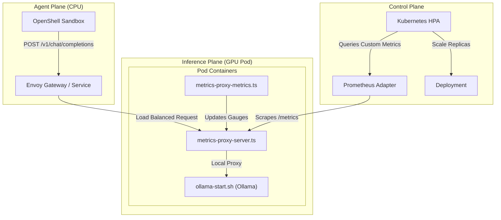
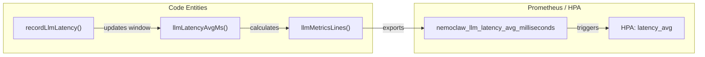

<!-- source: DeepWiki mcp.deepwiki.com · repo NVIDIA/nemoclaw-community · page 2.6 Kubernetes GPU Autoscaling · fetched 2026-10-26 -->

# Kubernetes GPU Autoscaling

Relevant source files

The following files were used as context for generating this wiki page:

- [examples/recipes/nvidia/kubernetes-gpu-autoscaling/.gitignore](examples/recipes/nvidia/kubernetes-gpu-autoscaling/.gitignore)
- [examples/recipes/nvidia/kubernetes-gpu-autoscaling/Chart.yaml](examples/recipes/nvidia/kubernetes-gpu-autoscaling/Chart.yaml)
- [examples/recipes/nvidia/kubernetes-gpu-autoscaling/README.md](examples/recipes/nvidia/kubernetes-gpu-autoscaling/README.md)
- [examples/recipes/nvidia/kubernetes-gpu-autoscaling/files/metrics-proxy-metrics.ts](examples/recipes/nvidia/kubernetes-gpu-autoscaling/files/metrics-proxy-metrics.ts)
- [examples/recipes/nvidia/kubernetes-gpu-autoscaling/files/metrics-proxy-server.ts](examples/recipes/nvidia/kubernetes-gpu-autoscaling/files/metrics-proxy-server.ts)
- [examples/recipes/nvidia/kubernetes-gpu-autoscaling/files/ollama-start.sh](examples/recipes/nvidia/kubernetes-gpu-autoscaling/files/ollama-start.sh)
- [examples/recipes/nvidia/kubernetes-gpu-autoscaling/files/package.json](examples/recipes/nvidia/kubernetes-gpu-autoscaling/files/package.json)
- [examples/recipes/nvidia/kubernetes-gpu-autoscaling/files/questions-sample.txt](examples/recipes/nvidia/kubernetes-gpu-autoscaling/files/questions-sample.txt)

The Kubernetes GPU Autoscaling recipe provides a production-grade architecture for deploying agentic workloads where the **OpenShell Sandbox** (CPU-only) is decoupled from the **Inference Backend** (GPU-backed Ollama). This separation allows for independent scaling: the agent remains a stable, low-resource sandbox while the GPU inference pool dynamically expands and contracts based on real-time demand metrics like GPU utilization or LLM response latency.

[examples/recipes/nvidia/kubernetes-gpu-autoscaling/README.md:8-10]()

## Architecture and Data Flow

The system uses a "Split-Plane" architecture. The **Agent Plane** runs the NemoClaw agent within a secured OpenShell sandbox on CPU nodes. The **Inference Plane** consists of a dynamic pool of Ollama pods, each managed by a Horizontal Pod Autoscaler (HPA).

### Inference Pod Structure
Each inference pod is a "2/2 Ready" unit containing two containers:
1.  **Ollama**: The model server (e.g., `llama3.2:3b`) bound to a physical GPU.
2.  **Metrics-Proxy**: A TypeScript-based sidecar that handles authentication, OpenAI-compatible proxying, health monitoring, and Prometheus metric generation.

### Request Lifecycle Diagram
This diagram illustrates the flow from the OpenShell Sandbox to the autoscaled GPU backends, identifying the specific code entities involved in the proxying and metrics collection.

"Inference Request Flow"

Sources: [examples/recipes/nvidia/kubernetes-gpu-autoscaling/README.md:23-45](), [examples/recipes/nvidia/kubernetes-gpu-autoscaling/files/metrics-proxy-server.ts:5-11]()

## Metrics-Proxy Implementation

The `metrics-proxy-server.ts` acts as the security and observability gateway for each GPU pod. It performs three critical functions:

### 1. Authentication and Security
The proxy enforces Bearer token authentication. It uses `timingSafeEqual` to prevent timing attacks when validating the `INFERENCE_API_KEY`.
- **Path**: [examples/recipes/nvidia/kubernetes-gpu-autoscaling/files/metrics-proxy-server.ts:30-48]()
- **Function**: `authorized(req)` checks both `Authorization: Bearer <key>` and `X-Api-Key` headers.

### 2. Request Proxying and Buffering
To protect the pod from memory exhaustion, the proxy caps the request body size and implements timeouts.
- **Max Body**: 2MB (default) [examples/recipes/nvidia/kubernetes-gpu-autoscaling/files/metrics-proxy-server.ts:24]()
- **Timeout**: 30 seconds [examples/recipes/nvidia/kubernetes-gpu-autoscaling/files/metrics-proxy-server.ts:25]()
- **Function**: `readBody(req)` [examples/recipes/nvidia/kubernetes-gpu-autoscaling/files/metrics-proxy-server.ts:69-104]() buffers the body before passing it to `proxyChatCompletions`.

### 3. Prometheus Metrics Generation
The proxy exposes a `/metrics` endpoint that provides data for the HPA.
- **Metric**: `nemoclaw_llm_latency_avg_milliseconds`
- **Logic**: A rolling average of the last 128 requests. If no requests occur for 60 seconds (`LLM_LATENCY_IDLE_EXPIRE_MS`), the gauge resets to 0 to allow the HPA to scale down.
- **Source**: [examples/recipes/nvidia/kubernetes-gpu-autoscaling/files/metrics-proxy-metrics.ts:5-20]()

## HPA Scaling Strategies

The recipe supports two primary HPA metrics, both utilizing the `AverageValue` target type across all Ready pods.

| Metric | Code Identifier | Scale-Out Trigger |
| :--- | :--- | :--- |
| **GPU Utilization** | `gpu_utilization` | Average pod GPU utilization > 40% |
| **LLM Latency** | `latency_avg` | Average pod response time > 3000ms |

Sources: [examples/recipes/nvidia/kubernetes-gpu-autoscaling/README.md:49-56]()

### HPA Metric Logic Diagram
This diagram maps the Prometheus metric names to the HPA scaling logic.

"Metrics to Scaling Mapping"

Sources: [examples/recipes/nvidia/kubernetes-gpu-autoscaling/files/metrics-proxy-metrics.ts:46-99]()

## Lifecycle and Deployment

The deployment lifecycle is managed via a series of scripts that handle cluster preparation, registry setup, and verification.

### Key Lifecycle Scripts
- **`install-hpa.sh`**: The primary entry point. It configures the GPU operator, installs the Prometheus adapter, and deploys the Helm chart.
- **`ollama-start.sh`**: The entrypoint for the Ollama container. It handles the `ollama serve` process and performs a conditional `ollama pull` only if the model is missing from the persistent volume. [examples/recipes/nvidia/kubernetes-gpu-autoscaling/files/ollama-start.sh:9-31]()
- **`verify-hpa.sh`**: A validation script that checks the readiness of the `metrics-proxy` and ensures the HPA can successfully query the custom metrics.

### Load Testing
The recipe includes a load-testing mechanism using `questions-sample.txt` [examples/recipes/nvidia/kubernetes-gpu-autoscaling/files/questions-sample.txt:1-10](). The test script floods the inference pool with requests to trigger the HPA scale-up logic, allowing operators to verify that new GPU pods are provisioned and integrated into the Envoy LeastRequest pool.

## Configuration and Secrets

The deployment uses a tiered configuration approach:
- **`versions.env`**: Pins the versions for NemoClaw, OpenShell, and the Agent Sandbox. [examples/recipes/nvidia/kubernetes-gpu-autoscaling/README.md:21]()
- **`local.env`**: Stores cluster-specific settings like OIDC credentials and registry paths. This file is git-ignored to prevent credential leaks. [examples/recipes/nvidia/kubernetes-gpu-autoscaling/.gitignore:1-2]()
- **`hpa-tls-values.yaml`**: An overlay file generated during installation to handle mTLS and OIDC configuration for the Envoy Gateway. [examples/recipes/nvidia/kubernetes-gpu-autoscaling/.gitignore:3]()

Sources: [examples/recipes/nvidia/kubernetes-gpu-autoscaling/README.md:82-90]()

---

