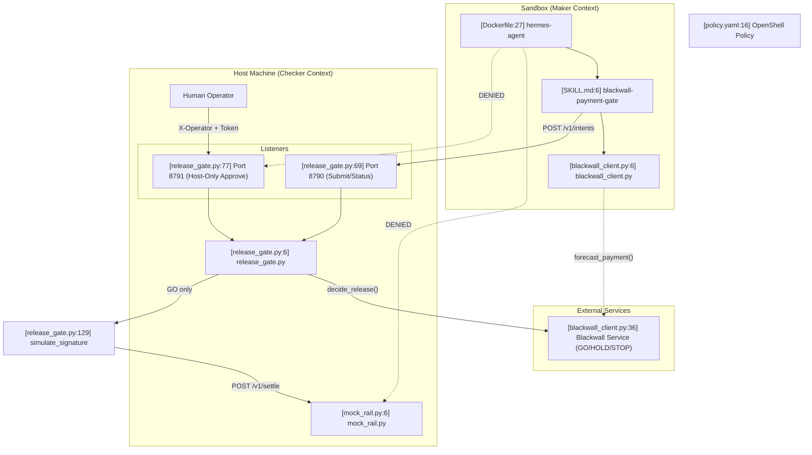
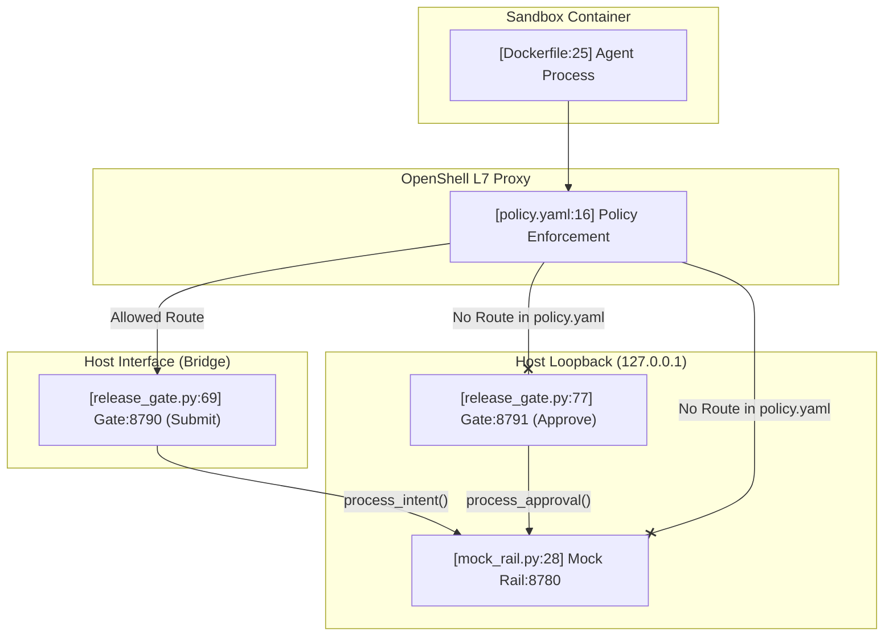

<!-- source: DeepWiki mcp.deepwiki.com · repo NVIDIA/nemoclaw-community · page 3.1 BlueTier x402 Payment Gate · fetched 2026-10-26 -->

# BlueTier x402 Payment Gate

Relevant source files

The following files were used as context for generating this wiki page:

- [examples/recipes/partners/bluetier/x402-payment-gate/Dockerfile](examples/recipes/partners/bluetier/x402-payment-gate/Dockerfile)
- [examples/recipes/partners/bluetier/x402-payment-gate/README.md](examples/recipes/partners/bluetier/x402-payment-gate/README.md)
- [examples/recipes/partners/bluetier/x402-payment-gate/agents/hermes/skills/blackwall-payment-gate/SKILL.md](examples/recipes/partners/bluetier/x402-payment-gate/agents/hermes/skills/blackwall-payment-gate/SKILL.md)
- [examples/recipes/partners/bluetier/x402-payment-gate/host/mock_rail.py](examples/recipes/partners/bluetier/x402-payment-gate/host/mock_rail.py)
- [examples/recipes/partners/bluetier/x402-payment-gate/host/release_gate.py](examples/recipes/partners/bluetier/x402-payment-gate/host/release_gate.py)
- [examples/recipes/partners/bluetier/x402-payment-gate/host/test_release_gate.py](examples/recipes/partners/bluetier/x402-payment-gate/host/test_release_gate.py)
- [examples/recipes/partners/bluetier/x402-payment-gate/policy.yaml](examples/recipes/partners/bluetier/x402-payment-gate/policy.yaml)
- [examples/recipes/partners/bluetier/x402-payment-gate/scripts/blackwall_client.py](examples/recipes/partners/bluetier/x402-payment-gate/scripts/blackwall_client.py)
- [examples/recipes/partners/bluetier/x402-payment-gate/scripts/bring-up.sh](examples/recipes/partners/bluetier/x402-payment-gate/scripts/bring-up.sh)
- [examples/recipes/partners/bluetier/x402-payment-gate/scripts/demo_verdicts.py](examples/recipes/partners/bluetier/x402-payment-gate/scripts/demo_verdicts.py)
- [examples/recipes/partners/bluetier/x402-payment-gate/scripts/tear-down.sh](examples/recipes/partners/bluetier/x402-payment-gate/scripts/tear-down.sh)
- [examples/recipes/partners/bluetier/x402-payment-gate/scripts/verify.sh](examples/recipes/partners/bluetier/x402-payment-gate/scripts/verify.sh)

The **BlueTier x402 Payment Gate** is a partner-contributed recipe that implements a **Maker/Checker** security boundary for [x402](https://www.x402.org/) machine payments. It demonstrates how a sandboxed agent (the **Maker**) can screen and submit payment intents while remaining strictly isolated from the signing keys and payment rails (the **Checker**).

The core security property is the **denied-edge**: the agent sandbox has no network route to any payment rail or facilitator. All settlement logic resides in a host-side release gate that enforces mandatory verdicts from the Blackwall service [examples/recipes/partners/bluetier/x402-payment-gate/README.md:1-21]().

## Architecture and Data Flow

The system splits responsibilities between the sandboxed agent and the host-side infrastructure. The agent uses the `blackwall-payment-gate` skill to perform advisory checks, while the `release_gate.py` service performs the mandatory enforcement.

### System Components Diagram
This diagram maps the logical roles to their specific code entities and network boundaries.

**Sources:** [examples/recipes/partners/bluetier/x402-payment-gate/README.md:46-82](), [examples/recipes/partners/bluetier/x402-payment-gate/policy.yaml:125-146](), [examples/recipes/partners/bluetier/x402-payment-gate/host/release_gate.py:6-24]()

## Maker: blackwall-payment-gate Skill

The agent operates as the **Maker**. It can extract payment details from an HTTP 402 challenge and interact with the `blackwall_client.py` for early warnings [examples/recipes/partners/bluetier/x402-payment-gate/agents/hermes/skills/blackwall-payment-gate/SKILL.md:8-12]().

### Key Functions
*   **Advisory Pre-check**: Uses `forecast_payment` in `blackwall_client.py` to fetch a verdict. This is non-binding but allows the agent to warn the user if a payment is likely to be held or refused [examples/recipes/partners/bluetier/x402-payment-gate/scripts/blackwall_client.py:93-115]().
*   **Intent Submission**: The agent calls `POST /v1/intents` on `host.openshell.internal:8790`. This is the *only* path the agent has toward settlement [examples/recipes/partners/bluetier/x402-payment-gate/agents/hermes/skills/blackwall-payment-gate/SKILL.md:38-41]().

**Sources:** [examples/recipes/partners/bluetier/x402-payment-gate/agents/hermes/skills/blackwall-payment-gate/SKILL.md:1-64](), [examples/recipes/partners/bluetier/x402-payment-gate/scripts/blackwall_client.py:1-25]()

## Checker: release_gate.py

The `release_gate.py` script acts as the **Checker**. It runs outside the sandbox and manages the state machine for payment release. It implements two distinct listeners to maintain the security boundary [examples/recipes/partners/bluetier/x402-payment-gate/host/release_gate.py:6-24]().

### Verdict State Machine
The gate uses `decide_release()` to map Blackwall verdicts to internal actions [examples/recipes/partners/bluetier/x402-payment-gate/host/release_gate.py:117-126]():
*   **GO**: Automated release. The gate calls `simulate_signature()` and settles immediately [examples/recipes/partners/bluetier/x402-payment-gate/host/release_gate.py:124-125]().
*   **HOLD**: Escalation. The intent is stored in `INTENTS` with a `held` status, and a host-side `APPROVAL_TOKEN` is generated [examples/recipes/partners/bluetier/x402-payment-gate/host/release_gate.py:126]().
*   **STOP**: Terminal refusal. No human or token can release the payment [examples/recipes/partners/bluetier/x402-payment-gate/host/release_gate.py:122-123]().

### Human Approval Loopback
For `HELD` intents, the `process_approval` function requires [examples/recipes/partners/bluetier/x402-payment-gate/host/release_gate.py:16-20]():
1.  A valid `intent_id`.
2.  A `X-Operator` header identifying the human.
3.  An `approval_token` found only in the host-side logs (inaccessible to the sandbox).

Crucially, approval triggers a **fresh re-screen** via `forecast_fn`. If a payee becomes sanctioned (STOP) between submission and approval, the gate still refuses to sign [examples/recipes/partners/bluetier/x402-payment-gate/host/release_gate.py:22-24]().

**Sources:** [examples/recipes/partners/bluetier/x402-payment-gate/host/release_gate.py:46-161](), [examples/recipes/partners/bluetier/x402-payment-gate/host/test_release_gate.py:87-110]()

## Network Policy and Denied Edge

The `policy.yaml` defines the sandbox constraints that enforce the maker/checker split.

| Endpoint | Port | Policy | Purpose |
| :--- | :--- | :--- | :--- |
| `integrate.api.nvidia.com` | 443 | Allow | LLM Inference |
| `blackwall-free.onrender.com`| 443 | Allow | Advisory Verdicts |
| `host.openshell.internal` | 8790 | Allow | **Submit Intent** (Least Privilege) |
| `127.0.0.1` (Rail) | 8780 | **Denied** | Settlement (Checker Only) |
| `127.0.0.1` (Approve) | 8791 | **Denied** | Human Override (Checker Only) |

The `bring-up.sh` script facilitates this by binding the `release_gate.py` submit listener to the `openshell-docker` bridge gateway via `GATE_BIND`, while keeping the rail and approval listeners on host loopback (`127.0.0.1`) [examples/recipes/partners/bluetier/x402-payment-gate/scripts/bring-up.sh:51-64]().

### Denied Edge Implementation Diagram
This diagram shows how the `policy.yaml` and network binding create the security boundary.

**Sources:** [examples/recipes/partners/bluetier/x402-payment-gate/policy.yaml:125-146](), [examples/recipes/partners/bluetier/x402-payment-gate/scripts/bring-up.sh:39-50]()

## Implementation Details

### Mock Payment Rail
The `mock_rail.py` service simulates a financial ledger. It binds to `127.0.0.1:8780` and is intentionally unreachable from the sandbox [examples/recipes/partners/bluetier/x402-payment-gate/host/mock_rail.py:6-11](). It records all settled transactions to `RAIL_LEDGER` (defaulting to `.run/rail-ledger.jsonl`) for verification [examples/recipes/partners/bluetier/x402-payment-gate/host/mock_rail.py:28-32]().

### Lifecycle Scripts
*   `bring-up.sh`: Starts the `mock_rail.py` and `release_gate.py` host services, builds the sandbox image, and applies the `policy.yaml` [examples/recipes/partners/bluetier/x402-payment-gate/scripts/bring-up.sh:6-23]().
*   `verify.sh`: Exercises the boundary by attempting to submit intents via `submit()` and verifying that direct access to the rail is blocked by policy, returning an explicit HTTP 403 [examples/recipes/partners/bluetier/x402-payment-gate/scripts/verify.sh:97-128]().
*   `tear-down.sh`: Deletes the sandbox and kills host service processes using PID files stored in `.run/` [examples/recipes/partners/bluetier/x402-payment-gate/scripts/tear-down.sh:6-24]().

**Sources:** [examples/recipes/partners/bluetier/x402-payment-gate/host/mock_rail.py:1-98](), [examples/recipes/partners/bluetier/x402-payment-gate/scripts/bring-up.sh:1-135](), [examples/recipes/partners/bluetier/x402-payment-gate/scripts/tear-down.sh:1-25](), [examples/recipes/partners/bluetier/x402-payment-gate/scripts/verify.sh:1-130]()

---

