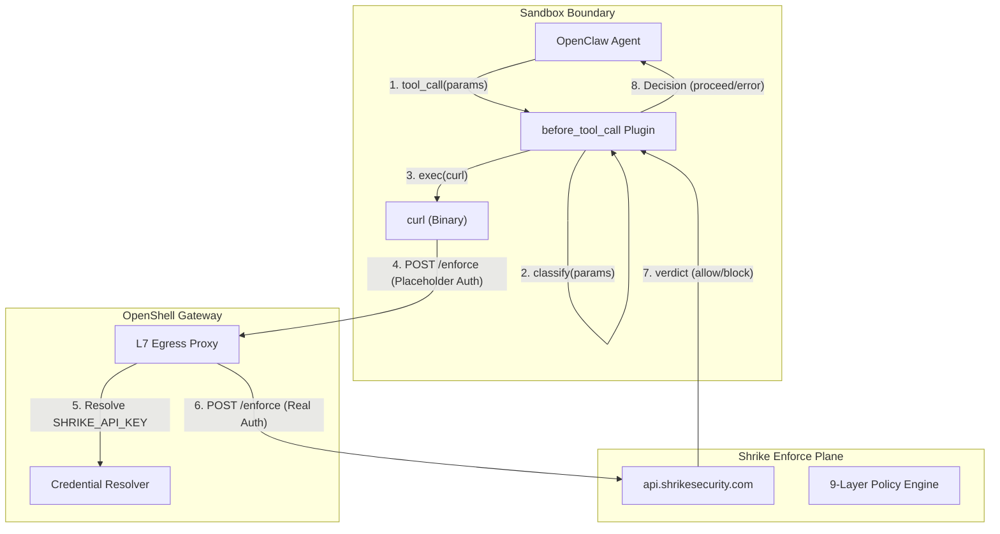
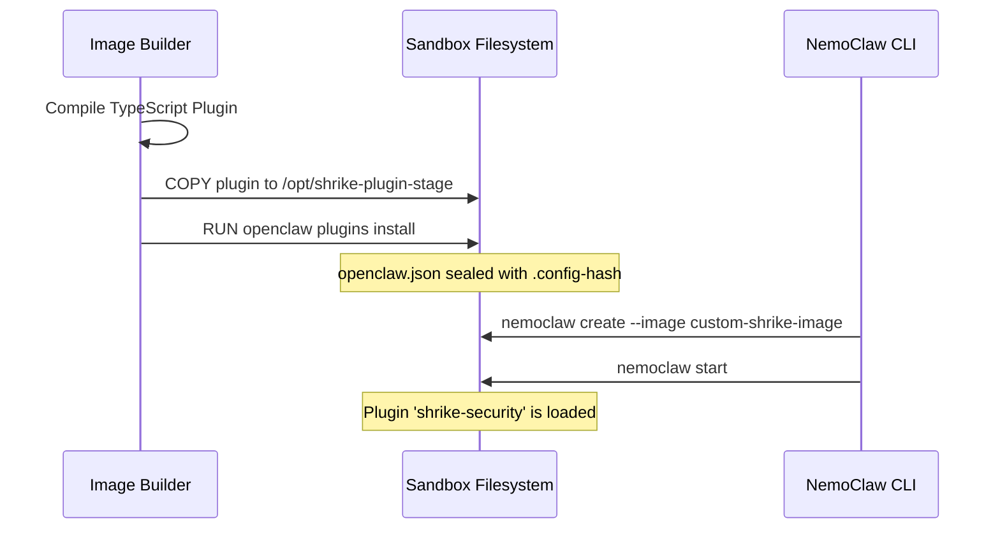

<!-- source: DeepWiki mcp.deepwiki.com · repo NVIDIA/nemoclaw-community · page 3.2 Shrike Security Action Governance · fetched 2026-10-26 -->

# Shrike Security Action Governance

Relevant source files

The following files were used as context for generating this wiki page:

- [examples/recipes/partners/shrike/shrike-security/.env.example](examples/recipes/partners/shrike/shrike-security/.env.example)
- [examples/recipes/partners/shrike/shrike-security/.gitignore](examples/recipes/partners/shrike/shrike-security/.gitignore)
- [examples/recipes/partners/shrike/shrike-security/README.md](examples/recipes/partners/shrike/shrike-security/README.md)
- [examples/recipes/partners/shrike/shrike-security/agents.yaml](examples/recipes/partners/shrike/shrike-security/agents.yaml)
- [examples/recipes/partners/shrike/shrike-security/docs/verify-functionality.md](examples/recipes/partners/shrike/shrike-security/docs/verify-functionality.md)
- [examples/recipes/partners/shrike/shrike-security/plugin/.gitignore](examples/recipes/partners/shrike/shrike-security/plugin/.gitignore)
- [examples/recipes/partners/shrike/shrike-security/plugin/openclaw.plugin.json](examples/recipes/partners/shrike/shrike-security/plugin/openclaw.plugin.json)
- [examples/recipes/partners/shrike/shrike-security/plugin/package-lock.json](examples/recipes/partners/shrike/shrike-security/plugin/package-lock.json)
- [examples/recipes/partners/shrike/shrike-security/plugin/package.json](examples/recipes/partners/shrike/shrike-security/plugin/package.json)

The Shrike Security recipe implements action-level governance for OpenClaw agents. It intercepts tool calls using a `before_tool_call` plugin that evaluates the action content against the Shrike Enforce Plane. While OpenShell defines *where* an agent can act (network/filesystem egress), Shrike governs *what* the action is (e.g., blocking SQL injection or secret exfiltration within an allowed connection) [examples/recipes/partners/shrike/shrike-security/README.md:7-17]().

## System Architecture

The governance system operates as an **in-sandbox defense-in-depth** layer [examples/recipes/partners/shrike/shrike-security/README.md:19-21](). The plugin intercepts tool calls before execution, classifies the intent, and requests a verdict from the Shrike API via a secured egress path.

### Governance Data Flow

**Sources:** [examples/recipes/partners/shrike/shrike-security/README.md:67-72](), [examples/recipes/partners/shrike/shrike-security/docs/verify-functionality.md:79-86]()

## Plugin Implementation

The plugin is a TypeScript module that registers with the OpenClaw runtime hook system. It maps Shrike's granular verdicts (`allow`, `warn`, `require_approval`, `block`) into binary OpenClaw decisions [examples/recipes/partners/shrike/shrike-security/README.md:74-79]().

### Key Entities and Hook Lifecycle
*   **`before_tool_call`**: The primary interception point. The plugin evaluates every tool call against Shrike's enforce plane before it runs, blocking when the verdict is `block` or `require_approval` [examples/recipes/partners/shrike/shrike-security/README.md:7-10]().
*   **Verdict Mapping**:
    *   `allow` / `warn` → OpenClaw `allow` [examples/recipes/partners/shrike/shrike-security/README.md:78-79]().
    *   `block` / `require_approval` → OpenClaw `block` [examples/recipes/partners/shrike/shrike-security/README.md:79-80]().
*   **Fail-Closed Mode**: If no Shrike credential is configured or the API is unreachable, the plugin blocks the action by default (`SHRIKE_FAIL_MODE=closed`) [examples/recipes/partners/shrike/shrike-security/README.md:44-45](), [examples/recipes/partners/shrike/shrike-security/.env.example:34-34]().

**Sources:** [examples/recipes/partners/shrike/shrike-security/README.md:7-17](), [examples/recipes/partners/shrike/shrike-security/plugin/openclaw.plugin.json:1-14]()

## Credential Injection and Network Security

The recipe uses the **OpenShell v2 provider pattern** to prevent the Shrike API key from ever entering the sandbox in plaintext [examples/recipes/partners/shrike/shrike-security/.env.example:3-7]().

| Component | Responsibility | Value |
| :--- | :--- | :--- |
| **Sandbox Env** | Credential Placeholder | `openshell:resolve:env:SHRIKE_API_KEY` |
| **L7 Proxy** | Credential Substitution | Replaces placeholder with real key on egress |
| **Provider Policy** | Egress Scoping | Limits `POST` to `api.shrikesecurity.com` |
| **Enforcement** | Action Governance | `enforcement: enforce` applied to the provider |

**Sources:** [examples/recipes/partners/shrike/shrike-security/providers/shrike.yaml:47](), [examples/recipes/partners/shrike/shrike-security/.env.example:3-7](), [examples/recipes/partners/shrike/shrike-security/docs/verify-functionality.md:105-107]()

## Installation Paths and Config Integrity

The recipe supports two installation modes, primarily differing in how they interact with the NemoClaw **Config-Integrity Shield**.

### Comparison of Install Modes

| Feature | `image` (Recommended) | `runtime` (Dev Escape Hatch) |
| :--- | :--- | :--- |
| **Mechanism** | Baked via `nemoclaw onboard --from` | Installed via `openclaw plugins install` |
| **Durability** | Persists across `rebuild` | Lost on `rebuild` |
| **Integrity** | Sealed at build time (Provenance-guarded) | Rewrites `openclaw.json` out-of-band |
| **Security** | Trusted build-time seal | May trip `GATEWAY_UNSAFE_CONFIG_PATH` |

**Sources:** [examples/recipes/partners/shrike/shrike-security/README.md:90-117](), [examples/recipes/partners/shrike/shrike-security/.env.example:17-27]()

### Image-Based Installation Flow
The recommended path bakes the plugin into a version-matched custom sandbox image during the onboard phase. This avoids runtime configuration races and ensures the plugin is present immediately upon sandbox start [examples/recipes/partners/shrike/shrike-security/docs/verify-functionality.md:55-62]().

**Sources:** [examples/recipes/partners/shrike/shrike-security/docs/verify-functionality.md:55-62](), [examples/recipes/partners/shrike/shrike-security/README.md:113-119]()

## Verification and Governance Coverage

The `verify.sh` script validates the governance layer by posting tool calls directly to the gateway's `/tools/invoke` endpoint and checking the results [examples/recipes/partners/shrike/shrike-security/docs/verify-functionality.md:7-14]().

### Governance Test Cases
The governance is exercised against a reference agent defined in `agents.yaml`, which explicitly allow-lists tool classes Shrike governs, such as file operations, command execution, and network access [examples/recipes/partners/shrike/shrike-security/agents.yaml:26-52]().

| Test Case | Expected Outcome | Shrike Reason / Error Type |
| :--- | :--- | :--- |
| Benign Query | `allowed` | Proceed to downstream tool execution |
| Destructive Command | `blocked` | `tool_call_blocked` |
| SQL Injection | `blocked` | `tool_call_blocked` |
| Prompt Injection | `blocked` | `tool_call_blocked` with recovery hint |
| Secret Exfiltration | `blocked` | `tool_call_blocked` |

**Sources:** [examples/recipes/partners/shrike/shrike-security/docs/verify-functionality.md:30-39](), [examples/recipes/partners/shrike/shrike-security/docs/verify-functionality.md:79-86](), [examples/recipes/partners/shrike/shrike-security/agents.yaml:26-52]()

---

