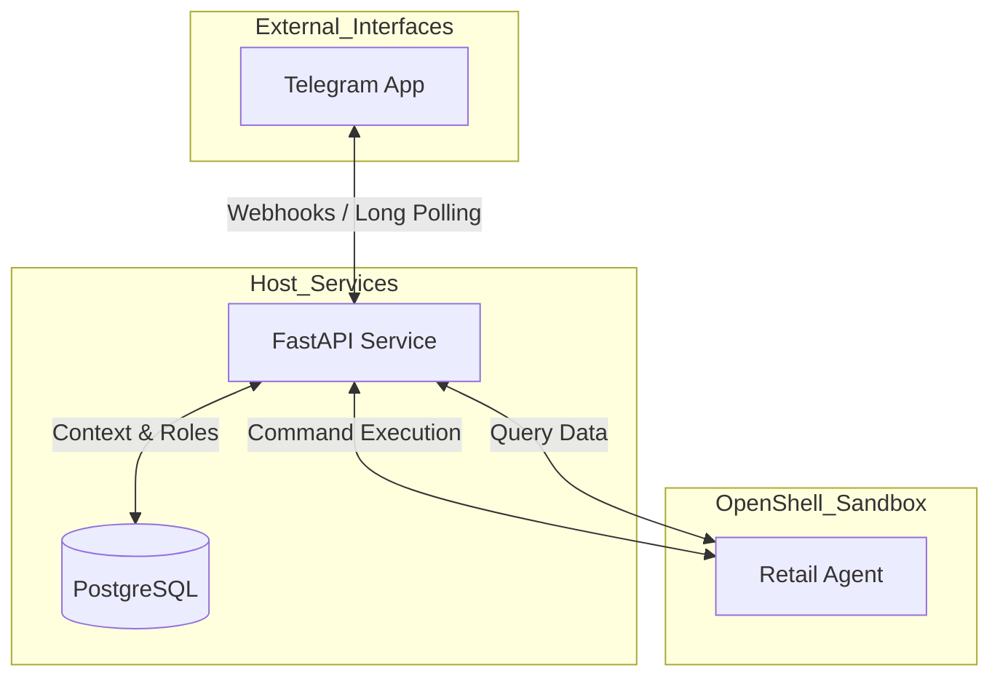
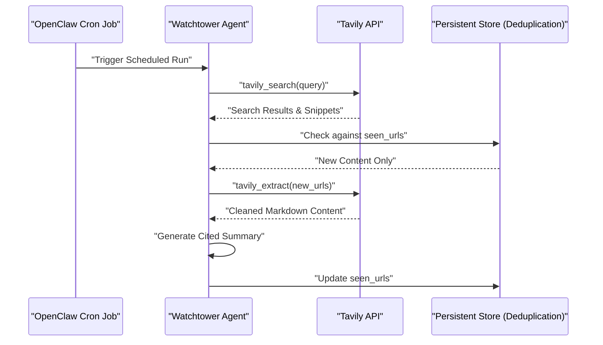

<!-- source: DeepWiki mcp.deepwiki.com · repo NVIDIA/nemoclaw-community · page 3.3 HPE Retail Assistant and Tavily Watchtower · fetched 2026-10-26 -->

# HPE Retail Assistant and Tavily Watchtower

Relevant source files

The following files were used as context for generating this wiki page:

- [examples/recipes/partners/bluetier/x402-payment-gate/README.md](examples/recipes/partners/bluetier/x402-payment-gate/README.md)

This page documents two partner-contributed recipes: the **HPE Retail Assistant** and the **Tavily Watchtower**. While serving different domains—retail operations and web monitoring—both recipes demonstrate the integration of external APIs (Telegram, Tavily) with the NemoClaw architecture to provide role-aware, scheduled, and persistent agentic workflows.

## HPE Retail Assistant

The HPE Retail Assistant is a role-aware retail operations agent designed for Telegram-native interaction. It utilizes a stack comprising FastAPI, PostgreSQL, and Docker Compose for local development, with Helm charts provided for production Kubernetes deployment [examples/README.md:23-23]().

### Architecture and Data Flow

The assistant functions as a bridge between retail staff on the front end (Telegram) and enterprise data on the back end. It maintains state and role information to ensure that operational commands are executed within the correct context.

**HPE Retail Assistant Component Interaction**

Sources: [examples/README.md:23-23]()

### Implementation Details

*   **Telegram Integration**: Native interaction via Telegram bots allows retail workers to query inventory, check schedules, or report issues directly from mobile devices.
*   **Role-Awareness**: The system uses a PostgreSQL backend to store user roles, ensuring that a "Store Manager" has different capabilities and data access than a "Floor Associate."
*   **Deployment Flexibility**: 
    *   **Docker Compose**: Used for rapid local prototyping and "shared-nothing" isolation [examples/README.md:23-23]().
    *   **Helm**: Provides the necessary configuration for scaling the FastAPI and PostgreSQL components in a Kubernetes environment.

## Tavily Watchtower

The Tavily Watchtower is a specialized recipe for scheduled, cited web monitoring. It focuses on persistent deduplication of search results to ensure that the agent only reports new, relevant information over time [examples/README.md:25-25]().

### Scheduled Monitoring Workflow

The Watchtower operates as an OpenClaw Cron Job, triggering search and extraction tasks at defined intervals. It leverages the Tavily API for high-quality web search and content extraction, specifically optimized for LLM consumption.

**Tavily Watchtower Logic Flow**

Sources: [examples/README.md:25-25]()

### Key Components

| Component | Code Entity / Role | Description |
| :--- | :--- | :--- |
| **Search Engine** | `Tavily Search` | Provides real-time web access with filtering for AI agents. |
| **Extractor** | `Tavily Extract` | Converts raw HTML from discovered URLs into clean, LLM-ready Markdown. |
| **Deduplicator** | `Persistent Store` | Prevents redundant processing of the same URLs across different scheduled runs. |
| **Scheduler** | `OpenClaw Cron` | Manages the execution lifecycle of the monitoring task. |

## Deployment Patterns

Both recipes follow the NemoClaw standard of being independently deployable with documented prerequisites and policies [examples/README.md:55-57]().

### Shared Patterns
*   **Credential Handling**: Both utilize OpenShell's mechanism for injecting API keys (Telegram Bot Token for HPE, Tavily API Key for Watchtower) without hardcoding them in the agent logic.
*   **Auditable Outputs**: The Tavily Watchtower specifically emphasizes auditable, cited outputs to ensure the provenance of web-sourced information [examples/README.md:25-25]().
*   **Maker/Checker Influence**: While these recipes are not strict maker/checker implementations like the `x402-payment-gate`, they follow the pattern of keeping high-privilege operations (like persistent database writes or external search triggers) outside the core LLM logic where possible [examples/recipes/partners/bluetier/x402-payment-gate/README.md:3-9]().

### Deployment Differences
*   **HPE Retail Assistant**: Optimized for persistent service availability (FastAPI) and multi-user state management (PostgreSQL) [examples/README.md:23-23]().
*   **Tavily Watchtower**: Optimized for ephemeral, scheduled execution (Cron Job) and incremental data processing (Deduplication) [examples/README.md:25-25]().

Sources: [examples/README.md:23-25](), [examples/README.md:55-57](), [examples/recipes/partners/bluetier/x402-payment-gate/README.md:3-9]()

---

