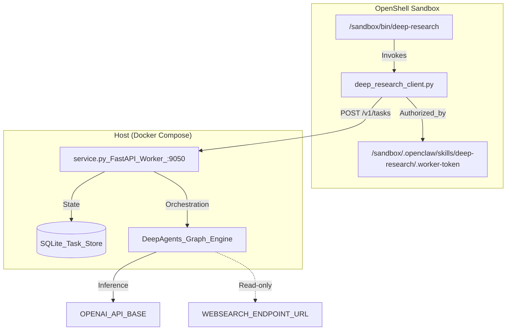
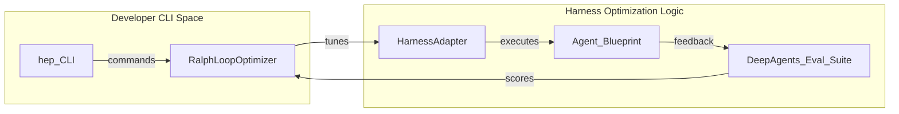

<!-- source: DeepWiki mcp.deepwiki.com · repo NVIDIA/nemoclaw-community · page 4 Community Recipes and Developer Tools · fetched 2026-10-26 -->

# Community Recipes and Developer Tools

Relevant source files

The following files were used as context for generating this wiki page:

- [examples/recipes/community/deep-research-worker/.env.example](examples/recipes/community/deep-research-worker/.env.example)
- [examples/recipes/community/deep-research-worker/.gitignore](examples/recipes/community/deep-research-worker/.gitignore)
- [examples/recipes/community/deep-research-worker/README.md](examples/recipes/community/deep-research-worker/README.md)
- [examples/recipes/community/deep-research-worker/docker-compose.yml](examples/recipes/community/deep-research-worker/docker-compose.yml)
- [examples/recipes/community/deep-research-worker/policies/deep-research-worker.yaml](examples/recipes/community/deep-research-worker/policies/deep-research-worker.yaml)
- [examples/recipes/community/deep-research-worker/scripts/bring-up.sh](examples/recipes/community/deep-research-worker/scripts/bring-up.sh)
- [examples/recipes/community/deep-research-worker/scripts/teardown.sh](examples/recipes/community/deep-research-worker/scripts/teardown.sh)
- [examples/recipes/community/deep-research-worker/scripts/verify.sh](examples/recipes/community/deep-research-worker/scripts/verify.sh)
- [examples/recipes/community/deep-research-worker/src/Dockerfile](examples/recipes/community/deep-research-worker/src/Dockerfile)

This page provides an overview of community-contributed recipes, field demonstrations, and developer-oriented tooling within the NemoClaw Community repository. While NVIDIA and Partners provide core recipes, the community ecosystem includes asynchronous research workers and experimental optimization tools for harness engineering.

## Overview of Community and Tooling Artifacts

The catalog distinguishes between reusable **Recipes** (independent, deployable agent patterns), **Demos** (environment-specific field examples), **Launchables** (fast-path onboarding), and **Developer Tools** (experimental CLI utilities).

| Category | Example | Purpose |
| :--- | :--- | :--- |
| **Community Recipe** | [Deep Research Worker](#4.1) | Asynchronous long-horizon research via a host-side FastAPI worker. |
| **Developer Tool** | [Harness Engineering Playground (hep)](#4.2) | CLI for eval-driven harness profile optimization. |
| **Field Demo** | [Field Demos and Launchables](#4.3) | Hardware-specific demo for 3D rendering and physics simulation. |
| **Launchable** | [Field Demos and Launchables](#4.3) | Fastest path to a running sandbox on Brev.dev. |

Sources: [examples/README.md:4-51]()

---

## Deep Research Worker (#4.1)

The **Deep Research Worker** is a community-contributed recipe designed for long-running research tasks that exceed the typical interactive timeout of a standard agent session. It offloads complex research graphs to a host-side service while maintaining a narrow security posture for the sandbox [examples/recipes/community/deep-research-worker/README.md:6-10]().

### System Architecture: Sandbox to Worker
The following diagram illustrates how the `deep-research` skill bridges the OpenShell sandbox boundary to the host-side worker.

**Deep Research Task Flow**

Sources: [examples/recipes/community/deep-research-worker/README.md:105-124](), [examples/recipes/community/deep-research-worker/scripts/bring-up.sh:26-51](), [examples/recipes/community/deep-research-worker/docker-compose.yml:13-28]()

### Key Components
*   **FastAPI Worker**: Runs on the host (port `9050`) and manages a queue of research tasks using a LangGraph-based engine [examples/recipes/community/deep-research-worker/README.md:168-172]().
*   **Task Lifecycle**: Tasks move through states (queued, planning, research, completed) with persistence in a local SQLite database [examples/recipes/community/deep-research-worker/README.md:129-160]().
*   **Narrow Egress Policy**: The sandbox is restricted via `policies/deep-research-worker.yaml` to only communicate with `host.openshell.internal:9050` [examples/recipes/community/deep-research-worker/policies/deep-research-worker.yaml:8-15]().
*   **Secret Handling**: Uses `DEEPAGENTS_SERVICE_SECRET` for bearer token authentication. `scripts/bring-up.sh` generates this token and installs it as a mode-`0600` file in the sandbox [examples/recipes/community/deep-research-worker/scripts/bring-up.sh:38-41](), [examples/recipes/community/deep-research-worker/scripts/bring-up.sh:109]().

For implementation details, task queue management, and bring-up scripts, see the **[Deep Research Worker](#4.1)** child page.

---

## Harness Engineering Playground (hep) (#4.2)

The **Harness Engineering Playground (`hep`)** is a developer tool designed for "Meta-Harnessing"—the process of using automated loops to optimize the configuration of an agent's harness. Unlike other examples in this repository, `hep` is not an OpenShell blueprint but an experimental CLI tool.

### Functional Scope
*   **RalphLoopOptimizer**: An automated routine that iteratively adjusts harness parameters to maximize performance against evaluation suites.
*   **HarnessAdapter**: An extension seam that allows developers to plug in different agent harnesses for tuning.
*   **DeepAgents Integration**: Leverages the DeepAgents evaluation suite to provide ground-truth scoring for the optimization loops.

**Harness Engineering Playground Entity Mapping**

Sources: [examples/README.md:47-49]()

For details on CLI usage and the optimization algorithms, see the **[Harness Engineering Playground (hep)](#4.2)** child page.

---

## Field Demos and Launchables (#4.3)

These artifacts provide specific entry points for specialized hardware or cloud environments.

### DGX Station Blender and Omniverse
A field-proven demo that showcases NemoClaw controlling a local GUI environment.
*   **Stack**: Uses `Nemotron 3 Ultra` for reasoning.
*   **Skills**: Integrates with `Blender MCP` and `OVPhysX` for 3D simulation and rendering.
*   **Entry Point**: Managed via a `Codex` entry point for high-fidelity 3D operations.

### Brev Launchable
The **Brev Hermes** launchable is the recommended starting point for users without local GPU resources. It provides a pre-configured Jupyter notebook that automates the setup of a NemoClaw-managed Hermes sandbox on a standard Brev CPU instance.

For setup guides and hardware requirements, see **[Field Demos and Launchables](#4.3)**.

Sources: [examples/README.md:35-43]()

---

