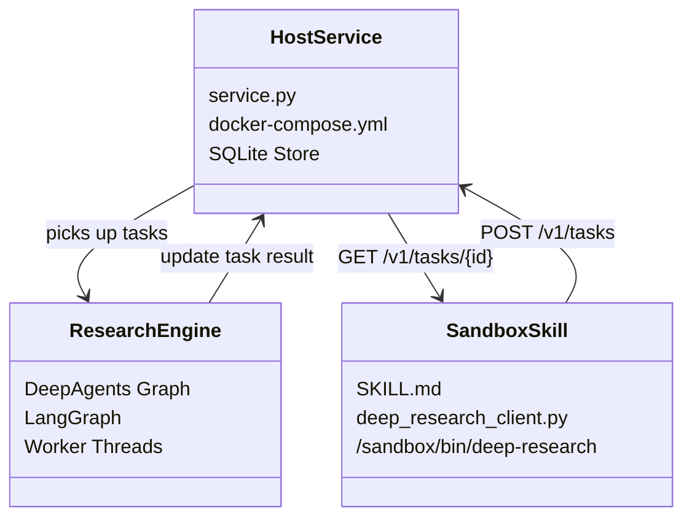

<!-- source: DeepWiki mcp.deepwiki.com · repo NVIDIA/nemoclaw-community · page 4.1 Deep Research Worker · fetched 2026-10-26 -->

# Deep Research Worker

<details>
<summary>Relevant source files</summary>

The following files were used as context for generating this wiki page:

- [examples/recipes/community/deep-research-worker/.env.example](examples/recipes/community/deep-research-worker/.env.example)
- [examples/recipes/community/deep-research-worker/.gitignore](examples/recipes/community/deep-research-worker/.gitignore)
- [examples/recipes/community/deep-research-worker/README.md](examples/recipes/community/deep-research-worker/README.md)
- [examples/recipes/community/deep-research-worker/docker-compose.yml](examples/recipes/community/deep-research-worker/docker-compose.yml)
- [examples/recipes/community/deep-research-worker/policies/deep-research-worker.yaml](examples/recipes/community/deep-research-worker/policies/deep-research-worker.yaml)
- [examples/recipes/community/deep-research-worker/scripts/bring-up.sh](examples/recipes/community/deep-research-worker/scripts/bring-up.sh)
- [examples/recipes/community/deep-research-worker/scripts/teardown.sh](examples/recipes/community/deep-research-worker/scripts/teardown.sh)
- [examples/recipes/community/deep-research-worker/scripts/verify.sh](examples/recipes/community/deep-research-worker/scripts/verify.sh)
- [examples/recipes/community/deep-research-worker/src/Dockerfile](examples/recipes/community/deep-research-worker/src/Dockerfile)

</details>


The Deep Research Worker is a community-contributed recipe designed for asynchronous, long-horizon research within a NemoClaw-managed sandbox. It bridges the gap between interactive agent sessions and long-running analysis tasks by offloading complex research to a host-side worker service. The worker utilizes a LangChain DeepAgents graph, a SQLite task store, and narrow egress policies to maintain a secure, inspectable research environment [examples/recipes/community/deep-research-worker/README.md:6-10]().

## System Architecture

The recipe follows a host-worker pattern where the heavy lifting of research occurs outside the primary agent sandbox to avoid context window saturation and session timeouts [examples/recipes/community/deep-research-worker/README.md:101-124]().

### High-Level Data Flow

"Deep Research Data Flow"
```mermaid
flowchart LR
    subgraph Sandbox["OpenShell Sandbox"]
        direction TB
        [cli_wrapper]("/sandbox/bin/deep-research")
        [client_py]("deep_research_client.py")
        [token_file](".worker-token (0600)")
        
        [cli_wrapper] --> [client_py]
        [client_py] -. reads .-> [token_file]
    end

    subgraph Host["Host Services (Docker Compose)"]
        [fastapi_svc]("service.py (FastAPI)")
        [sqlite_db]("SQLite Queue")
        [worker_loop]("DeepAgents Engine (LangGraph)")
        
        [fastapi_svc] <--> [sqlite_db]
        [worker_loop] <--> [sqlite_db]
    end

    subgraph Egress["External Services"]
        [llm_api]("Inference Endpoint")
        [search_api]("Web/Doc Search")
    end

    [client_py] -- "REST (Bearer Auth)" --> [fastapi_svc]
    [worker_loop] -. tool calls .-> [search_api]
    [worker_loop] -- "Prompts" --> [llm_api]
```
Sources: [examples/recipes/community/deep-research-worker/README.md:103-124](), [examples/recipes/community/deep-research-worker/scripts/bring-up.sh:22-26](), [examples/recipes/community/deep-research-worker/src/Dockerfile:27]()

## Implementation Details

### Host-Side Worker Service
The worker is hosted as a FastAPI application within a Docker container. It manages a task queue and coordinates the research graph.

*   **FastAPI Host (`service.py`)**: Exposes the `/v1/tasks` API for creating, listing, and retrieving research results. It listens on port 9050 [examples/recipes/community/deep-research-worker/src/Dockerfile:20-27](), [examples/recipes/community/deep-research-worker/docker-compose.yml:16]().
*   **Task Store**: A SQLite-backed persistent queue with 7-day (168-hour) retention by default, tracking states such as `running`, `failed`, `cancelled`, and `expired` [examples/recipes/community/deep-research-worker/README.md:168-172](), [examples/recipes/community/deep-research-worker/.env.example:11]().
*   **DeepAgents Graph Engine**: A LangGraph-based agentic loop for multi-step research. It supports up to 5 concurrent worker threads [examples/recipes/community/deep-research-worker/README.md:171-179](), [examples/recipes/community/deep-research-worker/docker-compose.yml:17]().

### Sandbox Skill and CLI
The `deep-research` skill is installed into the sandbox, providing a command-line interface for users or other agents to trigger research tasks.

*   **CLI Wrapper**: A bash script generated at `/sandbox/bin/deep-research` that sets `DEEPAGENTS_ENDPOINT_URL` and `DEEPAGENTS_CREDENTIAL_FILE` before executing the Python client [examples/recipes/community/deep-research-worker/scripts/bring-up.sh:100-108]().
*   **Python Client (`deep_research_client.py`)**: Handles the HTTP communication with the host worker, including authentication via the `DEEPAGENTS_SERVICE_SECRET` bearer token [examples/recipes/community/deep-research-worker/scripts/bring-up.sh:97-98](), [examples/recipes/community/deep-research-worker/README.md:68-72]().
*   **Skill Metadata (`SKILL.md`)**: Provides the sandbox agent with the schema for interacting with the research service [examples/recipes/community/deep-research-worker/scripts/bring-up.sh:96]().

### Security and Egress Policy
The recipe enforces a "shared-nothing" isolation principle using a narrow `policy.yaml`.

*   **Network Policy**: The sandbox is restricted to `host.openshell.internal:9050` using the `rest` protocol [examples/recipes/community/deep-research-worker/policies/deep-research-worker.yaml:8-14]().
*   **Method Whitelisting**: Only `GET`, `POST`, and `DELETE` methods are allowed for specific paths like `/health`, `/healthz`, and `/v1/tasks/**` [examples/recipes/community/deep-research-worker/policies/deep-research-worker.yaml:16-34]().
*   **Credential Handling**: If not provided in `.env`, a strong URL-safe token is generated during bring-up and installed as a mode-`0600` file inside the sandbox [examples/recipes/community/deep-research-worker/scripts/bring-up.sh:38-40](), [examples/recipes/community/deep-research-worker/scripts/bring-up.sh:109]().

"Code Entity to Component Mapping"

Sources: [examples/recipes/community/deep-research-worker/README.md:129-160](), [examples/recipes/community/deep-research-worker/docker-compose.yml:5-29](), [examples/recipes/community/deep-research-worker/scripts/bring-up.sh:94-110]()

## Task Lifecycle and Depth Presets

The research engine processes tasks through four distinct phases: Planning, Research, Cross-validation, and Finalization [examples/recipes/community/deep-research-worker/README.md:147-150]().

| Depth Preset | Description |
| :--- | :--- |
| `shallow` | Optimized for quick summaries and low latency. |
| `standard` | Balanced multi-step research. |
| `deep` | Comprehensive analysis with high step count and verification. |

Sources: [examples/recipes/community/deep-research-worker/README.md:91-92](), [examples/recipes/community/deep-research-worker/README.md:165](), [examples/recipes/community/deep-research-worker/docker-compose.yml:21]()

## Lifecycle Scripts

The recipe provides standardized scripts for deployment and maintenance.

*   **`scripts/bring-up.sh`**:
    1.  Generates or loads the `DEEPAGENTS_SERVICE_SECRET` [examples/recipes/community/deep-research-worker/scripts/bring-up.sh:29-40]().
    2.  Starts the host worker via `docker compose up -d --build` [examples/recipes/community/deep-research-worker/scripts/bring-up.sh:54]().
    3.  Applies the narrow egress policy to the target sandbox [examples/recipes/community/deep-research-worker/scripts/bring-up.sh:79-92]().
    4.  Installs skill assets and the CLI wrapper into the sandbox [examples/recipes/community/deep-research-worker/scripts/bring-up.sh:94-110]().
*   **`scripts/verify.sh`**: Performs syntax checks on shell and Python files, runs unit tests (via local environment or temporary Docker container), and validates policy/skill metadata [examples/recipes/community/deep-research-worker/scripts/verify.sh:10-54]().
*   **`scripts/teardown.sh`**: Stops the host-side worker and removes the installed skill assets from the sandbox [examples/recipes/community/deep-research-worker/scripts/teardown.sh:23-39]().

Sources: [examples/recipes/community/deep-research-worker/scripts/bring-up.sh:1-114](), [examples/recipes/community/deep-research-worker/scripts/verify.sh:1-56](), [examples/recipes/community/deep-research-worker/scripts/teardown.sh:1-41]()

---

