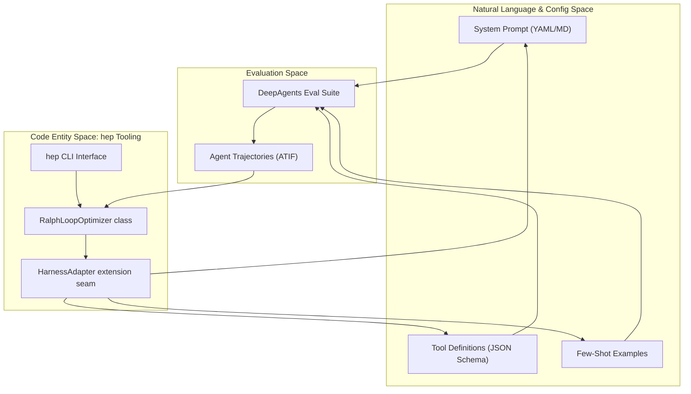
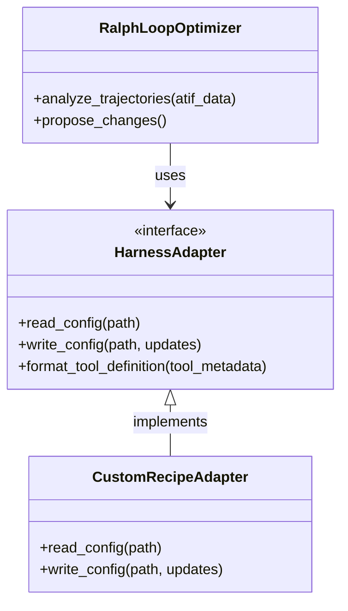

<!-- source: DeepWiki mcp.deepwiki.com · repo NVIDIA/nemoclaw-community · page 4.2 Harness Engineering Playground (hep) · fetched 2026-10-26 -->

# Harness Engineering Playground (hep)

Relevant source files

The following files were used as context for generating this wiki page:

- [examples/recipes/community/deep-research-worker/.env.example](examples/recipes/community/deep-research-worker/.env.example)
- [examples/recipes/community/deep-research-worker/.gitignore](examples/recipes/community/deep-research-worker/.gitignore)
- [examples/recipes/community/deep-research-worker/README.md](examples/recipes/community/deep-research-worker/README.md)
- [examples/recipes/community/deep-research-worker/docker-compose.yml](examples/recipes/community/deep-research-worker/docker-compose.yml)
- [examples/recipes/community/deep-research-worker/policies/deep-research-worker.yaml](examples/recipes/community/deep-research-worker/policies/deep-research-worker.yaml)
- [examples/recipes/community/deep-research-worker/scripts/bring-up.sh](examples/recipes/community/deep-research-worker/scripts/bring-up.sh)
- [examples/recipes/community/deep-research-worker/scripts/teardown.sh](examples/recipes/community/deep-research-worker/scripts/teardown.sh)
- [examples/recipes/community/deep-research-worker/scripts/verify.sh](examples/recipes/community/deep-research-worker/scripts/verify.sh)
- [examples/recipes/community/deep-research-worker/src/Dockerfile](examples/recipes/community/deep-research-worker/src/Dockerfile)

The **Harness Engineering Playground (`hep`)** is a developer tool designed for the iterative optimization of agent harness profiles. Unlike standard agent blueprints in the NemoClaw Community repository, which are designed to be executed via the OpenShell gateway, `hep` provides an experimental CLI for eval-driven harness tuning. It automates the refinement of system prompts, tool definitions, and few-shot examples by closing the loop between agent performance and harness configuration [examples/README.md:47-49]().

## Core Architecture and Components

The `hep` tool operates as an optimization loop that bridges the gap between raw model capabilities and structured harness requirements. It is built around three primary entities: the `RalphLoopOptimizer`, the `HarnessAdapter`, and the `DeepAgents` evaluation suite.

### System Data Flow

The following diagram illustrates how `hep` iterates on a harness profile based on evaluation feedback.

**Diagram: hep Optimization Loop**

**Sources:** [examples/README.md:47-49]()

### Key Components

| Component | Role in `hep` |
| :--- | :--- |
| `RalphLoopOptimizer` | The central engine that analyzes evaluation results and suggests modifications to the harness configuration to improve specific metrics (e.g., tool-calling accuracy, grounding). |
| `HarnessAdapter` | An extension seam that allows `hep` to interface with different harness formats. It translates internal optimizer suggestions into the specific YAML or JSON structures required by the target agent. |
| `DeepAgents` Integration | A suite of evaluation benchmarks (integrated via LangChain DeepAgents graph patterns) that provides the "ground truth" performance data needed for the optimizer to make informed adjustments [examples/recipes/community/deep-research-worker/README.md:9-10](). |
| CLI Interface | The entry point for developers to trigger optimization runs, inspect proposed changes, and apply them to their local blueprints. |

**Sources:** [examples/README.md:47-49](), [examples/recipes/community/deep-research-worker/README.md:9-10]()

## Implementation Detail: Harness Tuning vs. Agent Execution

It is critical to distinguish `hep` from the standard NemoClaw blueprints found in `recipes/`. While a recipe defines a deployable agent instance (including sandbox policies and host services), `hep` is a meta-tool used during the *engineering phase* of those recipes.

### Comparison: hep vs. OpenShell Blueprints

| Feature | OpenShell Blueprint (e.g., Chief of Staff) | Harness Engineering Playground (`hep`) |
| :--- | :--- | :--- |
| **Primary Goal** | Task execution and production deployment. | Harness profile optimization and tuning. |
| **Runtime** | OpenShell Gateway + Sandbox Container. | Local CLI + Eval Runner. |
| **Configuration** | Static `policy.yaml` and `SOUL.md`. | Dynamic, evolving harness parameters. |
| **Output** | Completed tasks, ATIF trajectories. | Optimized system prompts and tool schemas. |

**Sources:** [examples/README.md:47-49](), [examples/README.md:55-57]()

## Integration with DeepAgents Eval Suite

The `hep` tool leverages the `DeepAgents` eval suite to quantify agent performance. The optimization process follows a specific sequence:
1. **Baseline Generation:** The `hep` CLI runs a set of tasks through the current harness configuration.
2. **Trajectory Analysis:** The resulting Agent Trajectory Interchange Format (ATIF) data is parsed by the `RalphLoopOptimizer`.
3. **Hypothesis Generation:** The optimizer identifies failure points (e.g., "Agent failed to call `search_github` because the parameter description was ambiguous").
4. **Refinement:** The `HarnessAdapter` updates the local configuration files.
5. **Validation:** The cycle repeats until the performance reaches the target threshold.

**Sources:** [examples/README.md:47-49](), [examples/README.md:31-31]()

## Code Structure and Extension Seams

Developers looking to extend `hep` for custom harness formats should focus on the `HarnessAdapter`. This class acts as the translation layer between the `RalphLoopOptimizer`'s generic optimization suggestions and the specific syntax of a target agent's configuration.

**Diagram: HarnessAdapter Extension Seam**

**Sources:** [examples/README.md:47-49]()

---

