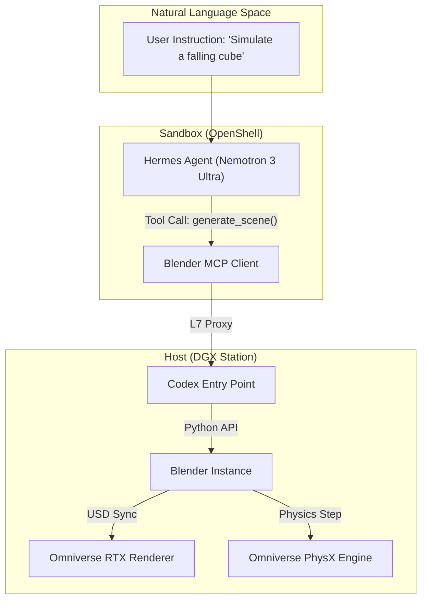
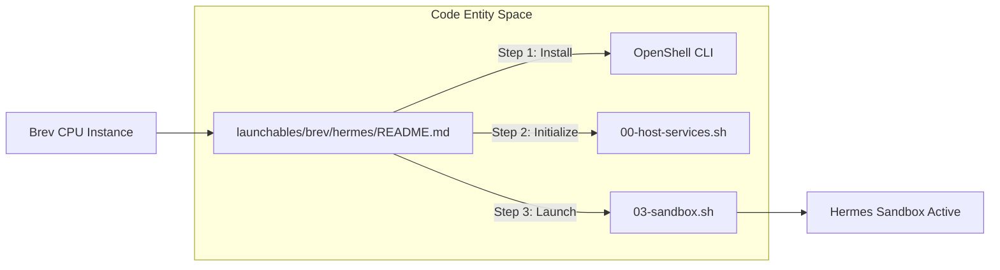

<!-- source: DeepWiki mcp.deepwiki.com · repo NVIDIA/nemoclaw-community · page 4.3 Field Demos and Launchables · fetched 2026-10-26 -->

# Field Demos and Launchables

Relevant source files

The following files were used as context for generating this wiki page:

- [README.md](README.md)
- [SUPPORT.md](SUPPORT.md)
- [examples/README.md](examples/README.md)
- [examples/recipes/partners/bluetier/x402-payment-gate/.dockerignore](examples/recipes/partners/bluetier/x402-payment-gate/.dockerignore)

This section documents specialized deployment targets for NemoClaw blueprints that fall outside the standard recipe structure. These include high-fidelity field demonstrations involving 3D simulation environments and "Launchables"—streamlined entry points designed for rapid onboarding on cloud infrastructure [examples/README.md:35-45]().

## 1. DGX Station Blender and Omniverse Demo

The **DGX Station Blender and Omniverse** demo showcases the integration of a sandboxed agent with professional 3D content creation tools and simulation engines. Unlike text-only recipes, this demo focuses on spatial reasoning and physics-based simulation control [examples/README.md:39-39]().

### 1.1. System Architecture and Data Flow

The demo utilizes a multi-layered stack to bridge natural language instructions to high-fidelity 3D renders. The agent operates within an OpenShell sandbox, communicating with host-side 3D applications through a specialized Model Context Protocol (MCP) bridge.

**Diagram: Blender/Omniverse Control Flow**

### 1.2. Key Components

*   **Nemotron 3 Ultra**: The primary model used for complex reasoning and Python script generation for 3D scenes [examples/README.md:39-39]().
*   **Blender MCP**: A Model Context Protocol implementation that exposes Blender's internal state and command execution as tools to the agent.
*   **Codex Entry Point**: The primary interface on the host machine that receives instructions from the sandbox and translates them into Blender-native commands.
*   **OVRTX & OVPhysX**: NVIDIA Omniverse components used for real-time ray-traced rendering and hardware-accelerated physics simulations respectively [examples/README.md:39-39]().

**Sources:**
* [examples/README.md:35-40]()

---

## 2. Brev Launchable (Hermes)

The **Brev Launchable** represents the "fastest path" to a running NemoClaw environment. It is designed to move a developer from a fresh cloud instance to a functional Hermes sandbox in minimal time [examples/README.md:45-45]().

### 2.1. Deployment Workflow

The launchable is delivered as a notebook-driven path optimized for Brev.dev CPU instances. It automates the environment preparation that is typically performed manually in the "Getting Started" guide [README.md:26-34]().

**Diagram: Brev Launchable Lifecycle**

### 2.2. Implementation Details

The Brev launchable abstracts the following complexities:
1.  **Dependency Injection**: Automatically handles the installation of the OpenShell CLI and necessary Docker configurations on the Brev instance [README.md:40-42]().
2.  **Resource Mapping**: Configures the sandbox to operate efficiently on CPU-only instances, ensuring the Hermes agent remains responsive without requiring a local GPU by leveraging remote inference providers [README.md:42-42]().
3.  **Connectivity**: Pre-configures the OpenShell gateway to handle the specific networking environment of a Brev instance, including the necessary L7 proxy and provider placeholders [README.md:12-14]().

**Sources:**
* [README.md:26-34]()
* [README.md:40-45]()
* [examples/README.md:41-46]()

---

