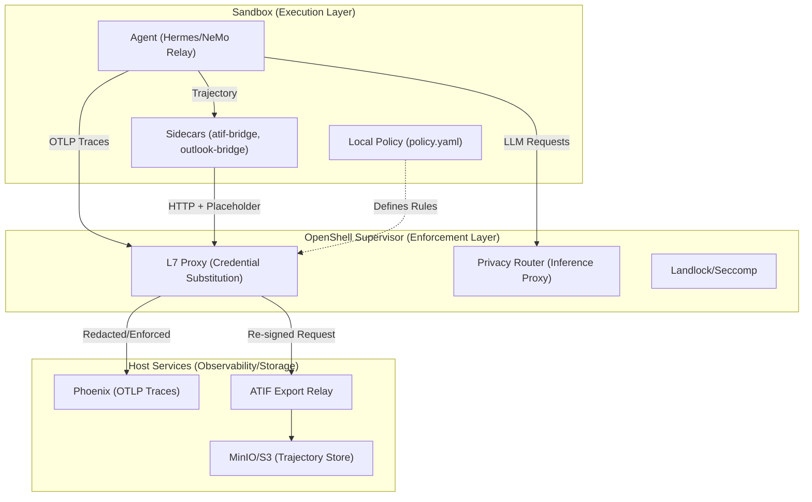

<!-- source: DeepWiki mcp.deepwiki.com · repo NVIDIA/nemoclaw-community · page 5 Security, Observability, and Cross-Cutting Concerns · fetched 2026-10-26 -->

# Security, Observability, and Cross-Cutting Concerns

Relevant source files

The following files were used as context for generating this wiki page:

- [examples/recipes/nvidia/developer-community-chief-of-staff/agents/hermes/generate-config.ts](examples/recipes/nvidia/developer-community-chief-of-staff/agents/hermes/generate-config.ts)
- [examples/recipes/nvidia/developer-community-chief-of-staff/certs/README.md](examples/recipes/nvidia/developer-community-chief-of-staff/certs/README.md)
- [examples/recipes/nvidia/developer-community-chief-of-staff/docs/host-tls-proxy.md](examples/recipes/nvidia/developer-community-chief-of-staff/docs/host-tls-proxy.md)
- [examples/recipes/nvidia/developer-community-chief-of-staff/docs/verify-functionality.md](examples/recipes/nvidia/developer-community-chief-of-staff/docs/verify-functionality.md)
- [examples/recipes/nvidia/developer-community-chief-of-staff/policy.yaml](examples/recipes/nvidia/developer-community-chief-of-staff/policy.yaml)
- [examples/recipes/nvidia/developer-community-chief-of-staff/scripts/inference_preflight.py](examples/recipes/nvidia/developer-community-chief-of-staff/scripts/inference_preflight.py)
- [examples/recipes/nvidia/developer-community-chief-of-staff/scripts/stage-enterprise-cas.sh](examples/recipes/nvidia/developer-community-chief-of-staff/scripts/stage-enterprise-cas.sh)
- [examples/recipes/nvidia/developer-community-chief-of-staff/scripts/tear-down.sh](examples/recipes/nvidia/developer-community-chief-of-staff/scripts/tear-down.sh)
- [examples/recipes/nvidia/developer-community-chief-of-staff/scripts/tests/test-enterprise-ca-staging.sh](examples/recipes/nvidia/developer-community-chief-of-staff/scripts/tests/test-enterprise-ca-staging.sh)
- [examples/recipes/nvidia/developer-community-chief-of-staff/scripts/tests/test_inference_preflight.py](examples/recipes/nvidia/developer-community-chief-of-staff/scripts/tests/test_inference_preflight.py)

This section provides a high-level overview of the security and observability frameworks shared across all NemoClaw recipes. The repository implements a "defense-in-depth" strategy where security is not a perimeter concern but is integrated into the agent's runtime environment, network path, and credential lifecycle.

The architecture relies on the **OpenShell** sandbox supervisor to enforce workload-specific protections, including L7 egress allowlists and credential placeholder substitution, ensuring that real secrets never enter the agent's execution environment [examples/recipes/nvidia/developer-community-chief-of-staff/agents/hermes/generate-config.ts:207-210]().

### Security and Observability Architecture

The diagram below illustrates how security policies and observability probes are interleaved across the host and sandbox layers.

**Cross-Cutting Concern Integration Map**

Sources: [examples/recipes/nvidia/developer-community-chief-of-staff/policy.yaml:89-108](), [examples/recipes/nvidia/developer-community-chief-of-staff/agents/hermes/generate-config.ts:153-155]()

---

### OpenShell Policy and Network Security
All recipes enforce a **denied-edge principle**. By default, the agent has no network access. Access is granted through a `policy.yaml` file that defines explicit L7 (HTTP/HTTPS) allowlists [examples/recipes/nvidia/developer-community-chief-of-staff/policy.yaml:36-80](). This mechanism also performs **credential substitution**: the agent uses placeholder strings (e.g., `openshell:resolve:env:SLACK_BOT_TOKEN`), which the OpenShell L7 proxy replaces with real credentials only as the request leaves the host [examples/recipes/nvidia/developer-community-chief-of-staff/agents/hermes/generate-config.ts:166-169]().

For details, see [OpenShell Policy and Network Security](#5.1).

### ATIF Trajectory Export and Observability
Observability is handled through two parallel paths:
1.  **OTLP/OpenInference Tracing**: Real-time spans are sent to a host-side **Phoenix** instance for debugging, typically via the `phoenix_collector` endpoint at `host.openshell.internal:6006` [examples/recipes/nvidia/developer-community-chief-of-staff/policy.yaml:89-93]().
2.  **ATIF (Agent Trajectory Interchange Format)**: Completed agent trajectories (logs, tool calls, and results) are bundled and exported via the `atif-bridge` sidecar to a central `atif-export-relay` [examples/recipes/nvidia/developer-community-chief-of-staff/scripts/tear-down.sh:8-11]().

For details, see [ATIF Trajectory Export and Observability](#5.2).

### Inference Preflight and Provider Validation
Before an agent starts, the `inference_preflight.py` system validates the environment. This includes checking for "leakage" of sensitive markers (e.g., `<tool_call>`) in model responses [examples/recipes/nvidia/developer-community-chief-of-staff/scripts/inference_preflight.py:26-26](), verifying that the configured inference route is active, and ensuring that the `SANDBOX_HOST_ALIAS` (`host.openshell.internal`) is correctly translated for the host-side preflight check [examples/recipes/nvidia/developer-community-chief-of-staff/scripts/inference_preflight.py:52-60]().

For details, see [Inference Preflight and Provider Validation](#5.3).

### Microsoft Graph OAuth2 and Outlook Integration
For recipes involving Microsoft 365, a specialized `outlook-bridge` sidecar manages the complexity of OAuth2 flows. It provides a local HTTP interface for the agent to poll and reply to emails while the OpenShell gateway handles background provider refreshes [examples/recipes/nvidia/developer-community-chief-of-staff/scripts/tear-down.sh:79-79](). The `outlook-bridge.py` sidecar ensures the agent can interact with mailboxes without handling raw OAuth2 tokens directly.

For details, see [Microsoft Graph OAuth2 and Outlook Integration](#5.4).

### TLS and CA Management
In environments with TLS interception (e.g., corporate proxies), the repository provides `stage-enterprise-cas.sh` to inject local CA certificates into the sandbox build context [examples/recipes/nvidia/developer-community-chief-of-staff/scripts/stage-enterprise-cas.sh:5-8](). Additionally, for inference endpoints that are difficult to reach due to split-horizon DNS or local CA chains, an optional `host-tls-proxy.py` can be used to bridge the sandbox to the host's trust store [examples/recipes/nvidia/developer-community-chief-of-staff/docs/host-tls-proxy.md:34-35]().

---

### Summary of Security Roles

| Component | Security/Observability Role | Code Entity / Service |
| :--- | :--- | :--- |
| **Sandbox** | Restricted Execution | `OpenShell Sandbox` |
| **Proxy** | Secret Masking & Egress Control | `OpenShell L7 Proxy` |
| **Telemetry** | OpenInference Tracing | `Phoenix` |
| **Persistence** | Immutable Trajectory Storage | `atif-export-relay` |
| **Validation** | Environment Integrity Checks | `inference_preflight.py` |
| **TLS Bridge** | Local CA Injection | `stage-enterprise-cas.sh` |

Sources: [examples/recipes/nvidia/developer-community-chief-of-staff/scripts/inference_preflight.py:31-35](), [examples/recipes/nvidia/developer-community-chief-of-staff/scripts/stage-enterprise-cas.sh:14-15](), [examples/recipes/nvidia/developer-community-chief-of-staff/docs/host-tls-proxy.md:43-47]()

---

