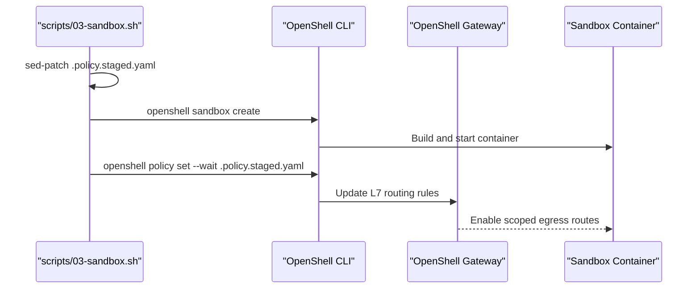

<!-- source: DeepWiki mcp.deepwiki.com · repo NVIDIA/nemoclaw-community · page 5.1 OpenShell Policy and Network Security · fetched 2026-10-26 -->

# OpenShell Policy and Network Security

<details>
<summary>Relevant source files</summary>

The following files were used as context for generating this wiki page:

- [examples/recipes/nvidia/developer-community-chief-of-staff/agents/hermes/generate-config.ts](examples/recipes/nvidia/developer-community-chief-of-staff/agents/hermes/generate-config.ts)
- [examples/recipes/nvidia/developer-community-chief-of-staff/docs/verify-functionality.md](examples/recipes/nvidia/developer-community-chief-of-staff/docs/verify-functionality.md)
- [examples/recipes/nvidia/developer-community-chief-of-staff/policy.yaml](examples/recipes/nvidia/developer-community-chief-of-staff/policy.yaml)
- [examples/recipes/nvidia/developer-community-chief-of-staff/providers/github.yaml](examples/recipes/nvidia/developer-community-chief-of-staff/providers/github.yaml)
- [examples/recipes/nvidia/developer-community-chief-of-staff/providers/gitlab.yaml](examples/recipes/nvidia/developer-community-chief-of-staff/providers/gitlab.yaml)
- [examples/recipes/nvidia/developer-community-chief-of-staff/providers/tavily-search.yaml](examples/recipes/nvidia/developer-community-chief-of-staff/providers/tavily-search.yaml)
- [examples/recipes/nvidia/developer-community-chief-of-staff/scripts/tear-down.sh](examples/recipes/nvidia/developer-community-chief-of-staff/scripts/tear-down.sh)
- [examples/recipes/partners/bluetier/x402-payment-gate/policy.yaml](examples/recipes/partners/bluetier/x402-payment-gate/policy.yaml)

</details>


This page documents the security architecture of the NemoClaw Community repository, focusing on how **OpenShell** enforces network isolation, credential safety, and the "denied-edge" principle. It covers the implementation of whitelist-based egress rules, the L7 proxy mechanism for credential substitution, and the lifecycle of policy application during agent bring-up.

## Purpose and Scope

The security model ensures that even if an agent's prompt is compromised (e.g., via prompt injection), the impact is strictly limited by the **OpenShell Gateway**. The gateway acts as an L7 intercepting proxy that validates every request against a `policy.yaml` definition before it leaves the sandbox.

Key security guarantees include:
*   **Whitelist-only Egress:** No network traffic is permitted unless explicitly defined in the policy [examples/recipes/nvidia/developer-community-chief-of-staff/policy.yaml:27-31]().
*   **Credential Masking:** The sandbox never sees real API keys; it uses provider placeholders which the gateway replaces at the edge [examples/recipes/nvidia/developer-community-chief-of-staff/agents/hermes/generate-config.ts:162-173]().
*   **Binary Pinning:** Network access can be restricted to specific executable paths, such as `python3` or `curl` [examples/recipes/nvidia/developer-community-chief-of-staff/policy.yaml:81-86]().
*   **Path-Level Scoping:** Egress rules are restricted to specific HTTP methods and URL paths, such as read-only access to specific GitHub repositories [examples/recipes/nvidia/developer-community-chief-of-staff/policy.yaml:148-150]().

---

## Whitelist-based Egress and Path Scoping

OpenShell policies define granular access to external services. Unlike standard firewalls that operate at L3/L4 (IP/Port), OpenShell operates at L7, allowing for deep inspection of REST requests.

### Implementation Pattern
Policies are defined in `policy.yaml` files within each recipe. For example, the Developer Community Chief of Staff recipe restricts GitHub access to a single repository by using a placeholder `__GITHUB_READONLY_REPOSITORY_RULES__` that is substituted during deployment [examples/recipes/nvidia/developer-community-chief-of-staff/policy.yaml:150-150]().

### Policy Structure Example
| Field | Description |
| :--- | :--- |
| `host` | The target domain or `host.openshell.internal` for host-routed services [examples/recipes/nvidia/developer-community-chief-of-staff/policy.yaml:92-93](). |
| `protocol` | Typically `rest` to enable L7 inspection [examples/recipes/nvidia/developer-community-chief-of-staff/policy.yaml:41-41](). |
| `tls` | `terminate` allows the gateway to inspect encrypted traffic [examples/recipes/nvidia/developer-community-chief-of-staff/policy.yaml:42-42](). |
| `rules` | A list of `allow` objects specifying `method` and `path` [examples/recipes/nvidia/developer-community-chief-of-staff/policy.yaml:45-47](). |
| `binaries` | A whitelist of paths allowed to initiate this network connection [examples/recipes/nvidia/developer-community-chief-of-staff/policy.yaml:81-86](). |

**Sources:** [examples/recipes/nvidia/developer-community-chief-of-staff/policy.yaml:27-86](), [examples/recipes/partners/bluetier/x402-payment-gate/policy.yaml:39-92]()

---

## Two-Stage Policy Application

To ensure a "fail-closed" state, NemoClaw recipes follow a two-stage bring-up pattern. The sandbox is first created, and the full network policy is applied only after the environment is stabilized and placeholders are resolved.

### Data Flow: Bring-up Lifecycle
The `03-sandbox.sh` script manages this transition, including patching placeholders like `__GITHUB_READONLY_REPOSITORY_RULES__` with real values from the environment [examples/recipes/nvidia/developer-community-chief-of-staff/policy.yaml:150-150](). The `tear-down.sh` script ensures these staged policy files are cleaned up [examples/recipes/nvidia/developer-community-chief-of-staff/scripts/tear-down.sh:100-104]().

**Sandbox Policy Application Flow**

**Sources:** [examples/recipes/nvidia/developer-community-chief-of-staff/scripts/tear-down.sh:97-105](), [examples/recipes/nvidia/developer-community-chief-of-staff/policy.yaml:138-150]()

---

## Credential Substitution and Provider Placeholders

A core security principle in NemoClaw is that **secrets never enter the sandbox**. Instead, the sandbox is configured with "Provider Placeholders."

1.  **Host-side Configuration:** The user provides real credentials (e.g., `SLACK_BOT_TOKEN`) in a `.env` file on the host.
2.  **Provider Creation:** The `02-providers.sh` script (or manual setup) registers these with OpenShell.
3.  **Sandbox Mapping:** The sandbox is linked to these providers during creation.
4.  **L7 Substitution:** The agent configuration uses strings like `openshell:resolve:env:SLACK_BOT_TOKEN` [examples/recipes/nvidia/developer-community-chief-of-staff/agents/hermes/generate-config.ts:168-169](). When the agent makes a request, the OpenShell Gateway identifies the placeholder, fetches the secret from its own secure store, and injects the `Authorization` header [examples/recipes/nvidia/developer-community-chief-of-staff/providers/tavily-search.yaml:4-7]().

**Sources:** [examples/recipes/nvidia/developer-community-chief-of-staff/agents/hermes/generate-config.ts:162-173](), [examples/recipes/nvidia/developer-community-chief-of-staff/providers/tavily-search.yaml:4-25]()

---

## The Denied-Edge Principle

The "Denied-Edge" principle ensures that high-stakes actions (like moving money or deleting data) cannot be performed directly by the agent, even if the network policy allows communication with the service.

### Implementation: FinGuard and x402
In the `x402-payment-gate` recipe, the sandbox policy allows the agent to talk to a `release-gate` on `host.openshell.internal:8790` to submit payment intents [examples/recipes/partners/bluetier/x402-payment-gate/policy.yaml:125-136](). However, the actual payment rail (port `8780`) is **explicitly omitted** from the policy [examples/recipes/partners/bluetier/x402-payment-gate/policy.yaml:12-15](). The agent has no physical network path to the money; it can only "ask" a host-side process to act, which then requires human-in-the-loop approval.

**Entity Mapping: Security Boundaries**
```mermaid
graph TD
    subgraph Sandbox["OpenShell Sandbox (hermes-runtime)"]
        A["Agent Skill (python3)"]
        B["Placeholder Creds"]
    end

    subgraph Gateway["OpenShell Gateway (L7 Proxy)"]
        C["Policy Enforcement (policy.yaml)"]
        D["Credential Injection"]
    end

    subgraph Host["Host Machine (Trusted)"]
        E["release_gate.py (Human-in-the-loop)"]
        F["Mock Payment Rail (Port 8780)"]
    end

    subgraph Internet["Public Internet"]
        G["Inference API (NVIDIA)"]
    end

    A -- "1. POST /v1/intents" --> C
    C -- "2. Validated Path" --> E
    E -- "3. Human Approval" --> F
    A -- "4. POST /v1/chat" --> C
    C -- "5. Inject API Key" --> D
    D --> G

    style F stroke-dasharray: 5 5
    note right of F: "DENIED EDGE: No path from Sandbox to 8780"
```
**Sources:** [examples/recipes/partners/bluetier/x402-payment-gate/policy.yaml:12-15](), [examples/recipes/partners/bluetier/x402-payment-gate/policy.yaml:125-146]()

---

## TLS and Certificate Management

Inside the sandbox, standard TLS clients (like `curl` or `requests`) must trust the OpenShell Gateway's CA to allow L7 inspection.

### Enterprise CA Staging
For environments with corporate TLS interception, NemoClaw provides a mechanism to inject custom CA roots into the sandbox build process. This involves staging certificates from the host into the sandbox build context so they can be added to the system trust store.

### Host-side TLS Proxy
If an inference endpoint uses a certificate the sandbox cannot trust (e.g., self-signed or split-horizon DNS), a host-side proxy can be used. This utility creates a plain-HTTP bridge on the host that handles the TLS handshake using the host's native trust store, allowing the sandbox to communicate securely without certificate errors.

**Sources:** [examples/recipes/nvidia/developer-community-chief-of-staff/policy.yaml:42-42](), [examples/recipes/nvidia/developer-community-chief-of-staff/providers/github.yaml:16-20](), [examples/recipes/nvidia/developer-community-chief-of-staff/providers/gitlab.yaml:15-20]()

---

