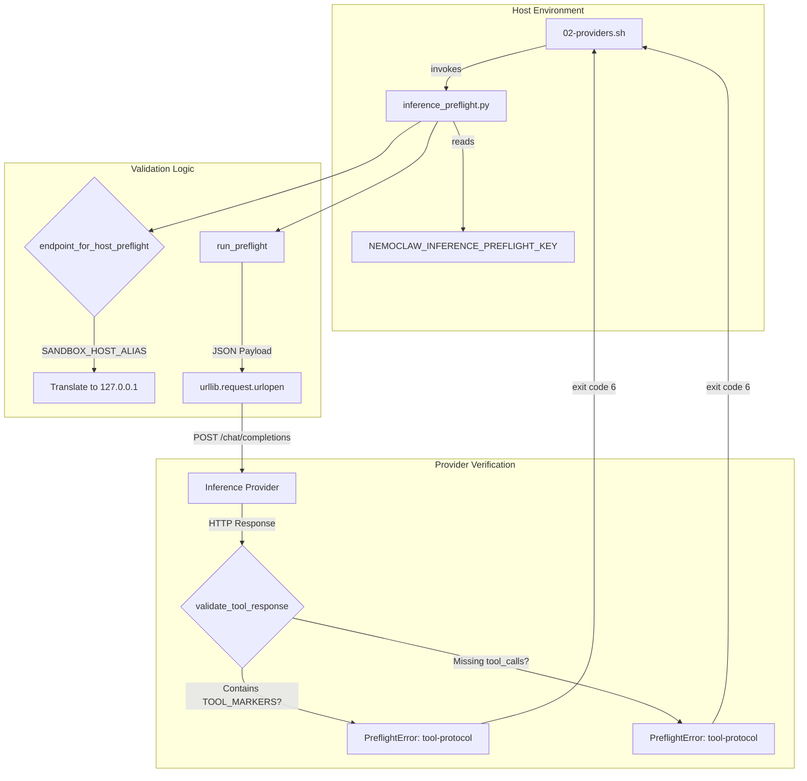
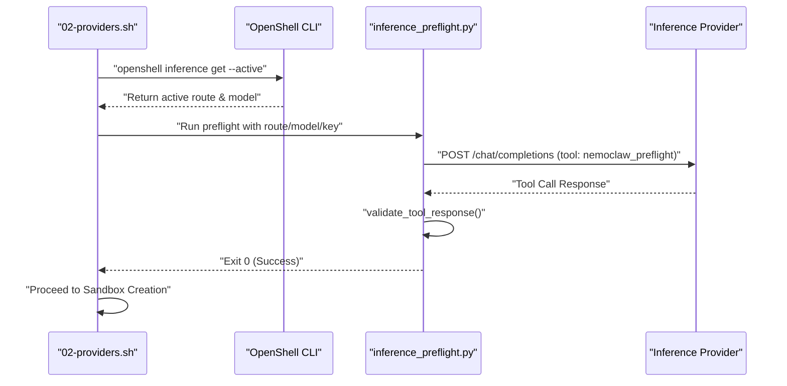

<!-- source: DeepWiki mcp.deepwiki.com · repo NVIDIA/nemoclaw-community · page 5.3 Inference Preflight and Provider Validation · fetched 2026-10-26 -->

# Inference Preflight and Provider Validation

Relevant source files

The following files were used as context for generating this wiki page:

- [examples/recipes/nvidia/developer-community-chief-of-staff/certs/README.md](examples/recipes/nvidia/developer-community-chief-of-staff/certs/README.md)
- [examples/recipes/nvidia/developer-community-chief-of-staff/docs/host-tls-proxy.md](examples/recipes/nvidia/developer-community-chief-of-staff/docs/host-tls-proxy.md)
- [examples/recipes/nvidia/developer-community-chief-of-staff/scripts/inference_preflight.py](examples/recipes/nvidia/developer-community-chief-of-staff/scripts/inference_preflight.py)
- [examples/recipes/nvidia/developer-community-chief-of-staff/scripts/slack_socket_preflight.py](examples/recipes/nvidia/developer-community-chief-of-staff/scripts/slack_socket_preflight.py)
- [examples/recipes/nvidia/developer-community-chief-of-staff/scripts/stage-enterprise-cas.sh](examples/recipes/nvidia/developer-community-chief-of-staff/scripts/stage-enterprise-cas.sh)
- [examples/recipes/nvidia/developer-community-chief-of-staff/scripts/tavily_search_preflight.py](examples/recipes/nvidia/developer-community-chief-of-staff/scripts/tavily_search_preflight.py)
- [examples/recipes/nvidia/developer-community-chief-of-staff/scripts/tests/test-enterprise-ca-staging.sh](examples/recipes/nvidia/developer-community-chief-of-staff/scripts/tests/test-enterprise-ca-staging.sh)
- [examples/recipes/nvidia/developer-community-chief-of-staff/scripts/tests/test_inference_preflight.py](examples/recipes/nvidia/developer-community-chief-of-staff/scripts/tests/test_inference_preflight.py)
- [examples/recipes/nvidia/developer-community-chief-of-staff/scripts/tests/test_slack_socket_preflight.py](examples/recipes/nvidia/developer-community-chief-of-staff/scripts/tests/test_slack_socket_preflight.py)

The `inference_preflight.py` system provides a robust validation layer for Large Language Model (LLM) providers before the agent sandbox is initialized. It ensures that the configured inference route is reachable, authenticated, and capable of performing structured tool calling without leaking internal implementation details.

## Purpose and Scope

The preflight system is designed to "fail fast" during the bring-up process, specifically within the `02-providers.sh` phase. By validating the inference provider early, the system prevents the creation of broken sandboxes that would otherwise fail silently or with cryptic errors when the agent attempts its first interaction.

### Key Validation Pillars
1.  **Connectivity & Protocol**: Verifies HTTP/HTTPS compliance and OpenAI-compatible route construction.
2.  **Authentication**: Validates credentials against the provider's `/chat/completions` endpoint.
3.  **Model Availability**: Ensures the requested model is authorized and exists.
4.  **Tool-Call Integrity**: Forces a structured tool call and inspects the response for "leaks" (raw JSON or markers in assistant text).
5.  **Environment Translation**: Maps sandbox-internal aliases to host-accessible addresses for local testing.
6.  **Multi-Provider Validation**: Extends beyond inference to validate Slack Socket Mode tokens and Tavily search API keys.

Sources: [examples/recipes/nvidia/developer-community-chief-of-staff/scripts/inference_preflight.py:5-22](), [examples/recipes/nvidia/developer-community-chief-of-staff/scripts/inference_preflight.py:31-39](), [examples/recipes/nvidia/developer-community-chief-of-staff/scripts/slack_socket_preflight.py:5-6](), [examples/recipes/nvidia/developer-community-chief-of-staff/scripts/tavily_search_preflight.py:5-6]()

## System Architecture and Data Flow

The preflight utility operates as a standalone Python script that performs a real network request to the inference provider. It uses a specific tool schema, `nemoclaw_preflight`, to force the model into a tool-calling state.

### Inference Validation Logic
The following diagram illustrates how `inference_preflight.py` bridges the gap between the configuration environment and the external provider.

**Inference Preflight Flow**

Sources: [examples/recipes/nvidia/developer-community-chief-of-staff/scripts/inference_preflight.py:52-70](), [examples/recipes/nvidia/developer-community-chief-of-staff/scripts/inference_preflight.py:157-202](), [examples/recipes/nvidia/developer-community-chief-of-staff/scripts/inference_preflight.py:220-250]()

## Implementation Details

### PreflightError and Exit Codes
The script uses a specialized `PreflightError` class to categorize failures. These categories map to specific exit codes used by the calling shell scripts to provide meaningful feedback to the user.

| Category | Exit Code | Description |
| :--- | :--- | :--- |
| `configuration` | 2 | Missing API keys or environment variables. |
| `endpoint` | 3 | Invalid URL scheme or unreachable route. |
| `authentication` | 4 | Provider rejected the credential (HTTP 401/403). |
| `model-access` | 5 | Model is unauthorized or does not exist (HTTP 404 + body check). |
| `tool-protocol` | 6 | Provider failed to return valid tool-call JSON or leaked markers. |
| `provider-availability` | 6 | Provider is down or rate-limiting (HTTP 429/5xx). |

Sources: [examples/recipes/nvidia/developer-community-chief-of-staff/scripts/inference_preflight.py:31-39](), [examples/recipes/nvidia/developer-community-chief-of-staff/scripts/inference_preflight.py:113-144]()

### TOOL_MARKERS and Leak Detection
A critical security and reliability feature is the detection of leaked internal markers. Some models might wrap tool calls in proprietary tags like `<|tool_call|>` or return raw JSON in the `content` field instead of the `tool_calls` field.

`inference_preflight.py` defines `TOOL_MARKERS`:
- `<|call|>`
- `<|tool_call|>`
- `<tool_call>`
- `</tool_call>`

The `validate_tool_response` function checks if the `message.get("content")` contains these strings or if the content is valid JSON that looks like a tool call. If detected, it raises a `PreflightError` with category `tool-protocol`.

Sources: [examples/recipes/nvidia/developer-community-chief-of-staff/scripts/inference_preflight.py:26-26](), [examples/recipes/nvidia/developer-community-chief-of-staff/scripts/inference_preflight.py:183-194]()

### SANDBOX_HOST_ALIAS Translation
The system uses a special alias `host.openshell.internal` [examples/recipes/nvidia/developer-community-chief-of-staff/scripts/inference_preflight.py:27-27]() to refer to the host machine from within the sandbox. However, the preflight script runs on the host.

The `endpoint_for_host_preflight` function [examples/recipes/nvidia/developer-community-chief-of-staff/scripts/inference_preflight.py:52-70]() detects this alias and translates it to `127.0.0.1`. This allows the host to validate local inference proxies (like a local NIM or vLLM instance) that are intended to be accessed via the `host.openshell.internal` name inside the sandbox.

## Ancillary Preflight Systems

### Slack Socket Mode Preflight
The `slack_socket_preflight.py` script validates the `SLACK_APP_TOKEN` (xapp- token) and ensures the `connections:write` scope is present. It calls the `apps.connections.open` Slack API to verify connectivity.

Sources: [examples/recipes/nvidia/developer-community-chief-of-staff/scripts/slack_socket_preflight.py:17-20](), [examples/recipes/nvidia/developer-community-chief-of-staff/scripts/slack_socket_preflight.py:82-90]()

### Tavily Search Preflight
The `tavily_search_preflight.py` script performs a single bounded search request for "NVIDIA NemoClaw" to verify the API key and service availability before the sandbox is deployed.

Sources: [examples/recipes/nvidia/developer-community-chief-of-staff/scripts/tavily_search_preflight.py:49-64]()

### Enterprise CA Staging
For environments with TLS-intercepting proxies, `stage-enterprise-cas.sh` copies local `*.crt` files from `/usr/local/share/ca-certificates` into the sandbox build context. This ensures the sandbox trust store matches the host's trust store.

Sources: [examples/recipes/nvidia/developer-community-chief-of-staff/scripts/stage-enterprise-cas.sh:14-16](), [examples/recipes/nvidia/developer-community-chief-of-staff/certs/README.md:9-20]()

## Integration with 02-providers.sh

The preflight check is integrated into the `02-providers.sh` bring-up script. Before finalizing the provider configuration, the script executes `inference_preflight.py`.

**Provider Validation Sequence**

Sources: [examples/recipes/nvidia/developer-community-chief-of-staff/scripts/inference_preflight.py:220-250](), [examples/recipes/nvidia/developer-community-chief-of-staff/scripts/tests/test_inference_preflight.py:66-90]()

## Testing and Verification

The system includes a comprehensive test suite in `test_inference_preflight.py` that mocks various provider failure modes:
- **`test_remote_http_endpoint_is_rejected`**: Ensures non-loopback HTTP is blocked for security [examples/recipes/nvidia/developer-community-chief-of-staff/scripts/tests/test_inference_preflight.py:99-109]().
- **`test_unavailable_model_is_model_access_failure`**: Validates handling of HTTP 404 with specific error bodies [examples/recipes/nvidia/developer-community-chief-of-staff/scripts/tests/test_inference_preflight.py:180-189]().
- **`test_tool_marker_leak_is_rejected`**: Ensures models that put markers in assistant text are caught [examples/recipes/nvidia/developer-community-chief-of-staff/scripts/tests/test_inference_preflight.py:214-222]().

Sources: [examples/recipes/nvidia/developer-community-chief-of-staff/scripts/tests/test_inference_preflight.py:1-26]()

---

