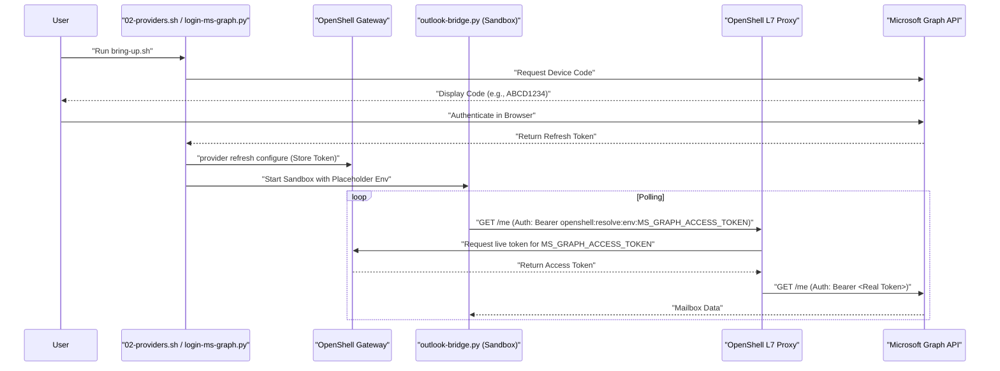
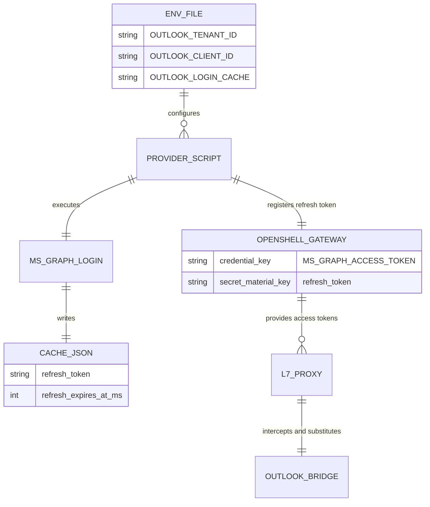

<!-- source: DeepWiki mcp.deepwiki.com · repo NVIDIA/nemoclaw-community · page 5.4 Microsoft Graph OAuth2 and Outlook Integration · fetched 2026-10-26 -->

# Microsoft Graph OAuth2 and Outlook Integration

Relevant source files

The following files were used as context for generating this wiki page:

- [examples/recipes/nvidia/developer-community-chief-of-staff/agents/hermes/bridges/atif/atif-bridge.py](examples/recipes/nvidia/developer-community-chief-of-staff/agents/hermes/bridges/atif/atif-bridge.py)
- [examples/recipes/nvidia/developer-community-chief-of-staff/agents/hermes/bridges/outlook/outlook-bridge.py](examples/recipes/nvidia/developer-community-chief-of-staff/agents/hermes/bridges/outlook/outlook-bridge.py)
- [examples/recipes/nvidia/developer-community-chief-of-staff/agents/hermes/manifest.yaml](examples/recipes/nvidia/developer-community-chief-of-staff/agents/hermes/manifest.yaml)
- [examples/recipes/nvidia/developer-community-chief-of-staff/agents/hermes/nemo-relay/hermes-cli-shim](examples/recipes/nvidia/developer-community-chief-of-staff/agents/hermes/nemo-relay/hermes-cli-shim)
- [examples/recipes/nvidia/developer-community-chief-of-staff/docs/set-up-outlook-bridge.md](examples/recipes/nvidia/developer-community-chief-of-staff/docs/set-up-outlook-bridge.md)
- [examples/recipes/nvidia/developer-community-chief-of-staff/scripts/lib/outlook_cache.py](examples/recipes/nvidia/developer-community-chief-of-staff/scripts/lib/outlook_cache.py)
- [examples/recipes/nvidia/developer-community-chief-of-staff/scripts/login-ms-graph.py](examples/recipes/nvidia/developer-community-chief-of-staff/scripts/login-ms-graph.py)
- [examples/recipes/nvidia/developer-community-chief-of-staff/scripts/tests/test_outlook_cache.py](examples/recipes/nvidia/developer-community-chief-of-staff/scripts/tests/test_outlook_cache.py)

This page documents the integration between the Hermes agent and Microsoft Graph, specifically for Outlook email operations. The architecture utilizes the **OpenShell Provider v2** gateway to manage OAuth2 lifecycles, ensuring that the sandboxed agent never handles raw long-lived credentials while maintaining persistent connectivity through background token rotation.

## Purpose and Scope

The Outlook integration allows the Hermes agent to act as a dedicated Entra mailbox, polling for new messages and responding in-thread [examples/recipes/nvidia/developer-community-chief-of-staff/docs/set-up-outlook-bridge.md:29-39](). The scope includes:
*   **Device-code authentication** for initial setup.
*   **Refresh-token rotation** managed by the OpenShell gateway.
*   **Credential substitution** via the OpenShell L7 proxy.
*   **Sidecar bridge** for polling and Markdown-to-HTML email rendering.

## System Architecture and Data Flow

The integration splits responsibilities between the host (credential management) and the sandbox (application logic).

### Natural Language to Code Entity Mapping

| System Concept | Code Entity | Role |
| :--- | :--- | :--- |
| **Login Flow** | `login-ms-graph.py` | Orchestrates the OIDC device-code flow [examples/recipes/nvidia/developer-community-chief-of-staff/scripts/login-ms-graph.py:5-16](). |
| **Token Cache** | `ms-graph-token.json` | Stores the refresh token on the host to avoid re-auth [examples/recipes/nvidia/developer-community-chief-of-staff/docs/set-up-outlook-bridge.md:91-91](). |
| **Gateway Config** | `openshell provider refresh` | The CLI command used to register the refresh token [examples/recipes/nvidia/developer-community-chief-of-staff/docs/set-up-outlook-bridge.md:91-91](). |
| **Egress Proxy** | `MS_GRAPH_ACCESS_TOKEN` | The environment variable placeholder substituted at egress [examples/recipes/nvidia/developer-community-chief-of-staff/agents/hermes/bridges/outlook/outlook-bridge.py:109-109](). |
| **Outlook Poller** | `outlook-bridge.py` | The sidecar process that runs inside the sandbox [examples/recipes/nvidia/developer-community-chief-of-staff/agents/hermes/bridges/outlook/outlook-bridge.py:4-8](). |

### Sequence: Authentication and Token Substitution

The following diagram illustrates how a placeholder in the sandbox becomes a live token at the Microsoft Graph API endpoint.

**Sources:** [examples/recipes/nvidia/developer-community-chief-of-staff/docs/set-up-outlook-bridge.md:83-94](), [examples/recipes/nvidia/developer-community-chief-of-staff/agents/hermes/bridges/outlook/outlook-bridge.py:86-110]().

## Implementation Details

### 1. The Login Flow (`login-ms-graph.py`)
The script `login-ms-graph.py` implements the OAuth2 device-code flow. It requests the `offline_access` scope to ensure a refresh token is returned [examples/recipes/nvidia/developer-community-chief-of-staff/scripts/login-ms-graph.py:92-93](). It calculates token expiration in milliseconds and returns a JSON payload containing the `access_token`, `refresh_token`, and `refresh_expires_at_ms` [examples/recipes/nvidia/developer-community-chief-of-staff/scripts/login-ms-graph.py:125-132]().

### 2. Cache Lifecycle and Migration (`outlook_cache.py`)
Tokens are cached locally at `.bootstrap/cache/ms-graph-token.json` [examples/recipes/nvidia/developer-community-chief-of-staff/docs/set-up-outlook-bridge.md:91-91]().
*   **Modes (`OUTLOOK_LOGIN_CACHE`)**:
    *   `0`: Disable cache (force login every time).
    *   `1`: Use cache, refresh if stale (Default).
    *   `2`: Force re-authentication and overwrite cache.
*   **Legacy Migration**: The `refresh_expires_at_ms` function in `outlook_cache.py` detects old cache files that only recorded access-token expiry. It migrates them by using the file's `mtime` plus a 90-day compatibility horizon [examples/recipes/nvidia/developer-community-chief-of-staff/scripts/lib/outlook_cache.py:31-34]().

**Sources:** [examples/recipes/nvidia/developer-community-chief-of-staff/scripts/lib/outlook_cache.py:18-36](), [examples/recipes/nvidia/developer-community-chief-of-staff/docs/set-up-outlook-bridge.md:91-91]().

### 3. The Outlook Bridge Sidecar (`outlook-bridge.py`)
This sidecar process runs inside the sandbox and handles the actual interaction with the Graph API.

*   **Credential Opacity**: The bridge uses the stable placeholder `openshell:resolve:env:MS_GRAPH_ACCESS_TOKEN` [examples/recipes/nvidia/developer-community-chief-of-staff/agents/hermes/bridges/outlook/outlook-bridge.py:109-109](). It avoids using the versioned environment variable (e.g., `v1_MS_GRAPH_ACCESS_TOKEN`) because versioned placeholders are frozen at process start; using the stable form allows the L7 proxy to fetch the latest rotated token without restarting the bridge [examples/recipes/nvidia/developer-community-chief-of-staff/agents/hermes/bridges/outlook/outlook-bridge.py:87-106]().
*   **Email Rendering**: The bridge includes an `_email_html` function that converts Markdown responses from the agent into Outlook-compatible HTML, including inline CSS for tables and code blocks [examples/recipes/nvidia/developer-community-chief-of-staff/agents/hermes/bridges/outlook/outlook-bridge.py:29-77]().
*   **Delegate Access**: The bridge determines the target mailbox via `OUTLOOK_TARGET_MAILBOX`. If unset, it defaults to the `/me` endpoint of the authenticated user [examples/recipes/nvidia/developer-community-chief-of-staff/agents/hermes/bridges/outlook/outlook-bridge.py:127-133]().

**Sources:** [examples/recipes/nvidia/developer-community-chief-of-staff/agents/hermes/bridges/outlook/outlook-bridge.py:109-109](), [examples/recipes/nvidia/developer-community-chief-of-staff/agents/hermes/bridges/outlook/outlook-bridge.py:127-133]().

## Provider Configuration and Rotation

The `02-providers.sh` script manages the registration of the Outlook provider with the OpenShell gateway.

### Error Handling and Re-authentication
During bring-up, the script attempts to rotate the cached token using `openshell provider refresh rotate` [examples/recipes/nvidia/developer-community-chief-of-staff/scripts/tests/test_outlook_cache.py:121-125]().
*   **HTTP 400**: If the rotation fails with an HTTP 400 (Bad Request), it indicates the refresh token is revoked or expired. The script then triggers a fresh device-code login [examples/recipes/nvidia/developer-community-chief-of-staff/docs/set-up-outlook-bridge.md:91-91]().
*   **HTTP 503 / TLS Failure**: Network or transient errors do not invalidate the cache; the setup fails loud to prevent accidental cache deletion [examples/recipes/nvidia/developer-community-chief-of-staff/docs/set-up-outlook-bridge.md:91-91]().

### Entity Relationship Diagram: Provider Configuration

**Sources:** [examples/recipes/nvidia/developer-community-chief-of-staff/docs/set-up-outlook-bridge.md:67-75](), [examples/recipes/nvidia/developer-community-chief-of-staff/docs/set-up-outlook-bridge.md:118-121]().

## Summary of Configuration Variables

| Variable | Description |
| :--- | :--- |
| `OUTLOOK_TENANT_ID` | Azure Directory (tenant) ID [examples/recipes/nvidia/developer-community-chief-of-staff/docs/set-up-outlook-bridge.md:70-70](). |
| `OUTLOOK_CLIENT_ID` | Azure Application (client) ID [examples/recipes/nvidia/developer-community-chief-of-staff/docs/set-up-outlook-bridge.md:71-71](). |
| `OUTLOOK_TARGET_MAILBOX` | The mailbox the agent monitors [examples/recipes/nvidia/developer-community-chief-of-staff/docs/set-up-outlook-bridge.md:72-72](). |
| `OUTLOOK_LOGIN_CACHE` | Cache behavior mode (0, 1, 2) [examples/recipes/nvidia/developer-community-chief-of-staff/docs/set-up-outlook-bridge.md:91-91](). |

**Sources:** [examples/recipes/nvidia/developer-community-chief-of-staff/docs/set-up-outlook-bridge.md:67-75]().

---

