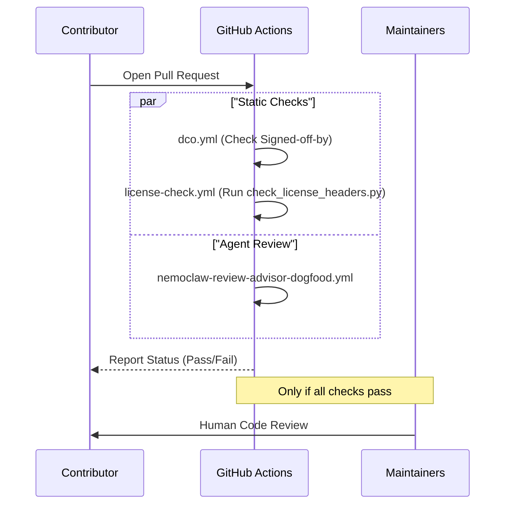

<!-- source: DeepWiki mcp.deepwiki.com · repo NVIDIA/nemoclaw-community · page 6 Contributing and Repository Governance · fetched 2026-10-26 -->

# Contributing and Repository Governance

<details>
<summary>Relevant source files</summary>

The following files were used as context for generating this wiki page:

- [.agents/skills/_shared/controlled-words.md](.agents/skills/_shared/controlled-words.md)
- [.github/CODEOWNERS](.github/CODEOWNERS)
- [.github/ISSUE_TEMPLATE/config.yml](.github/ISSUE_TEMPLATE/config.yml)
- [.github/PULL_REQUEST_TEMPLATE.md](.github/PULL_REQUEST_TEMPLATE.md)
- [.github/workflows/dco.yml](.github/workflows/dco.yml)
- [.github/workflows/license-check.yml](.github/workflows/license-check.yml)
- [CODE_OF_CONDUCT.md](CODE_OF_CONDUCT.md)
- [CONTRIBUTING.md](CONTRIBUTING.md)
- [GOVERNANCE.md](GOVERNANCE.md)
- [WRITING.md](WRITING.md)

</details>


This page provides a high-level overview of how to contribute to the NemoClaw Community repository and the governance structures that ensure its quality and security. As a community-focused repository, it balances open contribution with rigorous sanitization and compliance standards to protect both contributors and users.

The repository follows a fork-and-pull model, enforced by automated CI/CD checks and supported by coding agent skills that help maintainers and contributors adhere to the project's specific technical writing and naming standards.

## Contribution Framework

The NemoClaw Community uses a structured approach to contributions to maintain the "shared-nothing" isolation principle between examples. Every contribution must adhere to strict sanitization rules to prevent the leakage of nonpublic information into the public domain.

### Key Contribution Principles
*   **Example Isolation**: Each example must be independently deployable and not depend on private files, internal systems, or local state from another example [CONTRIBUTING.md:148-150]().
*   **Sanitization**: All public content—including code, logs, and documentation—must replace internal jargon, private URLs, and hostnames with generic placeholders [WRITING.md:32-35]().
*   **Controlled Vocabulary**: Both human and agent contributors must use the `controlled-words.md` list to ensure consistent terminology (e.g., using "allowlist" instead of "whitelist") [.agents/skills/_shared/controlled-words.md:41-41]().
*   **Branching Policy**: The repository does not allow force pushes (`git push --force`). Contributors must merge the current `main` branch into their published branch to resolve conflicts [CONTRIBUTING.md:103-108]().

For a detailed breakdown of the contribution lifecycle, proposal steps, and writing standards, see [Contribution Workflow and Standards](#6.1).

## Repository Governance and Compliance

Governance is managed by NVIDIA maintainers who oversee the review process, license compliance, and security protocols. The project enforces the Developer Certificate of Origin (DCO) for all commits to track authorship and rights.

### Governance Entities and Roles
| Entity | Role | Reference |
| :--- | :--- | :--- |
| **Maintainers** | Review/merge PRs, enforce DCO, and manage internal open-source reviews. | [GOVERNANCE.md:6-12]() |
| **CODEOWNERS** | Automatically routes pull requests to the primary maintainer team. | [.github/CODEOWNERS:5-5]() |
| **DCO Sign-off** | Mandatory declaration in the PR description certifying the right to submit code. | [.github/workflows/dco.yml:43-48]() |
| **Issue Type** | Native GitHub classification (Bug, Enhancement, Task, Documentation) used for routing. | [CONTRIBUTING.md:41-44]() |

### Security and Vulnerability Reporting
Security vulnerabilities must **not** be reported via public GitHub issues or pull requests [CONTRIBUTING.md:11-11](). Instead, contributors must follow the private disclosure process at the NVIDIA security portal [.github/ISSUE_TEMPLATE/config.yml:7-7]().

For details on the automation that enforces these policies, see [CI/CD Automation and GitHub Workflows](#6.2).

## Agent-Assisted Maintenance

A unique aspect of this repository is the integration of **Coding Agent Skills**. These are specialized instructions located in `.agents/skills/` that allow AI agents to act as "Review Advisors" or "Example Contributors."

### Agent-Code Interaction
The following diagram bridges the natural language guidelines used by agents and the code entities that enforce them.

**Diagram: Governance and Agent Integration Flow**
```mermaid
graph TD
    subgraph "Natural Language Space"
        ["WRITING.md"] -- "Defines style" --> ["controlled-words.md"]
        ["controlled-words.md"] -- "Shared Vocabulary" --> ["Agent Skills"]
        ["Agent Skills"] -- "Contains" --> ["nemoclaw-community-maintainer-policies"]
    end

    subgraph "Code Entity Space"
        [".github/workflows/"] -- "Executes" --> ["check_license_headers.py"]
        [".github/workflows/"] -- "Executes" --> ["check_label_taxonomy.py"]
        ["Agent Skills"] -- "Powers" --> ["nemoclaw-review-advisor-dogfood.yml"]
        ["nemoclaw-review-advisor-dogfood.yml"] -- "Validates" --> ["PULL_REQUEST_TEMPLATE.md"]
    end

    ["controlled-words.md"] -.-> ["nemoclaw-review-advisor-dogfood.yml"]
    ["check_license_headers.py"] -- "Verifies" --> ["SPDX Headers"]
    ["check_label_taxonomy.py"] -- "Verifies" --> ["Label Metadata"]
```
*Sources: [WRITING.md:51-54](), [.agents/skills/_shared/controlled-words.md:19-43](), [.github/workflows/license-check.yml:27-27](), [.github/PULL_REQUEST_TEMPLATE.md:34-40]()*

For details on how to use or extend these skills, see [Coding Agent Skills for Repository Maintenance](#6.3).

## Automated Quality Gates

The repository uses GitHub Actions to automate the enforcement of governance rules. This ensures that every PR meets the minimum requirements for licensing and metadata before a human maintainer reviews it.

**Diagram: PR Validation Pipeline**

*Sources: [.github/workflows/dco.yml:15-18](), [.github/workflows/license-check.yml:4-10](), [.github/PULL_REQUEST_TEMPLATE.md:17-19]()*

For details on these workflows, see [CI/CD Automation and GitHub Workflows](#6.2).

***

**Child Pages:**
*   [Contribution Workflow and Standards](#6.1)
*   [CI/CD Automation and GitHub Workflows](#6.2)
*   [Coding Agent Skills for Repository Maintenance](#6.3)

**Sources:**
*   [CONTRIBUTING.md:1-195]()
*   [GOVERNANCE.md:1-20]()
*   [WRITING.md:1-105]()
*   [.agents/skills/_shared/controlled-words.md:1-70]()
*   [.github/PULL_REQUEST_TEMPLATE.md:1-54]()
*   [.github/CODEOWNERS:1-5]()
*   [.github/workflows/dco.yml:1-58]()
*   [.github/workflows/license-check.yml:1-27]()
*   [.github/ISSUE_TEMPLATE/config.yml:1-8]()

---

