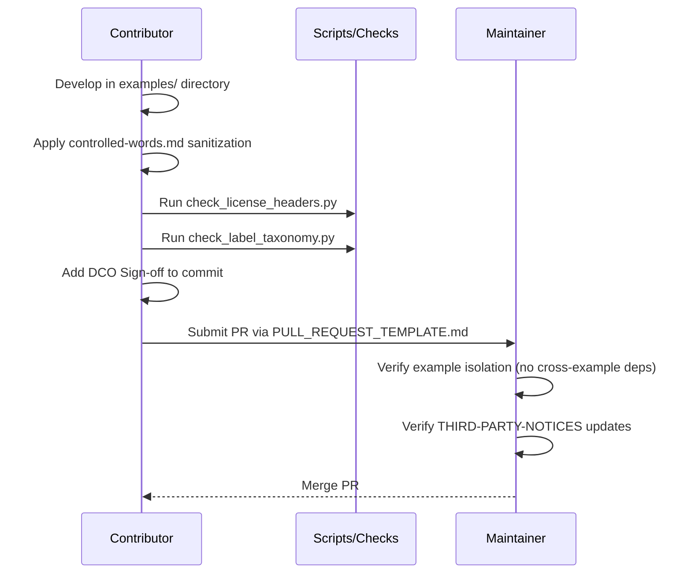

<!-- source: DeepWiki mcp.deepwiki.com · repo NVIDIA/nemoclaw-community · page 6.1 Contribution Workflow and Standards · fetched 2026-10-26 -->

# Contribution Workflow and Standards

<details>
<summary>Relevant source files</summary>

The following files were used as context for generating this wiki page:

- [.agents/skills/_shared/controlled-words.md](.agents/skills/_shared/controlled-words.md)
- [.github/PULL_REQUEST_TEMPLATE.md](.github/PULL_REQUEST_TEMPLATE.md)
- [CONTRIBUTING.md](CONTRIBUTING.md)
- [SECURITY.md](SECURITY.md)
- [THIRD-PARTY-NOTICES](THIRD-PARTY-NOTICES)
- [WRITING.md](WRITING.md)
- [scripts/audit_github_labels.py](scripts/audit_github_labels.py)
- [scripts/check_label_taxonomy.py](scripts/check_label_taxonomy.py)

</details>


This page documents the full contribution lifecycle for the NemoClaw Community repository. It covers the transition from initial proposal through development, sanitization, and final pull request (PR) submission. Adherence to these standards ensures that contributions remain independently deployable, secure, and understandable to a public audience.

## Contribution Lifecycle Overview

The contribution process follows a standard fork-based development model, augmented by specific sanitization and validation checks to prevent the disclosure of nonpublic information and ensure compliance with repository governance.

### 1. Proposal and Classification
Before implementing major changes, contributors must discuss them with maintainers [CONTRIBUTING.md:29-37](). This includes:
*   New dependencies or distribution changes.
*   New example contributions.
*   Changes to project licenses or compliance requirements.

Issues and PRs are classified using a Conventional Commit-style title: `<type>(<optional-scope>): <description>` [CONTRIBUTING.md:46-50](). Allowed types include `feat`, `fix`, `docs`, `chore`, `refactor`, `test`, `ci`, and `perf` [CONTRIBUTING.md:52-54]().

### 2. Fork-Based Development
Contributors without write access must use a fork-based workflow [CONTRIBUTING.md:76-77]().

**Standard Development Sequence:**
1.  **Clone and Upstream:** `git clone` the fork and `git remote add upstream` to the main repository [CONTRIBUTING.md:82-84]().
2.  **Branching:** Create a branch from `upstream/main` [CONTRIBUTING.md:86]().
3.  **Example Isolation:** Work within a specific example directory. Each example is independently deployable and must not depend on private files or local state from another example [CONTRIBUTING.md:148-149]().
4.  **Submodules:** Initialize submodules only for the specific example being modified [CONTRIBUTING.md:128-131]().

**Important:** Force pushes (`git push --force`) are not allowed on published branches [CONTRIBUTING.md:103-105]().

### 3. Sanitization and Writing Standards
All content, including code comments, logs, and documentation, must be written for a public audience [CONTRIBUTING.md:177-179]().

#### Controlled Words and Plain Language
Contributors must follow the `WRITING.md` guide, which incorporates plain-language principles similar to **ASD-STE100** [WRITING.md:9-11](). A shared vocabulary is maintained in `.agents/skills/_shared/controlled-words.md` to ensure consistency [CONTRIBUTING.md:181-183]().

| Standard | Purpose |
| :--- | :--- |
| **WRITING.md** | Guidance on direct sentences, active voice, and procedure writing [WRITING.md:71-91](). |
| **controlled-words.md** | Mapping of preferred terms (e.g., use "allowlist" instead of "whitelist") [.agents/skills/_shared/controlled-words.md:19-43](). |
| **Sanitization** | Replacement of internal jargon, private URLs, and ticket IDs with generic terms like "enterprise environment" or "internal tracking system" [.agents/skills/_shared/controlled-words.md:45-57](). |

#### Prohibited Information
The following must **never** be committed [CONTRIBUTING.md:170-173](), [WRITING.md:29-35]():
*   Secrets, API keys, or access tokens.
*   Local `.env` files or private certificates.
*   Internal project names, hostnames, or ticket identifiers.
*   Screenshots or logs containing nonpublic details.

### 4. Automated Validation Checks
Before submitting a PR, contributors must run local validation scripts located in the `scripts/` directory.

**Data Flow for Validation:**

```mermaid
graph TD
    "Local_Codebase[Local Codebase]" --> "check_license_headers.py[scripts/check_license_headers.py]"
    "Local_Codebase[Local Codebase]" --> "check_label_taxonomy.py[scripts/check_label_taxonomy.py]"
    "Local_Codebase[Local Codebase]" --> "git_diff_check[git diff --check]"
    
    subgraph "Validation_Logic[Validation Logic]"
        "check_license_headers.py[scripts/check_license_headers.py]" -- "Verifies" --> "SPDX_Headers[SPDX-FileCopyrightText]"
        "check_label_taxonomy.py[scripts/check_label_taxonomy.py]" -- "Validates" --> "TAXONOMY_PATH[.agents/skills/nemoclaw-community-maintainer-policies/references/label-taxonomy.json]"
    end

    "Validation_Logic[Validation Logic]" -- "Success" --> "PR_Submission[PULL_REQUEST_TEMPLATE.md]"
    "Validation_Logic[Validation Logic]" -- "Failure" --> "Correction[Contributor Fixes]"
```
*Sources: [scripts/check_label_taxonomy.py:18-19](), [.github/PULL_REQUEST_TEMPLATE.md:17-19]()*

## Pull Request Requirements

Every pull request must adhere to the `PULL_REQUEST_TEMPLATE.md` and include specific evidence of verification.

### DCO Sign-off
Contributors must include a **Developer Certificate of Origin (DCO)** sign-off in the PR description [.github/PULL_REQUEST_TEMPLATE.md:52-54]().
*   **Format:** `Signed-off-by: Your Name <your.email@example.com>`

### Third-Party Attribution
If a contribution adds or changes dependencies, the `THIRD-PARTY-NOTICES` file must be updated [CONTRIBUTING.md:162-163](). This file tracks:
*   Docker Base Images (e.g., `python:3.12-slim`) [THIRD-PARTY-NOTICES:14]().
*   System Packages (e.g., `curl`, `git`) [THIRD-PARTY-NOTICES:72, 78]().
*   Python/Node.js Packages (e.g., `fastapi`, `typescript`) [THIRD-PARTY-NOTICES:146, 226]().

### PR Review Checklist
The PR template requires confirmation of the following [.github/PULL_REQUEST_TEMPLATE.md:30-52]():
1.  **Documentation Review:** Completion of a writer review using the `docs-updated` or `no-docs-needed` labels.
2.  **Agent Review:** If text was generated by an AI agent, a human must review it before submission.
3.  **Sanitization Check:** Verification that no nonpublic identifiers or secrets are included.
4.  **Verification Scripts:** Confirmation that `check_license_headers.py` and `check_label_taxonomy.py` passed.

## Example Restructuring Protocol

When contributing a new example or restructuring an existing one, the repository follows a strict directory and isolation protocol.

**Contribution Workflow for Examples:**


*Sources: [CONTRIBUTING.md:148-151](), [CONTRIBUTING.md:162-163](), [.github/PULL_REQUEST_TEMPLATE.md:1-54]()*

### Implementation Detail: `check_license_headers.py`
This script ensures every source file contains the required Apache-2.0 and NVIDIA copyright headers. It is a blocking check in the CI pipeline [.github/PULL_REQUEST_TEMPLATE.md:17]().

### Implementation Detail: `check_label_taxonomy.py`
This script validates that any new labels or governance metadata changes align with the canonical maintainer taxonomy defined in `label-taxonomy.json` [scripts/check_label_taxonomy.py:18-19](). It checks for:
*   Duplicate label names [scripts/check_label_taxonomy.py:46-49]().
*   Correct hexadecimal color codes [scripts/check_label_taxonomy.py:55-56]().
*   Alignment between JSON metadata and `label-taxonomy.md` [scripts/check_label_taxonomy.py:57-58]().
*   Native GitHub Issue Type alignment in templates [scripts/check_label_taxonomy.py:82-97]().

### Implementation Detail: `audit_github_labels.py`
Maintainers use `scripts/audit_github_labels.py` to compare the live GitHub repository labels against the `TAXONOMY_PATH` [scripts/audit_github_labels.py:17-20](). It identifies labels that need to be created, updated, or marked as legacy [scripts/audit_github_labels.py:51-72]().

## Security Vulnerability Reporting
Do not report security vulnerabilities in public issues or PRs. Follow the process in `SECURITY.md`, which directs reports to the NVIDIA PSIRT team via the [Security Vulnerability Submission Form](https://www.nvidia.com/object/submit-security-vulnerability.html) or `psirt@nvidia.com` [SECURITY.md:5-11]().

***

**Sources:**
*   [CONTRIBUTING.md:1-200]()
*   [.github/PULL_REQUEST_TEMPLATE.md:1-54]()
*   [WRITING.md:1-105]()
*   [.agents/skills/_shared/controlled-words.md:1-70]()
*   [THIRD-PARTY-NOTICES:1-260]()
*   [SECURITY.md:1-24]()
*   [scripts/check_label_taxonomy.py:1-128]()
*   [scripts/audit_github_labels.py:1-105]()

---

