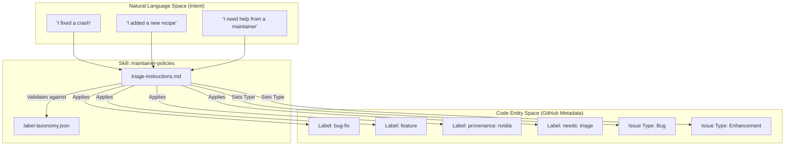
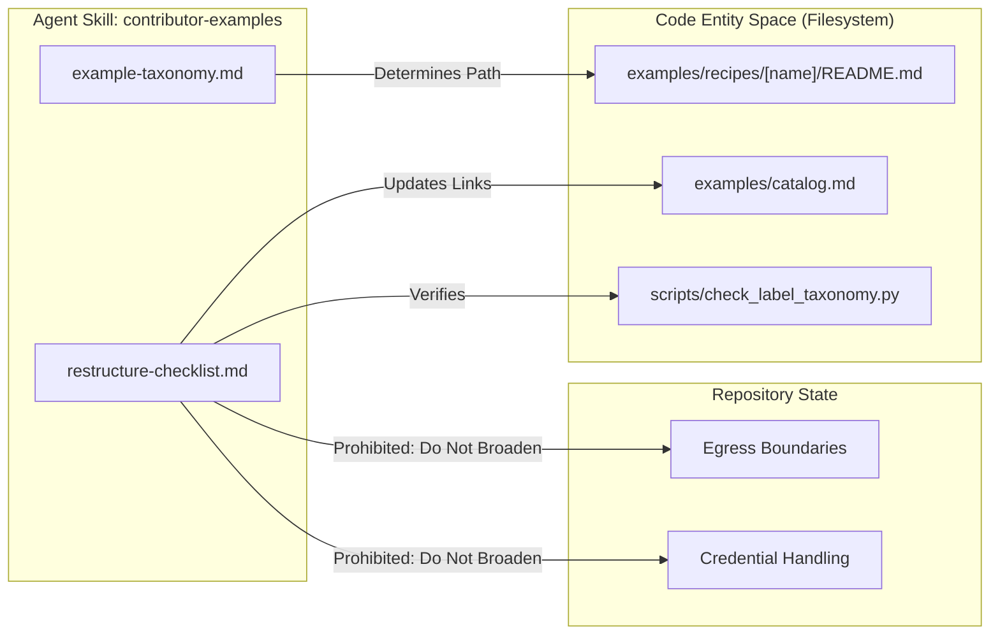

<!-- source: DeepWiki mcp.deepwiki.com · repo NVIDIA/nemoclaw-community · page 6.3 Coding Agent Skills for Repository Maintenance · fetched 2026-10-26 -->

# Coding Agent Skills for Repository Maintenance

Relevant source files

The following files were used as context for generating this wiki page:

- [.agents/skills/nemoclaw-community-contributor-examples/SKILL.md](.agents/skills/nemoclaw-community-contributor-examples/SKILL.md)
- [.agents/skills/nemoclaw-community-maintainer-policies/SKILL.md](.agents/skills/nemoclaw-community-maintainer-policies/SKILL.md)
- [.agents/skills/nemoclaw-community-maintainer-policies/references/examples.md](.agents/skills/nemoclaw-community-maintainer-policies/references/examples.md)
- [.agents/skills/nemoclaw-community-maintainer-policies/references/label-taxonomy.json](.agents/skills/nemoclaw-community-maintainer-policies/references/label-taxonomy.json)
- [.agents/skills/nemoclaw-community-maintainer-policies/references/label-taxonomy.md](.agents/skills/nemoclaw-community-maintainer-policies/references/label-taxonomy.md)
- [.agents/skills/nemoclaw-community-maintainer-policies/references/triage-instructions.md](.agents/skills/nemoclaw-community-maintainer-policies/references/triage-instructions.md)
- [.agents/skills/nemoclaw-community-maintainer-policies/references/workflow-policy.md](.agents/skills/nemoclaw-community-maintainer-policies/references/workflow-policy.md)

This page documents the `.agents/skills` directory, which provides the behavioral definitions and specialized knowledge for coding agents contributing to and maintaining the NemoClaw Community repository. These skills ensure that both human and agent contributors adhere to strict repository standards for classification, naming, and governance.

## Overview of Agent Skills

The repository uses a skill-based architecture for agents to automate repository maintenance while preserving security and public-facing quality. These skills are located in the `.agents/skills` directory and provide read-only policies and structured workflows for repository operations.

| Skill Name | Purpose | Key Components |
| :--- | :--- | :--- |
| `nemoclaw-community-contributor-examples` | Guides the creation and restructuring of examples. | Example taxonomy, restructure checklists, catalog update protocols. |
| `nemoclaw-community-maintainer-policies` | Defines repository governance and labeling rules. | Label taxonomy (JSON/MD), triage instructions, workflow hierarchy. |
| `controlled-words.md` | Shared vocabulary for sanitization and naming. | Public replacements, forbidden jargon, preferred technical terms. |

**Sources:** `.agents/skills/nemoclaw-community-contributor-examples/SKILL.md:2-3`(), `.agents/skills/nemoclaw-community-maintainer-policies/SKILL.md:2-3`()

## Contributor Skills: Example Lifecycle

The `nemoclaw-community-contributor-examples` skill governs how examples are classified, named, and moved within the repository catalog. It ensures that directory placement serves as navigation without accidentally altering security boundaries.

### Example Classification Workflow
Agents follow a specific sequence when handling example metadata:
1.  **Reference Taxonomy:** Read `references/example-taxonomy.md` and the maintainer `label-taxonomy.md` [ .agents/skills/nemoclaw-community-contributor-examples/SKILL.md:16-18]().
2.  **Artifact Selection:** Select the artifact type first (Recipe, Demo, Launchable, Tool), then contributor provenance for recipes [ .agents/skills/nemoclaw-community-contributor-examples/SKILL.md:21-22]().
3.  **Preservation:** Maintain deployment behavior, security policy, and credential handling during catalog changes [ .agents/skills/nemoclaw-community-contributor-examples/SKILL.md:26-27]().

### Restructure Protocol
When moving or renaming examples, agents must utilize the `references/restructure-checklist.md` to inventory every repository reference before editing [ .agents/skills/nemoclaw-community-contributor-examples/SKILL.md:23-25](). This includes updating public catalog links, contribution commands, and submodule configurations [ .agents/skills/nemoclaw-community-contributor-examples/SKILL.md:28-30]().

**Sources:** `.agents/skills/nemoclaw-community-contributor-examples/SKILL.md:14-32`(), `.agents/skills/nemoclaw-community-contributor-examples/SKILL.md:34-45`()

## Maintainer Skills: Governance and Policies

The `nemoclaw-community-maintainer-policies` skill serves as the canonical source for repository metadata policy, distinguishing between native GitHub fields and custom labels.

### Metadata Hierarchy
The skill defines a strict hierarchy for information ownership:
*   **Native GitHub Issue Type:** The primary classifier for issues (e.g., `Bug`, `Enhancement`, `Task`) [ .agents/skills/nemoclaw-community-maintainer-policies/references/workflow-policy.md:10]().
*   **Labels:** Used for routing, immediate action queues (`needs:*`), and pull request types [ .agents/skills/nemoclaw-community-maintainer-policies/references/workflow-policy.md:14-15]().
*   **GitHub Projects:** Own priority, effort, and lifecycle status [ .agents/skills/nemoclaw-community-maintainer-policies/references/workflow-policy.md:13]().

### Label Taxonomy and Triage
Agents use `label-taxonomy.json` to validate machine values and `label-taxonomy.md` for human-facing policy [ .agents/skills/nemoclaw-community-maintainer-policies/SKILL.md:18-19]().

**PR Type Mapping**
Agents map Conventional Commits titles to specific PR type labels:
*   `fix` maps to `bug-fix` [ .agents/skills/nemoclaw-community-maintainer-policies/references/label-taxonomy.md:36]().
*   `feat` maps to `feature` [ .agents/skills/nemoclaw-community-maintainer-policies/references/label-taxonomy.md:36]().
*   `refactor` maps to `refactor` [ .agents/skills/nemoclaw-community-maintainer-policies/references/label-taxonomy.md:36]().
*   Docs, CI, and maintenance map to `chore` [ .agents/skills/nemoclaw-community-maintainer-policies/references/label-taxonomy.md:34]().

**Sources:** `.agents/skills/nemoclaw-community-maintainer-policies/references/label-taxonomy.json:18-171`(), `.agents/skills/nemoclaw-community-maintainer-policies/references/triage-instructions.md:23-34`()

## Skill-to-Code Mapping Diagrams

The following diagrams bridge the natural language requirements of repository maintenance to the specific code entities and metadata patterns defined in the skills.

### Intent to Label Mapping
This diagram shows how agent logic translates contributor intent into standardized GitHub metadata.

**Metadata Translation Pipeline**

**Sources:** `.agents/skills/nemoclaw-community-maintainer-policies/references/examples.md:6-35`(), `.agents/skills/nemoclaw-community-maintainer-policies/references/label-taxonomy.json:10-17`()

### Example Restructure Data Flow
This diagram illustrates the operational flow when an agent modifies the example catalog.

**Example Catalog Update Flow**

**Sources:** `.agents/skills/nemoclaw-community-contributor-examples/SKILL.md:23-30`(), `.agents/skills/nemoclaw-community-contributor-examples/SKILL.md:39-40`()

---

