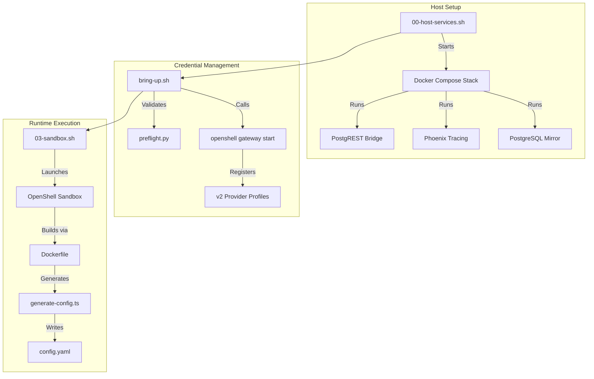
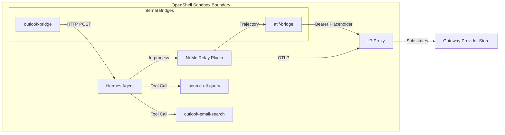

<!-- source: DeepWiki mcp.deepwiki.com · repo NVIDIA/nemoclaw-community · page 7 Glossary · fetched 2026-10-26 -->

# Glossary

Relevant source files

The following files were used as context for generating this wiki page:

- [.agents/skills/_shared/controlled-words.md](.agents/skills/_shared/controlled-words.md)
- [.agents/skills/nemoclaw-community-contributor-examples/SKILL.md](.agents/skills/nemoclaw-community-contributor-examples/SKILL.md)
- [.agents/skills/nemoclaw-community-maintainer-policies/SKILL.md](.agents/skills/nemoclaw-community-maintainer-policies/SKILL.md)
- [.github/PULL_REQUEST_TEMPLATE.md](.github/PULL_REQUEST_TEMPLATE.md)
- [CONTRIBUTING.md](CONTRIBUTING.md)
- [README.md](README.md)
- [SUPPORT.md](SUPPORT.md)
- [WRITING.md](WRITING.md)
- [examples/recipes/nvidia/developer-community-chief-of-staff/.env.example](examples/recipes/nvidia/developer-community-chief-of-staff/.env.example)
- [examples/recipes/nvidia/developer-community-chief-of-staff/README.md](examples/recipes/nvidia/developer-community-chief-of-staff/README.md)
- [examples/recipes/nvidia/developer-community-chief-of-staff/agents/hermes/generate-config.ts](examples/recipes/nvidia/developer-community-chief-of-staff/agents/hermes/generate-config.ts)
- [examples/recipes/nvidia/developer-community-chief-of-staff/docs/verify-functionality.md](examples/recipes/nvidia/developer-community-chief-of-staff/docs/verify-functionality.md)
- [examples/recipes/nvidia/developer-community-chief-of-staff/policy.yaml](examples/recipes/nvidia/developer-community-chief-of-staff/policy.yaml)
- [examples/recipes/nvidia/developer-community-chief-of-staff/scripts/tear-down.sh](examples/recipes/nvidia/developer-community-chief-of-staff/scripts/tear-down.sh)
- [examples/recipes/nvidia/kubernetes-gpu-autoscaling/.gitignore](examples/recipes/nvidia/kubernetes-gpu-autoscaling/.gitignore)
- [examples/recipes/nvidia/kubernetes-gpu-autoscaling/Chart.yaml](examples/recipes/nvidia/kubernetes-gpu-autoscaling/Chart.yaml)
- [examples/recipes/nvidia/kubernetes-gpu-autoscaling/README.md](examples/recipes/nvidia/kubernetes-gpu-autoscaling/README.md)
- [examples/recipes/nvidia/memory-driven-chief-of-staff/README.md](examples/recipes/nvidia/memory-driven-chief-of-staff/README.md)
- [examples/recipes/nvidia/memory-driven-chief-of-staff/fixtures/README.md](examples/recipes/nvidia/memory-driven-chief-of-staff/fixtures/README.md)
- [examples/recipes/nvidia/memory-driven-chief-of-staff/fixtures/envelopes/intake.json](examples/recipes/nvidia/memory-driven-chief-of-staff/fixtures/envelopes/intake.json)

This glossary defines the technical terms, architectural components, and domain-specific concepts used throughout the NemoClaw Community repository. It is intended for engineers onboarding to the codebase to understand how high-level agent concepts map to specific implementation details.

## Core Architectural Concepts

### Blueprint
A repeatable agent system composition consisting of three layers: **Model**, **Harness**, and **OpenShell**. Blueprints ensure that an agent's behavior is inseparable from its security policy and infrastructure requirements.
*   **Sources:** [README.md:8-14]()

### Model
The inference layer of a blueprint. It defines the specific LLM endpoint, provider configuration (e.g., NVIDIA, OpenAI), and model selection (e.g., `nvidia/nemotron-3-super-120b-a12b`).
*   **Sources:** [README.md:10-10](), [examples/recipes/nvidia/developer-community-chief-of-staff/.env.example:22-23]()

### Harness
The agent runtime and application logic. This includes the agent "brain" (e.g., Hermes), specific skills (Python functions/tools), bridges to external services, and behavioral contracts (SOUL).
*   **Sources:** [README.md:11-11](), [examples/recipes/nvidia/developer-community-chief-of-staff/README.md:89-92]()

### OpenShell
The security and networking substrate. It provides the containerized sandbox, the L7 proxy for credential substitution, and the policy engine that enforces egress allowlists.
*   **Sources:** [README.md:12-12](), [examples/recipes/nvidia/developer-community-chief-of-staff/README.md:22-26]()

---

## Technical Components & Tools

### ATIF (Agent Trajectory Interchange Format)
A standardized format for exporting agent execution logs (trajectories).
*   **atif-bridge**: A sidecar inside the sandbox that shims internal HTTP requests to the external relay.
*   **atif-export-relay**: A host-side service that receives trajectories, attaches downstream credentials (S3/MinIO), and persists them.
*   **Sources:** [examples/recipes/nvidia/developer-community-chief-of-staff/README.md:75-75](), [examples/recipes/nvidia/developer-community-chief-of-staff/README.md:92-92](), [examples/recipes/nvidia/developer-community-chief-of-staff/README.md:139-139]()

### L7 Proxy (OpenShell Proxy)
A security-hardened proxy (typically `10.200.0.1:3128`) that intercepts sandbox traffic. It performs **Credential Substitution**, replacing placeholder strings (e.g., `openshell:resolve:env:GITHUB_TOKEN`) with real secrets stored in the OpenShell Gateway.
*   **Sources:** [examples/recipes/nvidia/developer-community-chief-of-staff/README.md:83-85](), [examples/recipes/nvidia/developer-community-chief-of-staff/agents/hermes/generate-config.ts:168-169]()

### Phoenix
An observability platform (Arize Phoenix) used to collect and visualize OpenInference traces (OTLP) from agent runs.
*   **Sources:** [examples/recipes/nvidia/developer-community-chief-of-staff/README.md:140-140](), [examples/recipes/nvidia/developer-community-chief-of-staff/.env.example:131-135]()

### Preflight (Inference Preflight)
A validation system (`scripts/preflight.py` or `inference_preflight.py`) that runs before sandbox creation. It checks if the inference endpoint is reachable, the model exists, and the provider correctly supports structured tool calls.
*   **Sources:** [examples/recipes/nvidia/developer-community-chief-of-staff/.env.example:3-4](), [examples/recipes/nvidia/developer-community-chief-of-staff/.env.example:29-30]()

---

## Data Flow & Entity Mapping

### Natural Language to Code: Sandbox Lifecycle
The following diagram maps the logical phases of bringing up an agent to the specific scripts and entities in the codebase.

**Agent Bring-up Lifecycle**

*   **Sources:** [examples/recipes/nvidia/developer-community-chief-of-staff/.env.example:8-9](), [examples/recipes/nvidia/developer-community-chief-of-staff/agents/hermes/generate-config.ts:4-9](), [examples/recipes/nvidia/developer-community-chief-of-staff/README.md:138-143]()

### Code Entity Space: Hermes Agent Architecture
This diagram shows how internal code components interact within the sandbox environment.

**Hermes Sandbox Internal Components**

*   **Sources:** [examples/recipes/nvidia/developer-community-chief-of-staff/README.md:89-135](), [examples/recipes/nvidia/developer-community-chief-of-staff/agents/hermes/generate-config.ts:150-155]()

---

## Glossary Table

| Term | Definition | Code Pointer |
| :--- | :--- | :--- |
| **Controlled Words** | A list of approved terms for public-facing documentation and code comments to ensure clarity and safety. | [.agents/skills/_shared/controlled-words.md]() |
| **Deny-by-default** | The security posture where all network egress is blocked unless explicitly allowlisted in `policy.yaml`. | [examples/recipes/nvidia/developer-community-chief-of-staff/README.md:46-51]() |
| **DCO (Developer Certificate of Origin)** | A legal statement required for every commit to certify that the contributor has the right to submit the code. | [CONTRIBUTING.md:49-49]() |
| **Landlock** | A Linux security module used by OpenShell to restrict file system access for the agent process. | [examples/recipes/nvidia/developer-community-chief-of-staff/policy.yaml:22-23]() |
| **SOUL.md** | A behavioral contract file that defines the agent's persona, tone, and decision-making logic. | [examples/recipes/nvidia/developer-community-chief-of-staff/docs/verify-functionality.md:46-46]() |
| **Source ETL** | Background processes that scrape GitHub or Forums data into a local PostgreSQL mirror to avoid rate limits. | [examples/recipes/nvidia/developer-community-chief-of-staff/README.md:143-143]() |
| **PostgREST** | An HTTP bridge that exposes the PostgreSQL source mirror as a REST API for the agent. | [examples/recipes/nvidia/developer-community-chief-of-staff/README.md:141-141]() |

*   **Sources:** [CONTRIBUTING.md:49-49](), [README.md:41-41](), [examples/recipes/nvidia/developer-community-chief-of-staff/README.md:26-46](), [examples/recipes/nvidia/developer-community-chief-of-staff/policy.yaml:22-23]()