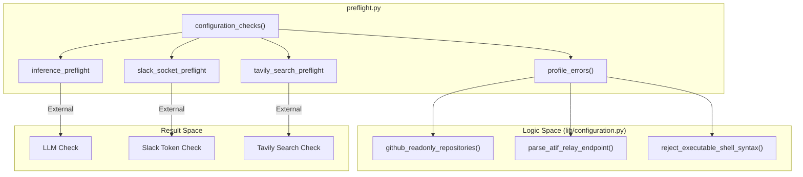
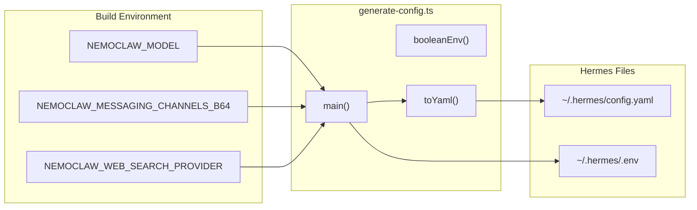

<!-- source: DeepWiki mcp.deepwiki.com · repo NVIDIA/nemoclaw-community · extra page Deployment Scripts and Provider Configuration · fetched 2026-10-26 -->

# Deployment Scripts and Provider Configuration

Relevant source files

The following files were used as context for generating this wiki page:

- [examples/recipes/nvidia/developer-community-chief-of-staff/agents/hermes/generate-config.ts](examples/recipes/nvidia/developer-community-chief-of-staff/agents/hermes/generate-config.ts)
- [examples/recipes/nvidia/developer-community-chief-of-staff/agents/hermes/tests/test_nvteam_runtime_contract.py](examples/recipes/nvidia/developer-community-chief-of-staff/agents/hermes/tests/test_nvteam_runtime_contract.py)
- [examples/recipes/nvidia/developer-community-chief-of-staff/docs/guided-setup.md](examples/recipes/nvidia/developer-community-chief-of-staff/docs/guided-setup.md)
- [examples/recipes/nvidia/developer-community-chief-of-staff/docs/verify-functionality.md](examples/recipes/nvidia/developer-community-chief-of-staff/docs/verify-functionality.md)
- [examples/recipes/nvidia/developer-community-chief-of-staff/policy.yaml](examples/recipes/nvidia/developer-community-chief-of-staff/policy.yaml)
- [examples/recipes/nvidia/developer-community-chief-of-staff/scripts/02-providers.sh](examples/recipes/nvidia/developer-community-chief-of-staff/scripts/02-providers.sh)
- [examples/recipes/nvidia/developer-community-chief-of-staff/scripts/03-sandbox.sh](examples/recipes/nvidia/developer-community-chief-of-staff/scripts/03-sandbox.sh)
- [examples/recipes/nvidia/developer-community-chief-of-staff/scripts/configure.py](examples/recipes/nvidia/developer-community-chief-of-staff/scripts/configure.py)
- [examples/recipes/nvidia/developer-community-chief-of-staff/scripts/lib/configuration.py](examples/recipes/nvidia/developer-community-chief-of-staff/scripts/lib/configuration.py)
- [examples/recipes/nvidia/developer-community-chief-of-staff/scripts/preflight.py](examples/recipes/nvidia/developer-community-chief-of-staff/scripts/preflight.py)
- [examples/recipes/nvidia/developer-community-chief-of-staff/scripts/tear-down.sh](examples/recipes/nvidia/developer-community-chief-of-staff/scripts/tear-down.sh)
- [examples/recipes/nvidia/developer-community-chief-of-staff/scripts/tests/test-snapshot-safety.sh](examples/recipes/nvidia/developer-community-chief-of-staff/scripts/tests/test-snapshot-safety.sh)
- [examples/recipes/nvidia/developer-community-chief-of-staff/scripts/tests/test_configuration_tools.py](examples/recipes/nvidia/developer-community-chief-of-staff/scripts/tests/test_configuration_tools.py)

The NemoClaw Community recipes utilize a four-phase bring-up pipeline to ensure consistent, validated, and secure agent deployments. This pipeline manages everything from infrastructure setup to the injection of TLS certificates and the application of granular network policies.

## The Four-Phase Bring-Up Pipeline

The deployment lifecycle is orchestrated through a series of numbered scripts located in the `scripts/` directory of the recipe.

| Phase | Script | Primary Responsibility |
| :--- | :--- | :--- |
| **00** | `00-host-services.sh` | Launches Docker Compose for host-side infrastructure (PostgreSQL, Phoenix, ETLs) [examples/recipes/nvidia/developer-community-chief-of-staff/scripts/tear-down.sh:8-11](). |
| **01** | `01-gateway.sh` | Initializes the OpenShell gateway and verifies global settings. |
| **02** | `02-providers.sh` | Configures v2 provider profiles, handles OAuth2 flows, and runs preflight checks [examples/recipes/nvidia/developer-community-chief-of-staff/scripts/02-providers.sh:5-8](). |
| **03** | `03-sandbox.sh` | Patches the Dockerfile, builds the sandbox image, and applies the final security policy [examples/recipes/nvidia/developer-community-chief-of-staff/scripts/03-sandbox.sh:5-11](). |

### Phase 02: Provider Configuration and Preflight
`02-providers.sh` is responsible for importing v2 provider profiles and upserting the specific provider instances for the sandbox [examples/recipes/nvidia/developer-community-chief-of-staff/scripts/02-providers.sh:5-8](). 

Key behaviors include:
*   **Profile Management**: It performs a delete-then-import cycle for profiles like `nemoclaw-outlook-email`, `nemoclaw-slack`, and `nemoclaw-github` to ensure local YAML edits are applied [examples/recipes/nvidia/developer-community-chief-of-staff/scripts/02-providers.sh:37-40](). Profiles attached to live sandboxes are not re-imported to avoid collisions [examples/recipes/nvidia/developer-community-chief-of-staff/scripts/02-providers.sh:29-36]().
*   **Placeholder Substitution**: For the ATIF relay and GitLab, it uses `sed` to inject host and port placeholders into the profile before registration [examples/recipes/nvidia/developer-community-chief-of-staff/scripts/02-providers.sh:52-64]().
*   **Inference Preflight**: It invokes `inference_preflight.py` to validate the LLM endpoint, credentials, and model availability before the sandbox is created [examples/recipes/nvidia/developer-community-chief-of-staff/scripts/02-providers.sh:135-142]().

### Phase 03: Sandbox Build and Policy Injection
`03-sandbox.sh` handles the final assembly of the agent environment [examples/recipes/nvidia/developer-community-chief-of-staff/scripts/03-sandbox.sh:5-11]().

*   **Dockerfile Patching**: Since `openshell sandbox create` does not support `--build-arg`, the script uses `sed` to patch a staged Dockerfile (`.Dockerfile.staged`) with per-run values like `NEMOCLAW_MODEL`, `GITHUB_READONLY_REPOS`, and `PHOENIX_COLLECTOR_ENDPOINT` [examples/recipes/nvidia/developer-community-chief-of-staff/scripts/03-sandbox.sh:131-157]().
*   **TLS Injection**: It invokes `stage-enterprise-cas.sh` to copy local TLS-inspection roots into the build context, allowing the sandbox to trust corporate interception proxies [examples/recipes/nvidia/developer-community-chief-of-staff/scripts/03-sandbox.sh:127-129]().
*   **Two-Stage Policy Application**: The sandbox is created with a base policy, and then the final `policy.yaml` (patched with exact repository paths) is applied via `openshell policy set --wait` [examples/recipes/nvidia/developer-community-chief-of-staff/scripts/03-sandbox.sh:9-11]().

**Sources:**
* [examples/recipes/nvidia/developer-community-chief-of-staff/scripts/02-providers.sh:1-148]()
* [examples/recipes/nvidia/developer-community-chief-of-staff/scripts/03-sandbox.sh:1-166]()

---

## Configuration and Preflight Tools

The recipe provides specialized Python tools to manage the `.env` lifecycle and verify prerequisites before deployment.

### Guided Configuration
`configure.py` provides an interactive and non-interactive interface to generate a minimal `.env` file [examples/recipes/nvidia/developer-community-chief-of-staff/docs/guided-setup.md:35-41](). It preserves existing comments and unknown settings while enforcing owner-only permissions (`0600`) on the output [examples/recipes/nvidia/developer-community-chief-of-staff/scripts/lib/configuration.py:125-133]().

### Prerequisite Preflight
`preflight.py` performs read-only checks across the local host and optional external services [examples/recipes/nvidia/developer-community-chief-of-staff/docs/guided-setup.md:122-128]().

Title: Preflight Validation Logic

**Sources:**
* [examples/recipes/nvidia/developer-community-chief-of-staff/scripts/preflight.py:143-225]()
* [examples/recipes/nvidia/developer-community-chief-of-staff/scripts/lib/configuration.py:71-208]()
* [examples/recipes/nvidia/developer-community-chief-of-staff/docs/guided-setup.md:149-174]()

---

## Sandbox Environment Generation

The `generate-config.ts` script is executed during the Docker build phase to translate environment variables into Hermes-specific configuration files [examples/recipes/nvidia/developer-community-chief-of-staff/agents/hermes/generate-config.ts:4-9]().

### Configuration Mapping
The script generates two primary files:
1.  `~/.hermes/config.yaml`: Contains immutable settings like the model provider, toolset list, and platform tweaks [examples/recipes/nvidia/developer-community-chief-of-staff/agents/hermes/generate-config.ts:99-160]().
2.  `~/.hermes/.env`: Contains OpenShell placeholder strings (e.g., `openshell:resolve:env:SLACK_BOT_TOKEN`) that the gateway resolves at runtime [examples/recipes/nvidia/developer-community-chief-of-staff/agents/hermes/generate-config.ts:162-183]().

Title: Environment to Hermes Config Mapping

**Sources:**
* [examples/recipes/nvidia/developer-community-chief-of-staff/agents/hermes/generate-config.ts:63-214]()

---

## Tear-Down and Maintenance

`tear-down.sh` manages the removal of the sandbox and its associated providers [examples/recipes/nvidia/developer-community-chief-of-staff/scripts/tear-down.sh:5-11]().

*   **Standard Mode**: Deletes the sandbox and per-sandbox providers (Slack, Outlook, GitHub, etc.) [examples/recipes/nvidia/developer-community-chief-of-staff/scripts/tear-down.sh:75-84]().
*   **Host Services**: Optionally stops the host infrastructure stack via `--stop-host-services` or wipes data volumes via `--purge-host-services` [examples/recipes/nvidia/developer-community-chief-of-staff/scripts/tear-down.sh:86-95]().
*   **Snapshot Safety**: The `filter_credential_files` function in `_lib.sh` (tested by `test-snapshot-safety.sh`) ensures that sensitive files like `access-token.txt` are excluded from state snapshots to prevent accidental credential leakage [examples/recipes/nvidia/developer-community-chief-of-staff/scripts/tests/test-snapshot-safety.sh:29-45]().

**Sources:**
* [examples/recipes/nvidia/developer-community-chief-of-staff/scripts/tear-down.sh:34-112]()
* [examples/recipes/nvidia/developer-community-chief-of-staff/scripts/tests/test-snapshot-safety.sh:1-68]()

---

