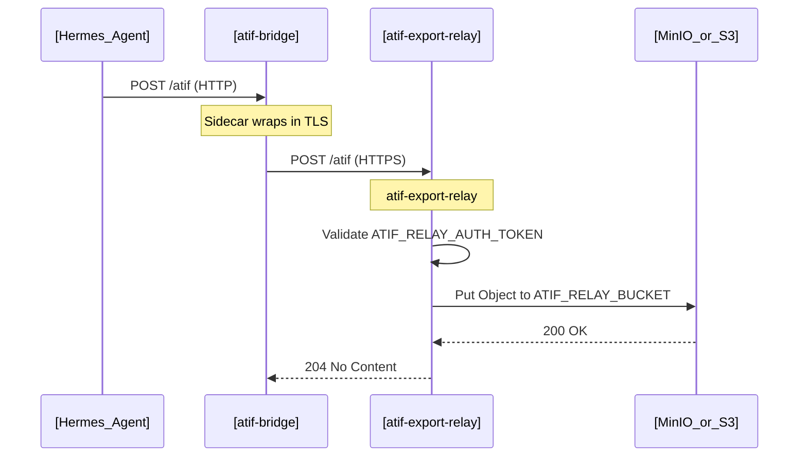

<!-- source: DeepWiki mcp.deepwiki.com · repo NVIDIA/nemoclaw-community · extra page Host Services and Data Infrastructure · fetched 2026-10-26 -->

# Host Services and Data Infrastructure

<details>
<summary>Relevant source files</summary>

The following files were used as context for generating this wiki page:

- [examples/recipes/nvidia/developer-community-chief-of-staff/extras/docker-compose.yml](examples/recipes/nvidia/developer-community-chief-of-staff/extras/docker-compose.yml)
- [examples/recipes/nvidia/developer-community-chief-of-staff/extras/source-etls/README.md](examples/recipes/nvidia/developer-community-chief-of-staff/extras/source-etls/README.md)
- [examples/recipes/nvidia/developer-community-chief-of-staff/extras/source-etls/forums-etl/refresh_api_views.py](examples/recipes/nvidia/developer-community-chief-of-staff/extras/source-etls/forums-etl/refresh_api_views.py)
- [examples/recipes/nvidia/developer-community-chief-of-staff/extras/source-etls/github-etl/entrypoint.sh](examples/recipes/nvidia/developer-community-chief-of-staff/extras/source-etls/github-etl/entrypoint.sh)
- [examples/recipes/nvidia/developer-community-chief-of-staff/scripts/00-host-services.sh](examples/recipes/nvidia/developer-community-chief-of-staff/scripts/00-host-services.sh)
- [examples/recipes/nvidia/developer-community-chief-of-staff/scripts/tests/test-host-ca-bundle.sh](examples/recipes/nvidia/developer-community-chief-of-staff/scripts/tests/test-host-ca-bundle.sh)
- [examples/recipes/nvidia/developer-community-chief-of-staff/scripts/tests/test_forum_api_views.py](examples/recipes/nvidia/developer-community-chief-of-staff/scripts/tests/test_forum_api_views.py)
- [examples/recipes/nvidia/developer-community-chief-of-staff/scripts/tests/test_host_services_profiles.py](examples/recipes/nvidia/developer-community-chief-of-staff/scripts/tests/test_host_services_profiles.py)

</details>


The Host Services and Data Infrastructure layer provides the persistent storage, observability, and data ingestion services required by the Developer Community Chief of Staff recipe. These services run on the host machine in a dedicated Docker Compose stack, isolated from the agent sandbox to ensure that sensitive credentials (like S3 keys or database superuser passwords) never enter the agent's execution environment.

## System Architecture

The host infrastructure is composed of several functional blocks: an observability sink (Phoenix), a relational data store (PostgreSQL), specialized ETL workers for GitHub and NVIDIA Forums, and an ATIF trajectory export relay.

### Data Flow and Service Interaction

The following diagram illustrates how the agent sandbox interacts with host-side services through the OpenShell L7 proxy.

**Diagram: Sandbox-to-Host Data Flow**
```mermaid
graph TD
    subgraph "Agent Sandbox [agents/hermes/]"
        [Hermes_Agent] -->|OTLP| [Phoenix_Collector]
        [Hermes_Agent] -->|HTTP_GET| [PostgREST_API]
        [Hermes_Agent] -->|ATIF_POST| [atif-bridge]
    end

    subgraph "Host Services [extras/docker-compose.yml]"
        [Phoenix_Collector] --> [phoenix_service]
        [PostgREST_API] --> [postgrest_service]
        [postgrest_service] --> [postgres_db]
        [github-etl] --> [postgres_db]
        [forums-etl] --> [postgres_db]
        
        [atif-bridge] -->|HTTPS| [atif-export-relay]
        [atif-export-relay] -->|S3_API| [MinIO_or_S3]
    end

    subgraph "External Sources"
        [github-etl] -.-> [GitHub_API]
        [forums-etl] -.-> [NVIDIA_Forums]
    end
```
Sources: [examples/recipes/nvidia/developer-community-chief-of-staff/extras/docker-compose.yml:8-140](), [examples/recipes/nvidia/developer-community-chief-of-staff/extras/source-etls/README.md:1-9]()

## Core Services

### PostgreSQL and PostgREST
The infrastructure uses PostgreSQL as the primary sink for all mirrored external data [examples/recipes/nvidia/developer-community-chief-of-staff/extras/docker-compose.yml:25-48](). To maintain the "shared-nothing" isolation principle, the agent does not connect to PostgreSQL directly. Instead, it queries a **PostgREST** instance [examples/recipes/nvidia/developer-community-chief-of-staff/extras/docker-compose.yml:110-124]().

- **Isolation**: PostgREST is configured with a read-only role (`SOURCE_ETL_POSTGRES_READER_USER`) [examples/recipes/nvidia/developer-community-chief-of-staff/extras/docker-compose.yml:119-121]().
- **Schema Management**: The `api` schema in PostgreSQL defines the views accessible to the agent. A Python utility, `refresh_api_views.py`, ensures these views exist even if the underlying ETL tables are empty, maintaining a stable API contract for the `api.forum_topics` view [examples/recipes/nvidia/developer-community-chief-of-staff/extras/source-etls/forums-etl/refresh_api_views.py:12-26](). It uses `NOTIFY pgrst, 'reload schema'` to trigger PostgREST schema cache refreshes [examples/recipes/nvidia/developer-community-chief-of-staff/extras/source-etls/forums-etl/refresh_api_views.py:57]().

### Phoenix Observability
Trace collection is handled by **Arize Phoenix**, which listens for OpenInference (OTLP) data on ports `4317` (gRPC) and `4318` (HTTP) [examples/recipes/nvidia/developer-community-chief-of-staff/extras/docker-compose.yml:14-19]().

## Source ETLs

The ETL (Extract, Transform, Load) services mirror external community signals into the local PostgreSQL instance.

| Service | Source | Implementation | Configuration |
| :--- | :--- | :--- | :--- |
| `github-etl` | GitHub Issues/PRs | Singer-SDK based ingestion | `SOURCE_ETL_GITHUB_REPO` [examples/recipes/nvidia/developer-community-chief-of-staff/extras/docker-compose.yml:60]() |
| `forums-etl` | NVIDIA Forums | Discourse JSON API ingestion | `SOURCE_ETL_FORUM_TAG` [examples/recipes/nvidia/developer-community-chief-of-staff/extras/docker-compose.yml:92]() |

Both ETL services are profile-gated in the `docker-compose.yml` file and are only started if `SOURCE_ETL_GITHUB_ENABLED=1` is set [examples/recipes/nvidia/developer-community-chief-of-staff/scripts/00-host-services.sh:69-81](). The `github-etl` entrypoint specifically aligns the Python `certifi` bundle with the host's CA bundle to ensure TLS trust during GraphQL calls [examples/recipes/nvidia/developer-community-chief-of-staff/extras/source-etls/github-etl/entrypoint.sh:14-18]().

Sources: [examples/recipes/nvidia/developer-community-chief-of-staff/extras/source-etls/README.md:1-30](), [examples/recipes/nvidia/developer-community-chief-of-staff/scripts/tests/test_host_services_profiles.py:61-89]()

## ATIF Export Relay

The `atif-export-relay` is a specialized service that receives Agent Trajectory Interchange Format (ATIF) payloads from the sandbox and persists them to S3-compatible storage [examples/recipes/nvidia/developer-community-chief-of-staff/extras/docker-compose.yml:133-164]().

### Implementation Details
- **Protocol**: The relay provides an HTTPS endpoint, with TLS certificates generated during bring-up [examples/recipes/nvidia/developer-community-chief-of-staff/scripts/00-host-services.sh:95-99]().
- **Authentication**: It uses a per-VM bearer token (`ATIF_RELAY_AUTH_TOKEN`) generated by the provider scripts [examples/recipes/nvidia/developer-community-chief-of-staff/scripts/00-host-services.sh:91-93]().
- **Backends**: Supported backends include `s3`, `minio`, and `s3-compatible`, selected via the `ATIF_RELAY_BACKEND` variable [examples/recipes/nvidia/developer-community-chief-of-staff/extras/docker-compose.yml:154]().
- **Network Mode**: The relay uses `network_mode: host` to allow it to reach the AWS IMDS (169.254.169.254) for IAM role resolution when targeting real S3 [examples/recipes/nvidia/developer-community-chief-of-staff/extras/docker-compose.yml:138-142]().

**Diagram: ATIF Export Sequence**

Sources: [examples/recipes/nvidia/developer-community-chief-of-staff/extras/docker-compose.yml:133-164](), [examples/recipes/nvidia/developer-community-chief-of-staff/scripts/00-host-services.sh:83-99]()

## Lifecycle and Preflight Validation

Host services are managed via the `00-host-services.sh` script [examples/recipes/nvidia/developer-community-chief-of-staff/scripts/00-host-services.sh:1-26]().

### CA Bundle Validation
A critical preflight check is the `assert_host_ca_bundle` function. It ensures that `NEMOCLAW_HOST_CA_BUNDLE` points to a valid, readable absolute path on the host before any containers are started [examples/recipes/nvidia/developer-community-chief-of-staff/scripts/00-host-services.sh:51-64](). This prevents Docker from creating empty directories at the bind-mount target if the host file is missing [examples/recipes/nvidia/developer-community-chief-of-staff/scripts/tests/test-host-ca-bundle.sh:35-36]().

### Service Bring-up (`cmd_up`)
The bring-up process follows these steps:
1. Validate the CA bundle [examples/recipes/nvidia/developer-community-chief-of-staff/scripts/00-host-services.sh:67]().
2. Resolve the ATIF relay backend (S3 or MinIO) and export the `ATIF_RELAY_BUCKET` [examples/recipes/nvidia/developer-community-chief-of-staff/scripts/00-host-services.sh:83-89]().
3. Execute `docker compose up` with profile arguments [examples/recipes/nvidia/developer-community-chief-of-staff/scripts/00-host-services.sh:105-111]().
4. If using MinIO, wait for healthiness (`/minio/health/live`) and create the bucket using a one-shot `minio/mc` container [examples/recipes/nvidia/developer-community-chief-of-staff/scripts/00-host-services.sh:114-130]().

Sources: [examples/recipes/nvidia/developer-community-chief-of-staff/scripts/00-host-services.sh:66-139](), [examples/recipes/nvidia/developer-community-chief-of-staff/scripts/tests/test-host-ca-bundle.sh:67-78]()

---

