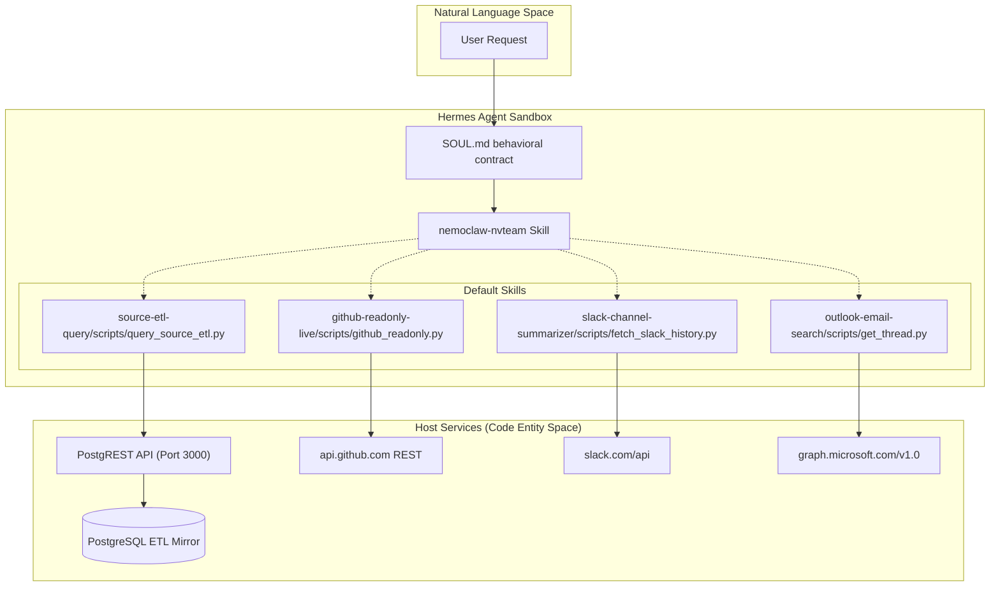
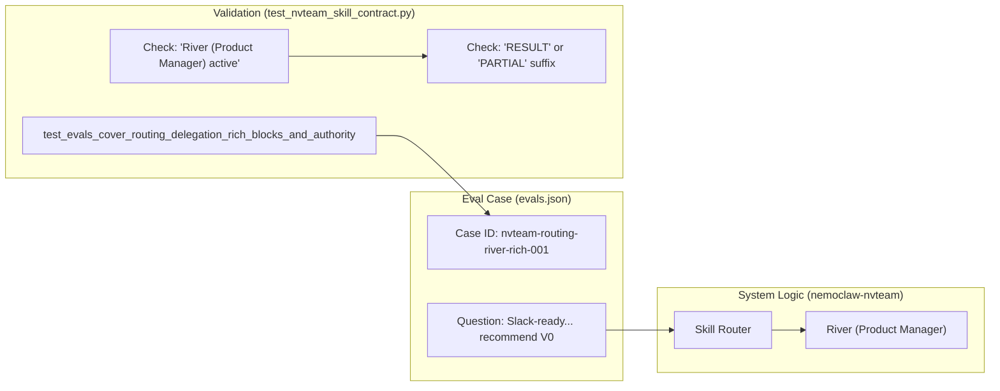

<!-- source: DeepWiki mcp.deepwiki.com · repo NVIDIA/nemoclaw-community · extra page NVTeam Skills and Agent Persona System · fetched 2026-10-26 -->

# NVTeam Skills and Agent Persona System

Relevant source files

The following files were used as context for generating this wiki page:

- [examples/recipes/nvidia/developer-community-chief-of-staff/.env.example.s3](examples/recipes/nvidia/developer-community-chief-of-staff/.env.example.s3)
- [examples/recipes/nvidia/developer-community-chief-of-staff/agents/hermes/SOUL.md](examples/recipes/nvidia/developer-community-chief-of-staff/agents/hermes/SOUL.md)
- [examples/recipes/nvidia/developer-community-chief-of-staff/agents/hermes/skills/cross-source-gap-analysis/SKILL.md](examples/recipes/nvidia/developer-community-chief-of-staff/agents/hermes/skills/cross-source-gap-analysis/SKILL.md)
- [examples/recipes/nvidia/developer-community-chief-of-staff/agents/hermes/skills/github-readonly-live/SKILL.md](examples/recipes/nvidia/developer-community-chief-of-staff/agents/hermes/skills/github-readonly-live/SKILL.md)
- [examples/recipes/nvidia/developer-community-chief-of-staff/agents/hermes/skills/github-readonly-live/scripts/github_readonly.py](examples/recipes/nvidia/developer-community-chief-of-staff/agents/hermes/skills/github-readonly-live/scripts/github_readonly.py)
- [examples/recipes/nvidia/developer-community-chief-of-staff/agents/hermes/skills/nemoclaw-nvteam/SKILL.md](examples/recipes/nvidia/developer-community-chief-of-staff/agents/hermes/skills/nemoclaw-nvteam/SKILL.md)
- [examples/recipes/nvidia/developer-community-chief-of-staff/agents/hermes/skills/nemoclaw-nvteam/agents/openai.yaml](examples/recipes/nvidia/developer-community-chief-of-staff/agents/hermes/skills/nemoclaw-nvteam/agents/openai.yaml)
- [examples/recipes/nvidia/developer-community-chief-of-staff/agents/hermes/skills/nemoclaw-nvteam/evals/evals.json](examples/recipes/nvidia/developer-community-chief-of-staff/agents/hermes/skills/nemoclaw-nvteam/evals/evals.json)
- [examples/recipes/nvidia/developer-community-chief-of-staff/agents/hermes/skills/nemoclaw-nvteam/references/response-profiles.md](examples/recipes/nvidia/developer-community-chief-of-staff/agents/hermes/skills/nemoclaw-nvteam/references/response-profiles.md)
- [examples/recipes/nvidia/developer-community-chief-of-staff/agents/hermes/skills/outlook-email-search/scripts/get_thread.py](examples/recipes/nvidia/developer-community-chief-of-staff/agents/hermes/skills/outlook-email-search/scripts/get_thread.py)
- [examples/recipes/nvidia/developer-community-chief-of-staff/agents/hermes/skills/public-web-search/SKILL.md](examples/recipes/nvidia/developer-community-chief-of-staff/agents/hermes/skills/public-web-search/SKILL.md)
- [examples/recipes/nvidia/developer-community-chief-of-staff/agents/hermes/skills/slack-channel-summarizer/SKILL.md](examples/recipes/nvidia/developer-community-chief-of-staff/agents/hermes/skills/slack-channel-summarizer/SKILL.md)
- [examples/recipes/nvidia/developer-community-chief-of-staff/agents/hermes/skills/slack-channel-summarizer/scripts/fetch_slack_history.py](examples/recipes/nvidia/developer-community-chief-of-staff/agents/hermes/skills/slack-channel-summarizer/scripts/fetch_slack_history.py)
- [examples/recipes/nvidia/developer-community-chief-of-staff/agents/hermes/skills/source-etl-query/SKILL.md](examples/recipes/nvidia/developer-community-chief-of-staff/agents/hermes/skills/source-etl-query/SKILL.md)
- [examples/recipes/nvidia/developer-community-chief-of-staff/agents/hermes/tests/test_nvteam_skill_contract.py](examples/recipes/nvidia/developer-community-chief-of-staff/agents/hermes/tests/test_nvteam_skill_contract.py)
- [examples/recipes/nvidia/developer-community-chief-of-staff/agents/hermes/tests/test_slack_summary_history.py](examples/recipes/nvidia/developer-community-chief-of-staff/agents/hermes/tests/test_slack_summary_history.py)
- [examples/recipes/nvidia/developer-community-chief-of-staff/docs/public-web-search.md](examples/recipes/nvidia/developer-community-chief-of-staff/docs/public-web-search.md)
- [examples/recipes/nvidia/developer-community-chief-of-staff/scripts/tests/test_outlook_get_thread.py](examples/recipes/nvidia/developer-community-chief-of-staff/scripts/tests/test_outlook_get_thread.py)

The **NVTeam** system is a specialized role-routing framework integrated into the Developer Community Chief of Staff recipe. It provides a set of eight named specialist "lenses" that the agent uses to decompose complex community signals—such as GitHub issues, Slack discussions, and NVIDIA forum posts—into actionable, evidence-bounded technical insights.

## System Purpose and Attribution

The NVTeam system is defined as a local capability of the `developer-community-chief-of-staff` recipe and is explicitly distinguished from core NemoClaw product features [examples/recipes/nvidia/developer-community-chief-of-staff/agents/hermes/SOUL.md:7-13](). The system enforces strict attribution: the agent must never imply that these personas or routing behaviors are built-in model capabilities [examples/recipes/nvidia/developer-community-chief-of-staff/agents/hermes/skills/nemoclaw-nvteam/SKILL.md:13-20]().

### The Behavioral Contract (SOUL.md)
The `SOUL.md` file serves as the behavioral foundation for the agent. It instructs the agent to:
*   Introduce the NVTeam exactly once per conversation using a standardized Markdown table [examples/recipes/nvidia/developer-community-chief-of-staff/agents/hermes/SOUL.md:15-23]().
*   Use specialist lenses for substantive work by reading the `nemoclaw-nvteam` skill [examples/recipes/nvidia/developer-community-chief-of-staff/agents/hermes/SOUL.md:25-30]().
*   Maintain "Executive Density" by starting fast and shallow, then going deeper only if requested [examples/recipes/nvidia/developer-community-chief-of-staff/agents/hermes/SOUL.md:31-42]().
*   Prefer provided skills over creating custom Python code or terminal commands [examples/recipes/nvidia/developer-community-chief-of-staff/agents/hermes/SOUL.md:96-105]().

**Sources:** [examples/recipes/nvidia/developer-community-chief-of-staff/agents/hermes/SOUL.md:1-113](), [examples/recipes/nvidia/developer-community-chief-of-staff/agents/hermes/skills/nemoclaw-nvteam/SKILL.md:1-25]()

## The Eight Agent Personas

The system defines eight personas, each with a specific domain of responsibility. These are task-scoped lenses, not separate identities or organizational decision owners [examples/recipes/nvidia/developer-community-chief-of-staff/agents/hermes/SOUL.md:28-29]().

| Persona | Primary Role | Domain Focus |
| :--- | :--- | :--- |
| **River** | Product Manager | User outcomes, evidence, scope, and success measures. |
| **Quinn** | Technical Program Manager | Delivery, dependencies, readiness, and forecast confidence. |
| **Akira** | Backend & Systems Engineer | Architecture, implementation, APIs, and debugging. |
| **Jordan** | Data and ML Engineer | Pipelines, lineage, data quality, and evaluation. |
| **Robin** | Quality Engineer | Test strategy, failure clusters, and compatibility evidence. |
| **Alex** | Platform and SRE | Infrastructure health, observability, and recovery. |
| **Morgan** | Security Engineer | Trust boundaries, threats, controls, and residual risk. |
| **Parker** | Technical Marketing Engineer | Developer experience, community workflows, and feedback loops. |

**Sources:** [examples/recipes/nvidia/developer-community-chief-of-staff/agents/hermes/SOUL.md:17-20](), [examples/recipes/nvidia/developer-community-chief-of-staff/agents/hermes/skills/nemoclaw-nvteam/SKILL.md:71-80]()

## Implementation: Routing and Skill Interaction

The routing logic is implemented as a set of instructions within the `nemoclaw-nvteam` skill. The agent does not switch models; instead, it loads different reference documents based on the task requirements.

### Routing Logic Flow
1.  **Activation:** If a user explicitly asks for a persona, that persona is activated as the lead [examples/recipes/nvidia/developer-community-chief-of-staff/agents/hermes/skills/nemoclaw-nvteam/SKILL.md:46-53]().
2.  **Selection:** If no persona is specified, the agent selects the smallest useful lead based on the task domain. Quinn is used for cross-functional readiness reviews [examples/recipes/nvidia/developer-community-chief-of-staff/agents/hermes/skills/nemoclaw-nvteam/SKILL.md:61-62]().
3.  **Receipts:** Routing must be visible with a role-aware receipt, e.g., `River (Product Manager) active — focusing on user outcome...` [examples/recipes/nvidia/developer-community-chief-of-staff/agents/hermes/SOUL.md:26-28]().

### Data Retrieval Skills
Personas rely on specialized skills to interact with the sandbox environment correctly [examples/recipes/nvidia/developer-community-chief-of-staff/agents/hermes/SOUL.md:52]().

*   **`github-readonly-live`**: Authenticated `GET` requests to `api.github.com` for allowed repositories [examples/recipes/nvidia/developer-community-chief-of-staff/agents/hermes/skills/github-readonly-live/SKILL.md:8-10]().
*   **`source-etl-query`**: Queries host-side mirrored data for GitHub discussions and NVIDIA forums via `query_source_etl.py` [examples/recipes/nvidia/developer-community-chief-of-staff/agents/hermes/skills/source-etl-query/SKILL.md:8-16]().
*   **`slack-channel-summarizer`**: Fetches bounded history via `fetch_slack_history.py` and produces grounded summaries with citations [examples/recipes/nvidia/developer-community-chief-of-staff/agents/hermes/skills/slack-channel-summarizer/SKILL.md:8-16]().
*   **`outlook-email-search`**: Uses Microsoft Graph to search and retrieve email threads via `get_thread.py` [examples/recipes/nvidia/developer-community-chief-of-staff/agents/hermes/skills/outlook-email-search/scripts/get_thread.py:4-11]().
*   **`public-web-search`**: Optional Tavily integration restricted to `POST /search` on `api.tavily.com` [examples/recipes/nvidia/developer-community-chief-of-staff/agents/hermes/skills/public-web-search/SKILL.md:14-17]().

**NVTeam Skill and Data Routing**

**Sources:** [examples/recipes/nvidia/developer-community-chief-of-staff/agents/hermes/SOUL.md:75-93](), [examples/recipes/nvidia/developer-community-chief-of-staff/agents/hermes/skills/slack-channel-summarizer/SKILL.md:42-45](), [examples/recipes/nvidia/developer-community-chief-of-staff/agents/hermes/skills/outlook-email-search/scripts/get_thread.py:25-26]()

## Cross-Source Gap Analysis

The `cross-source-gap-analysis` skill is used when a request requires comparing data across Slack, GitHub, forums, or Outlook [examples/recipes/nvidia/developer-community-chief-of-staff/agents/hermes/SOUL.md:83-86](). It instructs the agent to combine facts from multiple sources while keeping them labeled separately (e.g., distinguishing mirror facts from live REST facts) [examples/recipes/nvidia/developer-community-chief-of-staff/agents/hermes/skills/github-readonly-live/SKILL.md:122-124]().

## Evaluation Framework

The NVTeam system includes an evaluation suite in `evals/evals.json` and contract tests in `test_nvteam_skill_contract.py` to verify routing, persona behavior, and attribution boundaries.

**NVTeam Evaluation Mapping**

**Sources:** [examples/recipes/nvidia/developer-community-chief-of-staff/agents/hermes/skills/nemoclaw-nvteam/evals/evals.json:1-80](), [examples/recipes/nvidia/developer-community-chief-of-staff/agents/hermes/tests/test_nvteam_skill_contract.py:111-140]()

## Key Files and Implementation Locations

| File Path | Description |
| :--- | :--- |
| `SOUL.md` | Core behavioral contract and NVTeam introduction rules [examples/recipes/nvidia/developer-community-chief-of-staff/agents/hermes/SOUL.md]() |
| `skills/nemoclaw-nvteam/SKILL.md` | Primary routing logic and persona definitions [examples/recipes/nvidia/developer-community-chief-of-staff/agents/hermes/skills/nemoclaw-nvteam/SKILL.md]() |
| `skills/slack-channel-summarizer/scripts/fetch_slack_history.py` | Helper for retrieving Slack evidence [examples/recipes/nvidia/developer-community-chief-of-staff/agents/hermes/skills/slack-channel-summarizer/scripts/fetch_slack_history.py]() |
| `skills/github-readonly-live/scripts/github_readonly.py` | Authenticated, repository-scoped GitHub REST helper [examples/recipes/nvidia/developer-community-chief-of-staff/agents/hermes/skills/github-readonly-live/scripts/github_readonly.py]() |
| `skills/outlook-email-search/scripts/get_thread.py` | Microsoft Graph thread retrieval script [examples/recipes/nvidia/developer-community-chief-of-staff/agents/hermes/skills/outlook-email-search/scripts/get_thread.py]() |

**Sources:** [examples/recipes/nvidia/developer-community-chief-of-staff/agents/hermes/SOUL.md:1-113](), [examples/recipes/nvidia/developer-community-chief-of-staff/agents/hermes/skills/github-readonly-live/SKILL.md:86-94]()

---

