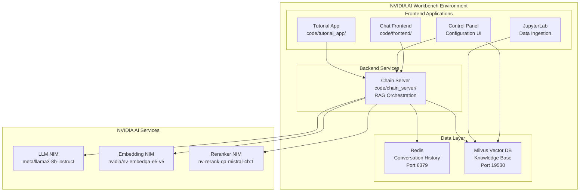
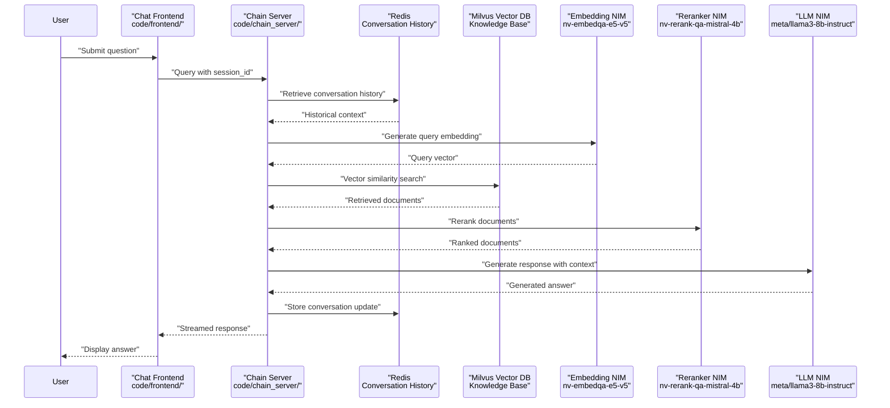

<!-- source: DeepWiki mcp.deepwiki.com · repo NVIDIA/nim-anywhere · page 1 Overview · fetched 2026-10-26 -->

# Overview

Relevant source files

The following files were used as context for generating this wiki page:

- [README.md](README.md)
- [code/frontend/__init__.py](code/frontend/__init__.py)
- [docs/_SUMMARY.md](docs/_SUMMARY.md)

This document provides a comprehensive overview of NVIDIA NIM Anywhere, explaining its purpose as an enterprise RAG (Retrieval-Augmented Generation) system and its architectural components. For detailed configuration instructions, see [Configuration](#5). For development guidance, see [Development](#6).

## Purpose and Scope

NVIDIA NIM Anywhere is a complete RAG system designed to enable enterprises to integrate their internal data with AI models using NVIDIA's NIM (NVIDIA Inference Microservices) technology. The system provides all necessary tooling to build production-ready RAG pipelines that can scale from development environments to full production deployments.

The system addresses the enterprise need to leverage AI with proprietary data while maintaining data security and control. Instead of sending sensitive information to external AI services, NIM Anywhere allows organizations to run AI inference locally or through NVIDIA's cloud services while keeping their data within their controlled environment.

Sources: [README.md:14-41](), [docs/_SUMMARY.md:1-13]()

## System Architecture Overview

NIM Anywhere operates as a multi-component system orchestrated by NVIDIA AI Workbench. The architecture follows a modular design with clear separation between frontend interfaces, backend processing, data storage, and AI services.

### Core System Components

Sources: [README.md:545-558](), [README.md:610-660]()

### Configuration and Runtime Architecture

```mermaid
graph LR
    subgraph "Configuration Sources"
        CONFIG["config.yaml<br/>Main Configuration"]
        VARS["variables.env<br/>Environment Variables"]
        SECRETS["NGC_API_KEY<br/>Authentication"]
        REQ["requirements.txt<br/>Python Dependencies"]
    end
    
    subgraph "AI Workbench Orchestration"
        SPEC[".project/spec.yaml<br/>Project Configuration"]
        COMPOSE["docker-compose.yml<br/>Service Definitions"]
        APPS["Applications<br/>Port Management"]
    end
    
    subgraph "Runtime Services"
        CHAIN_SERVER["Chain Server<br/>Port 3030<br/>Manual Launch"]
        CHAT_UI["Chat Frontend<br/>Port 7070<br/>Auto Launch"]
        TUTORIAL["Tutorial<br/>Port 8501<br/>Streamlit"]
        JUPYTER["JupyterLab<br/>Port 8888<br/>Development"]
    end
    
    CONFIG --> CHAIN_SERVER
    VARS --> COMPOSE
    SECRETS --> CHAIN_SERVER
    
    SPEC --> APPS
    COMPOSE --> CHAIN_SERVER
    COMPOSE --> CHAT_UI
    
    APPS --> TUTORIAL
    APPS --> JUPYTER
```

Sources: [README.md:564-589](), [README.md:443-512]()

## Core Components

### Chain Server
The Chain Server serves as the core RAG engine, implementing the LangChain-based processing pipeline. Located in `code/chain_server/`, it orchestrates interactions between user queries, vector databases, and NVIDIA NIMs.

**Key Responsibilities:**
- Query processing and embedding generation
- Vector similarity search coordination
- Document retrieval and reranking
- LLM prompt assembly and response generation
- Conversation history management

### Frontend Applications
The system provides multiple user interfaces built with different frameworks:

| Component | Framework | Port | Purpose |
|-----------|-----------|------|---------|
| Chat Frontend | Gradio | 7070 | Primary user interaction |
| Control Panel | Gradio | - | System configuration |
| Tutorial App | Streamlit | 8501 | Interactive learning |
| JupyterLab | Jupyter | 8888 | Data ingestion |

### Data Storage Layer
Two primary data stores support the RAG pipeline:

- **Milvus Vector Database**: Stores document embeddings for similarity search at `localhost:19530`
- **Redis Cache**: Manages conversation history and session state at `localhost:6379`

Sources: [README.md:443-512](), [README.md:598-660]()

## RAG Processing Pipeline

The system implements a sophisticated RAG pipeline that processes user queries through multiple stages:

Sources: [README.md:24-38]()

## Technology Stack

### AI Workbench Integration
NVIDIA AI Workbench serves as the orchestration platform, managing:
- Container lifecycle through Docker Compose
- Application routing and port management
- Environment variable configuration
- Development tool integration

### NVIDIA NIMs
The system integrates three types of NVIDIA Inference Microservices:
- **LLM NIM**: `meta/llama3-8b-instruct` for text generation
- **Embedding NIM**: `nvidia/nv-embedqa-e5-v5` for text embeddings
- **Reranker NIM**: `nv-rerank-qa-mistral-4b:1` for document ranking

### Development Framework
Built on Python 3.10+ with key dependencies:
- **LangChain**: RAG pipeline orchestration
- **Gradio**: Frontend UI framework
- **Streamlit**: Tutorial application framework
- **Milvus**: Vector database client
- **Redis**: Caching and session management

Sources: [README.md:598-660](), [README.md:943-949]()

## Deployment Model

### Local Development
For development environments, the system supports running with minimal GPU requirements by utilizing NVIDIA's cloud-hosted NIMs at `ai.nvidia.com`. This allows developers to work without local GPU resources while maintaining full functionality.

### Production Deployment
Production deployments can run NIMs locally with dedicated GPU resources:
- **Minimum 1 GPU**: Local LLM only
- **Minimum 2 GPUs**: LLM + Embedding
- **Minimum 3 GPUs**: Full local stack (LLM + Embedding + Reranker)

### Hybrid Deployment
The system supports hybrid configurations where some NIMs run locally while others use cloud endpoints, providing flexibility for different resource constraints and security requirements.

Sources: [README.md:439-497](), [README.md:459-487]()

---

