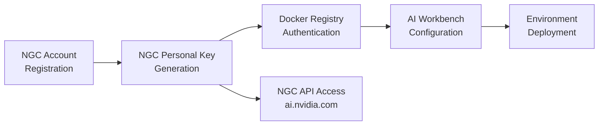
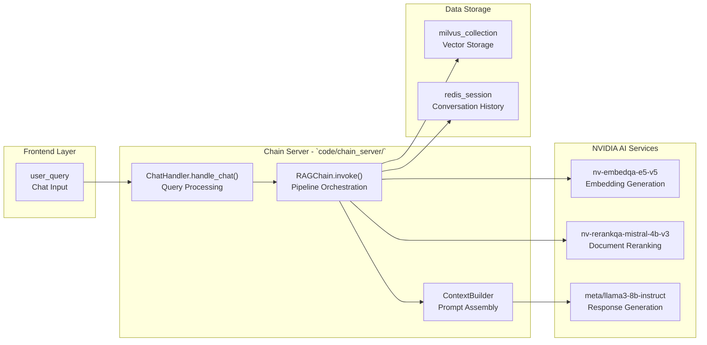

<!-- source: DeepWiki mcp.deepwiki.com · repo NVIDIA/nim-anywhere · page 2 Getting Started · fetched 2026-10-26 -->

# Getting Started

<details>
<summary>Relevant source files</summary>

The following files were used as context for generating this wiki page:

- [.gitattributes](.gitattributes)
- [docs/0_0_quick_start.md](docs/0_0_quick_start.md)
- [docs/0_1_personal_key.md](docs/0_1_personal_key.md)
- [docs/3.2_docs.md](docs/3.2_docs.md)

</details>


This page provides an overview of the initial setup process for NVIDIA NIM Anywhere. It covers the high-level workflow from prerequisites through first deployment, establishing the foundation for using the RAG system in your environment.

For detailed configuration of models and services after initial setup, see [Configuration](#5). For development and extension information, see [Development](#6).

## Setup Process Overview

NVIDIA NIM Anywhere requires a sequence of setup steps that establish authentication, deploy the AI Workbench environment, and configure the RAG components. The process involves three main phases: authentication setup, environment deployment, and system validation.

### Authentication and Prerequisites

The system requires authentication to NVIDIA's cloud services through NGC (NVIDIA GPU Cloud) Personal Keys. These keys enable access to NVIDIA AI models and services used throughout the RAG pipeline.

**Authentication Flow:**


The NGC Personal Key (`nvapi-` prefix) serves as the primary authentication mechanism for accessing NVIDIA's cloud-hosted AI models and container registries.

For complete authentication setup instructions, see [Prerequisites and Authentication](#2.1).

**Sources:** [docs/0_1_personal_key.md:1-27]()

### Environment Architecture

The deployment creates a containerized environment managed by NVIDIA AI Workbench. This environment orchestrates multiple applications and services that comprise the RAG system.

**Workbench Application Structure:**
```mermaid
graph TB
    subgraph WORKBENCH["`.project/spec.yaml` Workbench Project"]
        subgraph APPS["Application Layer"]
            CHAT_FRONTEND["`chat_frontend:7070
            Gradio Chat Interface`"]
            CHAIN_SERVER["`chain_server:3030
            LangChain RAG Engine`"]
            CONTROL_PANEL["`control_panel:7071
            Configuration Management`"]
            TUTORIAL_APP["`tutorial_app:8501
            Streamlit Tutorial`"]
            JUPYTER["`jupyterlab:8888
            Development Environment`"]
        end
        
        subgraph SERVICES["Docker Compose Services"]
            MILVUS_SVC["`milvus-standalone
            Vector Database`"]
            REDIS_SVC["`redis
            Conversation History`"]
            ETCD_SVC["`etcd
            Milvus Metadata`"]
            MINIO_SVC["`minio
            Object Storage`"]
        end
    end
    
    CHAT_FRONTEND --> CHAIN_SERVER
    CONTROL_PANEL --> CHAIN_SERVER
    CHAIN_SERVER --> MILVUS_SVC
    CHAIN_SERVER --> REDIS_SVC
    
    JUPYTER --> MILVUS_SVC
    TUTORIAL_APP --> CHAIN_SERVER
```

**Sources:** Based on system architecture diagrams provided in context

### Core RAG Components

The system implements a RAG pipeline that processes user queries through embedding generation, vector similarity search, optional reranking, and response generation using NVIDIA AI models.

**RAG Processing Chain:**


**Sources:** Based on RAG processing flow diagram provided in context

## Initial Deployment Steps

### 1. Prerequisites Setup
- Generate NGC Personal Key for NVIDIA AI service access
- Install NVIDIA AI Workbench platform
- Configure Docker authentication for NVIDIA container registry

### 2. Project Deployment
- Clone or import the NIM Anywhere project into AI Workbench
- Configure environment variables including `NGC_API_KEY`
- Deploy Docker Compose services (Milvus, Redis, supporting infrastructure)

### 3. Application Startup
- Launch Chain Server backend service on port 3030
- Start Chat Frontend application on port 7070 (auto-launches)
- Optional: Start Tutorial application on port 8501
- Optional: Start Control Panel on port 7071

### 4. System Validation
- Verify service connectivity through Chat Frontend
- Test RAG pipeline with sample queries
- Confirm knowledge base integration (if using custom data)

For detailed step-by-step instructions, see [Installation and Quick Start](#2.2).

## Expected Outcomes

Upon completion of the getting started process, you will have:

| Component | Status | Access Point |
|-----------|--------|-------------|
| Chat Frontend | Running | `http://localhost:7070` |
| Chain Server | Running | `http://localhost:3030` |
| Tutorial App | Available | `http://localhost:8501` |
| Control Panel | Available | `http://localhost:7071` |
| JupyterLab | Available | `http://localhost:8888` |
| Milvus Database | Running | Internal service |
| Redis Cache | Running | Internal service |

The system will be configured to use NVIDIA's cloud-hosted AI models by default, with the option to deploy local NIM containers for enhanced security or reduced latency.

## Next Steps

After completing initial setup:

1. **Explore the Tutorial** - Use the Streamlit tutorial application to understand RAG concepts and system capabilities
2. **Configure Models** - Customize LLM, embedding, and reranking model selections via the Control Panel
3. **Add Custom Data** - Ingest your organization's documents through JupyterLab or the Control Panel
4. **Production Configuration** - Review security settings, deploy local NIMs, and configure authentication for production use

**Sources:** Based on overall system architecture and application structure from context diagrams

---

