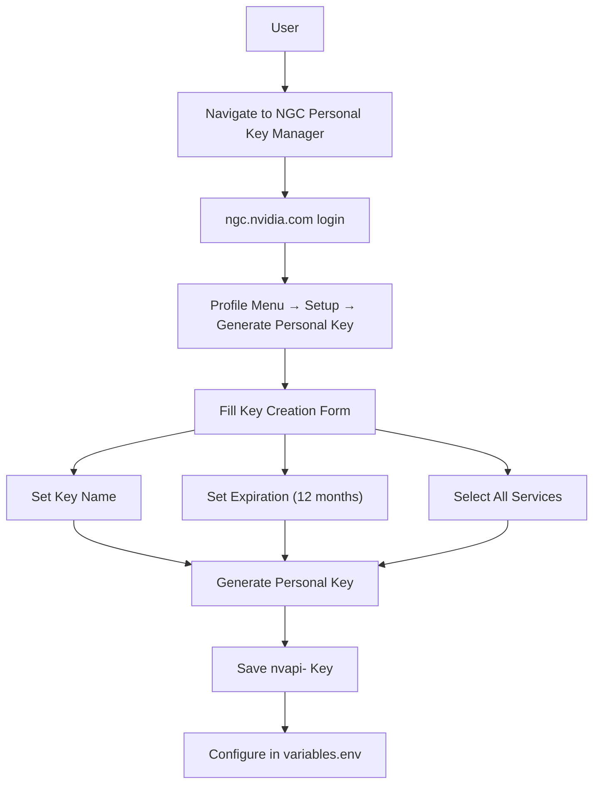
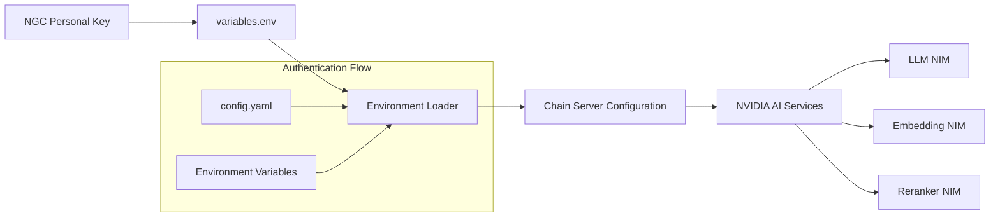
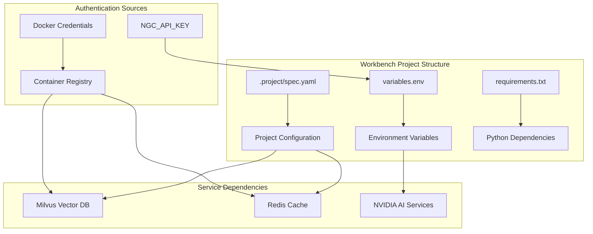
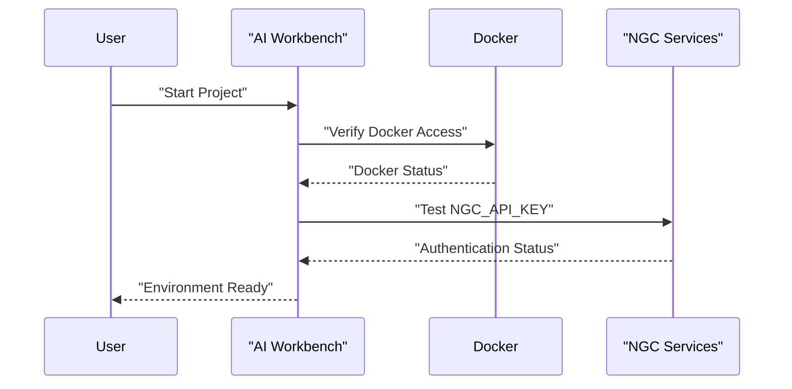

<!-- source: DeepWiki mcp.deepwiki.com · repo NVIDIA/nim-anywhere · page 2.1 Prerequisites and Authentication · fetched 2026-10-26 -->

# Prerequisites and Authentication

Relevant source files

The following files were used as context for generating this wiki page:

- [.gitattributes](.gitattributes)
- [docs/0_1_personal_key.md](docs/0_1_personal_key.md)
- [docs/3.2_docs.md](docs/3.2_docs.md)

This document covers the system requirements, authentication setup, and prerequisite configuration needed before installing and running NVIDIA NIM Anywhere. This includes obtaining NGC Personal Keys, Docker authentication, and NVIDIA AI Workbench environment preparation.

For information about the installation process itself, see [Installation and Quick Start](#2.2). For detailed configuration of models and services after installation, see [Configuration System](#5.1).

## System Requirements

NVIDIA NIM Anywhere requires the following components to be installed and configured before deployment:

| Component | Requirement | Purpose |
|-----------|-------------|---------|
| NVIDIA AI Workbench | Latest version | Container orchestration and environment management |
| Docker | Compatible with AI Workbench | Container runtime for services |
| NGC Account | Active account with Personal Key | Access to NVIDIA AI services |
| Network Access | HTTPS to `ai.nvidia.com` and `ngc.nvidia.com` | API communication |

## NGC Personal Key Generation

The system requires an NGC Personal Key for authenticating with NVIDIA AI services. This key enables access to hosted models including LLM, embedding, and reranking services.

### Personal Key Creation Process

**Personal Key Creation Steps:**

1. Navigate to the [NGC Personal Key Manager](https://org.ngc.nvidia.com/setup/personal-keys)
2. Register or sign in to your NGC account if prompted
3. Select **Generate Personal Key**
4. Configure key parameters:
   - **Key name**: Any descriptive name
   - **Expiration**: 12 months recommended
   - **Services**: Select all available services
5. Click **Generate Personal Key**
6. **Important**: Save the generated key immediately - it cannot be retrieved later

The generated key will begin with `nvapi-` and must be stored securely as it provides access to NVIDIA AI services.

**Sources:** [docs/0_1_personal_key.md:1-27]()

## Authentication Configuration

### Environment Variable Setup

The NGC Personal Key must be configured in the system environment before starting services. The key is stored in the `NGC_API_KEY` environment variable and loaded by the configuration system.

### Docker Authentication

NVIDIA AI Workbench uses Docker for container management. Ensure Docker is properly authenticated and configured:

1. **Docker Installation**: Verify Docker is installed and running
2. **Registry Access**: Ensure access to required container registries
3. **Resource Allocation**: Configure adequate CPU and memory resources

## AI Workbench Environment

### Workbench Project Configuration

The system uses NVIDIA AI Workbench for orchestration, with configuration defined in project specification files:

### Required Environment Variables

| Variable | Description | Required | Example |
|----------|-------------|----------|---------|
| `NGC_API_KEY` | NGC Personal Key for AI services | Yes | `nvapi-...` |
| `NVIDIA_API_KEY` | Alternative name for NGC key | Optional | `nvapi-...` |

**Sources:** [docs/0_1_personal_key.md:3-26]()

## Authentication Verification

### Service Connectivity Test

Before proceeding with installation, verify authentication and connectivity:

### Prerequisites Checklist

Before installation, ensure the following prerequisites are met:

- [ ] NVIDIA AI Workbench installed and running
- [ ] Docker installed with adequate resources allocated
- [ ] NGC account created with valid Personal Key
- [ ] NGC Personal Key saved securely (begins with `nvapi-`)
- [ ] Network connectivity to `ai.nvidia.com` and `ngc.nvidia.com`
- [ ] `NGC_API_KEY` environment variable configured
- [ ] Project environment variables file (`variables.env`) prepared

**Sources:** [docs/0_1_personal_key.md:10-26]()

---

